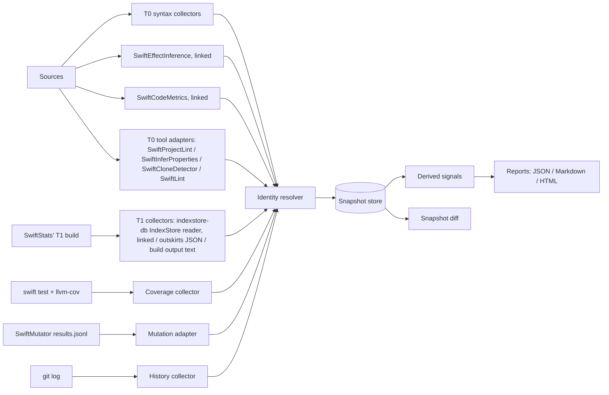

# SwiftStats — Product Requirements Document

**Status:** Draft v0.2.13 (2026-11-25). Reviewed against the source of every tool it names; see §16 for what changed and `Docs/prd-review-2026-11-17.md` in the repo for the evidence. M0, M1a, M1b and M2 are built, M3 is built with its labels pending, and M4, M5, M6 and M7 are built; see `Docs/m0-results.md`, `Docs/m1a-results.md`, `Docs/m1b-results.md`, `Docs/m2-results.md`, `Docs/m3-results.md`, `Docs/m4-results.md`, `Docs/m5-results.md`, `Docs/m6-results.md` and `Docs/m7-results.md`.
**Owner:** Joseph Cursio
**Repo:** `~/xcode_projects/SwiftStats` (SwiftPM, `SwiftStatsCore` library + `swiftstats` CLI)
**Inspired by:** [Sitrep](https://github.com/twostraws/Sitrep) (Paul Hudson / Hacking with Swift)

---

## 1. Summary

SwiftStats collects summary statistics about a Swift package. It stores them **one row per function**, keyed by a stable identity, and keeps **one snapshot per commit**. Sitrep reports project-wide totals: line counts, type counts, imports. SwiftStats goes down to individual functions and joins measurements that today live in separate tools: complexity, coverage, mutation results, side-effect tier, property-test candidates and git churn.

Each tool on its own gives a partial picture. The value comes from combining them, for example *"pure, complex, 40% region coverage, 6 surviving mutants, 2 untested Strong-tier property candidates, changed 14 times this quarter"*. That is a prioritised to-do list no single tool produces.

## 2. Problem

- Sitrep answers "how big is this project and what's it made of?" It can't answer "where are the risky, under-tested parts?"
- The signals that answer that question come from several places: SwiftLint, `llvm-cov`, SwiftMutator, SwiftEffectInference, SwiftInferProperties, SwiftPropertyLaws, SwiftCloneDetector, SwiftProjectLint, Periphery and git. Each has its own output format and its own idea of what a "function" is.
- No snapshots are kept, so trends (is coverage rising? is complexity creeping?) are invisible.

## 3. Goals

1. **Per-function records** that join every metric on a shared identity.
2. **Project and module roll-ups** reported as distributions (median, p90, max), not just totals or a single "longest".
3. **Snapshots per commit**, so any metric can be shown as a trend.
4. **Cost-tiered collection**: a cheap syntax-only scan runs in seconds; expensive collectors (tests, mutation) are opt-in and reuse earlier results where that is sound.
5. **Derived signals** computed from several metrics together (hotspots, untested properties, tool disagreements).
6. **Reuse existing tools** through adapters rather than reimplementing them.

## 4. Non-goals

- Not a linter. SwiftStats reports; it doesn't fail builds or suggest fixes (SwiftProjectLint and SwiftLint do that).
- Not a replacement for SwiftMutator, SwiftInferProperties and the others. It consumes their output.
- No GUI in v1. A Markdown or HTML report is enough. (A SwiftUI viewer could come later.)
- Xcode-project-only targets are out of scope for v1; SwiftPM packages only.
- No CI integration in v1 (most repos involved have no GitHub Actions, and free-tier minutes are tight).

## 5. Users and use cases

| User | Use case |
|---|---|
| Me, working on my own packages | "Which functions should I write tests for next?" |
| Me, running research corpora (e.g. swift-collections, swift-algorithms) | Compare packages; produce calibration data for SwiftInferProperties and SwiftEffectInference. |
| A reviewer of a PR | "Did this branch make anything measurably worse?" (diff of two snapshots) |

## 6. Core concepts

### 6.1 Function identity

Every metric must be attached to the same function.

**Primary key: a syntactic key, from M0 and permanent.** It is made of: module + enclosing path (type path including any extension `where` clause, and for a nested function its parent record's key) + declaration kind + `static`/`class` modifier + operator fixity (`prefix`/`postfix`/`infix`) + name + generic signature and constraints + parameter labels and types + `async`/`throws` + return type + `#if` condition. The file path is added only for `private` and `fileprivate` declarations, which Swift itself scopes to the file. Everything Swift lets overloads differ by is in the key, so overloads don't collide.

File path, source range and a **body hash** (over the body's tokens, with comments and whitespace removed) are attributes of the record, not part of the key. So inserting lines above a function, reformatting it, or moving a non-private function to another file in the same module leaves its key unchanged. A rename or signature change produces a new key; between neighbouring snapshots, a removed record and an added record with the same body hash are matched as one function, and the link records how the match was made (§7.13).

**USR: an attribute, added at M7.** The USR (Unified Symbol Resolution) comes from the index store of SwiftStats' own T1 build (`scan --index`, §7.7), read with indexstore-db's `IndexStore` product, which SwiftStats links (D3). It is unambiguous, including for overloads. It stays the same when a non-private function moves to another file in the same module. It changes when the function is renamed, its labels, parameter or return types or effects change, it moves to another type or module, or its access changes to or from `private`/`fileprivate`. `private` and `fileprivate` USRs also change when the file is renamed, because they include a file-based discriminator. So a USR is no more stable than the syntactic key; its value is resolving collisions and cross-file references. Stored keys are never rewritten when USRs arrive.

- SwiftPM writes the index store during debug builds (test targets always), under `.build/out/` with Swift 6.4's default Swift Build backend and `.build/<triple>/debug/index/store` with `--build-system native`. SwiftStats doesn't look for one: its T1 build writes its own at `<package>/.swiftstats/index-build/out`, always with Swift Build (`--build-system swiftbuild`, which the build's options record), and with `-index-include-locals`, so nested functions and local types' members are indexed too. The reader iterates the raw store through the toolchain's `libIndexStore.dylib` (`<runtimeResourcePath>/../libIndexStore.dylib`); it keeps no database.
- Two sources carry the USR already: an `llvm-cov` function name is the mangled symbol (USR = `s:` + the name without its leading `$s`), and Periphery's JSON lists USRs in `ids`. Periphery's results join on USR, and by position when the index didn't run (§7.6a). Coverage keeps its range mapping, since its `map:` option is in every carried run. M7's independent checker confirms that a record's USR names its llvm-cov function: 527 of 528 `s:` records on swift-algorithms and 825 of 826 on SwiftEffectInference agree (an initialiser by its allocating entry `…fC`, the only one the export holds), and the remaining one on each is explained, a subscript with explicit accessors (its USR names no code) and a signature naming `ContinuousClock.Instant`, whose USR uses the type's source module (`_Concurrency`) while the symbol uses the ABI module `@_originallyDefinedIn` gives it (`Swift`).

**USRs on records (M7).** The index read keeps only units of the package: a unit is `system`, `otherPackage` (its main file is outside the package, under the build directory or `.build`), `otherModule` (its module is no target's), `stale` (its main file is gone, or no longer a source of its target, as real paths), `duplicate` (an older unit of the same module, file and target triple) or `variant` (another triple of a kept unit's module and file, read too), else `kept`. Then:
- **The join.** Every definition of a function-like symbol in a read unit, in a scanned file that didn't change during the scan, goes to the innermost record holding its line and UTF-8 column (the latest start, the earliest end, the key), when the kinds are compatible: a `func` takes a function or method with no accessor subkind (an operator, or a local function, included); an `init` a constructor; a `deinit` a destructor; a `subscript` the subscript; an accessor the method whose accessor subkind is its kind (an `init` accessor by its raw subkind 1016, which the C header doesn't name); top-level code nothing. Implicit definitions are skipped: Swift Testing's `@Test` and `@Suite` peers, synthesised members, stored properties' accessors. A definition whose innermost record isn't compatible is listed as having no record.
- **A shorthand subscript** has one record, but the index defines the subscript at its keyword and its getter at the `{`; the getter's USR is kept as the record's secondary `usrAccessor`, never a disagreement. A subscript with explicit accessors has accessor records, which take theirs.
- **Records without a USR** get the first reason that applies: `top-level code` (no symbol); `plugin target` (never compiled into the store); `inactive #if branch` (§6.1a); `file changed during the scan` (its hash after the build differs from the scan's); `target not built`; `file not indexed`; `disagreement`; `unexplained`. Only the first three are expected; the others are faults.
- **Disagreements**, listed per snapshot: one record with several USRs, and one USR on several records; each such record keeps none. **Definitions with no record** are listed apart: protocol requirements without a body (`requirement`, a property or subscript requirement's getters and setters included), an incompatible innermost record (`incompatibleKind`), and none at all (`outsideRecords`). Records whose keys carry a collision suffix and whose USRs differ are listed as collisions the USR separates.
- **`@objc` declarations**, so XCTest classes and `test…` methods, have Objective-C USRs (`c:@M@…`), stored like any other and counted apart.

At M7's done-when, swift-algorithms' 756 records got 753 USRs (225 of them `c:`), the other 3 being inactive `#if` branches (`RandomSample.swift:17`, `:24` and `:29`, under `#if ALGORITHMS_DARWIN_ONLY`, a flag its manifest never defines), plus 21 secondary accessor USRs; SwiftEffectInference got 826 of 826; SwiftInferProperties 13,556 of 13,557, the one without being its `soundness-probe` executable's top-level code, with 1 secondary USR and 20 definitions with no record, all protocol requirements. None of the three had a disagreement or a collision.

External tools report locations as file:line (coverage, mutants, SwiftLint, SwiftProjectLint, SwiftInferProperties), so **every function record stores its source range** (start and end line and column) and results are mapped to the **innermost** enclosing record. Sitrep stores no source locations for any declaration; its `Function` keeps only the name, argument labels, static flag, throws kind and return type, and it covers `func` declarations only.

**Results outside a function body.** SwiftMutator mutates stored-property and global initial values, default arguments and top-level statements, and coverage has regions there too. These attach to the enclosing type or file, and a default argument to its function. They count as mapped.

### 6.1a What counts as a function

The tools disagree (Sitrep counts `func` only, SwiftLint `func` and `init`, llvm-cov and SwiftMutator also report closures), so SwiftStats fixes its own rule:

- **Records:** `func`, `init`, `deinit`, `subscript`, explicit accessors (`get`/`set`/`willSet`/`didSet`, including computed-property bodies), nested functions (own record, with a link to the parent), and one synthetic record per file for top-level code.
- **Not records:** closures (their results fold into the enclosing record by source range), protocol requirements without a body, and macro expansions (results inside them are reported as unmapped).
- Extension members belong to the extended type.
- Code in every `#if` branch is walked and the condition is stored. Records in branches not compiled in the current configuration can never get a USR or coverage; that is expected, not a mapping failure. From M7 they are listed with the reason `inactive #if branch`, which is inferred, since SwiftStats never evaluates conditions: a record with an `#if` condition and no definition of any kind, implicit ones included, in its range, in a file whose unit the index read. In a file no unit covers, the absence of definitions is no evidence, so such a record takes one of the fault reasons (§6.1).
- Files matching the configured generated-code globs, or carrying a known generated-file header (§7.8, D8), are marked `generated`.
- Sitrep's "function count" is the `func` subset.

### 6.2 Snapshot

A snapshot is **one commit plus one working-tree state**. Each collector run attaches its results to that snapshot. `scan --coverage` (M5), `scan --mutation` (M6) and `scan --index` (M7) are whole scans with the coverage collector, the SwiftMutator collector or the T1 group added, so each replaces the snapshot of the same commit and tree, and a later scan without it keeps those results when they still describe the tree (below, §7.7, §7.8 and §7.9). `scan --mutation --since <rev>` (M6) also reads the clean snapshot of `<rev>`'s commit: SwiftMutator retests the files changed since then, and every other file keeps that snapshot's mutants (§7.9).

Each snapshot records: the package, commit SHA, branch, date, dirty flag, and the toolchain (the first line of `swift --version` run in the package directory, the swiftly selection and its source from `swiftly use` when swiftly is installed, and the SDK version from `xcrun --show-sdk-version`). For each collector it records its version string, a **build identity**, its options, its run time and its status (§6.5). Tool version strings alone don't identify a build: SwiftProjectLint reports `1.0.0` after 1,697 commits with no tags, and SwiftCloneDetector's JSON always says `0.1.0`.

**Build identity** is what `diff` compares (§6.6), so it must change whenever the tool's output could, and a missing label must never make two builds look the same. It is a content hash, with a git commit kept beside it only as a label:

- **An external tool:** the SHA-256 of its binary, symlinks resolved. Rebuilding the same source gives the same binary (checked for SwiftProjectLint, 2026-11-19), so this causes no false breaks. The commit of the tool's source is recorded as a label only when the binary sits in a `.build` directory of a clean git work tree whose top level is the tool's own package, and the binary is newer than both HEAD's last move (its reflog) and every tracked file; otherwise none. The work tree's HEAD alone would name a binary built before a pull with the commit after it, and a pulled commit's own date is older than the pull.
- **SwiftStats itself (`swiftstats`).** Most T0 numbers (stripped lines, the Sitrep counts, risk markers, the API surface, the test inventory, where findings attach) are SwiftStats' own code, and they change when it does. `schemaVersion` tracks the output's shape, not its meaning: M1b's review changed what the API surface counts without changing it. So SwiftStats records its own build like any other tool's. Its identity is a hash of its build inputs (`Sources/`, `Package.swift`, `Package.resolved`, `Plugins/`), embedded at build time by a build-tool plugin with read-only git: the input trees at HEAD, plus the uncommitted changes to them when the tree is dirty, hashed as content (a diff in a fixed form whatever the user's diff settings, and each untracked input's blob hash). Docs-only commits don't change it, and debug and release builds of one tree share it. `Package.resolved` fixes the linked libraries (SwiftCodeMetrics, SwiftEffectInference, swift-syntax, and from M7 indexstore-db's `IndexStore` reader). The commit and dirty flag are its label. Without git at build time (a source archive), the identity is the SHA-256 of the `swiftstats` executable; the plugin only reports a commit when git's top level is SwiftStats' own package, so a copy inside another repository falls back too. Its options are the effective `excluded` and `generated` globs. While SwiftStats is changing quickly this breaks T0 trends often; `backfill --rerun` recomputes T0 history with the current build.
- **The dependency graph:** the `swift --version` line, and it is compared only when `swiftstats` is comparable too, since SwiftStats' own code reads the graph.
- **The history collector (`history`, M3):** `git:` and git's version, compared only when `swiftstats` is comparable too, since SwiftStats' own code parses every past version. Its options are its `history:` settings (§10.1). `diff` lists its comparability but doesn't diff history numbers in M3.
- **SwiftEffectInference (`swifteffectinference`, M4):** linked, so its identity is `git:` and the revision SwiftStats pins (§7.10), which is also its version. It is compared only when `swiftstats` is comparable too, since SwiftStats' own code walks the declarations and maps the results. Its options say how callees are resolved and which files are read (§7.10).
- **SwiftInferProperties and SwiftCloneDetector (M4)** are external tools like the rest: the binary's hash. Their version strings are recorded but identify nothing: `swift-infer --version` prints `1.160.0 (unattributable build)` for any plain build.
- **Law checks (M4)** are SwiftStats' own measurement (§7.11), so they belong to `swiftstats`, whose identity covers the protocol table compiled into it.
- **Coverage (`coverage`, M5):** the toolchain is the tool, as for the dependency graph. Its identity is `swift:` and the first non-empty line `--version` prints for the toolchain's own `swift` (the one the run uses, §7.8), and its version is `llvm-cov`'s line containing `LLVM version`. It is compared only when `swiftstats` is comparable too, since SwiftStats' own code maps the export. The test bundles are tree content, not an option: they are stored with the coverage, and `diff` shows a change in them as a fact rather than as "not comparable".
- **SwiftMutator (`swiftmutator`, M6):** `sha256:` and SwiftMutator's executable hash as the results file's header records it (`provenance.swiftMutator.executableSHA256`), not the hash of the binary SwiftStats found, since the header names the build that made every result, carried ones included. A `--since` merge requires the same build (§7.9), so a snapshot has one identity. The source-commit label is the found binary's only when its hash is the header's. Its version is the header's `version`, recorded but identifying nothing (`0.1.0` for every build). It is compared only when `swiftstats` is comparable too, since SwiftStats' own code maps the mutants. Its options are the command (`swift-mutator run -c .swiftstats/mutation/muter.conf.yml --skip-update-check`), the `arguments` verbatim, the `timeout`, the `.swift-version` pin, the toolchain's first version line, the hashes of the test executable and of the SDK environment (`DEVELOPER_DIR`, `SDKROOT`, `TOOLCHAINS`) as the header records them, the operators, `coverage: on` and the mapping rule (`map: …`). `workers` is not an option (SwiftMutator says it doesn't change outcomes), nor are the run's mode, base or dates, so a full run and a `--since` run with the same settings compare.
- **The T1 build (`build`, M7):** the toolchain is the tool, as for coverage: `swift:` and the first non-empty line `--version` prints for the toolchain's own `swift`, which is also its version. It is compared only when `swiftstats` is comparable too, since SwiftStats' own code maps the timings and warnings. Its options are the build's command line (which names the build system and configuration), `rebuild: root package intermediates`, the `.swift-version` pin, the toolchain's line, and the timing and warning rules (`map: …`, `warnings: …`).
- **The index (`index`, M7):** linked, so its identity is `git:` and the revision SwiftStats pins indexstore-db at (`64aa0b26913249c4e7c21d351a215fba02702003`, D3), and its version `indexstore-db swift-6.4.2-RELEASE`. It is compared only when `build` and `swiftstats` are comparable too, since the index is that build's and SwiftStats' own code joins it. Its options are the reader, `libIndexStore: toolchain`, and the rules `units:`, `usr:`, `references:` and `types:`.
- **outskirts (`periphery`, M7)** is an external tool: the SHA-256 of the `outskirts` binary. Its version is what `outskirts version` prints (`3.28.0`), recorded but identifying nothing. Its label is the commit label above followed by the release tag when `git describe --exact-match --tags` names one in that tree, as `git:a1e5d6e1eaeeda3be492f1a24f7e45aa57039345 (3.28.0)`. It is compared only when `build` and `swiftstats` are comparable too. Its options are its two command lines, the retained public modules and the rules `classes:` and `map:` (§7.6a).

**Module names.** Every module SwiftStats stores or compares is a target name. The index and outskirts name modules by their C99 name (`index_support` for the target `index-support`), so they are mapped to targets once, where units and outskirts' results are read, from the T1 build's own `swift package describe`; a module that isn't the package's keeps its C99 name.

**Git state** is read before any collector runs (SwiftPM's own commands write untracked files into `.build`), with read-only git (`--no-optional-locks`), in the package directory, which may be a subdirectory of the repository. The dirty check covers that directory only and ignores `.swiftstats/`, and a store kept elsewhere in the package: staged and unstaged changes against HEAD, and untracked files that aren't ignored. Its diff has a fixed form (no external diff tool, text conversion or rename detection), so a user's diff settings can't hide a change.

**One snapshot per state.** A store holds at most one clean and one dirty snapshot per package and commit; a package outside git has one snapshot, replaced on each scan. The package is identified by its name and its path from the repository's top level, so one store can hold a corpus. A rescan replaces the whole snapshot, so a collector that ran before and is skipped now loses its earlier result. Coverage (M5), mutation results (M6) and T1 results (M7) are the exceptions: only `scan --coverage`, `scan --mutation` and `scan --index` collect them, so a rescan whose coverage, SwiftMutator or T1 build didn't run, or whose run failed, carries the replaced snapshot's results when they still describe the tree, and is otherwise refused before anything is written (§7.7, §7.8, §7.9). Every other collector's results are still replaced with the snapshot.

**Dirty trees.** A dirty tree gets at most one working snapshot per commit, which records a hash of the changed files; the next dirty scan of that commit replaces it. `diff`, `trend` and `backfill` use clean snapshots unless `--include-dirty` is given; `report` uses the working tree's own. A dirty snapshot stands for the working tree only while its hash of the changes is the tree's: `diff --include-dirty` rescans otherwise, and `report` says the tree has changed since its last scan.

### 6.3 Collector

A unit that produces metrics. Each collector declares its **cost tier**, its inputs, and the identity it reports against.

| Tier | Needs | Typical time |
|---|---|---|
| T0 | Source files only (SwiftSyntax) | seconds |
| T1 | A build / index store | seconds to minutes. Measured in M7 on the same Mac (Swift 6.4.2; 6.4.1 on SwiftInferProperties, which its `.swift-version` selects): the first T1 build, dependencies included, took 11.6 s on swift-algorithms, 21.2 s on SwiftEffectInference and 122.8 s on SwiftInferProperties, and SwiftStats' own about 5 minutes in a research probe. Later builds recompile only the root package: 4.1 s and 7.1 s, but 93.3 s on SwiftInferProperties, whose own code dominates its build. The index read took 0.09 s, 0.21 s and 5.0 s; each outskirts run 0.2 to 0.4 s on the first two, and 6.0 s (tests as roots) and 1.6 s on SwiftInferProperties. A whole first `scan --index` took 18.9 s, 29.7 s and 196 s. The build directory persists: 147 MiB, 528 MiB and 2.65 GiB |
| T2 | A test run | minutes |
| T3 | Mutation testing | tens of minutes for a whole package, days for a large one; minutes for a branch with `--since`. Measured in M6 on an 8-core M3 with 4 workers: SwiftMutator took 41 min for swift-algorithms' 1,404 mutants (all ten operators; the M6 probe's run took 44 min, 20 of them rerunning 37 timeouts), and 17 min for SwiftEffectInference's 1,413 with three wall-clock tests skipped (92 min without the skip). SwiftInferProperties plans 16,266 mutants. A `--since` scan of a branch that changes one function and renames a file took 189 s on swift-algorithms and 105 s on SwiftEffectInference, coverage included |
| TH | Git history | seconds–minutes |

### 6.4 Census vs defect

Every metric carries a **kind**. The idea comes from SwiftProjectLint's `CandidateInventory`, which keeps three census rules (`pureFunctionCandidate`, `pureClosureCandidate`, `pureMutatorCandidate`) out of its text report.

- **Census**: counts something that needs no action per item ("this function is pure", "this is a property candidate", "this function has complexity 7"). Census values are counted, rolled up and fed to other tools.
- **Defect**: a claim about a specific place that can be wrong and is worth reading each time ("force unwrap here", "test with no assertions", "pure logic trapped in an impure method").

Raw census metrics are never listed one per line in a human-facing report. A derived signal (§8) may list items selected by a census metric, because the signal makes them actionable; that is where census data becomes a to-do list.

SwiftProjectLint's JSON carries each finding's kind from 1.1.0, so SwiftStats reads it rather than keeping its own rule-to-kind list (§7.15). SwiftStats' own markers (§7.4) carry a kind too.

Motivation: in a July 2026 road test on SwiftProjectLint's own code, 76% of findings were census items (460 pure functions and 204 pure closures out of 876 findings; see SwiftProjectLint's `CandidateInventory.swift` and `Docs/roadtest/README.md`). They buried a real defect, a `lossyStructRebuild` finding at line 1438 of a 1768-line report, which went unread. SwiftStats is the natural home for census data, which leaves linter reports for defects only.

### 6.5 Collector status

Each collector records `ran`, `skipped` (with the reason, such as the tool not being found) or `failed` (exit code and the last 20 lines of stderr). There is no `cached` state: results carried from an earlier scan of the same tree are `ran`, with a reason saying so (M5's coverage, M6's mutation results, M7's T1 results), and mutants a `--since` merge carries across commits record their provenance per mutant (§7.9).

- A missing value is stored as null, never 0. "Not collected" and "zero" must never look the same.
- A derived signal whose inputs are missing is left out of the report with the reason, not computed from partial data.
- Some tools exit non-zero on success: SwiftProjectLint exits 1 or 2 when it finds warnings or errors, and SwiftCloneDetector exits 2 when it finds clones. Adapters know each tool's codes. SwiftCloneDetector exits 64 for a usage error, which includes being given no Swift files, so SwiftStats never runs it on an empty list: the collector has run and found no classes. `swift-infer index` exits 0 whatever it finds, 64 for an unknown target and 1 for any other error. It prints `note:` and `warning:` lines on stderr on normal runs, so stderr is no sign of failure.
- The coverage collector (M5) is `skipped` with the reason "not requested; scan --coverage runs it" unless the scan asks for it. Failing tests don't fail it: it `ran`, with the option `tests: failing` and the reason "tests failing (swift test exited N); coverage merged from the test processes' profiles". Coverage carried from an earlier scan of the same tree is `ran` too, keeping the original run's identity, version, options and run time, with the reason "carried from the scan of <date>" (and the original reason after it); M5 adds no state. A failed build or test process gives a reason cut to its last 20 lines of at most 300 characters, the driver's long command lines dropped and the package, build and toolchain paths replaced with `<package>`, `<build>` and `<toolchain>`.
- The SwiftMutator collector (M6) is `skipped` with the reason "not requested; scan --mutation runs it" unless the scan asks for it, "disabled by collectors.swiftmutator.enabled" when turned off, and with the usual not-found reason when `swift-mutator`, or the `swift` its tests run with, isn't found, naming `collectors.swiftmutator.path` or `collectors.coverage.path`. Results carried from an earlier scan of the same tree are `ran` with "carried from the scan of <date>" (when they were collected) and the original reason after it, as coverage's are; M6 adds no state either. A run that ran may give notes in its reason: nothing SwiftMutator could test, every mutant a build error, how many files a `--since` merge retested and carried, the test files changed since its base, changed files with no results or with nothing SwiftMutator tests, an incomplete results file (how many of the discovered mutants it holds, and how it ended), results that don't list code no test ran, failed control runs, and files the copy fixed. It fails for SwiftMutator's exits 3 to 8 and 64, for exit 255 unless SwiftMutator said it found nothing to test, for a signal, and for a results file that doesn't read; a run interrupted or aborted with a readable results file is kept, its reason ending "scan --mutation --resume continues it" (§7.9). Reasons hold no paths: SwiftMutator's run folder reads `<run>`, and its log's last lines are cleaned as coverage's stderr is.
- The T1 collectors (M7), `build`, `index` and `periphery`, are `skipped` with the reason "not requested; scan --index runs it" unless the scan asks for them, "disabled by collectors.<name>.enabled" when turned off, and with the usual not-found reason when `swift` (naming `collectors.coverage.path`) or `outskirts` (naming `collectors.periphery.path`) isn't found. When the build didn't run, `index` and `periphery` are skipped "needs the build: <state>, <reason>"; a failed build's partial store is never read. `build` fails when another `scan --index` holds the package's lock ("another scan --index is running in this package"), when the toolchain or `swift package describe` fails, when the toolchain rejects `--build-system swiftbuild` (the index build needs Swift Build, Swift 6.2 or later), or when `swift build` exits non-zero; its reason then keeps the first 20 lines from the first error on, timing and `info:` lines dropped, cleaned as coverage's are. `index` fails when the toolchain has no `libIndexStore.dylib` or it doesn't load, when the store doesn't read or holds no unit of the package's targets, or when stale units can't be moved out of it (§7.6a); `periphery` when either outskirts run exits other than 0, its JSON doesn't decode or lacks a key, or outskirts didn't scan a module it was told to retain. A run that ran may note in its reason that timings may be incomplete, how many files changed during the scan, an outskirts version other than the one SwiftStats was checked against, or that the index didn't run, so outskirts' results were mapped by position. Carried T1 results are `ran` with "carried from the scan of <date>", as coverage's are.
- A SwiftInferProperties failure's reason reads the same on every run. Temporary paths in it are replaced with placeholders (`<copy>`, `<tmp>`, `<work>`, `<package>`), and a Foundation error gives its message without file paths or memory addresses. The warnings for unreadable `.swiftinfer/` join files carry no paths either. Other collectors record the tool's stderr as given; a SwiftCloneDetector failure, for example, reads "`swift-clone-detector …` over N files exited with status S: <message>".

### 6.6 Snapshot diff

`diff` says what changed between two snapshots, function by function, and what got better or worse.

**Comparability.** A collector's results are **compared** only when it ran in both snapshots with the same build identity and options (§6.2), and for results SwiftStats maps or reads itself (findings per function, the dependency graph, coverage, mutants) only when `swiftstats` is comparable too. Otherwise it is **not comparable** (it ran in both, with a different build or options; the reason is given) or **not collected** (it didn't run in one or both; each side's status is given). The function lists and everything SwiftStats measures belong to `swiftstats`; findings to their tool. Of the three, only "not comparable" makes a diff non-empty, so a snapshot diffed with itself is empty even when a tool was missing.

**Families.** Changes are reported per family, not per record: a record with no parent (§6.1a) together with its nested functions and accessors, or a computed property's accessors, named by the property. Moving a function moves its nested functions, and editing a nested function changes its parent's body hash too; both are one change, with the records involved listed under it.

**Matching**, families first and children after their parents:

1. **Same key**, held by exactly one record on each side. A key held by several records (a collision that location couldn't separate) is left unmatched, with a warning.
2. **A private record that moved file, or became or stopped being private:** its key without its ` @ <file>` part (and any collision location after it) is the other side's, held by exactly one family on each side; several families sharing that form are left to the next rule. Matched by key, so its body may also have changed.
3. **Same USR** (M7): family roots of the same kind whose primary USR is held by exactly one unmatched root on each side, when `index` compares in the two snapshots. The match is labelled `usr`, a certain one, so a spelling-only key change (`[T]` and `Array<T>`, a typealias for its target, an edited `#if` condition) reads as a rename rather than a removal and an addition.
4. **Same body hash:** family roots of the same kind and module whose body hash occurs exactly once among the unmatched on each side, and whose body, its own braces aside, has more than one stripped line (a one-line body such as `{ true }` is no evidence that two functions are one, however it is laid out). Each record carries its body's lines (`bodyLines`, scan `schemaVersion: 4`). The match is labelled `bodyHash`, so a guessed rename can be told from a certain one (§7.13).
5. Once a family matches, its nested records pair by key: the old root's key (or a computed property's accessor's) at the front of each is replaced with its new counterpart's, then sibling numbers and file parts are set aside, so a renumbered ` #2` still pairs with its own body. Children of an unmatched root are not matched by body hash.

Everything else is **added** or **removed**. Matching similar bodies waits for history (M3).

**Statuses** of a matched family, any of: **moved** (its file differs), **renamed** (its key differs other than in the ` @ <file>` part), **access changed** (its key differs only in having or not having that part, i.e. it became or stopped being `private`/`fileprivate`), **changed** (a record's body hash differs; the records are listed), **usr changed** (M7: a record kept its key, but its primary USR differs, so the key now names another declaration, as when a typealias is retargeted or a type moves module; the records are listed, when `index` compares). Every matched family whose key or file differs has at least one status.

**Metric deltas**, before → after, for each matched record whose compared metrics differ: stripped lines, parameter count, the complexity scores, `async`, and findings per comparable tool and rule. For each roll-up (§7.2: each module, and the project's production and test parts), every number, compared when its collector is and `swiftstats` is too, since every roll-up counts only the files SwiftStats scanned, where it assigned them. Each metric has a fixed direction: lower is better for sizes, complexity, nesting, parameters and findings; higher is better for tests, assertions, parameterized cases, documented declarations and the test line ratio; counts such as functions, types, files and declarations by access level are neutral. From M4 the roll-ups also count side-effect tiers and purity verdicts, property candidates by tier, law pairs by state, and clone classes by kind with their cloned lines (§7.10–§7.12): clone counts and lines and unchecked law pairs are lower-is-better, the rest neutral. A count keyed by name (findings by rule, records by tier, pairs by state) that one side lacks reads 0 where its collector is compared, so a fall to zero is judged. Property candidates, law-check pairs, clone classes and side-effect facts are not diffed one by one; of the law checks only the `laws.state.*` counts are compared. From M5 the roll-ups also hold coverage (§7.8): the scope's line and region percentages (`coverage.lines.percent`, `coverage.regions.percent`) and linked public functions are higher-is-better, unmapped entries and unlinked public functions lower-is-better, the rest neutral, the attached coverage's percentages included. Each matched record also gets its line and region percentages (`coverage.lines.percent`, `coverage.regions.percent`, higher-is-better) when `coverage` is compared. A coverage number one side lacks is not collected, never 0, since a record with no coverage data has none. When both snapshots hold coverage and their test bundles differ, the bundles added and removed are listed as a fact, whether or not coverage compares, and make the diff non-empty. From M6 the roll-ups also hold mutation results (§7.9): the scope's mutation score (`mutation.score.percent`) is higher-is-better; survived, no-coverage, timed-out, not-covered and unmapped mutants are lower-is-better; the rest (kills, crash kills, build errors, suspect-only and judged kills, functions by state) neutral. `mutation.carried` is not diffed: each side's provenance (a full run, or a merge with its base and how many mutants it carried) is listed as a fact and never makes a diff non-empty. Each matched record also gets, when `swiftmutator` is compared, its mutation score (`mutation.score.percent`, absent when nothing was scored) and its function score (`mutation.functionScore.percent`, the signals' figure, so a function no test ran reads low, not missing), both higher-is-better, its unkilled mutants (`mutation.unkilled`, lower-is-better) and its scored mutants (`mutation.scored`, neutral). A record with no mutant on a side is not collected there, never 0. When a side's results leave files out (an unlisted or unresolved file, or an incomplete run), its roll-ups' mutation counts are not compared at any scope, since the rows it dropped would read as improvements; only the score is, and a warning says why. Records' own figures still compare. From M7 the roll-ups also hold the T1 results (§7.6, §7.6a, §7.7): records with a USR (`index.withUSR`), those without one by reason (`index.withoutUSR.<reason>`, since an inactive branch isn't worse) and module edges (`index.moduleEdges`) are neutral; disagreements, type cycles and the types in them (`index.disagreements`, `index.typeCycles`, `index.typesInCycles`) lower-is-better; the type-check figures (`typecheck.*`) neutral, since they vary between runs; unused declarations, dead records with tests as roots, production-dead records and dead lines (`deadCode.unused.*`, `deadCode.records`, `deadCode.productionRecords`, `tests.lineRatio.deadLines`) lower-is-better; compiler warnings, as findings of tool `swiftc`, lower-is-better per rule. Records get no type-check, referrer or dead-code deltas; the roll-ups show the change. Reports group deltas into worse, better and neutral.

**Known limits in M2:** removing the first of several same-named local functions renumbers the rest (` #2` becomes the first), so they pair wrongly; a collision's `:line` suffix changes when lines move (from M7, the `usr` rule matches such a family when `index` compares); rewriting `var x: T { e }` as `{ get { e } }` changes the body hash; a nested function hoisted to the top level shows as removed and added.

## 7. Metric catalogue

### 7.1 Sitrep-compatible counts (T0)

SwiftStats reimplements these in its own visitor (§14 D1) and emits them as a `sitrep` block, compared against `sitrep -f json` as a test oracle:

- Files scanned; total lines; Sitrep's "source lines of code" (`sitrepLines`: non-empty lines, which still counts comments and lines holding only spaces); longest file and longest type in those lines
- Counts of structs, classes, enums, protocols and extensions, top-level only, as Sitrep counts them (nested-type counts are a separate SwiftStats metric, §7.2)
- Import counts per module
- UIKit view controller, UIKit view and SwiftUI view counts (direct subclasses or conformers only), and UIKit and SwiftUI lines of code

Sitrep has known quirks a per-function design fixes: nested types aren't counted; longest type is keyed by bare name, so a type's extensions add together and same-named types in different modules merge; longest file is reported by last path component only; file bodies are joined without a separator, so its stripped total loses a line per file boundary. The comparison lists each deliberate difference rather than copying the quirk.

**File discovery.** Sitrep scans every `.swift` file under the path (including `.build` and test folders) minus `.sitrep.yml` exclusions. SwiftStats scans the source files of the package's targets from `Package.swift`, split into production and test. For comparisons, run Sitrep with `.build` and the test folders excluded.

Sitrep declares function-count and documented-function-count fields but never fills them in or reports them; those are new SwiftStats metrics (§7.2, §7.5).

### 7.2 Size and shape (T0, per function / type / file)

**Stripped lines** are lines that contain at least one token after comments and whitespace are removed. Doc comments and attributes don't count, attributes nested in a body included, so a line holding only `@inlinable` counts toward neither the member, the type around it, nor the file. This differs from Sitrep's figure (§7.1), which is kept as `sitrepLines` for comparison.

- Function count (by §6.1a kind) and documented function count
- Type counts by kind including nested types
- Function length (stripped lines), parameter count, max nesting depth
- Type body length, member count; file length
- All reported as distributions per module and project

### 7.3 Complexity (T0)

Computed by **SwiftCodeMetrics**, a shared library that SwiftProjectLint also uses, so both tools report the same numbers. Its specification (`Docs/Spec.md` in that repo) defines every rule, with worked examples; SwiftStats doesn't restate them. Each function record gets three scores; the report records the library's definition version once (`metrics`), since every score in a scan shares it:

- **Cognitive complexity**, Swift-specific, built on SonarSource's specification (v1.7, 2023). Sonar removed its own Swift rule, so the Swift constructs (`guard`, condition lists, `if case`, `try`/`await`, result builders, `#if`) are decided in the spec.
- **Decision count**, McCabe's: every branch point, including `&&`, `||`, `??` and the ternary. Compared as `mccabe` (decisions + 1).
- **SwiftLint-compatible count**, matching SwiftLint's `cyclomatic_complexity` exactly, for parity checks: start at 0; +1 for each `if`, `else if`, `guard`, `for`, `while`, `repeat`, `catch` and `case` (including `default`); −1 for each `fallthrough`; no operators. Honour `ignores_case_statements` from the package's `.swiftlint.yml`. SwiftLint scores only `func` and `init`, so accessors, subscripts and `deinit` get a score marked as SwiftLint-unscored. Record the SwiftLint release the library was checked against.
- Optional: NPath, Halstead volume

### 7.4 Swift risk markers (T0)

Most of these are already SwiftProjectLint rules (`forceUnwrap`, `forceTry`, `forceCast`, `unconditionalTrap`, `uncheckedSendable`, `nonisolatedUnsafe`, `unsafeMemoryAPI`, `todoComment`); take them from the adapter (§7.15). SwiftStats computes the rest itself: **implicitly unwrapped optionals** (no rule exists), **`precondition`** (deliberately not reported by `unconditionalTrap`), **the `unsafe` expression keyword** (`unsafeMemoryAPI` covers `Unsafe*Pointer`, `OpaquePointer`, `Unmanaged`, `unsafeBitCast` and the `withUnsafe…` calls), and the concurrency-shape counts.

- Force unwrap `!`, `try!`, `as!`, implicitly unwrapped optionals
- `fatalError` and `preconditionFailure` (one rule, `unconditionalTrap`, which skips `required init?(coder:)`; split it by the callee named in the message if separate counts are wanted), and `precondition`
- Concurrency escape hatches: `@unchecked Sendable`, `nonisolated(unsafe)`, `unsafe` / `Unsafe*Pointer` use, `@preconcurrency` (`preconcurrencyImport`, `preconcurrencyConformance`), `@retroactive` (`retroactiveConformance`), `Task.detached` (`taskDetached`)
- Concurrency shape: actors, `@MainActor` declarations, `async` functions, `Task {}` creation sites
- `TODO` / `FIXME` count (`todoComment` also counts `HACK`)

The adapter runs SwiftProjectLint with a SwiftStats-owned config (§7.15), so the target repo's own configuration doesn't change these counts. Inline suppressions still apply and are counted separately.

The markers SwiftStats finds itself are findings of the `swiftstats` tool (§7.16): `implicitlyUnwrappedOptional` (a defect), and `precondition`, `unsafeExpression`, `mainActorDeclaration` (an attribute on a declaration, including one inside an `#if` in its attribute list, not on a closure or function type) and `taskCreation` (`Task { … }` or `Task(…) { … }`, specialised or not; `Task.detached` is SwiftProjectLint's), all census. `async` is a flag on each function record, and actors are counted with the other type kinds.

### 7.5 API surface (T0)

- Declarations by access level (`open`, `public`, `package`, `internal`, `fileprivate`, `private`)
- `final` ratio among classes
- **Documentation coverage of the public API** (new; Sitrep tracks doc comments on types only and reports no documentation figures). SwiftStats counts documented and undocumented public declarations itself. SwiftProjectLint's `missingDocumentation` is a cross-check only: it flags undocumented `public` structs, classes and functions, and skips `open`, enums, protocols, actors and properties.
- **Over-exposed declarations**: implicitly `internal` declarations used only in their own file (SwiftProjectLint `couldBePrivate` for types, `couldBePrivateMember` for functions and properties, `protocolCouldBePrivate`), as a count and as a share of implicitly internal declarations. Over-exposed `public` API needs Periphery's redundant-public analysis (§7.6a, T1), from a run without `--retain-public`, which M7 doesn't make (§11's Later row).

What is counted (M1b): types, typealiases, functions, initialisers, subscripts and each name a `var` or `let` binds (a tuple pattern's labels bind nothing), outside function bodies, closures and top-level statements, whose declarations are locals. Protocol requirements take their protocol's access and enum cases can't write one, so neither is counted. A declaration's level is the one it writes, else its extension's (members of a `private` extension are `fileprivate`), capped by what encloses it: for an extension's member, the type it extends when the module declares that type, in any file, not the extension's modifier (as Swift exports them: a `public` member of a `private` extension of a public type is public, one of an extension of an internal type is not); setter-only modifiers such as `private(set)` don't count. "Implicitly internal" means no modifier on the declaration or its extension, and nothing around it lowering that.

From M5 each function record carries its effective level (`access`), worked out by the same code: an accessor takes its property's or subscript's level, and a setter or observer its `private(set)`-style one when one is written; anything declared inside another record or a property's initialiser is `local`; top-level code is `internal`. Records not declared inside another record also carry their enclosing types' path (`typePath`, such as `Chain2Sequence.Index`, without `where` clauses) and, when one of those types is `private` or `fileprivate`, their file (`typeFile`); a subscript's accessors take the subscript's. Both are nil at top level and for other nested records. Tests per public function (§7.8) reads all three.

### 7.6 Coupling and structure (T0 via SwiftCodeMetrics, M7b; T1 via indexstore-db, M7)

SwiftCodeMetrics computes these from syntax alone, using swift-syntax's lexical lookup and a per-module symbol table; its spec says what syntax can and can't resolve. That moves them from T1 to T0:

- Per function: fan-out (with implicit-member and chained calls reported separately), parameter counts, static and singleton references.
- Per type: efferent coupling (concrete, view and namespace targets split out), afferent coupling within the module, WMC, LCOM4 cohesion, type cycles.
- Per module: efferent and afferent coupling from imports, instability, and Martin's abstractness and distance where they apply.

**These T0 values were never built.** SwiftStats calls only `SwiftCodeMetrics.functionMetrics` (§7.3), and no milestone up to M6 scheduled the rest. Storing them through SwiftCodeMetrics' `analyzeFile`, `analyzeModule` and `analyzePackage` on SwiftStats' own parse, and listing where they and the index disagree ("both are kept and the difference is listed"), is M7b (§11).

indexstore-db (M7) adds what syntax can't see: fan-in across modules, calls resolved through overloads and protocols, and USR-based cycles. M7 stores that side, from the T1 build's index (§6.1), as the `index` collector:

- **References and containers.** A reference is an index occurrence with the reference role, implicit ones included, in a file that didn't change during the scan. Its container is the symbol its `calledBy` relation names, else its `containedBy`, else its `baseOf` or `extendedBy` (an inheritance clause or an extension's head). When that symbol is a local declaration that is no record (a local variable holding a closure, a local type), its definition's `childOf` chain is followed to the first symbol that is a record or isn't local, which is the container; a local whose definition has no `childOf`, or that the walk reaches a second time, stays the container. A reference with none of these relations is placed by position: on a top-level statement line, the file's top-level-code record; else the innermost record of any role (an attribute argument lies inside its function's range), the innermost type, the file. A container that isn't a record (a stored property's initialiser, a global, a Swift Testing peer) is kept as its USR.
- **Referrers.** A reference counts for the record whose primary or secondary USR it names. A property's read references count for its reading accessors and its write references for its writing ones, and a reference with neither role (a key path, an `inout` use) for all of them, so production reads don't hide a setter only tests call. A reference to a requirement of a protocol the package declares counts for every record that witnesses it. References from the record's own family (§6.6) don't count. A record's referrers are its distinct containers, split by the container's target: its own production target, other production targets (cross-module fan-in) and test targets, with the first five test containers kept by name.
- **Witnesses.** A record is a witness when any occurrence of its USR (an accessor's property's, a shorthand subscript getter's subscript's) has an `overrideOf` relation, implicit ones included: protocol witnesses, protocol extensions' default implementations and class overrides alike, standard-library protocols' included.
- **Two readings, adopted at the done-when.** M7's design kept a local container as its own USR and expanded every protocol requirement to its witnesses; the build followed locals and expanded only requirements of protocols the package declares, and the done-when kept that. A local's USR is never a record, so as its own container every reference inside it (a call in a closure stored in a local) would drop out of family references, which need a container record, and would count as a referrer from outside the enclosing function's family. Expanding the requirements of standard-library and dependency protocols (`Equatable.==`, `Hashable.hash(into:)`, `Sequence.makeIterator()`, `CustomStringConvertible.description`) makes every comparison, hash or `for … in` in the package a reference to every package witness of that requirement, whatever the type, so unrelated families would reference each other and hidden coupling (§8) would read them as dependent. Measured against the design's readings: on swift-algorithms 231 of 756 records' referrers differ and family references are 6,554 against 438 (6,116 of them through 1,282 references to 47 requirements of protocols it doesn't declare); on SwiftEffectInference 405 of 826 records differ, 504 against 456; on SwiftInferProperties 7,384 of 13,557 differ, 7,636 against 6,702. No gating criterion turns on them: criteria 1 to 3 rest on the USR join, the reasons and the lists, and dead but tested reads no referrers. Nor do the gating packages' hidden-coupling results: swift-algorithms has no change-coupling pairs; SwiftEffectInference's four pairs are all members of one type, and none of the family references the design's readings change runs between a pair's two families (they drop one direct reference elsewhere and add 49 references to one `==` witness), so each pair keeps its class. Test-only production code leaves witnesses out before references count; that was argued, not re-run, and SwiftInferProperties' lists weren't re-derived under the design's readings. The `references:` option states the rule in short (it names only a local variable, and only for calledBy and containedBy); the walk above is the full rule.
- **Module edges**, from a package target to another target (`package`: the distinct references from its units to definitions in the other's, and its files whose imports name the other module) or to a non-system module that isn't the package's (`dependency`: the importing files only, since dependency units' records aren't read). They aren't marked against `Package.swift`: SwiftProjectLint's rules already compare imports with the manifest (below), and a macro dependency has neither a reference nor an import. On SwiftInferProperties the 35 package edges are its 36 declared target dependencies but `SwiftInferMacro → SwiftInferMacroImpl`, which only an `#externalMacro` string names.
- **Types.** A type is a struct, class, enum or protocol (actors are classes in the index) whose definition lies in a read unit, named by its USR and placed on SwiftStats' type record by position. A declaration belongs to the type its `childOf` relation names; an extension's members to the package type its head extends, and to none for an extension of a type the package doesn't declare (`extension Collection`). Each production type stores its referrers: the distinct referring types or free functions in its own target and in other production targets, and the test containers. A package type no type record holds (one declared inside a macro's closure, such as `#Preview { struct Demo … }`) gets no row, and the scan warns, naming it.
- **USR type cycles**: strongly connected components of two or more production types, with an edge where a member of one (extension members included) references the other or its members, and edges between a type and a type nested in it left out. SwiftInferProperties has 20, the largest of 11 types; an agent reading the code judged 4 of them worth attention.
- **Family references**, for hidden coupling (§8): one production family's counted reference to another's record, `direct` or through a requirement the other witnesses, and a family's references to package types or their members. They are kept for every production family, not only for the coupling pairs, since history's pairs are recomputed by each scan while T1 results carry across rescans.

Where the syntax and index values disagree, both are kept and the difference is listed: M7b.

At T0, module structure comes from SwiftProjectLint's `undeclaredTargetDependency` and `unusedTargetDependency` (imports compared with `Package.swift`). Its `circularDependency` finds only two-type cycles through stored properties (its visitor collects parameter types but skips them), and `layerDependency` checks folder layers only when `architectural_layers` is configured, so neither is used for cycles; type cycles come from the index (USR type cycles, M7), and SwiftCodeMetrics' syntax cycles are M7b.

### 7.6a Dead code (T1, M7; commented-out code T0)

Use **Periphery** as the primary source. It needs a build and an index store, which the T1 build provides (§7.7).

**Which Periphery.** Upstream `peripheryapp/periphery` (MIT) was archived on GitHub in August 2026. A maintained fork, `tiny-earth-moon/outskirts` (outskirts.dev, MIT), continues from the last 3.x release and keeps it building with Swift 6.4 / Xcode 27; it was three weeks old with one maintainer when checked (2026-11-17), and its minor releases ship "Breaking" sections. So SwiftStats pins it (D7): **outskirts 3.28.0** (`a1e5d6e1eaeeda3be492f1a24f7e45aa57039345`), built from source by the user (`swift build -c release --product outskirts`) and named by `collectors.periphery.path`, else `outskirts` on PATH. SwiftStats never builds or downloads it, and never runs Homebrew's `periphery`, which on this machine is 2.21.2, older than 3.0, with other JSON and no Swift Testing retention. The binary's hash is its identity (§6.2). `outskirts version` is recorded, and any other version runs with the warning "outskirts <v> isn't the version SwiftStats was checked against (3.28.0); results may differ".

**3.28.1**, released on 2026-11-25 after M7 was built, has one fix (#434: an explicit `public` member of an extension declared in another module than its type is no longer reported as redundant public). M7 stays pinned to 3.28.0, the version it was checked against, so the version warning fires for 3.28.1. The regression comparison made for the outskirts drafts (§15) ran both releases with outskirts' default options (no retention flags, tests not excluded) over the drafts' own index stores and found identical results on the drafts' test fixture, SwiftEffectInference and swift-algorithms (20 and 20, 90 and 90, 13 and 13 results). Those runs weren't SwiftStats' two runs, so they show the releases agree there, not that SwiftStats' dead-code results would be unchanged. Moving the pin is in §11's Later row.

**The two runs.** After the T1 build, and after the store's stale units are moved out (below), outskirts runs twice in the package root, with no standard input and each flag its own argument:

```
outskirts scan --format json --disable-update-check --config <build>/swiftstats-outskirts.yml \
  --index-store-path <build>/out --skip-build --index-exclude <build>/** \
  --json-package-manifest-path <build>/swiftstats-describe.json \
  [--retain-public-modules <module> …] --retain-codable-properties --retain-equatable-properties \
  [--exclude-tests]
```

- **`roots`**, without `--exclude-tests`: test targets are roots, so anything a test reaches is used. It gives the unused-declaration metrics and the ratio's dead lines (§7.8).
- **`production`**, with `--exclude-tests`, which reads the test targets from the describe JSON: production-dead code, for dead but tested (§8).
- Why each flag: `--disable-update-check`, since otherwise each scan asks GitHub for the latest release; `--config` names an empty file, since a package's `.outskirts.yml` or `.periphery.yml` changes results; `--index-store-path` and `--skip-build`, SwiftStats' own build and store (outskirts finds a Swift Build store itself since 3.8.3, but the path is passed anyway); `--index-exclude` with the build directory's real path, since the default pattern doesn't match `.swiftstats/index-build` and its dependency checkouts would add results; `--json-package-manifest-path`, the T1 build's own describe, since otherwise outskirts runs `swift package describe` itself and leaves `.build` lock files in the package; `--retain-codable-properties` and `--retain-equatable-properties`, since SwiftEffectInference's `assignOnlyProperty` results were all synthesised-`==` false positives.
- **`--retain-public-modules`**: the C99 module names of the targets the describe's library products list, and of the package targets those re-export with `@_exported import`, transitively, each with a unit the index read; omitted when there are none (an executable-only package). For a single-library package this is `--retain-public`; without it a library's tested API reads as dead. outskirts retains nothing for a listed module it doesn't scan, with only a warning, so that warning fails the collector.
- Exit 0 means it completed, with or without results. Any other exit of either run fails the collector, as does JSON that doesn't decode or an entry lacking one of the nine keys every entry holds (`accessibility`, `attributes`, `hints`, `ids`, `kind`, `location`, `modifiers`, `modules`, `name`), named with outskirts' version and hash; nothing partial is stored.

Not built in M7: the run without `--retain-public` for §7.5's redundant-public findings, so §7.5 is unchanged (§11's Later row).

**Stale units.** The index store is append-only: a deleted or renamed file's unit stays, and outskirts keeps any unit whose main file exists, the newest per module and platform. So before the runs, the units §6.1's filter classes `stale` or `otherModule` are moved out of `<build>/out/v5/units` into `<build>/swiftstats-quarantined-units/`, or the declarations of a file moved to another target, or of a renamed target, would read as unused in files that exist. The directory is SwiftStats' own and Swift Build never reads units back. The done-when packages had none.

**Reading the JSON.** Each entry has a `kind`, a `name`, its `accessibility`, one hint (`unused`, `assignOnlyProperty`, `redundantPublicAccessibility`, `redundantConformance`, …), `ids` (USRs, or synthetic parameter and import ids), `modules` (C99 names, mapped to targets) and a `location` (path, line and UTF-8 column of the name). It gets the first class that applies: `build` (under the build directory); `outsideRoot`; `test` (a scanned file of a test target, or for a file the scan didn't parse, a test target's directory or modules only); `unscanned`; `fileChanged` (its file changed during the scan, so its position may be stale); `local`, an unused local variable, which outskirts reports as `unused var.global` once locals are indexed (its USR's definition is local, or it is a variable inside a function record); else `production`. Test-target and local results are dropped from every metric and counted.

**Mapping.** outskirts lists only the outermost unused declaration, and 3.28.0's JSON has no end position, so SwiftStats spreads "dead" over its own ranges. Only `production` entries with the hint `unused` cover records. An entry with another hint (`redundantPublicAccessibility`, `redundantConformance`, `assignOnlyProperty`) is about a used declaration's access level, a conformance or a write, so it is stored with its place, counted by hint, and covers nothing; that reading was adopted at the done-when, where on SwiftInferProperties the two `redundantPublicAccessibility` entries in `SwiftInferMacroImpl` (`public struct CheckPropertyMacro` and its `expansion(of:providingPeersOf:in:)`) would otherwise have given 10 live records dead-record rows in each run (11 rather than 1 with tests as roots, 31 rather than 21 in production). Each `unused` entry covers, by the first rule that applies:
1. `usr`: the record whose primary or secondary USR is one of its `ids`;
2. `property`: a property's accessor records;
3. `type`: every function record the type owns, in any file, its extensions' and nested types' included, since outskirts folds an extension of a package type into the type and reports the type once (owned by USR with the index, else by target, type path and file);
4. `extension`: for an extension outskirts doesn't fold (of an external type, or a protocol extension), the records in its range;
5. `location`: a function whose `ids` matched nothing (the index didn't run), by its name's position.

Parameters, imports, enum cases, stored properties and typealiases cover nothing and are placed for listing, as findings attach. A record is **dead with tests as roots** when the `roots` run covers it, and **production-dead** when the `production` run does. Without the index the mapping is by position, and the collector's reason says so.

**Lines.** A run's dead lines in a scope are the stripped lines of its maximal covered units: a covered type with its extension records, an extension, or a function record that no other covered unit holds. So a local function outskirts reports inside an unused function isn't counted twice, and the result doesn't depend on the entries' order. Entries with no line count (properties without accessors, enum cases, parameters, imports) are counted apart.

**What 3.28.0 gets wrong**, as stated in the rules (the 2.21.2 limits measured earlier don't apply to it):
- `@Test` functions and their types are retained, through the Swift Testing macros' compiler-generated peers, even in files that see `Testing` only through a re-export, but the unused parameters of a parameterized `@Test` in such a file are reported. Test-target results are dropped anyway. A pull request making outskirts' Swift Testing checks follow re-exports is drafted (§15).
- An unused import of a module whose types appear only in the signatures of functions the file calls is missed (2.21.2 reports it). An issue is drafted (§15).
- A declaration called only from an inactive `#if` branch is reported unused, so dead but tested could list a function whose only caller is in a branch this build doesn't compile.
- A non-test helper target used only by tests is analysed as production code.
- Unused local variables come back as `unused var.global` once locals are indexed; SwiftStats classes them `local`.

At the done-when outskirts reported, with tests as roots and in production: on swift-algorithms 1 result (in a test target) and none; on SwiftEffectInference 3 and 3; on SwiftInferProperties 16 (8 in test targets, its 2 unused locals among them) and 31 (`SwiftInferCLI` 17, `SwiftInferTemplates` 7, `SwiftInferCore` 5, `SwiftInferMacroImpl` 2). SwiftInferProperties' production-dead lines were 120 in `SwiftInferCLI`, 17 in `SwiftInferCore` and 9 in `SwiftInferTemplates`, and its dead lines with tests as roots 8, all in `SwiftInferCLI`.

A naive "fan-in = 0" check from indexstore-db is only a fallback, because many declarations with no callers in the index are still live:

- `public` / `open` API used by other packages
- Protocol witnesses, `@objc`, `@IBAction` / `@IBOutlet`
- `Codable` properties, SwiftUI `#Preview`s, `@main`
- Code in `#if` branches not compiled in this configuration

Metrics:

- **Unused declarations** of the `roots` run by kind (function, type, extension, property, enum case, parameter, import, other) and of every run by hint
- **Records dead with tests as roots** and **production-dead records**, per module and project
- **Test-only code**: production functions whose only references come from test targets. Periphery doesn't report this (it treats tests as roots), so SwiftStats works it out from the index (§7.6), leaving out what the list above says is live: test-only production code (§8).
- **Unused parameters** and **unused imports** (Periphery reports imports only of the package's own modules; unused imports of Foundation, system or third-party modules are not detected)
- **Unreachable code**: the compiler's `unreachable_code` and `unreachable_code_after_stmt` warnings (§7.7)
- **Commented-out code blocks** (T0 heuristic: comment blocks that parse as Swift)
- **Dead but tested** (§8): production-dead functions whose mutants the tests run. That wasted test time also skews the coverage and mutation numbers, so roll-ups should be reportable with dead code excluded. M7 excludes dead lines from the test-to-code ratio (§7.8); coverage and mutation roll-ups with dead code excluded are a report-time addition over the stored dead records, in §11's Later row.
- Cross-checks from SwiftProjectLint: `unusedProtocolAbstraction`, `unusedProtocolRequirement` (opt-in).

### 7.7 Build health

- **SwiftLint violations** by rule (T0 for SwiftLint's normal rules, which need no build; T1 for its analyzer rules). SwiftStats runs `swiftlint lint --reporter json --quiet --force-exclude --config <file>` on the targets' directories (a target at the package root gives its files instead; a directory inside another given is left out, since SwiftLint lints a file once per path holding it). `--config` names the package's root `.swiftlint.yml`, or an empty configuration when it has none, because without it SwiftLint also applies any `.swiftlint.yml` in the directories above the package. Naming one turns off nested configurations, so a `.swiftlint.yml` inside a target directory is reported in a warning as not applied. Not the whole root: a plain run there also lints `.build/checkouts`, worktrees and other packages (146,559 of 156,843 violations on swift-collections, measured in M1b), and `--force-exclude` keeps the configuration's `excluded` in force for paths given this way. Violations are findings (§7.16).
- **Compiler warnings** by diagnostic ID (T1, M7), from the T1 build below, which passes `-debug-diagnostic-names` so that each diagnostic ends with its stable ID (`[variable_never_used]`) and, when it has one, its group (`[#DeprecatedDeclaration]`). Each `warning` in the root package becomes a finding (§7.16): tool `swiftc`, rule its ID (`unidentified` when none), category its group, kind defect, the message without the bracketed suffixes, its continuation lines joined. A warning inside a macro expansion is placed at its "expanded code originates here" note, and is unmapped without one. Duplicates (the emit-module job's, the task log's copy) collapse on place and ID. Places under the build directory or outside the package root are dropped and counted; Swift Build's `warning: '<package>': …` lines for each manifest compile aren't diagnostics and are counted apart. Errors and remarks aren't findings. Every build recompiles every root file, so every scan reports every root warning. Limits: every diagnostic a macro plugin emits carries the one generic ID `bridged_warning` (24 of SwiftInferProperties' 35 warnings at the done-when), so the Markdown shows the first message per ID; a root package's plugin target compiles without `-debug-diagnostic-names`, so its warnings are `unidentified` and counted apart. swift-algorithms and SwiftEffectInference have none.
- **Type-check time per function** (T1, M7), from the same build, which passes `-debug-time-function-bodies` and `-debug-time-expression-type-checking` to the frontend (`-Xswiftc -Xfrontend -Xswiftc …`) and `-v`, without which Swift Build prints no timings; they go to standard error. Not a clean build: before each build the root package's intermediates (`<build>/out/Intermediates.noindex/<manifest name>.build`) are deleted, so every root file is recompiled and timed while the dependencies stay built and the store stays consistent; when that folder is missing from an existing build, the reason says timings may be incomplete. Entries are read as whole hundredths of a millisecond and placed by position (file, line, UTF-8 column) on the innermost record of any role, test and helper code included, else the innermost type (a stored property's implicit accessors), else the file (a global initialiser). Synthesised members (`<invalid loc>`) and macro-expansion buffers are unmapped, dependencies and the build directory dropped, each counted. Each record gets `typeCheckMilliseconds`, the sum of its function-body entries, which includes its local functions (they have entries of their own too), and `slowestExpressionMilliseconds`, its largest expression entry, each rounded half up to whole milliseconds once; null when it has none. Every sum of entries (a record's, a counted class's, a total) stops at `Int.max` hundredths instead of overflowing. An entry the emit-module job repeats counts twice, since both are build time. Roll-up totals add only entries on records not nested in a body, on types and on files, so nothing counts twice; maxima take every record. Timings vary with the machine and its load: in M7's research two runs differed by a median 16 to 36% per function, while the set of timed places and the slowest functions stayed (at the done-when, the second scan timed the same places as the first on all three packages). So they are stored as collected, have no direction, and aren't diffed per record (§6.6). `-warn-long-expression-type-checking` and `-warn-long-function-bodies` aren't passed: they are warnings, which fail a package built with `-warnings-as-errors` and pollute the warning counts. Motivation: the 12-arm `+` chain in a SwiftInferProperties test, which type-checked locally but timed out on the CI runner's older toolchain. Local timings can show that an expression is slow; they can't show whether another toolchain will time out.

**The T1 build (`build` collector, M7).** `scan --index` (with or without `--no-store`, and with `--coverage` and `--mutation`) runs one build for the three T1 collectors: the timings and warnings above, the index (§6.1, §7.6) and outskirts (§7.6a). Otherwise all three are skipped, "not requested; scan --index runs it". `backfill` (with or without `--rerun`) and `diff`'s scans of other revisions never run it. It runs alone, after coverage, SwiftInferProperties and the clone detector have finished and before SwiftMutator, since its timings are wall-clock. Its `swift` is the coverage collector's (`collectors.coverage.path`, else PATH), so one toolchain serves T1, T2 and T3; asked for `-print-target-info` in the package root, where swiftly's proxy reads `.swift-version`, it names the toolchain whose own `swift` runs every command, so an interrupt reaches SwiftPM, and whose `libIndexStore.dylib` reads the store. In order:
1. It takes `<package>/.swiftstats/index.lock`; a second `scan --index` in the package fails the collector rather than wait on SwiftPM's lock.
2. It keeps `Package.resolved`'s bytes, or its absence, and puts them back when the build ends, as coverage does (§7.8).
3. `swift package --scratch-path <build> describe --type json`, by that toolchain, gives the targets, products and C99 module names; its output is the describe JSON outskirts reads, so outskirts writes nothing in the package.
4. It deletes the root package's intermediates, then runs `swift build --build-tests --build-system swiftbuild -c debug -v --no-color-diagnostics --scratch-path <build> -Xswiftc -index-include-locals` plus the three frontend flags above, standard output to `swiftstats-build.log` (Swift Build's task log) and standard error to `swiftstats-build.stderr` (timings and diagnostics). Debug builds are the only configuration that gives the store, the tests and the timings together, `--build-tests` indexes the test targets, and `--no-color-diagnostics` keeps Swift 6.4's colours and links out of the text.
5. It hashes the scanned files again: a file that changed during the scan gives no USR, timing, warning or dead-code mapping, and a warning names it.

`<build>` is `<package>/.swiftstats/index-build`, persistent between runs (dependency checkouts and builds stay warm) and never removed by SwiftStats; deleting it is always safe and costs one dependency build. An interrupted scan stops the build's processes (SIGINT, SIGTERM, SIGKILL, as M5's runs), puts `Package.resolved` back and stores nothing; on SwiftEffectInference, at the done-when, the scan ended 1.01 s after SIGINT to its process group or SIGTERM to it alone, no process was left 1.1 s after the signal, and the next `scan --index` finished with no lock refusing it. A failed build names its standard error and task log on standard error.

**Keeping T1 results across rescans.** As for coverage (§7.8): when a scan replaces a snapshot holding T1 results, and its own build didn't run, was skipped or failed, it carries all three collectors' results when all of these hold, in order:
1. both scans saw a commit;
2. the tree is the same: both clean, or both dirty with the same hash of the changes;
3. the stored rule options are this build's: `build`'s `map:` and `warnings:`, `index`'s `units:`, `usr:`, `references:` and `types:`, `periphery`'s `classes:` and `map:` (a held `index` or `periphery` result that was skipped or failed has no rules and carries as it was);
4. the records are the same, of every role (the index covers tests too): each with the same full span, start and end column included, and the same family root, the families the held rows name still exist, and the type records are the same, each with the same span;
5. every scanned file's SHA-256 is the one stored after the build (an edit to a git-ignored Swift file changes the build but not the dirty hash), and the rescan parses no file the held scan didn't.

A carried result keeps each collector's original identity, version, options, run time and state, with "carried from the scan of <date>" before its original reason; the roll-ups and line ratios are rebuilt from the carried rows, but the type-check totals are read back from the held roll-ups, since they are rounded once over hundredths, and the compiler warnings, with their groups, come from the held report. Otherwise the scan is refused before anything is written: "the snapshot of <package> at <commit> holds index results from <date> that this scan can't keep (<reason>); run scan --index to collect them again, or --drop-index to replace them", naming the first record, type or file that differs. Held results too damaged to read stop the scan the same way. `scan --drop-index` and `diff --drop-index` replace the snapshot without the results they can't keep; results that carry are always carried. A build that ran always replaces held T1 results, even when `index` or `periphery` then failed. Coverage is decided first, then mutation results, then T1 results, and all are written in one save. A refusal never costs a finished build: a scan asking for `--coverage`, `--mutation` or `--index` refuses held results of the other kinds before anything runs when the git state or the rules settle it, and decides held coverage and mutation results it didn't collect in full just before the build. `backfill` keeps a snapshot holding T1 results and never rescans it (§10).

**Known limits.** A scan killed outright (SIGKILL) can leave `swift-build` running, and the next `scan --index` then waits on SwiftPM's own lock or fails on it. On a package whose own code dominates its build, a later build is nearly as slow as the first (SwiftInferProperties: 93.3 s against 122.8 s). When two units of one file share a module and a target triple (SwiftInferProperties builds its macro target's three files twice), the newer is kept, the larger unit name breaking a tie, so which of the two is kept can change between builds (SwiftInferProperties' second build gave all six units one modification time); the records and their USRs don't change.

### 7.8 Tests and coverage

#### Coverage (T2, M5)

**What runs it.** The `coverage` collector measures **line coverage** and **region coverage** per function. Swift emits no branch records, so there is no branch coverage. It runs only when `scan --coverage` asks for it (with or without `--no-store`), since it builds and runs the package's tests: minutes on a real package. Otherwise it is skipped, "not requested; scan --coverage runs it". `backfill` and `diff`'s scans of other revisions never run it, and `collectors.coverage.enabled: false` skips it even when asked for.

**Toolchain.** The `swift` at `collectors.coverage.path`, else on PATH, is asked for `-print-target-info` in the package root, where swiftly's proxy picks the package's `.swift-version` toolchain. The `swift` beside the runtime resources it names (`<runtimeResourcePath>/../../bin`) then runs every command, so an interrupt reaches SwiftPM rather than stopping at swiftly's proxy. `llvm-profdata` and `llvm-cov` come from that toolchain when it has both, else from `xcrun --find`. Tool paths are never recorded.

**The run.** Tests build in `<package>/.swiftstats/coverage-build`, which persists between runs. SwiftStats creates `.swiftstats/` with its `.gitignore` of `*` first (D9), so a `--no-store` scan, or a store kept elsewhere, leaves no untracked build directory. Every SwiftPM command passes `--build-system swiftbuild --enable-code-coverage --scratch-path <that directory>`: Swift Build makes one test bundle per test target, while SwiftPM's native build system, the default up to Swift 6.3, makes one merged bundle whose counts no test target's tests could be linked to. A toolchain that rejects the flag fails the collector, saying coverage needs Swift Build's test bundles (Swift 6.2 or later). In order:

1. `swift build --show-bin-path` gives the bin directory. The profiles, test bundles and merged files an earlier run left are removed, so a failed build can't leave stale ones to be read.
2. `swift build --build-tests`. A non-zero exit fails the collector with the cleaned stderr (§6.5), and a build that made no test bundle fails it with "no test bundle was built (the package has no test targets)".
3. `swift package describe --type json`, run by the coverage toolchain, gives the test targets, as that toolchain reads the manifest (a `Package@swift-<version>.swift` or `#if compiler(…)` can add one). A bundle that is no test target of the package fails the collector before any test runs.
4. `swift test --skip-build`, with `collectors.coverage.arguments` after its own flags. Every exit status is accepted.
5. The raw profiles (`<XCTest|Swift Testing><signature>_<n>.<pid>.profraw`) are grouped by signature, one group per bundle. A group is tied to its bundle by its generated test runner (`<Target>.__SwiftPMGeneratedTestRunner`, once demangled); else by a counted function whose mangled name starts with the target's module; else by elimination, one group and one bundle left. Each bundle needs a non-empty profile from each framework's process: a missing or empty one fails the collector ("the <framework> test process for <bundle> wrote no profile (it crashed or was killed)"). When `swift test` exited non-zero and wrote no profile at all, the collector fails with its stderr.
6. `llvm-profdata merge -sparse` merges every profile, and `llvm-cov export` exports every bundle over them; SwiftPM's own JSON at `--show-codecov-path` holds one bundle only. Each group is also merged on its own and read with `llvm-profdata show --all-functions --counts`, so each record knows which test targets' own processes ran it.

SwiftPM resolves dependencies in the package root whatever the scratch path, writing `Package.resolved`. So the run keeps that file's bytes, or its absence, before the first command, and puts them back when it ends, whether it succeeds, fails or is interrupted. An interrupted scan sends the run's processes SIGINT, then SIGTERM, then SIGKILL, so `swift-build`, `swift-test` and the test processes stop with it.

**Outcome and options.** When `swift test` exits 0 the options say `tests: passed`. Otherwise, with every bundle's profiles present, the collector has run with `tests: failing` and says so in its reason (§6.5). When the tests failed and a group holds more than one profile of a framework, the reason adds that a test process may have crashed after an exit test, so coverage may be incomplete. SwiftStats records no test counts, only `tests:` and, when they failed, `swift test`'s exit status. The options record `swift test --build-system swiftbuild --enable-code-coverage --scratch-path .swiftstats/coverage-build`, the `arguments` verbatim (or `none`), the `.swift-version` pin, where the LLVM tools came from (`llvm tools: toolchain` or `xcrun`) and their version lines, `tests:`, the mapping rule (`map: …`) and the link rule of tests per public function (`links: …`, below), since a change in any of them can change the figures.

**Reading the export.** It must be of type `llvm.coverage.json.export`, version 3.0.1, with one `data` element; anything else fails the collector. Counts are read as 64-bit integers, and only compared, never summed. A count at `Int64.max` is **saturated** (parallel tests lose counter updates): it reads as covered and is listed with its file and line.

**Files**, compared by real path, the first match winning:
- under the coverage build directory, or a root-relative path in `.build/` (dependency checkouts, test runners, resource accessors): dropped as `build`;
- outside the package root: dropped as `outsideRoot`;
- in a test target's directory: dropped as `testFiles`;
- not a Swift file (a C, C++ or assembly target's source or header, which SwiftPM instruments but no record can hold): dropped as `otherLanguage`;
- in a production target's directory: kept when the scan parsed it, generated files included and marked; otherwise listed as unmapped, `excluded` or `not parsed`;
- anything else under the root, such as a nested package's Swift files: dropped as `otherPackage`.

Dropped files are counted per class, and none of them counts against the mapped share (§12 criterion 2).

**Entries.** Function names are mangled, but entries are mapped by source range, not by name; names are demangled (`swift demangle`, in batches) only to list unmapped entries and to find each profile group's test runner (step 5), and M7 keeps this range mapping rather than joining on USR (§6.1), since changing it would change the `map:` option every carried run holds. In a kept file, an entry's code regions go to the innermost record holding the start (line, column) of its first region, its anchor: the latest start, then the earliest end, and a top-level-code record only on its statement lines. Closures, autoclosures (the right-hand side of `&&`, `||`, `??`) and default-argument closures fold into that record; a generic function has one entry in a debug build. Outside every record, the entry attaches to the innermost type holding its anchor, else to its file (§6.1): stored-property and property-wrapper initialisers, lazy getters, global closures. A testable executable's top-level entry (`<module>_main`) goes to its file's top-level-code record without the anchor rule: its regions starting on statement lines go to the record, the rest (eager globals) to the file. Statement lines none of its regions spans are in a top-level `#if` with no active clause, for which the compiler emits nothing, and become skipped lines of the file, as skipped (inactive `#if`) regions do. An entry spanning several files or holding an expansion region is unmapped ("macro or expansion region"), as is one with no code region, or one whose first region runs past its record. Unmapped entries are listed with their file, range, count, mangled and demangled name, and reason.

**Figures.** A record's regions are its entries' code regions, deduplicated by range with the largest count; a region is covered when its count is above 0. The export has no per-function line totals, so a record's lines follow llvm-cov's per-function line rule over its own code and skipped regions, minus each line in a nested record's span on which none of its own regions starts. So sibling one-line accessors each get their line, an unrun nested function reads 0, and a closure's lines count for its parent. Each kept file's lines follow llvm-cov's file line rule, which gives the DA lines of `llvm-cov export -format=lcov`. A line that ran while holding a region-entry segment that didn't (an unrun branch, closure or autoclosure) is marked **partly run**, and counts as covered. Lines no record spans are credited to the innermost type holding them, else to the file, so every mapped line lies in some record's span or in exactly one attachment. A roll-up's lines come from the files' line data, so a line counts once however many records span it; its regions come from the records' and attachments' regions. These line totals are not `llvm-cov report`'s, whose file rows count more lines (4,390 against 4,006 on swift-algorithms in M5, 95.22% against 96.46% covered); the region totals agree.

**Null, never 0.** A record with no entry in any bundle has null coverage with the reason `no coverage data`: an inactive `#if` branch, an executable target no test links, a macro-only module. A module none of whose files is in the export has the reason `not linked into any test bundle`. A subscript whose accessors are records has no coverage of its own, since they carry it. Entries present with every region at 0 are a real 0%. A roll-up's lines and regions are null for a scope the export holds nothing of, never 0 of 0.

**JSON** (scan `schemaVersion: 7`). `coverage` holds `records` (for each production record: `key`, `lines` and `regions` as `{covered, total}` or null, `testTargets`, `reason`, `link` and `linkedTests`), `attachments` (`owner`, `attachedTo`, `lines`, `regions`), `unmapped`, `dropped` (files per class), `bundles`, `tests` (`passed` or `failing`), `saturated` (file and line) and `files` (each kept file's lines as runs, each with a count and a partly-run flag, and its skipped ranges). It is absent when the collector didn't run. A fresh scan and a carried one build it from the rows the store keeps (§9), so the two can't differ.

**Keeping coverage across rescans.** Only `scan --coverage` collects coverage. So when a scan replaces a snapshot holding coverage, and its own coverage run was skipped or failed, it carries that coverage when all of these hold, checked in this order:
1. both scans saw a commit (never outside git, or before the first commit);
2. the tree is the same: both clean, or both dirty with the same hash of the changes;
3. the stored run's `map:` option is this build's, and so is its `links:` option ("its functions were linked to tests by another rule");
4. the stored records are exactly the new scan's production records, each in the same file over the same lines.

A carried run keeps the original's identity, version, options and run time (§6.5); the roll-ups are rebuilt from it, and the warnings its mapping gave come with it. A requested run that failed or was skipped (no `swift`, a bad `collectors.coverage.path`, `enabled: false`) adds a warning saying so, which from M6 `scan` also prints on standard error. Otherwise the scan is refused before anything is written: "the snapshot of <package> at <commit> holds coverage from <date> that this scan can't keep (<reason>); run scan --coverage to collect it again, or --drop-coverage to replace it", where `<commit>` is the commit's first 10 characters, followed by " with uncommitted changes" for a dirty snapshot (outside git, "<package> (no git commit)"). The reason is the first condition that failed and, when coverage was asked for, why the scan's own run collected none. `scan --drop-coverage` and `diff --drop-coverage` replace the snapshot without its coverage instead; coverage that carries is always carried. Held coverage too damaged to read stops the scan the same way, naming both ways past it. A coverage run that ran always replaces held coverage. `backfill` keeps a snapshot holding coverage and never rescans it (§10).

**Known limits.**
- A test that hangs blocks the scan: the run has no timeout.
- Exit-test children that crash write no profile, so code reached only inside `#expect(processExitsWith: .failure)` reads as unrun.
- Counts in parallel Swift Testing suites can saturate or lose updates, and vary between runs. On swift-algorithms two runs of one tree differed in 83 of 4,006 line counts, none changing between run and unrun. On SwiftInferProperties which lines ran, or ran partly, differed in 11 files; 9 records' covered lines and 12 records' regions changed. So a diff between two coverage runs of one tree can show changes either way.
- A Swift file with lone-CR line endings makes `llvm-cov` reject the export, which fails the collector.
- SwiftInferProperties' copy (§7.11) runs while the coverage build does, so it can copy a `Package.resolved` the build is rewriting.
- The carry never consults the SwiftStats build, only the `map:` and `links:` options. So a rebuild that changes the access rules or the witness list (below) without changing either rule string keeps the old links, and a plain scan after a SwiftStats rebuild carries by construction unless one of the two changed.
- End to end, coverage was run only with Swift 6.4 (6.4.1 on SwiftInferProperties, 6.4.2 on swift-algorithms). On 6.3.3 the fixture built into per-target bundles by hand, but only with a scratch developer directory and linker flags the collector can't pass, so a full scan there is not verified; on 6.2.4 the build failed on this machine for SDK and deployment-target reasons.

#### Test inventory (T0)

**Finding test code:** use the test targets declared in `Package.swift`, not file names or folders. Within test targets, a *test* is a `@Test` function (including one inside an `#if` in the attribute list) or an XCTest `test…` method on an `XCTestCase` subclass, whose base class may be in any of the package's targets (swift-collections' `CollectionTestCase` is in a support library); everything else is a **helper** (fixtures, mocks, builders, utilities).

How M1b classifies a test: when one is more than one kind, the first that applies wins: property, idempotency, parameterized, example. A parameterized test's cases are counted when its arguments are literal (arrays, dictionaries, integer ranges, `zip` of those; two collections run every pair) and left unknown otherwise (`Mode.allCases`), or when the count would overflow. The test macros (`@PropertyLawSuite` and its siblings, `@CheckProperty`, `@IdempotencyTests`) are counted as `swiftstats` findings where they are attached, since SwiftStats can't see the tests they expand into.

Counts, each split by framework (Swift Testing vs XCTest):

- **Example-based** tests
- **Property-based** tests: a test that calls `propertyCheck(` (swift-property-based; Swift Testing only, so its XCTest column is always empty), a `check…PropertyLaws(` function (SwiftPropertyLaws; usable from Swift Testing or XCTest), `SwiftPropertyBasedBackend().check(` (SwiftInferProperties' generated stubs), or a wrapper built on `propertyCheck` such as SwiftIdempotency's `assertIdempotentProperty` / `assertIdempotentEffectsProperty`. Count the attribute forms too: `@PropertyLawSuite` and its sibling macros (`@ValueSemanticTests`, `@DefensiveCopyTests`, `@StableIdentityTests`, `@InteractionInvariantTests`), and SwiftInferProperties' `@CheckProperty(...)`. These expand wherever they are attached, so scan every target for them, not only test targets. Record the trial count where one is given (`count:` for `propertyCheck`, default 100; `options:` for the kit).
- **Idempotency checks** (SwiftIdempotency's `#assertIdempotent`, `assertIdempotentEffects`, `@IdempotencyTests`): example-based, counted separately and linked to the function they exercise
- **Parameterized** tests, with the **number of cases** (`@Test(arguments:)`), so one function running 50 cases isn't counted as one test
- **Generated** tests, found by their header rather than their folder: SwiftInferProperties stubs start with "// Auto-generated by `swift-infer discover --interactive`" (usually under `<test target>/Generated/SwiftInfer/`; refactor and trace outputs go to `Generated/SwiftInferRefactors/` and `Generated/SwiftInferTraces/`), and SwiftPropertyLaws files start with "// GENERATED by PropertyLawDiscoveryPlugin" (`PropertyLawTests.generated.swift`). Reported separately and excluded from ratios by default. Files under the legacy `Tests/Generated/` are in no test target and never run; report them as unbuilt.
- **Assertions per test**: `#expect`, `#require`, `XCTAssert*`
- **Tests with no assertions**: Swift Testing tests from SwiftProjectLint `testMissingAssertion`; XCTest tests with no `XCTAssert*` computed by SwiftStats. A defect-kind metric: these tests pass whatever the code does. Related, counted separately: `testMissingExpect` (a test that checks preconditions with `#require` but never asserts a result) and `testMissingRequire` (a test that traps through `!`, `try!` or `as!` where `#require` would fail just that test). All three rules are opt-in in SwiftProjectLint (§7.15).

#### Test-to-code ratio (T0)

Reported as context, never as a target. The plain project-wide line ratio misleads: property tests are compact (one can replace dozens of examples), generated tests and helpers inflate it, and it says nothing about whether tests check anything (that's mutation score, §7.9).

Variants to record:

- **Line ratio**, test stripped lines ÷ production stripped lines, with **generated tests and helpers excluded** on the test side. **Dead code (§7.6a) is excluded** on the production side when outskirts ran (M7, fresh or carried): each ratio, per production module and for the project, also holds `deadLines`, the `roots` run's dead lines in its scope, and the Markdown prints both `test/production` and `test/(production − dead)`, with the count of dead declarations that have no line count. Otherwise the snapshot records that the exclusion is missing. `productionLines` keeps its meaning, so genuinely under-tested's module comparison (§8) and stored trends are unchanged.
- Same ratio **split by test kind** (example / property / parameterized)
- **Per module and per type**, not only per project, so a module with no tests isn't hidden by a healthy total. M1b gives per module: a production module is measured against the tests in the test targets that depend on it directly, and a test target against the production targets it depends on directly. So a module tested only through another module has no test lines; genuinely under-tested reads it so (§8). Per type is not built: it needs to know which test ran which code, and one coverage run tells only which test target's process did (M5).
- **Tests per public function** (M5), a heuristic, labelled "heuristic: the test's target ran it and the test, or a test helper it calls, calls it with fitting labels or reads it (a subscript: names its type)". A public function is a production, non-generated `public` or `open` function, initialiser or accessor (by its `access`, §7.5), or a subscript with no accessor records. A test counts for it when the process of the test's own target ran the function (closures folded, §7.8 coverage), the coverage run's `--skip` regexes didn't leave the test out, and the test writes the function: in its body, its parameters or its `@Test` arguments collections (not its display name or traits), or in a test helper it calls. Argument and receiver types are never read. Writing a function is one of two things:
  - **A call whose labels fit**, for a function or initialiser. Arguments are matched to the parameters in order: a labelled argument to the parameter with that label, an unlabelled one to a parameter declared `_`. A parameter may be passed over only when it has a default or is variadic, and a variadic one takes any number of arguments, none included. The unlabelled trailing closure fills the next parameter whatever its label, and labelled trailing closures are labelled arguments. An unapplied reference counts only when written with all its labels (`f(a:b:)`, `x.f(a:)`, `T.init(a:)`); a bare `f` or `x.f` never counts. Operators have no labels to fit, so an operator function that isn't a witness is never linked.
  - **A member read**, for an accessor: `x.name`, `.name`, `T.name`, a key path component (`\.a.b`, `\T.a`), or the member called with no argument labels (`x.name()`, since the property may hold a closure); never a bare identifier, which in a test is a local, a parameter or the test's own member.

  Where the call or read must be written depends on the function, as its `link` says:
  - `function` (a free function): a fitting call, bare or qualified by its module; for a free variable's accessor, its bare name or its module-qualified name. A module is written by its module name, the target's C99 name (`my_lib` for the target `my-lib`).
  - `extension` (a protocol extension member, counted apart as the weaker rule): a fitting call written on something, or a member read, with no type requirement;
  - `member` (a function, accessor or initialiser of a concrete type): a function by a fitting call written on something (`x.f(…)`, `.f(…)`, `T.f(…)`, `self.f(…)`), never bare, since a bare call in a test is a local or helper function; an accessor by a member read; an initialiser by a fitting call of its type, `T(…)`, `T.init(…)`, `T<U>(…)`, `A.T(…)`, `Self(…)`, `Self.init(…)` or `self.init(…)` inside the type, or an implicit `.init(…)` initialising a binding annotated with the type. A function or accessor also needs the test to name the type, or a test file named for the member's file or type, as history matches test files (§7.13); an initialiser's call names its type. A type is named by its simple name, unqualified or qualified by names that end its module name followed by its parent types (`Mod.Outer.Inner`, `Outer.Inner` and `Inner` all name `Outer.Inner` in `Mod`; `Other.Inner` doesn't);
  - `subscript`, and a protocol extension's initialiser or subscript, whose names no body writes: the test names the type or protocol, by the same qualifier rule, or sits in such a file;
  - `witness`: a member witnessing a requirement of `Sequence`, `Collection`, `BidirectionalCollection`, `RandomAccessCollection`, `IteratorProtocol`, `Equatable`, `Hashable`, `Comparable` or `CustomStringConvertible`, through a conformance its type declares anywhere in its module (in its own file for a file-scoped type), refinements included (the package's own protocols too), and a superclass's when the module declares the superclass, decided from syntax. Tests reach it generically, so it is neither linked nor unlinked and gets no count.

  **Test helpers.** A test's references are extended with what each test helper it calls writes, then with what the helpers those call write, and so on. Each helper is taken once, so cycles end, and the result is a union of sets, so it doesn't depend on the order helpers are reached in. A helper is a function or initialiser of the test's own target that is no test and isn't nested in another record; its body and parameter clause are read. Computed properties and stored properties' initialisers are not followed. A call reaches a helper function by its base name, and a helper initialiser by its type's name under the qualifier rule above, only when the call's arguments fit the helper's parameters and the helper is visible where the call is written:
  - a `private` or `fileprivate` helper only in its own file;
  - a bare call reaches a free helper, or a member of a type around the caller (its own type, an enclosing one, or one these inherit from in the target); a call on `self`, `Self` or `super` reaches only such a member;
  - a call on a chain of names (`T.f()`, `x.f()`) reaches no free helper. When the chain ends in a type of the target, or a typealias of one, it reaches only that type's members; when it ends in another capitalised name, a type outside the target (`Issue.record(…)`), it reaches none. Any other receiver (a lowercase chain, `.f()`, `f().g()`) may reach any type's member, since its type isn't read.

  A helper in a test-target extension of a type the target doesn't declare, a production type, can call that type's members bare, so its bare calls also count as calls on `self`, and it names the type; its bare reads aren't taken as member reads, since they may be locals.

  **Skipped tests.** A test that a `collectors.coverage.arguments` `--skip` regex leaves out links nothing; its target's profile can't show that it didn't run. A regex leaves a test out when it is found anywhere in the test's identifier, as both SwiftPM and Swift Testing search. An XCTest test's identifier is `<module>.<class>/<method>`, matched against the regexes as written, as SwiftPM sends them. Swift Testing reads each regex as its entry point does: a leading `tag:` makes the rest a regex of tag names, a leading `id:` is dropped, and backticks around a pattern are stripped. A Swift Testing test is left out when an ID regex is found in `<module>.<suite types joined by />/<name>(<labels>)/<file>:<line>:<column>`, with `_:` for an unlabelled parameter and the line and column where its `@Test` attribute's name starts, or in the ID of a type declared `@Suite` that its ID passes through; or when a tag regex is found in its tags or those suites'. Types without `@Suite` aren't matched, since Swift Testing synthesises them only after filtering. The regexes compile as `NSRegularExpression`s, as SwiftPM's do; Swift Testing's `Regex` differs in corners. A regex that doesn't compile skips nothing, since `swift test` would have refused it.

  Names compare without the backticks of escaped identifiers. Each public function's `linkedTests` is a count; it is null for a witness, for a public function with no coverage data, and for every record that isn't a public function. The roll-ups per production module and project count public functions in total, with coverage, linked, unlinked, reached generically and extension members, with the distribution of linked tests; they are a census, never listed. The coverage run records the rule as its `links:` option, and coverage linked by another rule isn't carried (above).

  **What it gets wrong**, as measured on the M5 packages (`Docs/m5-results.md`):
  - Overloads that differ only in parameter types or constraints have the same labels, so each gets every fitting call of any of them: `Sequence` vs `Collection`, lazy vs eager, a `@_disfavoredOverload`, `Int?` vs a range, `detect(stateTypeName:in:)` with a `String` vs a `URL`. A trailing closure may fill a parameter that isn't a closure, so `splitUp { }` fits `splitUp(separator:maxSplits:)`. This is the main error left on a generic library: on swift-algorithms every sampled over-count but one (the helper below) comes from such overloads.
  - A helper is read as everything it writes, whichever branch the test's arguments take: swift-algorithms' `Validator` helper links all 27 `SplitTests` tests that use it to both lazy `whereSeparator:` `split` overloads, which 1 test reaches.
  - Through helpers, a value type's initialiser counts every test whose fixture builds it: on SwiftInferProperties `SourceLocation.init(file:line:column:)` has 1,693 links, `FunctionSummary.init(…)` 1,455 and `Parameter.init(…)` 1,300. The tests do run them, but the distribution's high end then measures fixture use rather than testing.
  - Missed: an implicit `.init(…)` passed as an argument (`emit(.init(typeName:…))`); a fixture built in a stored property (`static let front = summary(…)`); a member read through another type's property that names neither its type nor a matching file (`suggestion.match?.sortedOutputMatch`); a function reached only generically (`encode(to:)` through `JSONEncoder`).
  - `Codable`'s requirements aren't in the witness list, so a public `init(from:)` or `encode(to:)` is a `member`: 31 on SwiftInferProperties, 30 with 0 links and 1 with the 15 links of a same-labelled overload's callers (`IndexedTypeShape.init(from: Decoder)`, against `init(from: TypeShape)`).

  On the M5 packages every sampled count followed the stated rule. Before the links were tightened, under the label "heuristic: the test's target ran it and the test names it" (a free function or protocol extension member by its base name, a member by its name with its type's simple name), a reader agreed with 11 of 30 sampled public functions on swift-algorithms and 21 of 30 on SwiftInferProperties. Under this rule the same 30 give 16 of 30 and 26 of 30 (one more SwiftInferProperties link, which the old rule missed, has only a lower-bound count), and fresh samples give 15 of 30 and 27 of 30. Total links went from 593 to 457 on swift-algorithms, and from 9,311 to 18,370 on SwiftInferProperties, where helpers add the fixture links above.
- **Trend over time** (snapshots and backfill, §7.13): does test code grow with production code?

### 7.9 Mutation testing (T3, SwiftMutator, M6)

**What runs it.** The `swiftmutator` collector runs SwiftMutator only when `scan --mutation` asks for it (with or without `--no-store`), since it runs the package's tests once per mutant: tens of minutes on a real package (§6.3). Otherwise it is skipped, "not requested; scan --mutation runs it". `backfill` (with or without `--rerun`) and `diff`'s scans of other revisions never run it, and `collectors.swiftmutator.enabled: false` skips it even when asked for. It runs alone, after every other collector has finished, coverage included, because SwiftMutator times its baseline test run and sets each mutant's time limit from it. It doesn't share coverage's build; SwiftMutator makes its own coverage run.

**Verdicts.** Each mutant gets one:

| Verdict | From `results.jsonl` | Mutation score | Function score |
|---|---|---|---|
| `killed` | `outcome` `failed` (a test failed) or `runtimeError` (a crash, also counted as a crash kill) | killed and scored | killed and scored |
| `survived` | `passed`, with `activated` true or absent | scored | scored |
| `noCoverage` | `passed` with `activated: false`, or `noCoverage`: made and tested, but its code never ran | scored | scored |
| `timedOut` | `timeout` | scored | scored |
| `buildError` | `outcome` `buildError`, `endedBy: couldNotRun`, or `leftOutWithOthers: true`, whatever the outcome | neither | neither |
| `notCovered` | an entry of the last readable header's `mutantsNotCovered` with no `mutant` line: code no test ran, for which SwiftMutator lists the mutant but makes none | neither | scored |

- **Mutation score**, worked out as SwiftMutator does (`mutationScoring.swift`): killed × 100 ÷ (killed + survived + no coverage + timed out), multiplied before dividing, kept to two decimals, and null when nothing was scored. Timeouts and no-coverage mutants count as survivors; build errors and not-covered entries count for nothing. It is given per record, module and project, and in `diff`.
- **Function score**, the per-function signals' figure (§8): the same, with not-covered entries counted as unkilled, so code no test ran reads as a low score, not a missing one. Its denominator is a function's **scored mutants**. Suspect-only kills are not taken off it; weak tests reads them separately.
- **Unkilled** = survived + no coverage + timed out + not covered. **Ran but unchecked** = survived + timed out. **Unrun** = no coverage + not covered.
- Comparisons with limits are exact (`killed × 100 < limit × scored`), and orderings by a share cross-multiply integers, so reports stay byte-identical.

**Killing tests.** Each record lists the distinct names its kills' `killedBy` give, sorted, as SwiftMutator records them; they are not joined to test records. They are a lower bound. SwiftMutator's SwiftPM default stops at the first failing test, so a kill names at most one; a crash kill usually names none (630 of swift-algorithms' 1,144 kills were crashes); a mutant names at most 20; and `killedByComplete` says when a list is whole.

**Suspect-only kills** (`killedOnlyBySuspectTests`) are not in `results.jsonl`, so SwiftStats runs `swift-mutator report <results> -f json` and joins it. Each entry's `key` (`path:line:column Operator`, plus ` (#k)` for a later occurrence) is parsed from the right into the full five-part key and joined one to one. Keyless entries are the `skipped (no coverage)` placeholders of untested files, and are skipped. SwiftMutator writes the flag only as true, so it is a tri-state:
- true when it is present;
- false when it is absent and the report's `killingTestSummary` says suspects were checked;
- null (not judged) otherwise, and for a kill whose report entry doesn't read, which a warning counts.

Only kills by a failed test can be suspect-only. The suspect tests come from the summary, each with why it is suspect: it failed a control run, it is flaky when rerun alone, or it fails in f of F files with kills. A report that exits other than 0 or 2, or doesn't decode, leaves every flag null and gives a warning; it never fails the collector.

**Where it runs.** Never in the package, since SwiftMutator writes beside the project and copies it whole. Everything is under `<package>/.swiftstats/mutation/`, which SwiftStats' `.gitignore` of `*` covers (D9):
- **A temporary copy**, made in `work/` for each run and removed after it. With git it is a shared clone of the repository (`git clone --shared --no-checkout`: no object is copied and nothing in the source is written), checked out in full at the commit the scan read, with no hooks and no LFS download. Over it go byte copies of the uncommitted and untracked changes, of the package and of the rest of the repository, with deleted files removed; the files SwiftMutator lists even when git ignores them (Swift files, `.swift-version`, the root `Package.resolved`); and tracked files marked `skip-worktree` or `assume-unchanged`, or with a `filter` or `ident` attribute, from the work tree. Outside git, or for a package in a git-ignored folder, it is a recursive copy of the package without `.swiftstats`, `.build`, `.swiftpm` and `.git`.
- **A hash check against the scan**, before any build. Every file the scan parsed must have the same SHA-256 in the copy as in the scan (`files[].sha256`, over the raw bytes). A file that differs (because of a repository-local `core.autocrlf`, say) is copied from the package and counted ("copy fixed <n> files git checks out differently"); a file that still differs fails the collector, naming it. So the copy is the scanned tree, file for file.
- **A build cache.** The package's `.build` lives in `build-cache/` between runs and is moved into and out of the copy. A warm build (`swift build --build-tests` in the copy) keeps it current before SwiftMutator runs; a failure fails the collector with the cleaned output. On swift-algorithms it took 9.9 s cold and 3.3 s warm.
- **`muter.conf.yml`**, written by SwiftStats for each run and passed with `-c`. Its `executable` is the `swift` the coverage collector resolves (`collectors.coverage.path`, else PATH, whether or not coverage is enabled), by its absolute path, so swiftly's proxy reads the copy's `.swift-version`. Its `arguments` are `test` plus `collectors.swiftmutator.arguments`, which take coverage's `--skip` allowlist (§10.1). It adds no excludes (`exclude: []`, `excludeCalls: []`), so only SwiftMutator's defaults apply. The package's own `muter.conf.yml` is ignored, and `swift-mutator init` is never run. Coverage stays on, SwiftMutator's default.
- `swift-mutator.log`, the last run's output, whose path the scan prints after the step; `.lock`, so one `scan --mutation` runs per package at a time ("another scan --mutation is running in this package"); `pending.json` (below); and `runs/<id>/`, each stored run's `results.jsonl` and `report.json`.

**Command lines**, in the copy's project folder, with `NO_COLOR=1`, no standard input and the output appended to the log: `swift-mutator run -c <absolute path>/.swiftstats/mutation/muter.conf.yml --skip-update-check`, plus `--workers` and `--timeout` when `collectors.swiftmutator.options` sets them, and for a branch `--since <the base snapshot's full commit SHA>`. `--since` works by file; `--changed-lines` is never passed, since it would leave a changed function's other mutants without fresh results. The results file is the one `results*.jsonl` in the one run folder of SwiftMutator's log folder (SwiftStats empties it first), cross-checked with the path the log prints.

**How a run ends**, keyed on Foundation's termination reason and status, since SwiftMutator ends an interrupted run by raising the signal again:

| SwiftMutator ended | State | Reason |
|---|---|---|
| exit 0 with results | `ran` | none, or the notes of §6.5 |
| exit 0 without results, `--since` | `ran` | every result carried, or changed files with nothing SwiftMutator tests (below) |
| exit 2 | `ran` | every mutant was a build error |
| exit 255 with SwiftMutator's "wasn't able to discover any code it could mutation test" | `ran` | nothing SwiftMutator could test; stored as a full run with no mutants |
| exit 3 (a step before the mutants failed, such as the baseline test run) | `failed` | the step that failed, its detail and up to 5 failing tests, then "SwiftMutator needs passing tests; collectors.swiftmutator.arguments can --skip them" |
| exit 4 (aborted) | `failed`, resumable | "aborted: <detail>; scan --mutation --resume continues it" |
| exit 5 (it refused, as for a resume of a changed tree) | `failed` | "swift-mutator exited 5" and the log's last 20 lines, cleaned, which hold its refusal; SwiftStats never starts a full run instead |
| exit 6 | `failed` | another SwiftMutator run holds its lock |
| a signal, or exit 128 + n for SIGHUP, SIGINT or SIGTERM | `failed`, resumable when the results file has a readable header | "interrupted by <signal>", with the resume hint when resumable |
| exit 0 or 2 without results, on a full run | `failed` | "swift-mutator exited <n> without a results file" |
| any other exit (7, 8, 64, 255 otherwise) | `failed` | "swift-mutator exited <n>" and the log's last 20 lines, cleaned |

A results file that doesn't read fails the collector whatever the exit. A failed run stores no mutants; the replaced snapshot's results carry by the rule below.

**Interrupts.** SwiftMutator stops cleanly on SIGINT, SIGTERM or SIGHUP: it kills every process it started, writes its end line (`reason: interrupted`) and ends by the signal. A terminal's Ctrl-C doesn't reach it, since Foundation's `Process` makes each child the leader of its own process group; SwiftStats' stop policy does. SwiftMutator gets SIGTERM, then SIGKILL after 35 s (its own 30 s bound plus a margin), where the other tools keep M5's SIGINT, SIGTERM, SIGKILL. swiftstats also stops on SIGQUIT (Ctrl-\\). On swift-algorithms an interrupted scan ended 0.4 s after the signal, with no process left. An interrupted scan stores nothing; once SwiftMutator has stopped, it names the results file in `pending.json`, or removes the record when the file has no readable header. A scan killed outright (SIGKILL) leaves SwiftMutator running, and a `pending.json` that names no results file; a resume of it falls back to the one results file in SwiftMutator's log folder in the kept copy, and is refused unless that folder holds exactly one run folder with exactly one results file. The next `scan --mutation`, or `--resume`, probes SwiftMutator's own lock in the kept copy and fails the step while it is held, naming the process, rather than starting a second run on the same paths.

**Resuming.** `pending.json` records a failed or interrupted run whose results file has a readable header: when it started, the git state its copy was made from, the mode and base, the copy's project folder, the results file, the command, the effective settings, the files the copy fixed and the hash of each file the scan parsed. `scan --mutation --resume` refuses before anything runs when there is no such run ("no interrupted or failed SwiftMutator run to resume"), when the tree has changed, when the settings have (the `swift-mutator` and `swift` found, `arguments`, `options.workers`, `options.timeout`), or, for a since run, when its base's results have changed. Otherwise it reuses the kept copy, redoing the hash check without a warm build, runs the recorded command with `--resume <results file>`, and goes on in that run's mode, so a resumed since run merges. A plain `scan --mutation` discards a pending run with a warning. In a scan that stores its snapshot, results that ran stay recorded until the snapshot is stored, so if the save is refused, `--resume` can store them without running SwiftMutator again.

**Reading the results.** SwiftMutator has no library product, so SwiftStats reads its output: the run's `results.jsonl`, not the `-f json` report, which has no file hashes. It follows the file's own reading rules:
- A line that doesn't parse (a cut-off tail, NUL padding) is skipped and counted.
- Each `header` opens a session. `formatVersion` 1 to 4 is read, each header on its own, and a higher one fails the collector. A header with `projectDelta` is rebuilt from the earlier header it names, and a session without a readable header has its lines skipped and counted.
- Mutants are keyed by `path`, `mutationOperatorId`, `line`, `column` and `occurrence`. The last `mutant` line of a key wins, so a rerun replaces the first result, and a `retired` line drops the earlier lines of its keys.
- `control` lines are counted with their failures, and the last session's `end` says how the run ended. A file holding only a `stopped` line is a run that stopped before its first mutant.
- The last readable header gives the not-covered entries, each with its file's tree hash; the run's tree, every Swift path SwiftMutator listed with its SHA-256; and the discovered count. The results are **complete** when the last session finished and the winning keys among the discovered mutants number `mutantsDiscovered`.
- A header without `mutantsNotCovered` comes from a SwiftMutator build before 13f96a46, which doesn't list code no test ran. Genuinely under-tested is then left out, and the other mutation signals say that functions no test ran aren't judged (§8).

`skipped (no coverage)` is a row of the JSON report, not of `results.jsonl`.

**Mapping.** A mutant's `path` is relative to the project, and so to the package; SwiftStats doesn't use `mutationPoint.filePath`, which points into SwiftMutator's copy. Paths are compared in NFC, by their bytes. Files are classed as coverage's are (§7.8), the first match winning: under `.build` (dropped as `build`), outside the root (`outsideRoot`), in a test target (`testFiles`), not Swift (`otherLanguage`), in a production target (kept when the scan parsed it, otherwise unmapped as `excluded` or `not parsed`), anything else (`otherPackage`). Dropped mutants are stored and counted per class, and none of them counts against the mapped share (§12 criterion 2). A kept file's mutant whose `fileSHA256` isn't the scanned file's hash is unmapped as `file changed`, and one hashed as a symlink's target (`link:`) is unmapped as `symlink`.

SwiftMutator's column is a UTF-8 byte column that doesn't count a byte order mark, so 3 is added on line 1 of a file that has one. It gives a point, and where the point lies depends on the operator: most mutants start at a token; swaps of relational and logical operators, and relational boundary mutants, start at the operator's leading trivia; RemoveSideEffects, a ternary's first link and the `false` constants point one past the statement's trailing trivia. So each mutant gets an **anchor** in the scanned file's syntax tree: the token that starts at the point; else, for those relational, logical and boundary mutants, the next token; else the last character of the previous token. The anchor goes to the innermost record holding it (the latest start, then the earliest end, then the key; a top-level-code record only on its statement lines), with closures folded and a default argument inside its function. Outside every record it attaches to the innermost type holding it (stored-property initial values), else to the file (global initialisers). The option `map:` records the rule.

**Figures.** Per record and per attachment: counts by verdict (crash kills apart), suspect-only kills and how many kills were judged, and the killing tests. Per production module and for the project, over every mapped mutant of the scope: the same counts, the score (`killed`, `scored` and the percent), the carried mutants and the functions by state; the project also counts unmapped and dropped mutants. A production function outside generated files has the first **state** that applies: `noResults` (its file is unresolved after a merge), `notListed` (its file is unlisted), `scored` (a killed, survived, no-coverage or timed-out mutant), `notCoveredOnly`, `buildErrorsOnly` or `noMutant`. When the results are incomplete, module and project percents are null and only the counts are kept. A module's score is SwiftStats' own aggregation, since SwiftMutator has file scores only. SwiftMutator's `globalMutationScore` and `mutantsByOutcome` cover every mutant it tested, nested packages and unmapped files included, so they equal SwiftStats' `everyMutant` figure, not the production project's. The Markdown prints SwiftMutator's truncated whole percent beside `everyMutant`, and only for a single complete full run.

**`--since` merges.** `scan --mutation --since <rev>` reads the clean snapshot of `<rev>`'s commit B. It refuses before anything runs when the package isn't in a git repository or `<rev>` names no commit, and otherwise gives the first reason that applies:
1. there is no such snapshot;
2. it holds no mutation results (naming the nearest first-parent ancestor of HEAD whose snapshot does);
3. its results are incomplete;
4. B isn't an ancestor of HEAD;
5. its results come from a run that found nothing to test, so there is no run to compare with; or its SwiftMutator build differs from the `swift-mutator` found (SwiftMutator itself refuses to combine results across builds), or its `arguments`, `timeout`, `.swift-version`, toolchain or SDK environment differ;
6. `Package.swift` or a `Package@swift-*.swift` at the package's top changed since B, which can change which files SwiftMutator compiles and mutates while their bytes stay the same.

After the run, the header's build, operators and test executable must still be the base's, and its merge base must be B. Then each Swift path is one of:
- **retested:** a production path in the run's `since.files`, or with a new mutant or not-covered entry. It takes the new run's rows, so every function of a changed file gets fresh results, changed or not.
- **unlisted:** when the run wrote no results file while SwiftMutator's own selection held production paths. SwiftMutator exits 0 without a file when no chosen file has a mutant left to test, even when it holds code no test ran, so SwiftStats works out that selection itself with SwiftMutator's git flags. The base's rows for these paths are dropped, their functions read `notListed` and stay out of the signals' pools, and the reason says so. Scores stay exact, since they never count not-covered entries.
- **carried:** any other production path whose hash equals the base tree's. It keeps the base's rows, marked `carried`, each pointing at a copy of the run that tested it, which keeps that run's commit.
- **deleted:** a path gone from the new tree, a rename's old path included; SwiftMutator retests the new path whole.
- **unresolved:** any other production path whose hash differs, or that the base's tree lacks (an ignored file edited or added). Its rows are dropped, and the results are incomplete.
- Test files changed or deleted since B are marked `changedTest`.

The merged snapshot has `mode: since` and its base. It is mapped, rolled up and stored like a fresh one, and the Markdown heads its scores "Score over merged results (SwiftMutator's formula: …; c% of mutants carried from <base>)". A base that is itself merged keeps only the runs its kept rows still name. **Limits:** SwiftMutator's `--since` leaves tests out of mutation, so a test-only change retests nothing, and a weakened test or a changed callee in another file can leave a carried verdict that a full run would change. The reason counts the test files changed since the base, the Markdown lists them, and a full `scan --mutation` now and then is the remedy, as SwiftMutator's README advises. Refusal 5 compares the configured timeout, not the per-mutant limit SwiftMutator derives from its baseline, so a merge can combine verdicts judged under different limits.

**Keeping results across rescans.** As for coverage (§7.8): when a scan replaces a snapshot holding mutation results, and its own SwiftMutator run didn't run or failed, it carries them when all of these hold, checked in this order:
1. both scans saw a commit;
2. the tree is the same: both clean, or both dirty with the same hash of the changes;
3. the stored `map:` option is this build's;
4. every record a stored mutant names is a production record now, in the same file over the same lines; every production record of the rescan was among the held snapshot's; every kept file holding mutants has the same hash; and no mutant left unmapped as `excluded` or `not parsed` lies in a file the rescan now parses.

A carried result keeps the original runs, identity, version, options and run time, as `ran` with "carried from the scan of <date>". Otherwise the scan is refused before anything is written: "the snapshot of <package> at <commit> holds mutation results from <date> that this scan can't keep (<reason>); run scan --mutation to collect them again, or --drop-mutation to replace them". Held results too damaged to read stop the scan the same way. Coverage is decided first, then mutation, and when both carry they are written in one save. A refusal never costs a finished run: a scan asking for coverage or SwiftMutator refuses held results it doesn't ask for before anything runs when the git state alone settles it, and decides held coverage just before SwiftMutator starts. A SwiftMutator run that ran always replaces held results. `backfill` keeps a snapshot holding them and never rescans it (§10).

**JSON** (scan `schemaVersion: 8`). `files[].sha256`, and `mutation`, absent when the collector didn't run. It holds:
- `collectedAt` (when the newest run's first session started), `complete`, `listsNotCovered`, `mode` (`full` or `since`) and `base`;
- `files`: every Swift path of the tree with its hash, its disposition (`tested`, `carried`, `unresolved`, `unlisted`, `untested` or `deleted`), `changedTest` and the run that tested it;
- `runs`: each run's provenance and header facts;
- `suspectTests`;
- `mutants`, one per mutant: its key, anchor, verdict, raw outcome, `killedBy`, suspect flag, file hash, before and after, run, `carried`, and its place with its owner or reason;
- `records`, `attachments`, `everyMutant`, `dropped` and `unmapped`.

A fresh, carried or merged scan builds it from the rows the store keeps (§9), so the three can't differ. Run dates are stored facts of the snapshot, as coverage's carried date is; the Markdown prints no run times.

**Known limits.**
- There is no overall time limit: a hanging mutant ends at SwiftMutator's per-mutant limit, but nothing bounds the run.
- `runs/` is never pruned. A full run keeps 3.0 MB on swift-algorithms and 4.4 to 4.5 MB on SwiftEffectInference (`results.jsonl` and `report.json` together), a `--since` run 0.2 to 0.3 MB.
- Submodules and untracked nested repositories are not in the copy, nor are git-ignored non-Swift files a build needs (resources, generated inputs), and outside git a `.package(path:)` outside the package is missing. Such a package fails the warm build, which says so. A warm build orphaned by a killed scan isn't detected.
- A resume checks the package's own changes, not changes elsewhere in the repository since the interrupted run.
- Verdicts vary between runs: kills flip with timeouts under load, and an order-dependent test can flip a kill (on swift-algorithms, `Permutations.swift:437:33` survived in one of six full or resumed runs at the base commit, and was killed in the others and in the full run of the branch commit). The `--since` done-when allows only killed↔timedOut flips confirmed by a solo rerun (§11), so a killed→survived flip like that one would fail a `--since` check on its own.
- Kill evidence is thin: a kill names at most one test under SwiftMutator's SwiftPM default, crash kills usually none, and a small `--since` run judges no suspect by reach.
- SwiftMutator's `version` is `0.1.0` for every build; only its hash identifies it.

### 7.10 Side-effect tier (T0, SwiftEffectInference)

Syntax only; no build. SwiftStats links SwiftEffectInference at revision `ba3624d754c3c9150c946f66468c2c356be3e7e0`, the one SwiftInferProperties and SwiftProjectLint pin (D3), and runs it in process on the calling thread. The cross-file passes need every production source in one run. That **universe** is the production targets' files left after exclusion, generated files included, sorted by relative path (`String <`): the same tree instances the scan walks, since SwiftEffectInference resolves some answers by node identity. Plugin targets are left out, as SwiftInferProperties never indexes them, so a plugin's namesake can't make a library function ambiguous. Test records get no side-effect facts.

Store **two fields**, not one:

- **Side-effect tier** on the lattice `pure < observational < idempotent < externally_idempotent < non_idempotent`, or **none** when nothing applies (the common case). Store the snake_case spelling; the Swift cases are `externallyIdempotent` / `nonIdempotent`. For `externally_idempotent`, also store the key parameter when one was declared (a body-inferred one carries its callee's parameter, which is not stored). The tier's `idempotent` means *replay* idempotence (safe to run twice). It says nothing about *value* idempotence, `f(f(x)) == f(x)`, which is SwiftInferProperties' idempotence template (§7.11).
- **Purity verdict** from `PurityInferrer.verdict(for:)`: `pure` / `pure_but_partial` / `refuted`, with the refutation. A throwing function is `pure_but_partial` only when it is otherwise pure and has no `try`; a `try` refutes it (`propagatedTry`). It gets no `pure` tier. **`pure` is not referential transparency.** It refutes I/O, nondeterminism, traps, `async`, propagated `try`, default arguments and constructions, but never looks at state: `mutating func increment() { count += 1 }`, an `inout` parameter and a write to a global all come back `pure`. Shape (below) covers what it doesn't.

SwiftEffectInference has no single per-function call. Resolve in this order: declared annotation (`EffectAnnotationParser`), then `pure` from `PurityInferrer`, then the body-inferred tier (the lub of the callees' tiers, below). The resolved tier's source is the first of `conflicting`, `unknown`, `declared`, `purity`, `bodyInferred` and `none`. The body-inferred tier is kept beside the resolved one, so a function can be `pure` by its verdict and `non_idempotent` by its body. Name-based guesses never give `pure` or `externally_idempotent`; body inference reaches them only through callees declared with those tiers, so a body-inferred `pure` means only that nothing it calls is worse than pure. It is not a purity verdict.

- **Declared** means a SwiftIdempotency marker macro (`@Pure`, `@Observational`, `@Idempotent`, `@ExternallyIdempotent(by:)`, `@NonIdempotent`) or a `/// @lint.effect <tier>` doc comment. SwiftEffectInference reads both by name, so SwiftIdempotency doesn't need to be in the build. Only bare attribute names count (`@SwiftIdempotency.Idempotent` is not read), the first recognised attribute wins (`@Pure @NonIdempotent` is `pure`, not a conflict), and the first doc line with a valid tier wins. If the attribute and the doc form disagree on one declaration, the tier is withdrawn; record that as "conflicting declaration", not "none". `transactional_idempotent` is read as `non_idempotent`.
- `@EffectUnknown` (or `/// @lint.effect unknown`) and `@ClockDeterministic` (or `/// @lint.determinism clock_deterministic`) are separate flags, off the lattice. Neither stops body inference.
- **Evidence** stored per function: the source above; for a body-inferred tier its depth, its anchor (declared or heuristic) and `via`; for purity the `PurityRefutation` case, its innermost cause and its description. These stand in for a confidence value, which SwiftEffectInference doesn't have. SwiftEffectInference keeps no reason per function (`EffectProvenance.callSite` is never produced), so SwiftStats makes one more pass that resolves each call the same way and records `via`: for the calls resolved at the function's tier, a heuristic callee's reason (``from the callee name `insert` ``) or ``calls `<signature>` ``, sorted, at most three. Depth is stored but never ranked or diffed, since it grows through cycles. A refutation's cause positions can belong to another file (a construction's type is declared elsewhere), so none are stored.
- **Identity.** SwiftEffectInference reports no location. SwiftStats walks the syntax itself and calls the per-declaration APIs (annotation, purity) on each declaration, joining results to records by file, start and kind as complexity scores are, so they land on the right record. Body-inferred tiers are keyed only by `name(label:)`, so each function also gets an inference state: `annotated` (it declares a tier), `ambiguous` (more than one bodied declaration has its signature, so no inferred tier), `shadowed` (another declaration annotates its signature) or `unique`, the only state that gets the inferred tier. A function declared inside a closure gets none. Only `func`s with bodies, computed-property getters and subscripts with bodies get side-effect facts; initialisers, deinitialisers, setters, observers and a subscript's own accessors get none, not even a purity verdict. Subscripts get no declared or body-inferred tier; computed properties can be declared (on the `var`), but get no body-inferred tier. Both get a purity answer for their accessor block, per block rather than per accessor: a block with a setter or an observer is refuted as `notAGetter` on the getter's record, and accessors are never `pure_but_partial`.
- **Strict resolution.** SwiftEffectInference merges every declaration that shares a signature, so a shared callee passes its merged tier to every caller: on SwiftInferProperties, 1,164 of the 1,408 unique-signature functions with a tier had it only through such a callee (measured for M4). SwiftStats therefore runs its own loop over SwiftEffectInference's public `BodyEffectInferrer.inferEffects`, keeping its lattice, walk, depth, anchors and heuristics and changing only which callees resolve. Each pass reads only the previous pass's results, so file order changes nothing. A call resolves, in order: to nothing when two annotations share its signature (as in SwiftEffectInference); to the declared tier when one declaration annotates it; to nothing when more than one bodied declaration shares it; when a bodied package declaration holds the signature, to that declaration's previous-pass tier, or nothing, without a name guess, unless the call goes through another receiver (`transport.send`, `logger.info`), which takes the higher of that tier and the guess; otherwise to the guess (`CallSiteEffectInferrer`, import-aware, every framework). The guess is the same in every pass and previous tiers only rise, so each pass is monotone and the loop converges. It stops when no tier changes; 50 passes without that fail the collector. A call to a package function whose body gives no tier therefore gives no tier, rather than the guess its name would draw. A recursive call through another receiver (`node.updateTree()`) keeps its guess.
- **Shape**, for "missing template" (§8). A function is **value-shaped** unless it is `mutating`, takes an `inout`, returns `Void`, `()` or `Never`, or writes state: assigns to, or makes a discarded call on, `self`, `super` or a name it doesn't bind in that scope (`issues.append(x)`, `self.record(…)`), or makes a discarded unqualified call that names no local binding (`addIssue(…)`), `precondition`, `assert`, `fatalError` and their kin aside. Calls on a local `var` are allowed. A value-shaped function with parameters and no `override` gets the first **shape** it matches, comparing type text and reading `Self` as the enclosing type: `endomorphism` (one parameter, returns its type), `binaryOperation` (two parameters of the return type), `selfReturning` (an instance method returning the enclosing type) or `predicate` (one or two parameters of one type, returns `Bool`).
- **Construction facts.** Build `ConstructionFacts` from the universe, in the same sorted order and from the same trees, and pass them to every `PurityInferrer`, as SwiftProjectLint does; the default `.empty` gives different answers for functions that construct types with impure initialisers. The scan records the refuted types with their witnesses.
- **Repeatability.** SwiftEffectInference's own `applyBodyInference` stops at a wall-clock budget (30 s by default) without saying so, runs one pass unless `multiHop` is set, and with its default `maxHops: 5` doesn't converge on SwiftInferProperties; its depths grow with passes and cycles and depend on file order. SwiftStats never calls it. Its loop has no clock and runs to a fixed point over sorted files, and the options record the policy (`calleeResolution: unique-signature`, `maxPasses: 50`, the heuristic, `recognition: default`, the universe), so inferred tiers are repeatable between runs.
- **JSON.** A record's `effect` holds `tier`, `source`, `purity` and `refutation` (`case`, `root`, `detail`), plus `declaration` (funcs and getters: `declared`, `keyParameter`, `unknown`, `clockDeterministic`) and `function` (funcs only: `inference`, `inferred` with `tier`, `depth`, `anchor` and `via`, `valueShaped`, `shape`). The groups keep "not collected for this kind" (absent) apart from false. The scan's `effects` block holds the revision, the passes taken and the refuted types.

### 7.11 Property-test candidates (T0, SwiftInferProperties)

**Source.** `swift-infer discover` (the default subcommand) prints text only. The machine-readable output is the semantic index: `swift-infer index --target <T>` writes `.swiftinfer/index.json` (top level: `schemaVersion`, `updatedAt`, `entries`, `typeShapes`, `interactionEntries`, `sourceFileByTypeName`; a `schemaVersion` other than 5 fails the collector). It runs once per target and upserts into one file, which keeps rows it no longer finds and lets the last target overwrite a hash two targets share. It reads the whole package for construction facts, reads its `Tests/` for lifted rows and cross-validation, and runs `swift package dump-package`, which evaluates the user's manifest. The index has no "why suggested" text, so there is no reason field.

**How SwiftStats runs it.** Never in the package. It copies the package into a temporary directory: `Package.swift` and any `Package@swift-*.swift`, `Package.resolved`, `.swift-version` (the package's own, else the nearest above it), every target's files after exclusion that read as UTF-8 (tests included), and `.swiftinfer/config.toml` with the vocabulary file it names, or `.swiftinfer/vocabulary.json`, when present. It never copies the index, the decisions or the verify files. Each target then gets its own clone of the copy and its own `TMPDIR`, and `swift-infer index --target <T>` runs there, at most min(4, active cores) at once, each writing a fresh index; SwiftStats merges them. The targets are the production library, executable and macro targets. Plugin targets are never passed (swift-infer exits 64 on them) and are listed in the options. swift-infer starts in the background once the targets are known and runs while the rest of the scan does, so its time is measured under contention. Its manifest scratch directory can't be moved into the per-target `TMPDIR`, since swift-infer ignores `TMPDIR` on macOS (§15). An interrupted scan (SIGINT, SIGTERM or SIGHUP, unless the signal was already ignored when it started, as under `nohup`) stops its child processes and removes the copy. The options record what changes swift-infer's output: the skipped targets, the flags (index defaults, Possible rows included), the copy and universe rules, hashes of `config.toml` and the vocabulary, the `.swift-version` pin, and the targets for information.

**Merge.** Rows are grouped by population and identity, whatever order the targets finish in. Rows equal but for their timestamps count once (`crossTargetDuplicates`). Rows at one location that differ keep, in order, the one with a structural blocker, then the one with a type shape, then the lower score, then the first target's (`crossTargetConflicts`). An identity at two locations keeps one candidate per location, each flagged (`identityCollisions`).

**Identity.** Each suggestion carries an identity hash (`0x` + 16 uppercase hex digits; template + canonical signature; stable across moves, changes when the signature changes). The signature uses the bare innermost type name and no module, so two modules can share a hash. No USR. Its location is an absolute path (in the copy, so SwiftStats makes it relative to the package) and the line of the `func` keyword, or of `var`/`let` for a computed property; no column. Rows lifted from tests point at the asserting test, and corpus-level rows at `<corpus>:0`. SwiftStats maps a row by line into the innermost function's source range, and a computed property's row by name to its getter. A row on a type, between declarations, in a file outside the scan, or with no usable location (`(unknown)`, `<corpus>:0`) is kept as unmapped with that reason and listed in the report. A row located in a test target's file is marked as a test site (the law is already asserted there), whether it maps to a test record, to a type or to nothing between declarations. The hash is the join key for decisions, generated tests and verify results; `decisions.json` and `verify-evidence.json` store it without the `0x`.

**Two populations.** `entries` are the algebraic suggestions. `interactionEntries` are reducer invariants (their template is their `family`, such as `determinism`), with their decisions in `.swiftinfer/interaction-decisions.json`. Both map the same way; the signals use only the algebraic ones.

- **Template** name, stored as SwiftInferProperties writes it (a free string, not a fixed enum; about 60 exist and the list grows). Common ones on the M4 packages: `predicate`, `idempotence`, `guard-domain`, `round-trip`, `value-round-trip`, `monotonicity`, `inverse-pair`. Test-derived patterns (count-invariance, reduce-equivalence) arrive under `invariant-preservation` and `associativity`. "Algebraic structure" is not a template; it is a per-type cluster that `swift-infer suggest-refactors` reports as text.
- **Tier** as written: Strong (score ≥ 75) / Likely (40–74) / Possible (20–39), or Advisory. Advisory rows are scored suggestions whose subject no test can call (it is `private` or `fileprivate`, or sits in a private type), with the reason in `structuralBlocker`. SwiftStats stores the tier, the score, the score band the score gives, and whether the row is blocked. `swift-infer index` includes Possible rows by default and ignores `includePossible` in `config.toml`; `discover` hides them unless run with `--include-possible`. The index never holds Verified or Suppressed rows.
- **Verified** is worked out as `discover` does it. Evidence counts only when fresh: the record's and the row's subject fingerprints are both present and equal. A fresh `measured-bothPass` adds 50 to the score, and the row is Verified when that reaches Strong and the row isn't Advisory, so a Possible row scoring 25 can be Verified. A fresh `measured-defaultFails` disproves the row. In the JSON this is `verification` (absent when there is no readable evidence file), holding `outcome` (absent when no record names the row) and `judgement` (`fresh`, `verified`, `disproven`). When no record names the row, `judgement` is present with all three false, for interaction rows as for algebraic ones. When a record names an interaction row, `judgement` is absent, since the index carries no fingerprint for interaction rows: freshness is undecided, not false.
- **Pair partner** for two-function properties (e.g. `encode` ↔ `decode`), stored as a link. In the index this is a bare name (`secondaryFunctionName`), only for `round-trip`, `differential-equivalence` and `emptiness-agreement`, and not always then. SwiftStats resolves it by base name and labels within the primary's file and type (a type and its extensions in that file count as one), never to the primary itself, and only when exactly one record matches; otherwise the link is unresolved. Partners for other templates need the library adapter.
- **Decision status** from the scanned package's own `.swiftinfer/decisions.json` (and the interaction file), joined by identity hash: undecided (no record) / `accepted` / `acceptedAsConformance` / `rejected` / `skipped`; the interaction file spells the second `accepted-as-conformance`. `decisions.json` writes tiers in lowercase (`strong`). `.swiftinfer/` is git-ignored in both M4 packages, so editing these files never makes a snapshot dirty, and an exported revision (`diff`, `backfill`) lacks them, so its joins are null. An export gets no special handling: SwiftStats reads the export's own `.swiftinfer/`, so a package that commits these files gets joins there too. The files' hashes are kept beside the candidates (`joinInputs`) as provenance, not as options, and decision-derived fields stay out of `diff` and every roll-up. Records that name no current row are counted (`orphanDecisions`, `orphanVerifyRecords`). An unreadable file joins nothing and gives a warning. `// swiftinfer: skip <hash>` markers are not counted in M4.
- **Whether a matching property test exists** (`testedBy`), the first that applies: `generated`, exact: a test-target file whose header has the stub's `// Suggestion identity: 0x…` line with the row's hash; `macro`: `@CheckProperty` whose kind checks the row's template (`.idempotent` for `idempotence` and `idempotence-lifted`, `.preservesInvariant` for `invariant-preservation`, `.roundTrip(pairedWith:)` for `round-trip`, on either side of the pair); `handwritten`, heuristic: a property test outside generated files, in a test target that depends on the function's module directly or through other targets, that calls the function's or its partner's base name (operators included).
- **Per type, suggested conformances** (RefactorBridge: Semigroup, Monoid, CommutativeMonoid, Group, Semilattice, SetAlgebra, Numeric). Only accepted ones can be read from files (`acceptedAsConformance` and `Generated/SwiftInferRefactors/`). Open proposals need the library adapter. Not built in M4.

**Law checks (SwiftPropertyLaws).** A SwiftStats measurement, not a collector: a syntax walk in the measure step, owned by `swiftstats`. SwiftPropertyLaws is neither run nor linked, and `.swiftinfer/kit-evidence.json` is not read: no owner repository has one, and its writer replaces rows per type rather than per protocol and races under parallel tests. Revisit once it records evidence per protocol (§15).

- **Protocols.** The kit covers 33 protocols (`KnownProtocol`: the stdlib set from `Equatable` to `StringProtocol`, plus Semigroup, Monoid, CommutativeMonoid, Group, Semilattice, Ring). The enum is package-scoped, so SwiftStats keeps a copy, with what each check runs of its parents at run time.
- **Subjects** are production structs, classes, enums and actors; never protocols, and never types local to a function. A private or fileprivate subject's name carries ` @ <file>`, as function keys do, so same-named private types in two files stay apart. A subject's conformances are its primary declaration's together with those of the production extensions that resolve to it (through typealiases, with generic arguments dropped), normalised (`@retroactive`, `@unchecked` and `Swift.` stripped, `&` split). A raw-value enum conforms to RawRepresentable (provenance `rawType`), and Encodable plus Decodable make Codable (`codable`); the rest are `declared`. The six algebraic protocols count only in a file that imports `PropertyLawKit`, `PropertyLawMacro` or `SwiftInferMacro`, and only when the package declares no protocol of that name. Conformances the kit doesn't cover make no pair. A conformance declared only in a test target, such as a RefactorBridge writeout under `Generated/SwiftInferRefactors/`, makes no pair and is counted (`testOnlyConformances`).
- **Implementation.** A pair is `custom` when the subject has a hand-written witness for laws the kit tests: `==` (Equatable; Hashable too), `hash(into:)` or `hashValue`, `<`, `encode(to:)` or `init(from:)` taking just a coder, or nested `CodingKeys`, `init?(rawValue:)` or `rawValue` (or a declared RawRepresentable), `allCases`; any class's Equatable or Hashable; and any other kit protocol. A file-scope `==` or `<` counts where the conformance can see it: its own file if it is private, else its module. Every other pair is `synthesized`.
- **State**, the first that applies. `suppressed` (evidence `marker`): the comment `// (check<Protocol>PropertyLaws for <Type> suppressed by user marker)`, which the discovery plugin writes in its own file, under the user's `// property-law-suppress: <protocol>_<TypeName>` marker, in place of the test the marker removed. SwiftStats reads that comment, not the marker's key, and only in a file whose header contains "GENERATED by PropertyLawDiscoveryPlugin"; the protocol comes from the check's name and the type from the text after ` for `. `run`: a `check<Protocol>PropertyLaws(…)` call in a test-target file (evidence `call`), covering the protocols that check runs of its parents unless it passes `laws: .ownOnly`; or `@PropertyLawSuite` on the primary declaration (evidence `macro`), which reads only that declaration's inheritance clause as written and covers its most specific kit protocols, never `IteratorProtocol`, `Strideable` or `CaseIterable`. `waived`: SignedNumeric, Numeric and AdditiveArithmetic beside a FloatingPoint or BinaryFloatingPoint check (a call or a suite), which leaves their laws out on purpose; a `checkBinaryFloatingPointPropertyLaws(…, laws: .ownOnly)` call waives them too, though it doesn't run FloatingPoint's laws. Otherwise `notRun`. A `.skip(...)` suppresses one law inside a check that still runs, so it is `run`.
- **Reading a check.** `for:` is optional, so the type comes from `for: X.self` or else a `using:`, `overEvery:` or `sampling:` argument written `X.gen()`, generic arguments stripped. It is resolved lexically from the call site (the enclosing types innermost first, then the module, then other modules), following typealiases; a type local to the test shadows a production one. The discovery plugin names its tests `<protocol>_<TypeName>` (the lower-camel protocol and the qualified type with other characters as `_`), which isn't injective, so SwiftStats reads the call rather than the name. A call whose type it can't name (a generic parameter, an associated type, an alias to something that isn't a type) is counted (`unresolvedCalls`); a name that resolves to several types is listed (`ambiguousNames`) and attached to none.
- **Output.** Each pair is `{ type, protocol, provenance, implementation, state, evidence, file, line, generated }` (`evidence` only for run and suppressed pairs), sorted by type and protocol, with the first declaration that makes the type conform as its location. `kitDependency` says whether the package depends on SwiftPropertyLaws (`Package.resolved` identity `swiftpropertylaws`, or its URL in the manifest). Type records gain `conformances`.

### 7.12 Duplication (T0, SwiftCloneDetector)

- **Clone classes** (SwiftCloneDetector's term), broken down by kind: exact (type 1), renamed identifiers or literals (type 2), near-miss (type 3) and sequence (runs of statements or members). The tool's passes are subtree (renamed by default, exact with `--type1`), near-miss (`--type3`) and sequence (`--sequence`), and its JSON labels neither the pass nor exactness: `similarity` appears only on near-miss classes, and is absent, not null, on the others. Taking the default pass minus the `--type1` results is unsound, since `--type1` reports sub-clones the default pass subsumes, and `--type3` or `--sequence` run alone re-report regions `--all` drops. So SwiftStats runs the default pass, `--type3`, `--sequence` and `--type1` as four processes at once, and merges the first three with the tool's own rule (`CloneClass.merged`, which `--all` applies: by mass, then specificity, then earliest copy, dropping a class whose every copy lies in lines already claimed in that file by an equally or more specific class), re-implemented and checked against `--all`. A subtree class is exact when its copies are exactly a `--type1` class's, otherwise renamed. SwiftCloneDetector does ship a linkable library (`SwiftCloneDetectorKit`), so reading its CLI output is a choice (D3).
- Size in lines (`lineSpan`, the tool's, which spans only its first copy) and mass (AST nodes plus tokens); the tool doesn't count tokens on their own.
- **Inputs.** Results depend on the set of files (rarity weights are computed over the run) and on the order they are given in, not only on the settings. So SwiftStats passes an explicit list from the package root: the production files left after exclusion that it read as UTF-8, generated ones left out, package-relative and byte-sorted. It records a hash of the list. An empty list runs no process: the collector has run and found no classes. Test targets are not run in M4.
- **Settings**, fixed and stored in the options: `--include-generated --min-mass 20 --min-lines 2 --min-distinct-identifiers 0 --similarity 0.85 --min-distinctiveness 1.55 --min-identifier-overlap 0.25`, which are the tool's defaults except that SwiftStats leaves generated files out by its own rule (§6.1a). Trends compare only snapshots with the same settings and file rule.
- **Copies.** The tool's positions are 1-based with an exclusive end column; SwiftStats stores them inclusive, shifts columns on line 1 past a byte order mark, and fails the collector on a copy with a position below 1 or one that ends before it starts. Similarity is rounded to 4 places. Copies are sorted by position, and classes numbered by first copy, then pass, then mass.
- **Percentage of code in clones**: stripped lines covered by any clone instance (merged, counted once), divided by the non-generated production stripped lines of the module or the project's production part, worked out at report time. A class counts in each module that holds a copy. The tool's own `duplicatedLines` uses the first copy's span for every copy and counts overlapping classes twice, so it is kept per pass as a hint, not trended.
- **For each copy**: the innermost record holding it (`containing`) and the records it covers whole (`wholes`). A copy is a function's whole when it covers that record; fragments are rooted at 14 anchor kinds (statements, `if`/`guard`/`switch`, closures, members, …), not only functions. Twins pair up position by position (§8): when whole types or runs of members are cloned, pairing every function that overlaps one copy with every function that overlaps another would match the wrong methods.
- **Clone ratio over time** (from snapshots), to show whether duplication is growing.
- **Duplicated knowledge** that clone detection misses, because the code isn't copied but the same facts are restated (SwiftProjectLint `duplicateStructShape`, `duplicateEnumMapping`, `parallelEnumShape`, `scatteredEnumMapping`, `parallelListDrift`). Reported alongside clones but counted separately.

CLI details: exit code 2 means clones were found, 64 a usage error (including no Swift files to read). The tool forms paths from its arguments and never makes them relative, and given a directory it reads every `.swift` file below it (fixtures included), so SwiftStats passes its own file list.

### 7.13 History (TH, git)

Source: the local clone's `git log`, not the GitHub API. PR reviews, linked issues and CI results add API calls and rate limits for little value on solo repos; revisit only for multi-contributor corpora.

**What runs it.** `scan` reads history unless `--no-history` is given; `scan --no-store` stays git-free, as in M0. History is read from the repository, never from the scanned directory, for the commit being scanned (HEAD for an in-place scan), so it can be read for any commit; `diff`'s scans of other revisions and `backfill` don't, for speed. Everything is relative to that commit's committer date, never the clock, so a commit's history reads the same whenever it is scanned. Uncommitted changes are not history: on a dirty tree, a family that exists only in uncommitted code has no history (null, never zero), and an uncommitted rename keeps its committed history. A package its commit doesn't hold yet is all uncommitted code: history runs and every family's is null.

**The walk.** One `git log <commit>` over the package's directory, merges left out (their changes are in the merged commits), newest first in topological order, with renames detected. Every setting that could change git's output (root commit, relative paths, rename detection and its limit, path quoting, external diff tools, signatures, mailmap) is fixed on the command line, so a user's git configuration can't change the history. Concurrent branches are linearised by that order. A shallow clone gives a warning. Only Swift files a target compiles count: a file the scanned commit holds counts only when one of the scan's targets compiles it, so fixtures, files a target excludes and files of a commented-out target don't. An old path, one the scanned commit no longer holds, counts under one of its target directories, or under `Sources/<X>/` and `Tests/<X>/`; `excluded` files never do. Only commits that changed one of those files are counted or listed. The history covers the package's whole life; the window (§10.1, default 90 days) only decides which commits count as recent.

**Tracking through renames and moves.** Neither identity in §6.1 survives a rename on its own, and past commits have no USRs. Every changed version of every file is parsed with the scan's own collector and key rules (in parallel, through one `git cat-file --batch` per batch of blobs). For each commit, the function families (§6.6) of its changed files before and after are matched with `diff`'s rules, plus three that only history uses: the same key after a move to another target (`module-moved-key`, whether or not git saw the move as a rename), the same file, kind, enclosing type and name with the signature changed (`same-name`), and bodies of three lines or more sharing at least 70% of their lines, each the other's only best match (`similar-body`, a guess). A family's lineage starts from the families of the scanned commit's own files, parsed the same way, and runs back through those matches; the scan's families are then joined to them (exactly on a clean tree, by `diff`'s matching on a dirty one). Each family records its least certain link (`tracedBy`), so a guessed rename can be told apart from a certain one. A commit changes a family when a member's body, its members, its name or signature, or its access changed; a pure move to another file or target does not count.

**Sweeps.** A commit that changes more of the package's Swift files than `history.bulk_files` (default 30), or that `history.ignore_revs` or the repository's `.git-blame-ignore-revs` names, is a sweep: lint runs, reformatting, renames across the codebase. Sweeps are left out of churn, fixes, reverts and coupling and counted apart, and the report lists them. Token-neutral sweeps (trailing commas, comments, reordering) change no body hash and never count at all.

**Per family**, up to the scanned commit:

- **Churn:** commits in the window that changed it (sweeps aside), sweeps in the window, and all commits that ever changed it.
- **Age and stability:** first seen and last changed.
- **Bug-fix density:** fix commits in the window and ever, the fix rate per change in the window, and a fix score that weights each fix by age (0.5 at `history.half_life`, default 90 days). A commit is a fix when its subject matches one of `history.fix_patterns` and none of `history.fix_exclude_patterns`, and it isn't a sweep. The defaults (`^(fix|fixes|fixed)\b`, `\bbug\b`, `\bregression\b`, `^hotfix\b`; excluding lint and warning cleanups and `style:`/`chore:`) are a starting point: repositories with their own subject style should set their own, and §13's labelled sample measures them.
- **Reverts and repeated fixes:** revert commits in the window (`Revert …` or "This reverts commit"), and fixes that follow another fix to the same family within `history.repeat_window` (default 14 days).
- **Tests changing with the code:** how many of its changes also changed a matching test file. Tests are matched by file name (coverage doesn't change this in M5, since one run doesn't say which test ran which code), in tiers, the first that finds any winning: the test file named for the family's file (`ShapeTests` for `Shape.swift`, or `Shape+Draw.swift`), then tests named for the file plus a topic (`FunctionScannerBodyTests`), then tests named for the enclosing type.
- **Change coupling:** pairs of families changed together by at least `history.coupling.min_support` (default 3) non-sweep commits in the window, with each side's changes, so confidence follows. They are kept in the scan JSON and, from M7, in a table (`couplingPair`) that every scan reading history writes; the History section's change-coupling table lists them. Pairs with **no static dependency** between them in the index are hidden coupling (§8, M7), and `top hidden-coupling` is the pairs' top view: it ranks only those.
- **Authors** are not counted: near-useless for solo, AI-assisted repos.
- **Which commits** (M4): the history lists the commits it counted (`commitLog`: hash, date, and whether each is a sweep or a fix, in walk order), and each family the positions in that list of the commits that changed it (`changedBy`, sweeps included). `changedBy` is null when the family has no history and `[]` when no listed commit changed it, matching `allChanges`. Divergent clones and clone hotspot (§8) read these lists.

**Merge style.** From the first-parent commits in the window: `merge` when at least a fifth are merges, `squash` when few are and most subjects end in a pull-request number, else `linear`. A squashing repository gets a report warning, since each branch counts as one commit.

**Backfilled trends:** `swiftstats backfill` scans past first-parent commits that hold the package's manifest, every Nth counting from the first of them or the latest of each ISO week in UTC, so earlier picks never move and a package newer than its repository has no failed picks. Each commit is exported from a temporary index into a temporary directory, as `diff` exports one, so nothing is left in the repository, and scanned with `swift package describe` like any other scan: SwiftPM's own source selection, at about a second per commit. When describing fails, the export's `.swift-version` toolchain pins are removed (its own, and for a nested package the nearest one above it, which the export carries just above itself) and it is tried once more, as `diff`'s scan of an export is; a commit that still fails is reported and skipped, never scanned with guessed targets. By default only SwiftStats' own collectors run, SwiftEffectInference and law detection included (`--with-tools` adds SwiftLint, SwiftProjectLint, SwiftInferProperties and SwiftCloneDetector), and history is never read. T1–T3 are not backfilled: index, coverage and mutation results are never collected, and a snapshot holding any of them is kept, never rescanned.

**Assumption:** history is most useful when commits are small and merges keep them (`--merge`, not squash).

**Nested packages.** A package whose code lives in local path packages inside the same repository (SwiftProjectLint keeps its rules in seven under `Packages/`) is scanned per package: each nested package is a package of its own, whose history follows its own directory. Files moved into it from elsewhere in the repository start their history at the move.

### 7.14 Dependencies (T0)

- Direct dependencies from `Package.swift` (`swift package describe --type json` or `dump-package`).
- The full graph, with transitive edges, from `swift package show-dependencies --format json`.
- Pinned versions from `Package.resolved` when it exists. It is a flat list of remote pins, with no edges, no direct/transitive flag and no `path:` dependencies, and many libraries don't commit it (swift-algorithms ignores it; swift-collections has none at the root).
- Resolving dependencies may need the network, so this collector is T0 only when `.build` already holds resolved checkouts. M1b runs `show-dependencies` only when `.build/workspace-state.json` exists (or the package declares no dependencies); otherwise the `dependencies` collector is skipped with that reason, and the graph is absent rather than empty. It runs with `--disable-automatic-resolution`, so a dependency added since the last resolve fails the run instead of fetching, and the run never writes `Package.resolved`. The coverage build (§7.8, M5) does resolve, and puts `Package.resolved` back as it found it before this collector reads it. A `Package.resolved` that exists but can't be read gives a warning, not an absent lockfile.

### 7.15 SwiftProjectLint findings (T0, adapter)

SwiftProjectLint has 218 rules in 13 categories.

**Output.** JSON: a `summary` of counts and an `issues` array. Each issue has `ruleName`, `category`, `severity`, `message`, `suggestion`, an optional `symbol`, and `locations` (a list of `filePath` + `lineNumber`, relative to the project root). `ruleName` is the rule's display name ("Force Unwrap"). From 1.1.0 the report also carries `schemaVersion` and `tool` (name and version), and each issue carries `ruleIdentifier`, the case name used in this document, and `kind` (`census` or `defect`). There is no column and no end line. It also emits CSV (one row per location) and a `pbt-seeds` manifest (`file`, `line`, `symbol`, `rule`, `kind`, …) that swift-infer consumes.

SwiftStats reads the JSON for every finding, and fails loudly on a `schemaVersion` it doesn't know. The `pbt-seeds` manifest holds seed facts the JSON omits (`kind`, `role`, `restriction`, `effect`, `requires`, `mutates`, `skippedPackages`); reading it, joined on file, line and symbol, waits for the milestone that reads SwiftInferProperties' `seed-index.json` (`swift-infer index --seeds`). The plain `index` M4 runs never reads seeds, so M4 doesn't read the manifest. Each finding maps to a function by line, the same way as SwiftLint and coverage results (§7.16). The schema allows several `locations` per finding, though no current rule emits more than one; if one does, store it once, link it to each function it names, and count it once in roll-ups.

**Invocation.** Several rules used here are opt-in (`testMissingAssertion`, `testMissingExpect`, `testMissingRequire`, `duplicateStructShape`, `duplicateEnumMapping`, `parallelEnumShape`, `scatteredEnumMapping`, `unusedProtocolRequirement`). There is no `--rules` flag, and `enabled_only` both turns opt-in rules on and turns every unlisted rule off, so one run can't have every default rule plus some opt-in ones without listing all 218 display names. SwiftStats runs it twice, each time with a config of its own (`--config`), so the package's `.swiftprojectlint.yml` changes nothing: once with an empty config, for every default rule, and once with `enabled_only` naming the eight opt-in rules above by display name. It records both configs. A rule name SwiftProjectLint doesn't recognise (it says so on stderr) becomes a scan warning. Nested packages are not included: SwiftStats scans only the package's own targets, so their findings would land outside the scan. Exit codes 1 and 2 mean findings, not failure.

**Census rules → per-function metrics.** Census is `CandidateInventory.inventoryRules` plus `impureClosureInventory` (below); every other rule is a defect. The JSON's `kind` says which.

- Pure function / closure / mutator candidates (`pureFunctionCandidate`, `pureClosureCandidate`, `pureMutatorCandidate`). **Not** an independent purity opinion: these are built on SwiftEffectInference's `PurityInferrer` (function and mutator candidates through SwiftProjectLint's `PropertyTestCandidacy`; closure candidates call it directly), with filters for whether the function is a sensible property-test candidate. What SwiftStats gains is that candidacy decision. Compare on `verdict(for:)` with matching `ConstructionFacts` (§7.10). A function SwiftEffectInference calls pure (or pure but partial) that SwiftProjectLint doesn't nominate shows a candidacy filter at work. The reverse means the two ran different SwiftEffectInference revisions. Both pin it by commit SHA (it has no version tags), so record SwiftStats' revision and SwiftProjectLint's pinned one in the snapshot.
- `impureClosureInventory`: closures refused as pure, grouped by reason. Its doc comment calls it a census, but it is not in `CandidateInventory`; treat it as census and flag the mismatch upstream.

**Defect rules → counts per function, type and module**

- **Testability:** `extractableTotalKernel` (pure logic trapped in an impure method), `globalMutableState`, `nonInjectedNondeterminism` (direct `Date.now`, random, etc.), `singletonUsage`, `directInstantiation`, `missingEquatableOnPureResult` (pure function refused as a property-test candidate only because its result isn't `Equatable`; it still seeds pbt-seeds, but it asks for an edit, so it is a defect)
- **Correctness:** `lossyStructRebuild`, `lossyRoundTrip`, `subsumedCondition`, `contradictedClockDeterminism`, `catchWithoutHandling`, `discardedTryResult`, `potentialRetainCycle`
- **Design smells:** `fatProtocol`, `godViewModel`, `singleImplementationProtocol`, `lawOfDemeter`
- **Concurrency risk:** `actorReentrancy`, `fireAndForgetTask`, `swallowedTaskError`, `missingCancellationCheck`, `unboundedTaskGroup`, `blockingIOOnMainActor`
- **Idempotency:** `idempotencyViolation`, `missingIdempotencyKey`, `nonIdempotentInRetryContext`, `onceContractViolation`, `unannotatedInStrictReplayableContext`, `tupleEqualityWithUnstableComponents`, `nonIdempotentActionName`. The first five depend on `@lint.effect` / `@lint.context` annotations, so report them alongside the count of annotated functions: zero on an unannotated package means not checked. The last two are shape-based and run everywhere.
- Also consumed by other sections: risk markers (§7.4), over-exposure (§7.5), module structure (§7.6), dead code (§7.6a), assertion-free tests (§7.8), duplicated knowledge (§7.12)

**Suppression density**

- Count of `swiftlint:disable` and SwiftProjectLint suppression comments (`swiftlintSuppression`, `swiftprojectlintSuppression`), per module and over time. Rising suppression means problems are being muted rather than fixed.

**Roll-ups**

- Findings per rule and per category, per 1k stripped lines, as trends. Same treatment as SwiftLint violations (§7.7).

**Source of truth:** where SwiftStats and SwiftProjectLint could both compute a measure (risk markers, purity candidates), SwiftProjectLint is the source and SwiftStats only counts and joins, so the two tools can't disagree about, say, what counts as a force unwrap. §7.4 lists the few measures SwiftStats computes itself because no rule exists. Without SwiftProjectLint installed, its metrics show as "not collected" (§6.5), not zero.

### 7.16 Findings and where they attach (T0)

SwiftProjectLint issues, SwiftLint violations, the markers SwiftStats finds itself (§7.4) and, from M7, compiler warnings (§7.7: tool `swiftc`, collected by `build`, rule the diagnostic ID, category the warning group) are all **findings**: a tool, a rule, a kind (§6.4), a severity, a message and a location (file and line, plus a column when the tool gives one). They share one mapping and one roll-up, so a SwiftLint `force_unwrapping` and a SwiftProjectLint `forceUnwrap` are counted the same way.

- **Where a finding attaches.** To the innermost function record whose line range holds its line (a file's top-level-code record holds only its statements' lines, not the declarations between them); otherwise to the innermost type whose range holds it; otherwise to its file. All three count as mapped (§6.1). A type is named `<module>::<type path>`, with ` @ <file>` when it is `private` or `fileprivate` (M5), so two files' same-named private types never merge; coverage attaches to types under the same names (§7.8). A finding in a file SwiftStats didn't scan (`Package.swift`, an excluded file, a folder in no target) is **outside the scan**: kept, listed, and left out of the mapped share rather than dropped (§12 criterion 2).
- **Roll-ups.** Per module and project: findings by tool and rule, and by tool and kind. Raw counts only; per 1k stripped lines is worked out at report time (D6).
- **A tool that didn't run** gives no counts at all, not zeros (§6.5): its collector status says why (`skipped` with the reason, or `failed` with the exit code and the end of stderr). In the JSON a place outside the scan is `unscanned`, and a SwiftLint violation with no line attaches to its file.
- **Finding the tools.** `collectors.<name>.path` in `.swiftstats.yml` names a binary, otherwise `swiftprojectlint` and `swiftlint` are looked up on `PATH`; `collectors.<name>.enabled: false` turns one off. Compiler warnings come from the T1 build, so they exist only for a scan with `--index`, or one keeping such results (§7.7).

## 8. Derived signals

Computed from the joined records. These are the main reason the project exists. "From" is the first milestone that has all the inputs.

| Signal | Definition (sketch) | Why it matters | From |
|---|---|---|---|
| **Hotspot** | high churn × high complexity | Complex code that keeps changing is where bugs land (Adam Tornhill's method). | M3 |
| **Bug-prone** | high bug-fix density, weighted by recency | Past bugs predict future ones; use as a weight on every "where to test next" list. | M3 |
| **Unstable fixes** | reverts or repeated fixes in a short window | Area that's hard to get right; needs tests before more changes. | M3 |
| **Safe to leave** | old, stable, no bug-fix history | Lowers priority of otherwise poor scores (complexity, coverage) so lists don't fill with code nobody touches. | M3 |
| **Tests not keeping up** | frequent production changes, tests rarely changed alongside | Covered code whose tests may no longer check what matters. | M3 (naming); the coverage version was not built in M5 |
| **Untested property** | algebraic suggestion on a production function, in the Strong score band (Advisory rows included, flagged as blocked) or Verified, neither disproven nor rejected, that no property test checks (§7.11); rows at test sites are left out, since a test already asserts them | Concrete test to write. | M4 |
| **Tool disagreement** | idempotence suggested (from `swift-infer index`: `idempotence`, `idempotence-lifted`, `binary-idempotence`, `mutator-idempotence`, or the replay law `replay-idempotence`) on a production function whose own signature is unique and undeclared, but whose body SwiftStats' strict SwiftEffectInference run (§7.10) infers `non_idempotent` (a declared `non_idempotent` already vetoes the suggestion inside SwiftInferProperties) | A triage list: each item is either an inference error or a function that returns a stable value while repeating a side effect (value vs replay idempotence, §7.10); a `replay-idempotence` row is a contradiction outright. SwiftInferProperties proposes idempotence only for functions its own SwiftEffectInference oracle calls pure, so the list mainly calibrates SwiftEffectInference's heuristics and receiver resolution. It is not evidence that SwiftInferProperties is wrong: `index` never resolves inferred effects (only `discover --resolve-effects` does, and that prints text only; see §15). Record both SEI revisions. | M4 |
| **Missing template?** | pure (or pure but partial), value-shaped, template-shaped production function (§7.10), not nested, with no algebraic suggestion of any tier (Advisory and Possible rows count, and a two-function suggestion covers its partner) | May reveal a template SwiftInferProperties lacks, or a law it left to SwiftPropertyLaws because a conformance already covers it. SwiftEffectInference's `pure` ignores state, so without the shape filters every mutating or Void function would qualify. | M4 |
| **Unchecked laws** | production type with a hand-written witness (`custom`) for a conformance the kit covers, and no check run (`notRun`, §7.11) | Easy test coverage to add, where a hand-written `==`, `<` or `hash(into:)` can break a law. Synthesised witnesses are lawful by construction, though not guaranteed, so their pairs are counted, not listed. | M4 |
| **Divergent clones** | a clone class of an earlier snapshot where, since then, one copy changed (a non-sweep commit to its family and a diff hunk in its lines) and another didn't | Most useful duplication finding; a bug fixed in one copy likely still exists in the other. Exact and renamed clones drop out of the current report once one copy changes, so this needs snapshot history. A current near-miss pair has no "since", so there is no variant for it. | M4 |
| **Clone hotspot** | clone class whose copies are whole functions or cover at least 80% of one, with high churn | Every change has to be made in several places. | M4 |
| **Risky + untested** | a crash marker (force unwrap, `try!`, `as!`, implicitly unwrapped optional) or race marker (`@unchecked Sendable`, `nonisolated(unsafe)`) in production code no test ran: on a line that ran 0 times, or in a function that ran nothing | Crash or data-race candidates. | M5 |
| **Uneven clone testing** | a clone class with one copy at least 80% covered and another at most 20% | Copy the tests, or merge the code. | M5 |
| **Uneven clone testing (mutation)** | a clone class with one copy at least 80% of its mutants killed and another at most 20%, copies with at least 2 scored mutants (configurable) | Copy the tests, or merge the code. A poorly killed copy whose mutants ran has tests that run it without checking it, which coverage can't show. | M6 |
| **Weak tests** | at least 80% of lines covered, and a function score under 50% with a mutant that ran and survived or timed out, or a kill only suspect tests made; at least 3 scored mutants (configurable) | Code is run, but little is really checked. The test-to-code ratio is shown as context only. | M6 |
| **Genuinely under-tested** | at most 20% of lines covered, a function score under 20%, at least 3 scored mutants, in a module with no test code or a test-to-code line ratio below the project's, or below `signals.genuinely-under-tested.ratio` when set (configurable) | Coverage, mutation and the module's test code agree. SwiftMutator makes no mutants in code no test ran, so there the first two agree by construction, and the module's test code is the independent measure. In a package with one production module the module's ratio is the project's, so nothing is listed unless the ratio is set. | M6 (the partial M5 version was not built) |
| **Best property-test target** | algebraic property suggestion (any tier, Advisory flagged, neither disproven nor rejected) + mutants the tests don't kill | A property test here may kill those mutants. Check after writing it: run `scan --mutation`, or SwiftMutator on the file, and see whether the former survivors are now killed, and by which test (each mutant's `killedBy`). A `--since` run retests nothing when only tests changed. | M6 |
| **Hidden coupling** | a pair of production families changed together (history's change coupling, at least 3 commits and 50% of the less-changed family's changes, configurable) with no static dependency in the index: neither references the other, directly or through a protocol requirement the other witnesses, they don't share or nest a package type, and neither references the other's type or its members | Shared knowledge (formats, constants, assumptions) not visible in the code; candidates for an explicit abstraction. Sharing a file or a module isn't a dependency, since it says nothing about shared knowledge; calling through a protocol the other implements is one, since the abstraction already exists. | M7 |
| **Dead but tested** | a dead production function (outskirts, with test targets not counted as roots) with a mutant that ran: killed, survived or timed out, or only killed in a file mutated with coverage off. Types and properties aren't judged yet | Delete the code and its tests; frees test and mutation time. | M7 |
| **Test-only production code** | a production function referenced only from tests (the index), leaving out public API of library products, witnesses and overrides, `@objc` declarations, entry points and deinitialisers. Types and properties aren't judged yet | Either dead or missing a production caller. | M7 |

Notes:

- **No "tool agreement" signal.** SwiftInferProperties already links SwiftEffectInference: it uses `PurityInferrer` as its purity oracle, adds +15 for a declared `idempotent` and vetoes on a declared `non_idempotent` or `externally_idempotent`. So SEI agreeing with an idempotence suggestion is not independent evidence, and `pure` says nothing about `f(f(x)) == f(x)` (`x + 1` is pure). Independent confirmation comes from a passing property test or mutation results.
- **Untested code and mutation.** With coverage on, SwiftMutator makes no mutants in code no test ran, so such a function has no mutation score at all. Since 13f96a46 it lists that code in the results header's `mutantsNotCovered`, which SwiftStats stores as `notCovered` mutants (§7.9). For the per-function signals above they count as unkilled, so such a function has a low function score, not a missing one. Module and project scores still follow SwiftMutator's rule, which leaves them out; run SwiftMutator with `--skip-coverage` to get real scores for that code. Results from an older build don't list it, so genuinely under-tested is left out, saying so, and the other mutation signals say that functions no test ran aren't judged.
- **Thresholds.** The ranked signals of M3 and M4 keep a configurable percent of their candidates (`signals.<name>.threshold`). M6's signals use absolute limits, configurable under `signals.<name>` (§10.1) and printed in every rule: weak tests 80% of lines covered, a function score under 50% and 3 scored mutants; genuinely under-tested 20%, 20% and 3, plus an optional ratio, unset by default; uneven clone testing (mutation) 80% and 20% killed, with 2 scored mutants per copy. M5's signals, uneven clone testing's coverage part included, have fixed limits. Of M7's, only hidden coupling has limits, `signals.hidden-coupling.support` (3 commits) and `signals.hidden-coupling.confidence` (50%); dead but tested and test-only production code list every member. Because relative membership shifts when other code changes, and absolute membership when a fresh coverage or mutation run moves a function's figures, `diff` compares raw scores, not signal membership.
- **How M3's signals are computed.** At report time, from the snapshot's typed rows, with the thresholds of the configuration the report is made with (printed in the report). Candidates are production families outside generated files whose history is known. A ranked signal (hotspot, bug-prone) keeps the top `signals.<name>.threshold` percent (default 10) of all candidates by nearest rank, keeping ties at the cut; the others keep every family meeting their condition. Hotspot: changes in the window × cognitive complexity (a computed property's, or a subscript's with explicit accessors: its most complex accessor's). Bug-prone: the fix score, for families fixed at least once. Unstable fixes: reverts plus repeated fixes in the window. Tests not keeping up: at least 3 changes in the window, a test file matching by name, and a test change in under a quarter of them. Safe to leave: complex, unchanged in the window, never fixed, and older than the window. `top` ranks every candidate with a score above zero and marks the members, so a 20-item list exists where membership is shorter.
- **How M4's signals are computed.** As M3's: at report time, from the snapshot's typed rows (§9), over production code outside generated files. A signal whose inputs are missing is left out with the first reason that applies: no history (M3's wording, for the signals that need it); "the snapshot predates M4" (the scan report it was stored from has a `schemaVersion` below 6, or it has no row for the collector or no M4 facts); "needs `<collector>`: `<state>`, `<reason>`"; and for divergent clones git's failure, then the lack of an earlier snapshot. Only clone hotspot is ranked (`signals.clone-hotspot.threshold`, default 10, as M3's ranked signals); the others list every member, so `top` adds only the ranking. Each states its order; ties end with subject, file and line.
  - *Untested property:* the score is SwiftInferProperties' plus 50 for a Verified row, as `discover` scores it. When no record is a test or helper, the rule says the package has no test target, so no test can be found.
  - *Tool disagreement:* the rule prints a funnel: of the suggestions in the pool, how many were removed for a shared signature, for being shadowed or declared, for not being a production `func` or not mapped, for having no body-inferred tier, and for an inferred tier other than `non_idempotent`. It names both SwiftEffectInference revisions: SwiftStats' own, and swift-infer's from the `workspace-state.json` of the `.build` holding its binary (possibly stale after a resolve without a rebuild). Rows sort replay first, then declared anchors before heuristic ones, then by SwiftInferProperties' score; the table shows `via`, anchor, depth, source and purity.
  - *Missing template:* scored by body lines, sorted by shape (endomorphism, binary operation, self-returning, predicate) and then the shortest first; the rule counts the pure, value-shaped functions left out for having no shape.
  - *Unchecked laws:* scored by the number of such pairs; the rule counts the synthesised `notRun` pairs it leaves out. The action is to add `check<Protocol>PropertyLaws` calls, or first the SwiftPropertyLaws dependency when the package lacks it.
  - *Divergent clones.* The earlier snapshot S is a clean snapshot, in which SwiftCloneDetector ran, of a commit before the scanned commit C on C's first-parent line: the latest whose committer date is at or before the start of C's history window, else the earliest. The rule names S's commit and date, and says when the period is shorter than the window. "Since" means the commits of `git rev-list S..C` and the hunks of a zero-context `git diff -M -w --text` from S to C over the package's Swift files, with the settings and environment that could change it pinned, as for the history walk. S's families are matched to C's with `diff`'s rules (§6.6). A copy's units are the families whose roots it covers whole, else the family of the record holding it, with the copy's own lines. A copy is used only when every unit matches a production family outside generated files whose history is known; other copies are skipped and counted. A unit changed when a non-sweep commit since S changed its family and a hunk lies in its lines at S, so an edit elsewhere in the same function reads as unchanged, an edit later reverted reads as unchanged, and a sweep through the copy plus another commit elsewhere in the function reads as changed. Units pair into slots across copies: by position for subtree and sequence classes whose copies have equal numbers of units, else by signature when a copy has several (a unit without one partner in every other copy takes no slot), else one slot of each copy's unit. A class is listed when a slot has a changed and an unchanged unit. **Score:** the stripped lines of every used copy's units in the diverging slots, summed, divided by the number of used copies minus one; so two copies of a 6-line method, one changed, score 12. Items sort by score; ties go to the larger mass, then exact, renamed, sequence, near-miss. A listed class whose changed and unchanged families both fall within another listed class's folds into it, and the rule counts the folded classes. The subject is the first unchanged copy; the table lists the changed copies with their commits since S and the last one's date. On a dirty snapshot only commits are compared, up to C, and the rule says uncommitted changes aren't compared (they aren't history, §7.13). Without an earlier snapshot the reason names the remedy, `swiftstats diff <rev> --rescan`, or `backfill --with-tools` for commits not yet scanned: a plain `diff` or `backfill` keeps a commit's existing snapshot, which may lack clone data. `report` runs `git` (the first-parent line, `rev-list` and `diff`) for this signal when the snapshot has history.
  - *Clone hotspot:* the pool is C's classes whose every copy is a whole function or covers at least 80% of its family's stripped lines, and whose families are production, outside generated files, with known history; the rule counts the fragment classes it leaves out. The score is the number of distinct non-sweep commits in the window that changed any of those families, so a commit changing both copies counts once.
- **How M5's signals are computed.** As M4's: at report time, from the snapshot's typed rows, over production code outside generated files. Their requirements are checked in order, M5's first: "the snapshot predates M5" (the scan report it was stored from has a `schemaVersion` below 7, or it has no row for the coverage collector, whatever its state); then "needs `<collector>`: `<state>`, `<reason>`", such as "needs coverage: skipped, not requested; scan --coverage runs it". A coverage run that ran but left no rows gives "the snapshot holds no coverage rows". Neither signal is ranked, and neither threshold is configurable; `top` adds only the ranking. Tests not keeping up by coverage and the partial genuinely under-tested were not built in M5: each needs to know which test ran which code, and one coverage run tells only which test target's process did.
  - *Risky + untested* needs coverage and SwiftProjectLint. Its markers are defect findings in production files outside generated ones: crash markers (SwiftProjectLint's `forceUnwrap`, `forceTry` and `forceCast`, SwiftStats' `implicitlyUnwrappedOptional`) and race markers (SwiftProjectLint's `uncheckedSendable` and `nonisolatedUnsafe`). Each finding location is one marker. Two merge only when tool, rule, file, line and column all agree and the column is known; SwiftProjectLint gives none, so two force unwraps on one line are two markers. `unconditionalTrap` (deliberate unreachable code), `unsafeMemoryAPI` (memory safety) and SwiftLint's duplicates (`force_cast`, `force_try`, `force_unwrapping`, `implicitly_unwrapped_optional`) are left out and counted. Each marker gets the first verdict that applies:
    1. *no coverage data*, when its function has none, or its line is in an inactive `#if` range;
    2. for a race marker on a type: *untested* when none of the type's functions (in every extension; same module and type path, and same file for a file-scoped type) but its initialisers and deinitialisers ran anything, and one of its functions has coverage data; *no coverage data* when none has any. What is attached to the type (stored-property initialisers, lazy getters) neither clears it nor gives it data;
    3. on a mapped line: *untested* at 0, *tested* above 0, a partly run line counting as tested (and counted apart); but a marker whose function has data and ran nothing is untested whatever its line says;
    4. on an unmapped line in a function that ran nothing: *untested*;
    5. otherwise *no coverage data*, by reason: a signature in a function that ran, a stored property without an initialiser, a global.

    The pool is the production functions, types and files outside generated files with coverage data; a type whose only coverage is attached can't be placed in a file, so it counts even when it is generated. A function, type or file holding an untested marker is listed, scored by its untested markers, then ordered by region coverage, lowest first, then by subject, file and line. The rule prints how many markers were counted, tested (with those on partly run lines), untested, and with no coverage data by reason, and the left-out rules with their counts, so an empty list still shows what it judged. On both M5 packages the list was empty: on swift-algorithms all 12 markers were tested, and on SwiftInferProperties both markers had no coverage data, so only the fixture test shows untested verdicts and rows. It states its limits: a marker on a line where other code ran reads as tested, and one reached only by crashing exit tests reads as untested. The payloads are `markers` (`byRule`: rule → `[untested, total]`, and `onPartlyRunLines`) and `coverage`, the subject's `lines` and `regions`: a function's own, a type's functions' plus what is attached to it, or what is attached to a file.
  - *Uneven clone testing* (its coverage part) needs SwiftCloneDetector and coverage. A copy's coverage is its file's line data over its inclusive line range, covered of mapped lines; a copy with no mapped line, or in a generated file, is skipped and counted. The pool is the clone classes with at least two measurable copies. A class is listed when one copy is at least 80% covered and another at most 20%, and scored by the uncovered mapped lines of its copies at most 20% covered. The subject is the least covered copy (the lowest share, then the most uncovered lines, file and start line), named by its family as divergent clones names copies. Items sort by score, then the larger mass, then exact, renamed, sequence, near-miss, then subject, file, line and ordinal. A listed class whose poorly covered copies all lie inside another listed class's folds into it, with the folding divergent clones uses; the rule counts the folded classes, and the uncovered lines more than one item counts. The payload is M4's `clone`, whose `lines` are the stripped lines of the copies at most 20% covered, plus `coverage`: the `folded` ordinals and the `copies` with their `file`, `line`, `family`, `covered` and `mapped` lines.
- **How M6's signals are computed.** As M5's: at report time, from the snapshot's typed rows, over production records outside generated files, with the limits of the configuration the report is made with. None is ranked, so `top` adds only the ranking. Each item is a function, named by its key, except for uneven clone testing (mutation), whose items are clone classes. Requirements are checked in order: "the snapshot predates M6" (the scan report it was stored from has a `schemaVersion` below 8, or there is no row for the SwiftMutator collector, whatever its state); then "needs `<collector>`: `<state>`, `<reason>`" for each collector the signal needs, in turn, such as "needs swiftmutator: skipped, not requested; scan --mutation runs it"; then, for genuinely under-tested only, results that list code no test ran. A collector that ran but left no rows gives "the snapshot holds no mutation rows", then, for the two signals that need coverage, M5's "the snapshot holds no coverage rows". A function has coverage data when its line tally maps at least one line. Each rule states its limits, then a funnel written as sums ("N = A + B; A = …"), so an empty list shows what it judged and every count can be checked. Function scores and shares are those of §7.9.
  - *Weak tests* needs SwiftMutator and coverage. The pool is the functions with coverage data, in state `scored` or `notCoveredOnly`, with at least `mutants` scored mutants. One is listed when at least `coverage` percent of its lines ran and either its function score is under `score` with at least one mutant that ran and survived or timed out, or it has a kill only suspect tests made. The survivor is required because a function whose unkilled mutants all lie in code no test ran is a coverage finding (SwiftMutator's region coverage and SwiftStats' line coverage can disagree), not tests that run code without checking it; the funnel counts such functions. Items are scored by survived and timed-out mutants plus suspect-only kills, and ordered by score, then function score, lowest first. The payloads are `mutation` (counts, both scores, the killing tests' count and first five names, the survived and timed-out mutants with operator, position, before and after, and the suspect tests behind its suspect-only kills, matched by name, so a same-named suspect in another file is listed too), `coverage` and `ratio` (the module's and the project's test and production lines, as context). The rule advises running `scan --mutation` after adding checks, since a `--since` run doesn't retest after test-only changes, and states the killing-test limits; the funnel counts how many kills by a failing test had their suspects judged (a run whose kills name tests in fewer than 10 files judges only control-run and flaky suspects).
  - *Genuinely under-tested* needs SwiftMutator, coverage, and results that list code no test ran; with older results it is left out with "the mutation results don't list code no test ran (…), so low scores can't be told from missing ones". Its pool is weak tests'. One is listed when at most `coverage` percent of its lines ran, its function score is under `score`, and its module's test code is low: no test line measured against it, a line ratio below the project's (compared by cross-multiplying), or, when `ratio` is set, below that many test lines per production line. Tests count for a module only when their test target depends on it directly (§7.8). Items are scored by unkilled mutants, and ordered by score, then line coverage, lowest first. The payloads are `mutation`, `coverage` and `ratio`. The funnel starts with the production modules by where their test code stands. With one production module whose tests are measured, and no `ratio`, it says first that no function can be listed: both done-when packages are such packages, so the list is empty there by default, and with `ratio: 1.0` it lists 4 functions on swift-algorithms and 8 on SwiftEffectInference.
  - *Best property-test target* needs SwiftMutator and SwiftInferProperties, not coverage. The pool is the functions in state `scored` or `notCoveredOnly` that carry an algebraic suggestion at a production site, of any tier (blocked Advisory rows flagged), neither disproven nor rejected. A function already linked to a property test (`testedBy`) stays in, flagged, since that property doesn't kill these mutants. One is listed when at least one of its own mutants isn't killed. Items are scored by those mutants plus, for a two-function suggestion whose partner resolves to a production record, the partner's unkilled mutants, each partner counted once per item; the funnel counts the mutants more than one item counts. They are ordered by score, then by the best suggestion's score (+50 when Verified). The payloads are `mutation` (as weak tests') and `propertyTarget`: the suggestions, best first, the function's unkilled mutants, and each partner's counts and unkilled mutants. The rule advises running `scan --mutation`, or SwiftMutator on the file (`swift-mutator run --files-to-mutate <file>`), after writing the property test, and reading the former survivors' `killedBy`.
  - *Uneven clone testing (mutation)* needs SwiftCloneDetector and SwiftMutator, not coverage. A copy's mutants are every mapped mutant of its file whose anchor (§7.9) lies in the copy's inclusive range, so a mutant SwiftMutator points past a copy's last statement still counts for it; its function score counts code no test ran as unkilled. A copy in a generated file, in a file whose results are unresolved or unlisted, or with fewer than `mutants` scored mutants is skipped and counted. The pool is the clone classes with at least two measured copies. A class is listed when one copy's function score is at least `high` and another's at most `low`. It is scored by the unkilled mutants of its copies at most `low`, each mutant once, and named by its least killed copy's family. Classes whose poorly tested copies hold a mutant that ran and wasn't checked come first; the rest, unkilled only through code no test ran, are the evidence the coverage part already shows. Then items follow the coverage part's order and folding. The payload is M4's `clone`, whose `lines` are the poorly tested copies' stripped lines, plus `mutation`: the `folded` ordinals and the measured `copies` with their `file`, `line`, `family`, `killed`, `scored`, `runButUnchecked` and `unrun` mutants.
- **How M7's signals are computed.** As M6's: at report time, from the snapshot's typed rows, over production records outside generated files, with the limits of the configuration the report is made with. None is ranked, so `top` adds only the ranking. All three judge **production functions**, not every declaration: a production type or stored property used only by tests isn't listed (the type rows keep their referrers, so a type-level reading needs no rescan). Requirements are checked in order: M3's history first where needed; then "the snapshot predates M7" (the scan report it was stored from has a `schemaVersion` below 9, or there is no row for the `index` collector, whatever its state); then "needs `<collector>`: `<state>`, `<reason>`" for each collector the signal needs, in turn, such as "needs index: skipped, not requested; scan --index runs it"; then the missing input it reads: "the snapshot holds no index rows" for hidden coupling and test-only, "the snapshot holds no dead-code rows" and M6's "the snapshot holds no mutation rows" for dead but tested. Each rule states its limits, then a funnel written as sums whose parts add up, so an empty list shows what it judged.
  - *Hidden coupling* needs history and `index`. Its pairs are the snapshot's change-coupling pairs (§7.13), each classed by the first that applies: a family not among this snapshot's records (`U`), a family in a generated file (`G`), a test or helper family (`T`), else both production (`P`). Of `P`, a pair is judged (`K`) when each family has a USR on its root or a member; the rest (`W`) the index didn't see. A judged pair has a static dependency when, checked in order, one family references the other (`R`, directly), one calls through a requirement of a package protocol that a record of the other witnesses (`Q`), the roots' owning package types are the same or one is nested in the other (`Y`: the same target, one type path the other's followed by `.`; free functions and members of extensions of external types own no type), or one family references the other root's owning type or its members (`X`). A pair without one (`C`) is listed when its support is at least `support` and `support × 100 ≥ confidence × the smaller of the two families' changes` (integers). Items are scored by support and ordered by score, then confidence (cross-multiplied), then subject, file and line, then the partner and its file, since a family leads every pair it is in. The subject is the pair's first family, at its root's line; the payload `coupling` holds the partner and its file, the support, both families' changes, the confidence as `{support, smaller}`, both families' modules, and whether they share a file or a module. The funnel: "N pairs = U + G + T + P; P = K + W; K = R + Q + Y + X + C; C = L listed + B below the limits", noting that pairs exist only at or above `history.coupling.min_support` when the `support` limit is below it.
  - *Dead but tested* needs `periphery` and `swiftmutator`, so without mutation results it is left out ("needs swiftmutator: skipped, not requested; scan --mutation runs it"); carried results count. `index` isn't needed: without it outskirts' results map by position, and the payload says so. Its pool is the production functions; one is dead when the `production` run covers it, or a record up its parent chain (an accessor of a dead subscript, a local function of a dead function), whose cover it takes. It is listed when at least one of its mutants ran: killed, survived or timed out, since with coverage on SwiftMutator makes mutants only in code tests ran; in a file whose mutation run had coverage off, where unrun code's mutants read survived, only killed counts. Only the outermost dead record of a nest is listed, with the mutants and killing tests of every record nested in it. Items are scored by the mutants that ran and ordered by score, then the killing tests' count, then subject, file and line. The payloads are `dead` (outskirts' kind and name of the covering declaration, its file and line, how it covers the record, its accessibility, and whether the `roots` run covers it too, so no test references it statically either), `mutation` (as weak tests', with the run's coverage setting) and `coverage` when the snapshot holds coverage rows. The rule names what outskirts retains (the public API of library-product modules and the package modules they re-export, Codable and Equatable, Hashable or Comparable properties), and that a function called only from an inactive `#if` branch reads as unused. Two funnels: "N production functions = D production-dead + A used; D = L listed + R with no mutant that ran + F in files without full mutation results + I nested in one of those, judged with it", with R split by why (only not covered or no coverage, only build errors, no mutant, only survived or timed out with coverage off); and the `production` run's unused production declarations by what they cover (function entries matching a record or none, types, extensions, properties with accessor records, others).
  - *Test-only production code* needs `index`. Its pool is the production functions, each counted out by the first that applies: no USR (`W`, by reason); public or open in a target a library product lists, or that such a target re-exports (`P`: a library's API used only by its tests is expected); a witness or override (`V`); `@objc` (`J`, a `c:` USR); an entry point (`M`, a parameterless `static func main()` in an executable target, since the compiler leaves no index reference to `main()` from its synthesised entry); a deinitialiser (`D`). The rest are candidates (`C`). One is listed when it has test referrers and no production referrer in any target (§7.6: references from its own family don't count, and a property's reads and writes count for its reading and writing accessors). Items are scored by their test referrers (distinct test containers) and ordered by score, then subject, file and line. The payloads are `references` (the test referrers' count, the first five, the module) and `coverage` and `mutation` when the snapshot holds them. The funnel: "N production functions = W without a USR + K with one; K = P + V + J + M + D + C; C = L listed + R with a production reference + Z with no reference at all", Z not listed because fan-in 0 isn't dead (§7.6a). A function can be both test-only and dead but tested: test-only is one hop in the index, dead but tested outskirts' transitive judgement plus the mutation cost.
  - At the done-when all three lists were empty on both gating packages, each with its funnel printed. swift-algorithms: no coupling pairs (none of its 128 commits falls in the window); dead but tested 473 production functions = 0 production-dead + 473 used; test-only 473 = 3 without a USR + 470, of which 299 public API, 34 witnesses and 137 candidates, 133 with a production reference and 4 with none. SwiftEffectInference: 4 pairs, 1 referencing each other and 3 sharing a type; 336 = 1 production-dead + 335 used, the one with no mutant that ran; test-only's 197 candidates = 190 with a production reference + 7 with none. The Index fixture's test lists rows for all three, `onlyTestsCall()` among them as dead but tested. On SwiftInferProperties, without mutation results, dead but tested was left out; hidden coupling listed 7 of 136 pairs (8 without a static dependency, 1 below the limits), and an agent reading the code judged 4 worth attention; test-only listed 19 of 2,757 candidates, of which 5 were judged worth attention, 4 partly, and 10 documented test seams or counters.

## 9. Architecture



- **Collectors** produce metrics against either a syntactic key, a USR or a source range.
- **Identity resolver** maps every result onto function records (innermost enclosing record), and reports what it couldn't map rather than dropping it.
- **Adapters.** SwiftEffectInference is library-only (no CLI, no JSON), so it is linked. SwiftCodeMetrics is linked too: it takes a parsed tree, so it reuses SwiftStats' parse, and SwiftStats and SwiftProjectLint can't drift apart on complexity (or, from M7b, coupling). Linking them fixes SwiftStats to swift-syntax `exact: "603.0.2"` via the `swiftlang/swift-syntax` URL, to SEI at revision `ba3624d754c3c9150c946f66468c2c356be3e7e0` (it has no version tags), and to a SwiftCodeMetrics release. The index reader (M7) is linked too: indexstore-db's `IndexStore` product at revision `64aa0b26913249c4e7c21d351a215fba02702003` (D3). One file imports it, behind a protocol (`IndexStoreSource`), so unit tests run the real traversal, join and graph over recorded reader output, and its one asynchronous call (`IndexStoreLibrary.at(dylibPath:)`) goes through one documented bridge. Every other tool is read through its output, so it can move independently: SwiftProjectLint (JSON; its pbt-seeds manifest later), SwiftInferProperties (`.swiftinfer/index.json` from per-target runs in a temporary copy, plus the package's own decisions and verify evidence), SwiftCloneDetector (JSON, one run per pass), SwiftMutator (`results.jsonl` from a run in a temporary copy, plus `swift-mutator report -f json` for suspect-only kills, §7.9), outskirts (JSON, two runs over SwiftStats' own index store, §7.6a) and SwiftLint (JSON). The T1 build's timings and warnings are read from its text output (§7.7). The coverage collector (M5) runs the toolchain's own `swift`, `llvm-profdata` and `llvm-cov` and reads `llvm-cov export`'s JSON and `llvm-profdata show`'s text (§7.8). Law checks are neither: SwiftStats detects them in the syntax it already walks (§7.11). See §14 D3.
- **Store:** one SQLite database per package (D9), so derived signals are queries and trends are cheap. It upgrades with GRDB's `DatabaseMigrator`, forward only; migrations change the schema, never the measured values. GRDB's own table of applied migrations is the source of truth, and `PRAGMA user_version` mirrors their count for other readers. A store with a migration this build doesn't know was written by a newer SwiftStats, and is refused rather than opened. `report --format json` gives a git-diffable file per snapshot for anyone who wants one.
  - **Tables (M2):** `snapshot` (§6.2); `collectorRun` (one per collector per snapshot: status, version, build identity and its label, options, run time); `function` (one row per function record, with the columns diff and trends need: key, kind, module, name, file, lines, body hash, parent key, role, stripped lines and body lines, parameter count, the complexity scores, `async`); `finding` (one row per finding location: tool, rule, kind, severity, file, line, and what it attaches to); `rollupMetric` (one row per number in each roll-up, named by its path, such as `cognitive.p90` or `findings.swiftlint.line_length`, so a roll-up field added later needs no migration and is simply absent from older snapshots); and the whole scan report, deflate-compressed, for `report --format json`.
  - **Tables (M3):** `historyRun` (one per snapshot whose history was read: the commit, its date, the window, the merge style and commit counts) and `familyHistory` (one row per family: the §7.13 numbers, null where the family has no history, whether its file is generated, and how it was traced). Coupling pairs are a table from M7 (`couplingPair`, below), and stay in the stored report too, as the commit notes do.
  - **Tables (M4, migration v3):** `function` gains nullable side-effect columns (`effectTier`, `effectSource`, `purity`, `refutation` (the innermost cause's case), `inference`, `inferredTier`, `inferredAnchor`, `inferredDepth`, `inferredVia`, `valueShaped`, `shape`) and `generated`; `scanFacts` (one per snapshot: `kitDependency` and swift-infer's SEI revision); `propertyCandidate`, `lawCheck` and `cloneClass`, each with an `ordinal` that keeps the report's order; `cloneInstance` (its class, file, inclusive range, stripped lines, `containing`, `wholes`); `historyCommit` (the commit log) and `familyChange` (family, file, commit ordinal: the `changedBy` lists, with no rows where a family has none or no history, which its `familyHistory` row tells apart). Rows of snapshots from before v3 are null or absent, and M4 signals leave such snapshots out (§8).
  - **Tables (M5, migration v4):** `function` gains nullable `access`, `typePath` and `typeFile` (§7.5); `coverageRun` (one per snapshot whose coverage collector ran: `collectedAt`, the bundles, `tests`, the dropped files per class (`droppedBuild`, `droppedOutsideRoot`, `droppedTestFiles`, `droppedOtherPackage`, `droppedOtherLanguage`) and the saturated lines); `functionCoverage` (one per production record: `key`, `lineCovered`, `lineTotal`, `regionCovered`, `regionTotal`, nullable, `testTargets`, `reason`, `link` and `linkedTests`); `coverageAttachment` (`owner`, `attachedTo` and the four tallies); `coverageLine` (one per kept file: its `lines` as runs written `start-end:count`, with `*` for partly run, and its `skipped` ranges); and `coverageUnmapped` (an `ordinal`, the file and range, count, mangled and demangled name, and reason). Every coverage table's rows go with their snapshot (`ON DELETE CASCADE`). The scan JSON's coverage, and its roll-ups, are rebuilt from these rows when coverage is carried (§7.8), so `collectorRun`, `coverageRun.collectedAt` and the stored report agree. Rows of snapshots from before v4 are null or absent, and M5 signals leave such snapshots out (§8).
  - **Tables (M6, migration v5):** `mutationScan` (one per snapshot holding mutation results: `collectedAt`, `complete`, `listsNotCovered`, `mode`, and the base's commit and date); `mutationRun` (one per run its mutants or files name, by `ordinal`: identity, version, start and end, how it ended, the commit it tested and whether the tree was dirty, mode, sessions, the `--since` ref, commit and merge base, the results file and its SHA-256, format versions, operators, coverage, workers, time limit, whether it stops at the first failure, whether suspects were judged, mutants discovered and dropped, control runs and their failures, the toolchain, the test executable's and SDK environment's hashes, and for a run copied by a merge the commit of the snapshot it was carried from and when that snapshot's results were collected); `mutationFile` (one per Swift path of the tree the results describe: its hash, null for a deleted path, its disposition, `changedTest` and the run that tested it), which is what the next merge compares against; `mutationSuspect` (run, name, file, why, and for a reach suspect its file counts); and `mutant` (one per mutant, dropped and unmapped ones included, so a carry keeps them: its key, anchor, verdict, raw outcome, activation, how it ended, exit status, `killedBy` as a JSON array, whether that list is whole, the failed-test count, suspect flag, file hash, before, after and description, session, duration, run, `carried`, `reused`, why it was rerun, place, and owner or reason), indexed by owner and by path. Every mutation table's rows go with their snapshot (`ON DELETE CASCADE`). The scan JSON's mutation block, and its roll-ups, are rebuilt from these rows when results are carried or merged (§7.9). Snapshots from before v5 have no mutation rows, and M6 signals leave such snapshots out (§8).
  - **Tables (M7, migration v6):** `function` gains nullable `usr`, `usrAccessor`, `usrReason`, `witness`, `referrersSameModule`, `referrersOtherModules`, `referrersTests`, `testReferrers` (a JSON array of the first five), `typeCheckMilliseconds` and `slowestExpressionMilliseconds`; `indexScan` (one per snapshot whose index ran: `collectedAt`, the store's layout, the library modules, the units by class and how many were moved out, records, occurrences, and the definitions joined, implicit, secondary and `c:`); `indexUnit` (the kept, variant, duplicate, stale and other-module units: name, target, main file, triple, class); `indexFile` (each scanned file's SHA-256 after the build, which the carry compares); `usrDisagreement` (several USRs on a record, one USR on several, definitions with no record and their sub-reason, and collisions the USR separates); `moduleEdge` (from, to, kind, references, files); `typeIndex` (per package type: module, type path and type file, USR, referrers per kind, cycle); `familyReference` (from, to, `via`) and `familyTypeReference`; `couplingPair` (the change-coupling pairs, written with history by every scan from M7, not with the index); `buildScan` (one per snapshot whose build ran: `collectedAt`, `complete`, the entries and totals, the unmapped and dropped counts, files changed during the scan, and the counters the independent checker reads); `timingAttachment` (timings on types and files); `deadScan` (outskirts' version and each run's result count); `deadDeclaration` (every entry of both runs, dropped classes included, so a carry keeps them: hint, kind, name, accessibility, attributes, modifiers, ids, modules as targets, class, place and owner); `deadRecord` (the records each run covers, with the entry and `via`); and `deadLines` (each run's dead lines per module). Compiler warnings are `finding` rows of tool `swiftc`. Every T1 table's rows go with their snapshot (`ON DELETE CASCADE`). The scan JSON's `index`, `build` and `deadCode` blocks, and their roll-ups, are rebuilt from these rows when T1 results are carried (§7.7). Snapshots from before v6 have no T1 rows, and M7 signals leave such snapshots out (§8).
  - **Old reports.** The tables are what `diff`, trends and signals read, and migrations carry them forward. The stored report is read only by a build with the same report `schemaVersion`; an older one gives an error naming its version and suggesting a rescan, rather than SwiftStats keeping a decoder for every past version. T0 is always rescannable.
- **Output contract.** Every JSON output carries `schemaVersion`. Reports are deterministic: each signal's items sort in the order its definition states (by default score, then subject, file and line); JSON keys are sorted; percentiles use nearest-rank; the only timestamps are the snapshot's own date and dates stored with it (coverage's, mutation results' and T1 results' collection dates, and in the scan JSON the mutation runs' start and end), never the clock's. Running a report twice on the same snapshot with the same configuration gives byte-identical output.
- **Reuse of expensive results.**
  - T3: SwiftStats doesn't run SwiftMutator's `--reuse`: without `--reuse-ignoring` it keeps nothing after a source change, and with it every timeout is retested (28.7 min against 82 s for `--since` after a one-function change on swift-algorithms, in the M6 probe). Instead `scan --mutation --since <rev>` runs SwiftMutator with `--since <the base snapshot's commit>`, by file, and merges per file by hash with that snapshot's results (§7.9). A mutant's verdict depends on the tests and on the rest of the code, not only on its function's source, so a test-only or callee change can leave a carried verdict stale; the reason says so, and a full run now and then is advised, as SwiftMutator's README does. Carried mutants keep their run's provenance per row. A rescan of the same tree keeps the results, as `ran` with the reason "carried from the scan of <date>".
  - T2: coverage is not cached; one test run produces it for every function. A rescan of the same tree keeps it (§7.8), as `ran` with the reason "carried from the scan of <date>", since it describes that very tree.
  - T1: the build directory persists, so dependencies stay built and a later build recompiles only the root package (§7.7); nothing else is reused between builds. A rescan of the same tree, with the same records and rules, keeps the T1 results (§7.7), as `ran` with the reason "carried from the scan of <date>".
  - Nothing is marked `cached` (§6.5).

## 10. User-facing behaviour

Command shape (illustrative):

- `swiftstats scan` — T0 + TH collectors, writes a snapshot (`--no-history` skips TH) and prints a one-line summary; `--format json` prints the scan JSON (`-o` writes it to a file; `schemaVersion: 5` added `history`, `schemaVersion: 6` side effects, property candidates, law checks, clones and history's commit lists, `schemaVersion: 7` coverage and each record's `access`, `typePath` and `typeFile`, `schemaVersion: 8` each file's SHA-256 and the SwiftMutator collector, whose status every scan lists, and its results, and `schemaVersion: 9` adds the `build`, `index` and `periphery` collectors, whose statuses every scan lists, their `build`, `index` and `deadCode` blocks, and the line ratios' `deadLines`), `--no-store` skips the store and reads no history. The T0 collectors include SwiftEffectInference, law detection, SwiftInferProperties and SwiftCloneDetector from M4. A scan that replaces a snapshot holding coverage, mutation or T1 results keeps them or is refused (§7.7, §7.8, §7.9); `--drop-coverage`, `--drop-mutation` and `--drop-index` replace it without the results it can't keep
- `swiftstats scan --coverage` — also builds and runs the package's tests with code coverage (T2, M5, §7.8), in `.swiftstats/coverage-build`; works with `--no-store` too
- `swiftstats scan --mutation` — also runs SwiftMutator on the package's tests (T3, M6, §7.9), after every other collector, in a temporary copy under `.swiftstats/mutation`; works with `--no-store` too, and with `--coverage`. `--since <rev>` retests only the files changed since the snapshot of `<rev>`'s commit and keeps that snapshot's results for the rest; `--resume` continues an interrupted or failed run, or stores results a refused save kept. Each needs `--mutation` and a store, and the two can't be combined (a resume keeps the base of the run it continues). A coverage or mutation run asked for that fails or is skipped doesn't fail the scan: when the snapshot can be stored (the results it held carry, or it held none) the scan exits 0 and stores it with whatever results it keeps, and a save the held results refuse still exits 1. It says so on standard error, after the summary line when there is one (none with `--no-store`) (`Warning: swiftmutator: this scan's mutation run failed (<reason>)`, or the carry's warning when it kept earlier results). A scan whose mutation step wrote SwiftMutator's log names it on standard error
- `swiftstats scan --index` — also runs the T1 group (M7, §7.7): SwiftStats' own build in `.swiftstats/index-build`, alone, after coverage and before SwiftMutator, then the index read (USRs and coupling, §6.1, §7.6) and outskirts (dead code, §7.6a); works with `--no-store`, `--coverage` and `--mutation`. A requested build that fails or is skipped doesn't fail the scan: it says so on standard error after the summary line (`Warning: build: this scan's index build failed (<reason>)`, or the carry's warning when it kept earlier results), and so does an index read or outskirts run that failed or was skipped for a reason of its own. A failed build names its standard error and its task log
- `swiftstats report [--format json|markdown]` — the snapshot of the working tree (HEAD's; when the tree is dirty, its dirty snapshot if that covers the current changes, else an error saying to scan), or of `--commit <rev>`, with roll-ups and derived signals; outside git, the latest. Markdown leads with the signals (none until M3, and it says so), then the collectors, a Coverage section (M5: how the tests ran and whether the coverage was carried, the test bundles, lines and regions of the production part and each production module, the functions with no coverage data by reason, public functions by how their tests are linked, labelled as a heuristic, saturated counts, the files left out per class, and the first 50 unmapped entries, the JSON holding them all; when the collector didn't run, why), a Mutation section (M6: whether the results were carried, made by one full run or merged by a `--since` run and from which base, complete or not, and whether code no test ran is listed; the runs, with mode, commit, how each ended, sessions, mutants, carried rows, control runs, workers, time limit, SwiftMutator's build and toolchain, but no run times; the settings; the score of the production part, each production module and every mutant, SwiftMutator's own whole percent beside every mutant's only for a single complete full run; functions by state; mutants by operator; the killing-test limits; suspect-only kills, the kills judged and the suspect tests with why; files by disposition, with the unresolved, unlisted and changed test files; dropped mutants per class, and unmapped ones by reason with the first 50 listed; when the collector didn't run, why), a Build and index section (M7: the build's and index's status, a carried date apart; the build's toolchain and `.swift-version`; units by class; records with a USR per module and part, with secondary and `c:` USRs counted; records without one by reason, with "Every compiled record has a USR." when the only reasons are top-level code, inactive `#if` branches and plugin targets; the two disagreement lists, or "No USR and key disagree."; definitions with no record, apart; collisions the USR separates; module edges with their counts; types with cross-module fan-in, or "No type is referenced from another production module."; type cycles; type-check time per part and module, the 20 slowest functions, including their local functions, the 10 slowest expressions, and the unmapped and dropped entries, noting that two runs differ per function; compiler warnings by ID and group, with the first message per ID and the first 20 places), a Dead code section (M7: outskirts' status, version, identity and label, the two runs and their result counts, the retained public modules; the `roots` run's unused production declarations by kind, and the other hints; records dead with tests as roots and production-dead records per module; the ratio both ways and the declarations without a line count; dropped results per class; the unused production declarations with what they cover; outskirts' stated limits). Every list in these two sections prints at most 50 rows, the JSON holding them all, and a section with no results but a carried status says so. Then the project roll-up with findings per 1k stripped lines by tool and rule and by tool and kind (D6), the count sections M4 adds (side effects, property candidates with every unmapped candidate listed, law checks, and clones with their share of the code), and per-module detail. JSON is a document of its own (`schemaVersion: 6`) holding the snapshot block, the signals with their members, the thresholds they used (`percents` of the ranked signals, and every M6 and M7 limit in effect as `limits`, the ratio only when set), and the scan report, which keeps its own `schemaVersion`. Each signal item has `rank`, `subject`, `file`, `line`, `score` and `member`, plus the payloads its signal fills: `history` (M3's numbers), `property`, `effect`, `function`, `laws` and `clone` (with `churn` for a clone hotspot, and `divergence` for divergent clones: the earlier commit, the folded classes, and the changed and unchanged copies), from M5 `markers`, `coverage` and the clone's `coverage`, from M6 `mutation`, `ratio`, `propertyTarget` and the clone's `mutation`, and from M7 `coupling`, `dead` and `references` (§8). When the snapshot has history, `report` runs `git` for divergent clones (§8). HTML waits for the trend charts (Later).
- `swiftstats top <signal> [--limit 20] [--commit <rev>]` — e.g. `top hotspot`, `top untested-property`, `top risky-untested`, `top weak-tests`, `top hidden-coupling`, `top dead-but-tested`, `top test-only-production`; the snapshot `report` would show, every candidate with a score above zero ranked, members marked; Markdown or JSON (`schemaVersion: 5`, with how many items are ranked and are members before `--limit` cuts the list, and items shaped as `report`'s). A report's pointer to a signal's other members passes `--limit` when they don't fit in the default 20.
- `swiftstats diff <rev-a> [<rev-b>]` — what changed and what got better / worse between two snapshots (§6.6); `<rev-b>` defaults to HEAD, and revisions resolve to commits (`<rev>^{commit}`, so an annotated tag names its commit). If a revision has no snapshot (the usual case for a PR's base), it runs a T0 scan of it first, in a temporary directory checked out from a temporary index (`read-tree` and `checkout-index` with their own `GIT_INDEX_FILE`), which leaves no state in the repository and, unlike `git archive`, keeps `export-ignore` files and doesn't rewrite `export-subst` ones; submodules are not exported. It stores the snapshot. That scan uses the revision's own `.swiftstats.yml` (or `--config` when given) but the invoking package's store. Its dependency graph is not collected, since the archive has no resolved `.build`, and its SwiftInferProperties joins are null when `.swiftinfer/` is git-ignored, as in both M4 packages, since the export holds only what the commit holds (§7.11). For the same reason a git-ignored `config.toml` and vocabulary are missing from the export, so swift-infer runs there without them (its options record `config.toml: absent`); that can change scores, and against a working-tree scan with those files SwiftInferProperties is not comparable. `--rescan` rescans both revisions with the current build first (once, when they are the same commit). Its scans never collect coverage, mutation or T1 results: one that replaces a snapshot holding them keeps them or stops (§7.7, §7.8, §7.9), and `--drop-coverage`, `--drop-mutation` and `--drop-index` replace it without them. When both snapshots hold index results that compare, families match by USR too (the `usr` method) and records whose USR changed under the same key are listed (§6.6). JSON (`schemaVersion: 4`: 2 added records' coverage percentages and the test bundles added and removed, 3 records' mutation figures, the mutation roll-ups and each side's mutation provenance, and 4 adds the `usr` match method, the USR changes and the T1 roll-ups' directions) or Markdown.
- `swiftstats trend <metric> [--module <name> | --part production|tests]` — a roll-up number (such as `fileLength.total` or `cognitive.median`) over the clean snapshots of HEAD's first-parent commits, oldest first; a count keyed by name (findings by rule, side-effect records by tier, law pairs by state, …) reads 0 where its collector ran and the module or part is there, once some point stores it for that module or part, as `diff` reads it, and is shown as not collected otherwise, so a count never collected there (side effects, law pairs or clones in test code) or a misspelt key isn't a flat 0; coverage and mutation numbers (`coverage.lines.percent`, `mutation.score.percent`, …) are never read as 0, only as not collected, and a mutation count has no value at a snapshot whose results leave files out, its break column saying why; a merged snapshot's point is not marked as merged; the T1 roll-ups (`index.*`, `deadCode.*`, `typecheck.*`, `findings.swiftc.*`, `findingKinds.swiftc.*`, `tests.lineRatio.deadLines`) have values only at snapshots scanned with `--index` or keeping such results, and the millisecond ones (`typecheck.milliseconds.*`, `typecheck.slowestExpression.*`) get a footnote that they depend on the machine and its load; a point whose collector or SwiftStats build or options differ from the one before (a new outskirts build or toolchain included), or whose collector ran on only one side, is marked as a break; a collector that ran on neither side gave neither a number, so nothing breaks. Snapshots of commits only reachable through a merged branch are counted, not shown; snapshots of commits HEAD can't reach are neither. Markdown or JSON (`schemaVersion: 1`).
- `swiftstats backfill [--every N | --weekly] [--since <date|rev>] [--max-commits N] [--rerun] [--with-tools]` — scan past first-parent commits to seed trends (§7.13). A commit with a snapshot is skipped, whatever the package was called at that commit; `--rerun` rescans those from another SwiftStats build, but never replaces a snapshot holding results the new scan didn't collect: history, coverage, mutation results, T1 results, tools not run or not found, or a dependency graph an export can't read. SwiftEffectInference and law detection always run; `--with-tools` adds SwiftLint, SwiftProjectLint, SwiftInferProperties and SwiftCloneDetector.

Reports lead with the derived-signal lists, then roll-ups, then per-module detail.

### 10.1 Configuration

`.swiftstats.yml` in the package root, YAML like the sibling tools; command-line flags override it. Keys: `excluded` and `generated` path globs; `history.window` (`<n>d`, default 90d), `history.fix_patterns` and `history.fix_exclude_patterns` (lists of case-insensitive regular expressions), `history.repeat_window` (14d), `history.half_life` (90d), `history.bulk_files` (30), `history.ignore_revs` (commit hashes) and `history.coupling.min_support` (3); `signals.hotspot.threshold`, `signals.bug-prone.threshold` and `signals.clone-hotspot.threshold` (a percent, default 10), and the M6 and M7 signals' limits (below); `collectors.<name>.enabled`, `.path` and `.options`, and `collectors.coverage.arguments` and `collectors.swiftmutator.arguments`; and `store` path. The collectors with settings are `coverage`, `dependencies`, `swiftlint`, `swiftprojectlint`, `swifteffectinference`, `swiftinferproperties`, `swiftclonedetector`, `swiftmutator`, `build`, `index` and `periphery`. For `coverage` (M5), `path` names the `swift` whose toolchain the run uses (§7.8), and `enabled: false` skips it even with `scan --coverage`. `arguments` is a list of strings added to `swift test`, and an allowlist: only `--skip <regex>` pairs, repeatable, since most other `swift test` flags (`--disable-xctest`, `-c release`, `--filter`, `--parallel`, …) change or remove the profiles the collector reads. Any other token, a `--skip` with nothing after it, or a regex that is empty or starts with `-` is an error naming it; `arguments` under any collector but `coverage` and `swiftmutator` is an error too ("only the coverage and swiftmutator collectors take arguments"). `swifteffectinference` runs in process, so a `path` for it is an error ("a collector SwiftStats runs itself has no path"); `enabled: false` records it as skipped ("disabled by collectors.swifteffectinference.enabled"), and the signals needing it are left out. `.options` is accepted but not used yet, with a warning, except under `swiftmutator`, as is a collector name SwiftStats doesn't build yet. Other unknown keys, at any level, and invalid values are an error.

For `swiftmutator` (M6), `path` names the `swift-mutator` executable, and `enabled: false` skips it even with `scan --mutation`. `arguments` takes the same `--skip <regex>` allowlist as coverage's; the pairs are added to the test command in the configuration SwiftStats writes for SwiftMutator (§7.9). `options.workers` (a whole number of at least 1) and `options.timeout` (seconds per mutant, above 0 and at most 86,400) are passed as SwiftMutator's `--workers` and `--timeout`; without them SwiftMutator's own defaults apply. Any other key under `options` is an error naming it. The test command's `swift` is the coverage collector's: `collectors.coverage.path`, else `swift` on PATH, whether or not coverage is enabled. Operators, excludes and SwiftMutator's suspect thresholds aren't configurable in M6; its defaults apply, and the results header records them.

For the T1 collectors (M7), each takes `enabled`. `collectors.build.enabled: false` skips the build even with `scan --index`, and with it `index` and `periphery` ("needs the build: skipped, disabled by collectors.build.enabled"). `collectors.index.enabled: false` skips only the index read: the build still runs, and outskirts maps its results by position. `collectors.periphery.enabled: false` skips outskirts. `collectors.periphery.path` names the `outskirts` executable; without it `outskirts` is looked up on PATH, never `periphery`. The build has no `path` ("the build uses the coverage collector's swift; set collectors.coverage.path"), nor does the index, which runs in process ("a collector SwiftStats runs itself has no path"). `arguments` under any of the three is an error, and `.options` is accepted with the "not used yet" warning.

The M6 and M7 signals' limits (§8) are read when a report is made, so they can be changed without rescanning:

| Key | Meaning | Default | Valid |
|---|---|---|---|
| `signals.weak-tests.coverage` | lines covered, at least (percent) | 80 | 0 to 100 |
| `signals.weak-tests.score` | function score, below (percent) | 50 | 0 to 100 |
| `signals.weak-tests.mutants` | scored mutants, at least | 3 | a whole number from 1 to 1,000,000 |
| `signals.genuinely-under-tested.coverage` | lines covered, at most (percent) | 20 | 0 to 100 |
| `signals.genuinely-under-tested.score` | function score, below (percent) | 20 | 0 to 100 |
| `signals.genuinely-under-tested.mutants` | scored mutants, at least | 3 | a whole number from 1 to 1,000,000 |
| `signals.genuinely-under-tested.ratio` | test lines per production line below which a module's test code is low too, besides a ratio below the project's | unset | a number above 0 |
| `signals.uneven-clone-mutation.high` | one copy's function score, at least (percent) | 80 | 0 to 100, above `low` |
| `signals.uneven-clone-mutation.low` | another copy's, at most (percent) | 20 | 0 to 100 |
| `signals.uneven-clone-mutation.mutants` | scored mutants of a measured copy, at least | 2 | a whole number from 1 to 1,000,000 |
| `signals.hidden-coupling.support` | commits changing both families in the history window, at least (pairs exist only at or above `history.coupling.min_support`) | 3 | a whole number from 1 to 1,000,000 |
| `signals.hidden-coupling.confidence` | support as a share of the less-changed family's changes, at least (percent) | 50 | 0 to 100 |

Unknown keys under these signals, and invalid values, are errors naming the key.

## 11. Milestones

| Milestone | Scope | Done when |
|---|---|---|
| **M0** | `swiftstats scan --format json`, T0 only, no store, no git. Find targets and their source files with `swift package describe --type json` (SwiftPM's own source selection, no dependency resolution); walk them with swift-syntax 603.0.2. Emit one record per §6.1a kind: key, kind, file, start and end line and column, stripped lines, body hash, parent key, `#if` condition, role (production / test / helper). Plus a `sitrep` block of Sitrep-compatible project counts (§7.1). Output carries `schemaVersion: 1`. | (1) A fixture package covering every §6.1a kind produces checked-in golden JSON exactly. (2) On Sitrep's test inputs (`Tests/SitrepCoreTests/Inputs`, wrapped in a fixture package since they are loose files) and on swift-algorithms, the `sitrep` block matches `sitrep -f json` field by field, with each deliberate difference listed. (3) Inserting lines above a function or reformatting it leaves its key and body hash unchanged; moving its file leaves a non-private function's key unchanged; changing its signature changes the key. (4) Two runs on the same tree give byte-identical output. (5) Scan time on swift-collections is recorded as the §12 baseline. |
| **M1 prep** (sibling repos) | **SwiftCodeMetrics:** tag `0.3.0`, the release SwiftStats pins (D3). **SwiftProjectLint:** add `schemaVersion`, the rule's case name, a `kind` (census / defect) and a real version string to the JSON (§15), before the adapter is written against it. | `swift package resolve` pins SwiftCodeMetrics `0.3.0`. SwiftProjectLint's JSON carries the four fields, with a test for each, and its `kind` agrees with the census list in §7.15. |
| **M1a** | T0, SwiftStats only: link SwiftCodeMetrics `0.3.0`, reusing the M0 parse; the three complexity scores and the library's definition version on every record (§7.3); size and shape per function, type and file, with distributions per module and project (§7.2); a minimal `.swiftstats.yml` (§10.1); `schemaVersion: 2`. | (1) The SwiftLint-compatible count matches SwiftLint on swift-algorithms: SwiftLint run with `only_rules: [cyclomatic_complexity]` and `warning: 0`; for every `func` and `init`, SwiftLint's value (0 when it reports nothing) equals SwiftStats'. (SwiftCodeMetrics runs the same test; this one checks the join.) (2) The AllKinds fixture's golden JSON, regenerated with the new fields, matches exactly. (3) Two runs give byte-identical output. (4) Scan time on swift-collections is recorded next to the M0 baseline, within §12's 30-second budget. |
| **M1b** | T0 adapters and counts: the **SwiftProjectLint adapter** on the new JSON (§7.15; moved here from M4, since risk markers, over-exposure and assertion-free tests depend on it); risk markers (§7.4); API surface (§7.5); test inventory and test-to-code ratios, no dead-code exclusion yet (§7.8); SwiftLint violations, normal rules (§7.7); dependencies (§7.14). | (1) SwiftProjectLint and SwiftLint findings on swift-algorithms and one more package map to functions per §12 criterion 2 (at least 95% of in-body results), with unmapped ones listed. (2) SwiftLint violation counts per rule equal `swiftlint lint --reporter json` on swift-algorithms. (3) A fixture package gives hand-checked golden counts for the markers SwiftStats computes itself (implicitly unwrapped optionals, `precondition`, `unsafe`, concurrency shape), the API-surface counts, and the test inventory: every test classified by framework and kind, parameterized case counts, generated files excluded, and the line ratio. (4) Direct dependencies match `swift package describe` on two packages, and the transitive graph matches `show-dependencies` when `.build` is resolved. |
| **M2** | Snapshot store (SQLite, migrations) + `report` + `diff`; each snapshot's metadata per §6.2, with every collector's build identity, SwiftStats' own included | Diffing a snapshot with itself is empty. On a fixture commit that adds, changes, moves and deletes one function each, the diff shows exactly those four, and the move shows as a move. Two snapshots of one commit, taken by SwiftStats builds from different commits, diff with SwiftStats' measurements listed as not comparable (through two stores, since a store keeps one clean snapshot per commit). Re-running `report` gives byte-identical output. |
| **M3** | TH: churn, stability, change-coupling pairs, bug-fix density, reverts; `backfill`, `top` and `trend`; signals: hotspot, bug-prone, unstable fixes, safe to leave, tests not keeping up (naming-based). The labelled repositories are SwiftProjectLint's rules package (`Packages/SwiftProjectLintRules`) and SwiftInferProperties | On two repos, I label the top 20 hotspots and at least 12 are judged worth attention; the labels are kept as a test fixture. A backfilled trend of stripped lines and median complexity is produced for one repo. |
| **M4** | Adapters: SwiftEffectInference (linked at `ba3624d`, strict resolution, §7.10), SwiftInferProperties (`swift-infer index` per target in a temporary copy, joined to the package's own decisions and verify evidence, §7.11), law detection (a SwiftStats measurement, §7.11), SwiftCloneDetector (one run per pass, merged, §7.12); history's commit lists; store migration v3; signals: untested property, tool disagreement, missing template, unchecked laws, divergent clones, clone hotspot. The two packages are M3's: SwiftInferProperties and SwiftProjectLint's rules package | On both packages: (1) the tool-disagreement table is produced, and a package with no rows counts as produced when its funnel is printed, since a fixture test shows the signal does yield rows; (2) the divergent-clones list is produced against an earlier snapshot made with `swiftstats diff <rev>`; (3) every SwiftInferProperties suggestion, interaction rows included, maps to a record or is listed as unmapped. |
| **M5** | T2: the coverage collector (`scan --coverage`; tests built with Swift Build in `.swiftstats/coverage-build`; failing tests allowed; every bundle's profiles merged and exported by SwiftStats, §7.8); the coverage mapped by source range (line + region, closures folded into their parent, coverage outside functions attached to types and files, unmapped entries listed); each record's access level and owning type; tests per public function, a labelled heuristic; coverage carried across rescans of the same tree, else the rescan refused, with `--drop-coverage`; store migration v4; signals: risky + untested, uneven clone testing (coverage part). The two packages are SwiftInferProperties and swift-algorithms | On both packages: (1) per-function line and region coverage, which an independent checker matches against `llvm-cov` (the lcov lines of every kept file, `llvm-cov report`'s per-function figures, demangled names against keys, and its own implementation of the mapping); (2) unmapped regions listed, and at least 95% of in-body regions mapped; (3) the risky + untested list is produced, with every marker's verdict hand-checked, and a package with no rows counts as produced when its counts are printed, since a fixture test shows the signal does yield rows; (4) `report` is byte-identical twice; a plain scan after `scan --coverage` carries the coverage, also after a SwiftStats rebuild; `git status --porcelain` stays empty with the default store and another; and, on one package, an interrupt during the build and during the tests leaves no SwiftPM or test process, and the next `scan --coverage` hits no lock; (5) uneven clone testing and tests per public function are produced, with 20 links hand-checked per package. |
| **M6** | T3: the SwiftMutator collector (`scan --mutation`; SwiftMutator run alone after the other collectors, in a temporary shared clone under `.swiftstats/mutation/` checked against the scan's file hashes, with a build cache, a configuration SwiftStats writes and allowlisted arguments; its exits mapped to states; stopped by SIGTERM with a 35 s grace; `--resume`, §7.9); its `results.jsonl` read by the file's rules and joined to `swift-mutator report -f json` for suspect-only kills; mutants anchored and mapped to the innermost record, attached to types and files, or listed; mutation and function scores, roll-ups and function states; `--since` runs merged per file with the base snapshot; results carried across rescans of the same tree, else the rescan refused, with `--drop-mutation`; store migration v5; signals: weak tests, genuinely under-tested, best property-test target, uneven clone testing (mutation part), with absolute limits configurable under `signals.<name>`. The two packages are swift-algorithms and SwiftEffectInference, the latter at `c8644fd` with three wall-clock tests skipped | On both packages: (1) per-function mutation figures that an independent checker matches against SwiftMutator's results file and its own JSON report (each mutant's verdict, the outcome counts, the global and file scores, the suspect flags, its own placement with a column-exact text check, per-record counts, roll-ups and stored rows); (2) at least 95% of in-body mutants mapped, the rest listed; (3) the weak-tests, best-property-target and uneven-clone-mutation lists produced, and genuinely under-tested produced, expected empty on a package with one production module; a list with no rows counts as produced when its funnel is printed, since a fixture test shows the signal yields rows; (4) a `--since` run on a branch updates only the changed files' results: unchanged files' rows carried untouched, changed files retested, and their unchanged functions keeping their verdicts, checked by comparing store rows per function; no difference is allowed except a killed↔timedOut flip that a solo rerun of that one mutant shows to be SwiftMutator's timing, and every such flip is listed; (5) `report` is byte-identical twice; a plain scan after `scan --mutation` carries the results, also after a SwiftStats rebuild; `git status --porcelain` stays empty with the default store and another; and, on one package, an interrupt leaves no SwiftMutator or test process, and `scan --mutation --resume` finishes the run. |
| **M7** | T1: one opt-in build for three collectors (`scan --index`; SwiftStats' own debug build with Swift Build, test targets and local declarations indexed, in the persistent `.swiftstats/index-build`, root intermediates deleted first, alone after coverage and before SwiftMutator, §7.7): `build` (type-check time per record from the frontend's timings; compiler warnings by diagnostic ID as `swiftc` findings), `index` (indexstore-db's `IndexStore` reader, linked at `64aa0b2`; stale units filtered; USRs joined to records, with reasons, disagreements and definitions with no record, §6.1; references, referrers, witnesses, module edges, package types' fan-in, USR type cycles and family references, §7.6), `periphery` (outskirts 3.28.0, two runs over the store, results classed and mapped to records, dead lines, §7.6a); the test-to-code ratio with dead lines excluded; the `usr` match rule and USR changes in `diff`; T1 results carried across rescans of the same tree, else the rescan refused, with `--drop-index`; store migration v6; signals: hidden coupling, dead but tested, test-only production code. The two packages are swift-algorithms (`5b7143f`) and SwiftEffectInference (`c8644fd`), scanned with copies of the M6 stores; each has one production module, so cross-module coupling, test-only production code and hidden coupling are shown on SwiftInferProperties (`79908525`), a third package that doesn't gate | On both packages: (1) every record for code compiled in the build configuration gets a USR, which an independent checker re-derives from the index store read through libIndexStore itself; the only reasons accepted for none are top-level code, an inactive `#if` branch and a plugin target; (2) records without one are listed with the reason, none unexplained; (3) every case where USR and syntactic key disagree is listed (several USRs on a record, one USR on several records), with definitions that have no record listed apart; (4) the dead-but-tested list is produced, and a list with no rows counts as produced when its funnel is printed, since a fixture test shows the signal yields rows; (5) `report` is byte-identical twice; a plain rescan after `scan --index` carries the T1 results, also after a SwiftStats rebuild; `git status --porcelain` stays empty with the default store and another; and, on one package, an interrupt leaves no process. |
| **M7b** | T0 coupling (§7.6) through SwiftCodeMetrics' `analyzeFile`, `analyzeModule` and `analyzePackage` on SwiftStats' own parse, stored and diffed; then the cross-check against M7's index values, with the differences listed | On SwiftInferProperties and one more package, the syntax values are stored, and every difference from the index side is listed by kind. |
| Later | HTML trend charts, SwiftUI viewer, Xcode-project support; coverage and mutation roll-ups with dead code excluded (§7.6a), from the stored dead records; the outskirts run without `--retain-public` for §7.5's redundant-public findings; type-level readings of test-only production code and dead but tested; moving the outskirts pin to 3.28.1 or later and rerunning the dead-code checks (§7.6a) | — |

## 12. Success criteria

1. `swiftstats scan --no-history` on swift-collections at a named tag, with the T0 collectors, finishes in under 30 seconds on this Mac with a warm build. From M4 these include SwiftEffectInference, law detection, SwiftInferProperties and SwiftCloneDetector; swift-infer runs from the start of the scan, overlapping SwiftStats' own work. Adapter times are recorded separately in each snapshot, measured while the others run.
2. Every coverage region, mutant and function-scoped SwiftLint or SwiftProjectLint result whose location lies inside a function body maps to the innermost enclosing record. Results outside any function attach per §6.1; anything else is counted and reported as unmapped, never dropped. Target: at least 95% of in-body results mapped.
3. Over the first four weeks of use on two of my packages, at least half the items in each top-10 list are judged worth acting on. Each test written from a list is logged.
4. At least one SwiftInferProperties or SwiftEffectInference calibration-cycle document cites a disagreement found by SwiftStats.

## 13. Risks

| Risk | Mitigation |
|---|---|
| Identity drift between tools (macros, generated code, `#if`) | Store source ranges and hashes; report unmapped results rather than dropping them |
| Mutation runs are slow | Opt-in tier, run alone after the other collectors; `--since` runs merged per file with the base snapshot (a 189 s scan against 41 min for a full run on swift-algorithms); `--resume` after an interrupt or a failure; a full run now and then |
| Carried mutation verdicts go stale | SwiftMutator's `--since` leaves tests out, and unchanged files aren't retested, so a weakened test or a changed callee elsewhere can leave a carried kill a full run would show as a survivor. The reason counts the test files changed since the base, the Markdown lists them, and a full run now and then is advised. On the done-when branches a full run of the same commit differed from the merged results in 0 of 1,347 carried mutants on swift-algorithms and 1 of 1,496 on SwiftEffectInference: `ConstructionFacts.swift:180:37`, killed at the base after 21.49 s by a wall-clock assertion under a 25.60 s limit, and timed out in the full run at 24.07 s under a 24.04 s limit |
| SwiftMutator writes beside the project and copies it whole | It runs in a temporary copy under `.swiftstats/mutation/`, which SwiftStats' `.gitignore` covers, removed after each completed run; one scan per package at a time; SwiftProjectLint and SwiftLint found nothing under `.swiftstats/` with an interrupted run's copy in place |
| A stopped scan leaves test processes running | SwiftMutator gets SIGTERM, its clean stop, then SIGKILL after 35 s; a scan killed outright leaves SwiftMutator running, and the next `scan --mutation` refuses while its lock is held, naming the process |
| Mutation verdicts vary between runs | Timeouts flip with load and order-dependent tests flip kills; `report` reads one stored set of results, so it stays byte-identical; the `--since` done-when allows only timeout flips a solo rerun confirms, and lists them |
| Coverage needs a passing test suite | SwiftPM writes no coverage JSON when a test fails, but the `.profraw` files remain. The collector merges them with `llvm-profdata` and exports every bundle with `llvm-cov` itself (§7.8), recording `tests: failing`; a test process that crashed writes no profile and fails the collector, naming it |
| Coverage counts vary between runs | Parallel Swift Testing suites lose counter updates and can saturate them, and on SwiftInferProperties even which lines ran changed between two runs of one tree. Saturated counts read as covered and are listed; the limit is stated; `report` reads one stored run, so it stays byte-identical |
| Toolchains lay out test bundles differently | SwiftPM's native build system (the default up to Swift 6.3) makes one merged bundle, whose counts can't be tied to test targets; every coverage command asks for Swift Build, and a bundle that is no test target fails the collector |
| The coverage build changes the package | It builds in `.swiftstats/coverage-build`, which SwiftStats' `.gitignore` covers, and puts back `Package.resolved`, which SwiftPM writes in the package root whatever the scratch path; an interruption stops its processes and puts the file back too |
| Coverage can't be collected again by T0 commands | A plain rescan of the same tree carries it only when its records and mapping rule still match, and is otherwise refused unless `--drop-coverage` is given; `backfill` never rescans a snapshot holding it |
| Tests-per-function links look more certain than they are | Labelled a heuristic in the Markdown report (the JSON carries each record's `link` rule); witnesses and protocol extension members counted apart; census only, never listed. Calls must fit the function's argument labels, accessors link only through member reads, a qualified type name must fit the record's module and parent types, test helpers are followed only where they are visible, and tests `--skip` leaves out count for nothing; coverage linked by another rule isn't carried. Overloads with the same labels, helpers read whole whatever the branch, and fixtures built through helpers still mislead it (§7.8) |
| The T1 build changes the package | It builds in `.swiftstats/index-build`, which SwiftStats' `.gitignore` covers, puts back `Package.resolved` (an interruption too), and passes its own describe JSON to outskirts, which otherwise writes `.build` lock files in the package; `git status --porcelain` stayed empty after every done-when step. A T0 collector's SwiftPM call still leaves an ignored `.build` holding only lock files, as before M7 |
| The persistent T1 directory is large | 147 MiB on swift-algorithms, 528 MiB on SwiftEffectInference, 2.65 GiB on SwiftInferProperties; SwiftStats never removes it; deleting `.swiftstats/index-build` is always safe and costs one dependency build |
| Stale index units | The store is append-only and the directory persistent, so a deleted, renamed or moved file's unit stays: the unit filter keeps only units of current targets' current sources, and the stale ones are moved out before outskirts runs (§7.6a); files are hashed again after the build, and one that changed gives no index, timing or dead-code mapping |
| Type-check timings vary between runs | Stored as collected, with no direction and no per-record diff; the roll-ups are neutral; the trend's footnote says they depend on the machine and its load; the timed places are stable (the done-when's second scans timed the same places as the first) |
| outskirts is a one-maintainer fork whose minor releases break results | Pinned at 3.28.0, identified by its binary's hash, with a warning for any other version; compared only across one build; its known errors stated in the rules (§7.6a); changes sent as drafted pull requests and issues rather than a fork (D7); 3.28.1, released after M7, gave the same results as 3.28.0 on three packages with outskirts' default options (not SwiftStats' runs), and moving the pin waits (§11's Later row) |
| The index reader and store follow the toolchain | indexstore-db is pinned at the tag of the toolchain SwiftStats is built with (`swift-6.4.2-RELEASE`), and moving the pin changes `index`'s identity; the build's own toolchain's `libIndexStore.dylib` always reads the store (6.4.1's on SwiftInferProperties); subkinds the C header lacks, such as the `init` accessor's 1016, are read by raw value; in M7's research, stores read identically with older and newer libIndexStore builds (6.1.2 to main) |
| Module names differ between targets and the index | One map from C99 names to targets, from the T1 build's describe, applied where units and outskirts' results are read; every stored module is a target name |
| Toolchain skew (swiftly vs Xcode) changes results | Record `swift --version`, the swiftly selection and the SDK in every snapshot |
| Inferred stats (purity, properties) look more certain than they are | Always store the tool's own strength measure and reason alongside the value: SwiftInferProperties' tier, score and blocker; for side-effect tiers, the source, anchor, depth and `via`. Don't invent a confidence number where a tool gives none |
| Inferred tiers vary between runs | SwiftEffectInference's own body inference stops at a wall-clock budget without saying so, runs one pass unless told otherwise, doesn't converge at its default hop count, and depends on file order. SwiftStats runs its own strict loop instead (§7.10): no clock, sorted files, monotone passes to a fixed point, failing the collector after 50 passes; its options are recorded |
| Clone results depend on more than the settings | The file set and the input order change SwiftCloneDetector's classes; pass an explicit byte-sorted file list and record its hash with the settings; round similarity to 4 places |
| SwiftInferProperties' index keeps stale rows, depends on target order and evaluates the manifest | Run `index` per target in clones of a temporary copy, each writing a fresh index, and merge them in SwiftStats in an order-free way; never touch the package; an interrupted scan stops the runs and removes the copy |
| Decisions and verify evidence change without a commit | `.swiftinfer/` is git-ignored, so record the join files' hashes with the candidates and keep decision-derived fields out of `diff` and roll-ups |
| Metric overload | Lead reports with derived signals, not raw tables |
| Fix-commit detection from messages is a guess | Configurable patterns and exclusions; sweeps never count as fixes; precision and recall on a hand-labelled sample per repo (`Tests/Fixtures/FixLabels`) |
| Squash-merged or bulk-commit history gives coarse results | Detect merge style; warn in the report; prefer recent time windows; set sweeps apart (§7.13) |
| Function-level history is expensive on long histories | Parse each file version once, in parallel, through `git cat-file --batch`; measured at about 5 s for SwiftInferProperties' 2,600 commits, so no cache is kept |
| swift-syntax pinned exactly by linked tools | Link only SwiftEffectInference, SwiftCodeMetrics and indexstore-db's `IndexStore` reader, which needs no swift-syntax; record the pins; move swift-syntax in step with the sibling tools |
| Tool versions change between snapshots | Record each tool's commit or binary hash and options, SwiftStats' own included (§6.2); mark trend breaks where a collector changed; `backfill --rerun` with current tools |
| Thresholds: relative ones shift when other code changes, and absolute ones are package-blind | The ranked signals' percents and M6's absolute limits are configurable under `signals.<name>` and printed in every rule; `diff` compares raw scores, not signal membership |
| Manifest evaluation per backfilled commit is slow, runs repo code and can fail on old manifests | Measured at about a second per commit, so no cache (a layout cached by manifest hash would also miss files added since); retry without the export's `.swift-version` pins, its own and the one it inherits; report a commit that still fails rather than guess its targets |
| Tool output formats change silently | Adapters check `schemaVersion` / `formatVersion` where the tool has one, and fail loudly with the tool commit otherwise |

## 14. Decisions and open questions

### Proposed decisions (confirm before M0)

- **D1. Reimplement Sitrep's counts; don't fork or extend.** Using Sitrep as a dependency doesn't work: its data model is internal (the public API offers the aggregate `Report` and a debug JSON dump of each file's tree, with no source locations), and it requires `apple/swift-syntax` 602.x while SwiftEffectInference and the other tools pin 603.0.2, so the two can't share a package graph. Extending upstream means PRs to a project that merges a few times a year (last commits 2026-04-16 and 2026-09-11), and per-function records are outside its scope. A fork is small (about 1,140 lines in 12 files) but needs a swift-syntax bump, Swift 6 language mode and Apache-2.0 attribution, and brings Yams, the report code and the disabled stripper. Reimplementing the ten or so counts in SwiftStats' own visitor, with `sitrep -f json` as a test oracle, avoids all of that. Credit Sitrep in the README; offer source ranges upstream separately if wanted.
- **D2. The syntactic key is the permanent primary key** (§6.1). USRs are an attribute from M7; no stored key is ever rewritten.
- **D3. Link only SwiftEffectInference, SwiftCodeMetrics and indexstore-db's `IndexStore` reader** (the first two have no CLI, and SwiftCodeMetrics is shared with SwiftProjectLint so the numbers agree) and pin swift-syntax `exact: "603.0.2"` to match them. **The `IndexStore` reader** (decided for M7) is a Swift layer over the toolchain's `libIndexStore.dylib`, with no swift-syntax, no C++ and no database; `IndexStoreDB` is never linked. It is pinned by revision `64aa0b26913249c4e7c21d351a215fba02702003`, the tag `swift-6.4.2-RELEASE` of the toolchain SwiftStats is built with, so the pin moves with the toolchain. `Package.resolved` also pins swift-lmdb by branch (`release/6.4.x`), resolved but never compiled, which `swift package update` would move. Read every other tool through its output files. SwiftInferProperties pins SEI by revision, so depending on it as a library would also force SwiftStats onto branch/revision/path dependencies; parsing `.swiftinfer/index.json` avoids that, at the cost of the explanation text and open RefactorBridge proposals. **SEI is pinned by revision `ba3624d754c3c9150c946f66468c2c356be3e7e0`** (decided for M4), the revision SwiftInferProperties and SwiftProjectLint pin, so all three judge purity alike; `c8644fd`, named earlier, was a stale local checkout. A revision dependency means no package can depend on SwiftStatsCore by version, which a CLI can accept. SwiftCloneDetector does ship a linkable `SwiftCloneDetectorKit` on a compatible swift-syntax range, so reading its CLI output is a choice, not forced: it keeps the tool's version independent of SwiftStats' build. Law detection links nothing: it is a SwiftStats measurement over the syntax it already walks (§7.11), with SwiftPropertyLaws' package-scoped protocol table copied.
- **D4. SwiftProjectLint is the source of truth** for every measure it has a rule for; §7.4 lists the exceptions. Without it, those metrics show as "not collected". Complexity (§7.3), and from M7b coupling (§7.6), are the other exception: SwiftStats calls SwiftCodeMetrics directly, the library SwiftProjectLint's rules use, so it gets every function's score rather than only those over a threshold.
- **D5. SQLite store**, plus `report --format json` for git-diffable snapshots.
- **D6. Store raw counts; normalise per 1k stripped lines at report time**, so corpora can be compared without losing the raw numbers.
- **D7. Don't make Periphery a sibling project; pin outskirts and send it patches** (decided 2026-11-18). Every other tool SwiftStats reads is the owner's, so changing one is cheap. Periphery isn't: it works from the index store and the compiler's build output, which tend to break with each Swift and Xcode release. Keeping it building is the cost that outskirts already carries, and the reason upstream was archived. SwiftStats needs only the two small changes in §15, and both have workarounds. So at M7: pin an outskirts release, recheck the 2.21.2 limits (§7.6a), and send the two changes to outskirts as pull requests. If they stall, keep a thin GitHub fork of outskirts, never of the archived upstream, only to carry those patches rebased on its releases. Keep reading its JSON rather than linking it (D3), so its swift-syntax and index-store dependencies stay out of SwiftStats' package graph. Revisit only if outskirts goes quiet, or if SwiftStats comes to need deep changes, such as native test-only reporting or a reason for each retained declaration. Either way the maintenance would then be SwiftStats' to carry, so it may as well own the code. **At M7:** outskirts 3.28.0 is pinned (`a1e5d6e1`), built from source, identified by its binary's hash with the release tag as its label. Of the two changes, finding the Swift Build index store had already shipped (3.8.3), and the `@Test` one narrowed to the unused parameters of parameterized tests in files that see `Testing` through a re-export; it is drafted as a pull request, and a newly found missed unused import as an issue, each with an opener for the user to rewrite. Nothing is posted until the user says so (§15).

- **D8. Generated code** (decided 2026-11-18, for M1b). A file is generated when its path matches a `generated` glob or its leading comment carries a known header. The default globs are `**/*.generated.swift`, `**/*.pb.swift`, `**/*.grpc.swift` and `**/Generated/**`; `generated:` in `.swiftstats.yml` replaces them. The known headers are SwiftInferProperties' ("Auto-generated by `swift-infer"), SwiftPropertyLaws' ("GENERATED by PropertyLawDiscoveryPlugin"), Sourcery's and SwiftGen's ("Generated using Sourcery" / "Generated using SwiftGen"), and the common "DO NOT EDIT". Headers always count, whatever the globs. SwiftInferProperties' `scaffold-kit-suites` output ("Generated by `swift-infer scaffold-kit-suites`. REVIEW BEFORE USE") matches none of them, so a kept scaffold counts as hand-written unless a glob catches it; that is intended, since it is meant to be reviewed and adopted. Being generated changes no measurement of the file: it is marked on the file record, and its tests are reported separately and left out of the test-to-code ratio (§7.8).
- **D9. The store is local** (decided 2026-11-19, for M2): `.swiftstats/stats.sqlite` in the package, kept out of git by a `.gitignore` of `*` that SwiftStats writes in `.swiftstats/`, so it never edits the package's own `.gitignore`. `store:` in `.swiftstats.yml` or `--store <path>` puts it elsewhere, for research corpora. Each machine keeps its own history: T0 history can be rebuilt with `backfill`, coverage, mutation and T1 history (M5–M7) can't. M5 keeps the store local, and instead never drops coverage without being asked: `backfill` keeps a snapshot holding it, and a rescan carries it or is refused unless `--drop-coverage` is given (§7.8). M6 keeps mutation results the same way: `backfill` keeps a snapshot holding them, and a rescan carries them or is refused unless `--drop-mutation` is given (§7.9). M7 keeps T1 results the same way, with `--drop-index` (§7.7). SQLite is reached through GRDB.

### Still open

1. ~~**Where snapshots live.**~~ Decided as D9.
2. ~~**Generated-code globs.**~~ Decided as D8.
3. ~~**Cognitive complexity for Swift.**~~ Moved to the SwiftCodeMetrics spec (v0.2.2), which decides `guard`, condition lists, optional binding, `if case`, `try?`, `defer` and result-builder bodies, with worked examples.
4. **Census rules in SwiftProjectLint's reports.** Its text report already counts the census rules without listing them (since July 2026). Should the HTML report do the same, and should the census counts leave the human-facing summary entirely? This is a SwiftProjectLint backlog item, not a SwiftStats one.

## 15. Changes worth making in the sibling tools

Small changes upstream would remove adapter work here. None blocks SwiftStats.

| Tool | Change | Removes |
|---|---|---|
| SwiftProjectLint | ~~Add `schemaVersion`, the rule's case name, and a `kind` (census / defect) to the JSON; real version string~~ Done in 1.1.0 | SwiftStats' census list and display-name mapping |
| SwiftProjectLint | An `opt_in_rules` config key that adds opt-in rules to the defaults, as SwiftLint's does | The second run (§7.15) |
| SwiftProjectLint | Put `impureClosureInventory` in `CandidateInventory` (or drop "census" from its doc) | A known mismatch |
| SwiftCloneDetector | Add `pass` (`subtree` / `sequence` / `near-miss`, already `CloneClass.pass`) and an `exact` flag to each class in the JSON (exact vs renamed is a normalisation, not a pass), a `schemaVersion`, a count of skipped generated files and a real version string; sort its input files and each class's copies itself; write end columns inclusive | Four runs and SwiftStats' copy of the merge; passing a sorted file list to get stable results; the end-column adjustment |
| SwiftInferProperties | `discover --format json`, or `index --resolve-effects` plus the "why" text and partner locations in `index.json` | Empty reason fields, name-only partner links, and tool disagreements that are expected by construction |
| SwiftInferProperties | In `index.json`: the module or target on each row, a flag for rows lifted from tests, package-relative locations; a way to write a fresh index rather than upsert one (`--fresh`) | Hash collisions across modules, test-site detection by path, stripping the copy's root, per-target indexes merged by SwiftStats |
| SwiftInferProperties | Honour `TMPDIR` for the `dump-package` scratch directory, or take `--scratch-path` | A shared per-user scratch directory outside the temporary copy |
| SwiftInferProperties | `KitEvidenceRecorder`: replace rows per type and protocol rather than per type, serialise writes, and add a `schemaVersion` and a module-qualified type | The reasons `kit-evidence.json` isn't read (§7.11) |
| SwiftEffectInference | Report when body inference hit its time budget | Silent non-repeatable tiers |
| SwiftEffectInference | Body-inferred results per declaration, or an option to refuse callees whose signature several declarations share | SwiftStats' strict resolution loop (§7.10) |
| SwiftPropertyLaws | Make `KnownProtocol` public, with what each check runs of its parents and what it waives | SwiftStats' copy of the 33-protocol table |
| SwiftProjectLint | Add cognitive-complexity and decision-count rules, and move `circularDependency` and `singleImplementationProtocol` onto SwiftCodeMetrics' type graph | Two definitions of the same number |
| SwiftMutator | Write `killedOnlyBySuspectTests` (and `suspectsChecked`) into `results.jsonl` | The `swift-mutator report -f json` run and its key join (§7.9) |
| SwiftMutator | Let a run choose its results path or log folder (`--results <path>`), and the parent of its side folders | Finding the results file in the log folder, and the copy's parent layout |
| SwiftMutator | When there is nothing to test, with `--since` or in a full run, write a header-only results file with `since`, `project` and `mutantsNotCovered`, and exit 0 | SwiftStats' own listing of the changed files, the `unlisted` disposition, and matching the text of exit 255 |
| SwiftMutator | Record a renamed file's old path in `since.files` | Telling a rename from a deletion and an addition by the trees |
| SwiftMutator | Fix `Docs/results-file.md`'s score recipe, which divides first where SwiftMutator multiplies first, and its RemoveSideEffects column example, which isn't where SwiftMutator points (one past the statement and its trailing trivia) | A reader of the doc computing a score 1 lower than SwiftMutator's, or expecting the wrong column |
| Periphery / outskirts (third-party; sent as pull requests to outskirts, D7) | ~~Confirm it finds the Swift Build index store~~ Done in 3.8.3; SwiftStats passes `--index-store-path` anyway | — |
| outskirts | Recognise `@Test` when `Testing` is imported indirectly, narrowed at M7 to what 3.28.0 still gets wrong: the unused parameters of a parameterized `@Test` in a file that sees `Testing` through a re-export. A pull request that makes the Swift Testing checks follow re-exports is drafted, rebased onto 3.28.1 and tested there; not posted | False unused-parameter results in test files, which SwiftStats drops with every test-target result |
| outskirts | Report an unused import of a module whose types appear only in the signatures of functions the file calls, as 2.21.2 does. An issue with a minimal reproducer is drafted, asking whether the rule is intended; not posted | A missed unused import in §7.6a's counts |
| outskirts | Ship the declaration's full source range in the JSON in a release (merged as PR #368, absent from 3.28.0) | SwiftStats' own spreading of a dead type over its ranges |
| outskirts | A format version in the JSON | Checking that every entry holds the nine keys |
| outskirts | An option to restrict which index units it reads, or to skip units of modules the manifest doesn't name | Moving stale units out of the store before it runs |

## 16. Changes in v0.2

Reviewed on 2026-11-17 by checking every claim against the tools' source (full findings and evidence: `Docs/prd-review-2026-11-17.md` in the repo; v0.1 kept as `Docs/prd-v0.1.md`).

- **Facts corrected:** Swift has no branch coverage (§1, §7.8, M5); Sitrep doesn't report function or documented-function counts, and its "stripped" lines keep comments (§7.1); SwiftProjectLint has 218 rules in 13 categories, its JSON field names, suppression rule spellings, and which rules are opt-in (§7.15); SwiftInferProperties' tiers, decision values, template names, JSON source and generated-test paths (§7.11, §7.8); SwiftEffectInference is T0, library-only, and its tier is replay idempotence, separate from the purity verdict (§7.10); SwiftMutator outcomes, score rule, results file and lack of a library (§7.9); SwiftCloneDetector has no clone-type labels in JSON and no token counts (§7.12); USR stability (§6.1); `Package.resolved` has no graph (§7.14); `swiftly use` isn't a compiler version (§6.2); git has no Swift diff driver (§7.13); Periphery's limits (§7.6a).
- **Design fixed:** syntactic key without line range or file path is the permanent key, USR an attribute (§6.1, D2, M7); new §6.1a (what counts as a function), §6.5 (collector status), §10.1 (configuration), §15 (upstream asks); snapshot semantics for tier add-ons and dirty trees (§6.2); caching rule replaced with SwiftMutator's own `--reuse` (§9); output schema versioning and determinism (§9).
- **Signals:** "tool agreement" dropped (the tools aren't independent); "tool disagreement", "untested property", "missing template?", "unchecked laws", "divergent clones" redefined; each signal given a first milestone (§8).
- **Milestones:** M0 rescoped with testable done-when; SwiftProjectLint adapter moved to M1; hidden coupling moved to M7; every done-when made pass/fail.
- **Open questions:** six proposed as decisions (§14), four left open.

### v0.2.1 (2026-11-17, after M0)

- **§7.6a Periphery:** upstream is archived; the maintained fork (outskirts) and Periphery 3.0+ retain Swift Testing `@Test` functions, so the "unused or test-only" caveat applied only to the old 2.21.2 installed here. Pin a fork version and recheck the 2.21.2 limits in M7.
- **M0 discovery:** targets and sources come from `swift package describe --type json` instead of `dump-package` plus hand-written layout rules. The M0 review found eight ways those rules disagreed with SwiftPM (resources, symlinked directories, bundle directories, test targets under `Sources/`, `path: "."`, `..` in `exclude`).

### v0.2.2 (2026-11-17)

- **SwiftCodeMetrics:** complexity and coupling move into a shared library, also used by SwiftProjectLint, specified in its own repo. §7.3 now names three scores (cognitive, decision count, SwiftLint-compatible); §7.6's syntax-only coupling moves from T1 to T0, with indexstore-db as the M7 cross-check; D3 and D4 name the library; §14 Q3 is answered by the spec.

### v0.2.3 (2026-11-18)

- **D7 Periphery:** Periphery stays a third-party tool, not a sibling project. SwiftStats pins an outskirts release, sends it the two §15 changes as pull requests, and forks outskirts only to carry those patches if they stall. §7.6a and §15 point to D7.

### v0.2.4 (2026-11-18)

- **M1 split:** M1 named nine pieces of work, but its done-when checked only two of them. It is now three rows:
  - **M1 prep** makes the two sibling changes M1 builds on: a SwiftCodeMetrics `0.3.0` tag to pin, and SwiftProjectLint's JSON fields from §15, added before the adapter is written.
  - **M1a** links SwiftCodeMetrics and adds complexity, size and shape; its done-when keeps the SwiftLint parity check.
  - **M1b** adds the adapters and the remaining T0 counts, each with its own pass/fail criterion.
- §11 named SwiftCodeMetrics v0.1, but the library is at v0.3, so M1 now pins `0.3.0`. Open question 2 is now needed by M1b.

### v0.2.5 (2026-11-18, after M1a)

- **M1a built** (`Docs/m1a-results.md`): all four done-when criteria met.
- **§7.2:** stripped lines leave out every attribute, nested ones included, so functions, types and files measure the same way.
- **§7.3:** the definition version is recorded once per report (`metrics`) rather than on each record.

### v0.2.6 (2026-11-18, after M1b)

- **M1b built** (`Docs/m1b-results.md`): all four done-when criteria met; `schemaVersion: 3`.
- **D8:** open question 2 (generated-code globs) decided.
- **§6.4, §7.15:** SwiftProjectLint's JSON carries the kind and case name from 1.1.0, so SwiftStats keeps no census list. The adapter runs SwiftProjectLint twice (every default rule, then the eight opt-in rules), since `enabled_only` can't add opt-in rules to the defaults; §15 asks for an `opt_in_rules` key. Nested packages aren't included, and the `pbt-seeds` join moves to M4.
- **New §7.16:** SwiftProjectLint issues, SwiftLint violations and SwiftStats' own markers are all findings, with one mapping and one roll-up; how tools are found and turned off.
- **§7.4, §7.5, §7.7, §7.8, §7.14:** what M1b decided for each: SwiftStats' markers and their kinds; which declarations the API surface counts and at which level; SwiftLint on the targets' directories rather than the root, with the configuration always named; test kinds, case counts, and the ratio per module (per type waits for M5); the graph only when resolved, never resolving or writing `Package.resolved`.

### v0.2.7 (2026-11-18)

- **§6.2, §11 M2, §13:** SwiftStats records its own build in each snapshot as the `swiftstats` collector (version, commit with a dirty flag, or its executable's hash), since its own code produces most T0 numbers and `schemaVersion` doesn't track their meaning. `diff` compares its measurements only between snapshots from the same build; M2 gains a done-when for it.

### v0.2.13 (2026-11-25, M7)

- **M7 built** (`Docs/m7-results.md`): scan `schemaVersion: 9`, report `schemaVersion: 6`, top `schemaVersion: 5`, diff `schemaVersion: 4`, store migration v6; trend stays at 1.
- **Decided for M7:**
  - The index is read with indexstore-db's `IndexStore` product, linked and pinned by revision `64aa0b2` (tag `swift-6.4.2-RELEASE`), not `IndexStoreDB`: no C++, no database, no swift-syntax (D3).
  - M7 stores the index side of coupling: module edges, cross-module fan-in, USR type cycles and family references. §7.6's T0 values were never built; storing them and the cross-check against the index move to a new milestone, M7b.
  - One opt-in flag, `scan --index`, runs three collectors that fail and compare separately: `build` (the T1 build, type-check timings and compiler warnings), `index` and `periphery`. The build is SwiftStats' own, always with `-index-include-locals`, in a persistent `.swiftstats/index-build` whose root-package intermediates are deleted before each run, using the coverage collector's `swift`. T1 results carry across rescans of the same tree like coverage, with `--drop-index`, a refusal before the build, and `backfill` keeping them.
  - swift-algorithms (`5b7143f`) and SwiftEffectInference (`c8644fd`) gate pass and fail, scanned with copies of the M6 stores; an empty dead-but-tested list counts when its funnel is printed and a fixture yields rows. SwiftInferProperties (`79908525`) is a non-gating third package for cross-module coupling, test-only production code and hidden coupling, since each gating package has one production module.
  - Dead code is outskirts 3.28.0 (`a1e5d6e1`), built from source, identified by its binary's hash with the release tag as label: production-dead from its run with `--exclude-tests`, and "tested" meaning a mutant that ran; the run with tests as roots gives the unused-declaration counts and the ratio's dead lines. Library-product modules' public API, and Codable and Equatable properties, are retained.
  - One primary USR per record; a shorthand subscript's getter as a secondary accessor USR; requirements without a body listed as definitions with no record. Test-only production code is read from the index, leaving out library products' public API, witnesses and overrides, `@objc`, entry points and deinitialisers. Hidden coupling has no reference either way, no shared or nested owning type and no reference to the other's type or members, with `signals.hidden-coupling.support` (3) and `.confidence` (50%). Type-check time per record is two figures, the sum of its function-body entries (`typeCheckMilliseconds`) and, separately, its slowest expression (`slowestExpressionMilliseconds`), in whole milliseconds, with no diff direction; `-warn-long-*` isn't passed; warnings are classified by `-debug-diagnostic-names` ID.
  - The outskirts pull request and issue are drafted with openers for the user to rewrite; nothing is posted until the user says so.
- **§6.1, §6.1a:** the USR is read from SwiftStats' own T1 build's store with the linked reader, keeping no database; the unit filter; the join rule, kind compatibility, the secondary accessor USR, the reasons, the disagreement lists and the definitions with no record; `@objc` declarations' `c:` USRs; nested functions indexed through `-index-include-locals`; outskirts joins on USR, coverage keeps its range mapping and the checker confirms the llvm-cov names; inactive `#if` branches inferred and listed.
- **§6.2, §6.3, §6.5, §6.6:** T1 results are the third kind a rescan keeps; the `build`, `index` and `periphery` identities (outskirts' label adds its release tag); every stored module is a target name; T1 times as measured; the three collectors' statuses and reasons; the `usr` match rule, after the private-move rule and before body hash; the `usr changed` status; the T1 roll-ups' directions, type-check times neutral and not diffed per record, and no per-record dead-code facts.
- **§7.6:** the T0 values recorded as never built (M7b); the index side as built, with its references, referrers, witnesses, module edges (not marked against the manifest), types, cycles and family references, and the two readings adopted at the done-when.
- **§7.6a rewritten:** outskirts 3.28.0 pinned, built from source, with a version warning, and 3.28.1 noted; the two runs and each flag's reason; retained public modules, re-exports included, and the failure when outskirts doesn't scan one; stale units moved out of the store; the JSON's classes, local variables included; the mapping, unused entries only, an unused type covering its extensions' records; dead lines from maximal covered units; the 2.21.2 limits replaced by 3.28.0's; test-target results dropped; the metrics; unreachable code as compiler warnings. Not built, and said so: the run without `--retain-public`, and coverage and mutation roll-ups with dead code excluded.
- **§7.7:** compiler warnings by diagnostic ID and group as `swiftc` findings; type-check time from a rebuild of the root package, not a clean build, per record and in totals that leave out nested records; `-warn-long-*` dropped; the T1 build, its order, directory, lock, `Package.resolved`, interrupts, carry and refusal, and its known limits.
- **§7.8, §7.13, §7.16:** the ratio's `deadLines` and the exclusion note's end, `productionLines` unchanged; the change-coupling pairs as a table, with hidden coupling and `top hidden-coupling` as their top view; compiler warnings join the findings.
- **§8:** the three M7 rows say production functions, with types and properties not judged yet; hidden coupling's "Why" says what is and isn't a dependency; hidden coupling's limits; how M7's signals are computed, with the done-when's lists.
- **§9, §10, §10.1:** the T1 box and the linked reader; the M7 tables; coupling pairs as a table; T1 reuse; T1 dates in the output contract; `scan --index` and `--drop-index`, scan JSON 9, the Build and index and Dead code sections, report JSON 6 with `coupling`, `dead` and `references`, `top` 5 and the three names, `diff` 4 with the `usr` method, `trend`'s T1 metrics and footnote, `backfill` keeping T1 snapshots; `collectors.build`, `.index` and `.periphery`, and hidden coupling's limits.
- **§11:** M7's scope as built and its done-when as decided; the new M7b row; the Later row gains coverage and mutation roll-ups with dead code excluded, the run without `--retain-public`, type-level readings of test-only and dead but tested, and moving the outskirts pin. **§13:** the T1 build and the package, its large persistent directory, stale units, varying timings, the outskirts fork, a reader that follows the toolchain, module names; the swift-syntax row names the reader. **D3** names the reader, **D7** what M7 did with outskirts, **D9** T1 results kept like coverage. **§15:** the index-store request done in 3.8.3, the `@Test` request narrowed and drafted as a pull request, and four new requests: the missed unused import (an issue, drafted), source ranges in a release, a format version, and a way to restrict the units read.
- **After the done-when:**
  - Design §4.1's text (M7's design, which isn't in the repository; `Docs/m7-results.md` describes it) kept a local container as its own USR and expanded every protocol requirement to its witnesses; the build follows locals to their enclosing declaration and expands only requirements of protocols the package declares. The audits found that no record adopted the build's readings, and they were adopted as built (§7.6); the checker now takes them by default, and its literal readings fail as measured there.
  - Design §5.4's body read as mapping every production entry to records, while its rule string and the build map only hint `unused`; the build's reading was adopted (§7.6a). The checker maps `unused` by default; mapping every hint fails on SwiftInferProperties (11 against 1, 31 against 21).
  - The checker's optional llvm-cov check counts an initialiser that agrees by its `…fC` entry as agreeing, explains a USR naming a type by its source module where the symbol uses its ABI module, and exits 0 when only explained exceptions remain. SwiftEffectInference's step 7 had exited 1 on one such record (`runInferencePass`); re-run, both packages exit 0.
  - None of these changed SwiftStats' Swift code; only the checker changed. Its `usr`, `build`, `dead`, `signals` and `rows` modes were re-run on the done-when's outputs and passed, except SwiftInferProperties' first scan's `usr` (u1, the unit swap below); `build` couldn't be re-run on the gating packages' second scans, whose build output step 7 overwrote, and `dump` and u0, which the fixes don't touch, weren't re-run.
  - The outskirts drafts were rebased onto 3.28.1 and their checks re-run (48 tests in the filtered suite and 1,132 in the whole target, all passing; a clean self-scan; the regression comparison); their version lines now say 3.28.1, and five accuracy issues (the two reproducer listings, the macOS version, a test-file count, and logs backing two claims) were fixed. Nothing was posted.
- **Done-when results:**
  - USRs: swift-algorithms 753 of 756 records, the 3 without being inactive `#if` branches, with 21 secondary accessor USRs and 225 `c:` USRs; SwiftEffectInference 826 of 826. No disagreement and no definition without a record on either. The independent checker, reading the store through libIndexStore with its own ctypes reader, re-derived the unit set, every USR, every reason and the lists, and SwiftStats' reader matched its dump unit for unit and occurrence for occurrence; its `usr`, `build`, `dead`, `rows` and `signals` modes passed on both scans of both packages.
  - Dead but tested, hidden coupling and test-only production code were produced, empty, with their funnels, on both packages; the Index fixture's test lists rows for all three.
  - A second `scan --index` timed the same places as the first. `report` is byte-identical twice; a plain scan after `scan --index` carried all three T1 collectors with coverage and mutation results, every row equal, also after a SwiftStats rebuild with a comment changed; `git status --porcelain` stayed empty with an outside store and the default one. An interrupt on SwiftEffectInference, SIGINT to the process group and SIGTERM to swiftstats alone, ended the scan in 1.01 s with no process left 1.1 s after the signal, `Package.resolved` as it was and nothing stored, and the next `scan --index` finished.
  - A plain scan of swift-collections took a median 14.28 s against M6's 14.23 s; `report` on a T1 snapshot was 2.0% to 4.9% slower than on a snapshot of the same tree without T1 results.
  - SwiftInferProperties (not gating): 13,556 of 13,557 records with a USR; first build 122.8 s and a later one 93.3 s; 35 compiler warnings; module edges as its manifest but the macro dependency; 20 type cycles; hidden coupling 7 listed and test-only 19 listed, with an agent's notes (4 of 7, and 5 of 19 with 4 more in part, worth attention); dead but tested left out without mutation results. Its macro target's units are built twice with one triple, and which of each pair is kept swapped between the two scans; the checker's `usr` mode then failed on the unit list of the first scan read against the second build's store, and passed on the second.
  - Every criterion was met.

### v0.2.12 (2026-11-22, M6)

- **M6 built** (`Docs/m6-results.md`): scan `schemaVersion: 8`, report `schemaVersion: 5`, top `schemaVersion: 4`, diff `schemaVersion: 3`, store migration v5; trend stays at 1.
- **Decided for M6:**
  - The done-when packages are swift-algorithms (`5b7143f`) and SwiftEffectInference at `c8644fd`, the revision whose full-run cost was probed (92 min, or 16.5 min with three wall-clock ratio tests skipped; the skip is set in both collectors' `arguments`). SwiftStats still links `ba3624d`, which has no bearing on which commit is scanned.
  - SwiftMutator runs as the collector `swiftmutator`, in a temporary copy under `.swiftstats/mutation/`, with a configuration SwiftStats writes, allowlisted arguments and `--skip-update-check`, alone after the other collectors. Coverage stays on; results without `mutantsNotCovered` leave genuinely under-tested out. Suspect-only kills come from `swift-mutator report -f json`, and §15 asks for the flag in `results.jsonl`.
  - `scan --mutation --since <rev>` runs SwiftMutator with `--since` the base snapshot's commit and merges per file: unchanged files keep the base's rows, changed files take the new run's. SwiftMutator computes no score over a merged set, so SwiftStats reports its formula over the merged rows, labelled with the share carried.
  - The `--since` done-when is read as changed files: unchanged files' rows carried untouched, changed files retested, and their unchanged functions keeping their verdicts, compared per function in the store. The only difference excused is a killed↔timedOut flip, and only when a solo rerun of that mutant gives the earlier verdict; every such flip is listed.
  - A same-tree carry is `ran` with "carried from …", provenance across commits is kept per mutant row, and `cached` is gone. One stored row per mutant. The score multiplies before dividing, as SwiftMutator's source does.
  - Thresholds are absolute and configurable under `signals.<name>`: weak tests below a 50% function score, genuinely under-tested below 20%, at least 3 scored mutants for both, uneven clone testing (mutation) 80/20 with at least 2 scored mutants per copy. Genuinely under-tested compares the module's line ratio with the project's, and an optional `signals.genuinely-under-tested.ratio`, unset by default, lets a single-module package opt in. The test-to-code ratio is context only for weak tests.
  - Best property-test target covers every tier, Advisory rows flagged, one item per function plus a resolved partner's unkilled mutants. Genuinely under-tested is scored by unkilled mutants. The mutation part of uneven clone testing is a signal of its own.
  - SwiftMutator's exits 3 to 8, 64 and 255 (unless it found nothing to test) and signals fail the collector. An abort (exit 4), or an interrupt whose results file has a readable header, keeps that file for `--resume`; the other failures keep none. Exit 5 fails with its reason and never starts a full run unasked.
- **§6.2, §6.3, §6.5, §6.6:** mutation results are the second kind a rescan keeps, and `--since` merges per file with the base snapshot; SwiftMutator's identity is the results header's executable hash, compared only when `swiftstats` is; T3 times as measured, replacing the 2,463 mutants of SwiftMutator's October four-operator set; `cached` removed, and SwiftMutator's statuses and reasons; mutation in `diff`: roll-up and per-record figures with their directions, provenance as a fact, never read as 0, and counts left out when a side's results leave files out.
- **§7.8:** the line ratio counts tests for a module only when their test target depends on it directly.
- **§7.9 rewritten:** the verdicts, with no coverage and not covered told apart; the mutation and function scores; killing tests and their limits (`killedBy` in `results.jsonl`, not `killingTests`); suspect-only kills joined from the JSON report on the full key, as a tri-state; the temporary copy, its hash check, the build cache, the configuration SwiftStats writes and the warm build; command lines; how a run ends; interrupts; resuming; the reading rules (`skipped (no coverage)` is a report row, not a results line); mapping by anchor; figures and function states; the `--since` merge, its refusals and dispositions; keeping results across rescans; the JSON; known limits. **§7.13:** backfill never collects mutation results.
- **§8:** weak tests, genuinely under-tested and best property-test target defined as built; uneven clone testing split into its coverage part (M5, fixed 80/20) and its mutation part (M6, configurable); weak tests' "lots of test code exists" dropped, since the ratio is context; best target's check names `killedBy` and a full run or SwiftMutator on the file, not `--since`; the note on untested code (`mutantsNotCovered`); thresholds absolute and configurable, the "relative, top decile" sentence removed; how M6's signals are computed.
- **§9, §10, §10.1:** the mutation adapter; the M6 tables; T3 reuse rewritten (no `--reuse`; `--since` by file, merged by hash; nothing marked `cached`); stored dates in the output contract; `scan --mutation`, `--since`, `--resume`, and `--drop-mutation` on `scan` and `diff`; schema versions and payloads; the Mutation section; `top weak-tests` and the other three names; `trend` and `backfill` with mutation results; `collectors.swiftmutator` (`path`, `enabled`, `arguments`, `options.workers`, `options.timeout`), `options` read only by it, and the `signals.<name>` limits.
- **§11 M6:** the scope as built; the done-when as decided. **§13:** slow runs, stale carried verdicts, SwiftMutator's side folders, a stopped scan's processes, varying verdicts, thresholds. **D9:** mutation results kept like coverage. **§15:** five SwiftMutator requests.
- **After the M6 review:**
  - The copy checks out the whole repository rather than a sparse cone, so a `.package(path:)` sibling builds, and it lays over the rest of the repository's changes and the files git checks out differently (skip-worktree, assume-unchanged, `filter`, `ident`).
  - A scan killed outright left SwiftMutator running, so the next one probes SwiftMutator's own lock and refuses while it is held, naming the process. swiftstats also stops on SIGQUIT.
  - Held results that would refuse the save are decided before SwiftMutator runs, and results that ran stay recorded until the snapshot is stored, so `--resume` can store them without running SwiftMutator again.
  - The report join is one to one: a kill with no readable report entry is unjudged, and a report without a killing-test summary judges no suspects. A resumed file's discovered count, and the other facts a resume can change, come from the last header.
  - Paths compare in NFC by their bytes, and the warning about paths that differ only in case or normalisation groups files by bytes.
  - `diff` and `trend` no longer read mutants dropped for unlisted or unresolved files as improvements.
  - A manifest changed since the base refuses a merge; a test file deleted since the base is a changed test; a merge whose base is merged keeps only the runs it still names.
  - The same-tree carry refuses a rescan that has records the held results never mapped, or that now parses a file whose mutants weren't mapped.
  - A full run that finds nothing to test stores empty results, so a rescan carries them.
  - Weak tests matches the suspect tests behind a kill by name, listing every same-named suspect, since `killedBy` holds names only.
- **After the done-when:**
  - An interrupted scan names its results file in `pending.json` once SwiftMutator has stopped. It had left the record without one, so a resume found the file only through SwiftMutator's log folder.
  - A requested coverage or mutation run that fails or is skipped is printed on standard error; the exit status stays 0.
  - `Scripts/mutation-check.py since` expects no rows for the unchanged functions of an unlisted path, and M5's `Scripts/coverage-check.py` reads the name of a local type's initializer that returns a local type.
- **Done-when results:**
  - swift-algorithms: 1,442 rows (1,144 killed, 222 survived, 37 timed out, 1 build error, 38 not covered), score 81.54%, 1,440 of 1,440 in-body mutants mapped and 2 attached to types. SwiftEffectInference: 1,584 rows (1,031 killed, 377 survived, 4 timed out, 1 no coverage, 171 not covered), score 72.97%, 1,580 of 1,580 mapped and 4 attached. The independent checker found no difference on either.
  - Lists, swift-algorithms then SwiftEffectInference: weak tests 5 and 26; genuinely under-tested 0 and 0, or 4 and 8 with `ratio: 1.0`; best property-test target 4 and 42; uneven clone testing (mutation) 4 and 5. A hand read found 11 of 17 items worth attention on swift-algorithms, none of them among the 5 weak-tests items (four `precondition` boundaries, and one function whose survivors are a `precondition` made `true` and two equivalent mutants, and whose timeouts are hangs the tests do catch), and 44 of the 53 read on SwiftEffectInference.
  - The `--since` runs carried 1,347 and 1,496 rows unchanged, and the 1,433 and 1,571 mutants of unchanged functions kept their verdicts, with no flip to excuse.
  - `report` is byte-identical twice, T0 scans are unchanged, and on the same kind of snapshot `report` is within 2% of M5's. On a snapshot holding mutation results it is 3.8% (Markdown) and 5.5% (JSON) slower on swift-algorithms, and 12.4% and 12.8% slower on SwiftEffectInference, than M5's on a coverage-only one; M5 can't read such a snapshot, so there is no like-for-like figure.
  - Every criterion was met. The design's stricter interrupt check was partly met: after an interrupt, `pending.json` named no results file on any run, so each resume found it through SwiftMutator's log folder; fixed after the runs (above) and checked on the Mutation fixture only, not re-run on either package. swift-algorithms' unlisted side branch needed a new file, since every production file at B holds a tested mutant. On SwiftEffectInference, `mutation-check.py since` failed on the unlisted side branch and M5's `coverage-check.py` failed on 1 of 648 names; both were checker gaps, fixed as above.

### v0.2.11 (2026-11-20, M5)

- **M5 built** (`Docs/m5-results.md`): scan `schemaVersion: 7`, report `schemaVersion: 4`, top `schemaVersion: 3`, diff `schemaVersion: 2`, store migration v4.
- **Decided for M5:** the done-when packages are SwiftInferProperties and swift-algorithms; tests build in `<package>/.swiftstats/coverage-build`; risky + untested counts a marker as untested when it sits on a line no test ran, keeping that line rule, and counts the markers on partly run lines rather than judging them; tests per public function links a test when its target's own coverage ran the function and the test names it, labelled a heuristic; an empty risky + untested list counts as produced when its counts are printed, since a fixture test shows the signal yields rows; a plain scan carries earlier coverage when the tree is the same and every stored coverage key still names a record over the same lines, and otherwise refuses, naming `scan --coverage` and `--drop-coverage`.
- **§6.2, §6.5, §6.6:** §6.2's `scan --tier 3` example becomes `scan --coverage`, and the claim that results are replaced per collector from M5 is withdrawn: only coverage is carried or refused, and every other collector's results still go with the snapshot. The coverage collector's identity (the toolchain's `swift --version` line), its version (`llvm-cov`'s) and its comparability through `swiftstats`; its statuses (not requested, tests failing, carried); coverage in `diff`: each record's percentages, the roll-ups' directions, coverage never read as 0, test bundles as a fact.
- **§7.5:** each record's effective `access`, `typePath` and `typeFile`.
- **§7.8 rewritten:** the collector is opt-in through `scan --coverage` and never runs in `backfill` or `diff`'s exports; the toolchain is found through `-print-target-info`, so signals reach SwiftPM rather than swiftly's proxy; Swift Build (`--build-system swiftbuild`), since the native build system's merged bundle can't be tied to test targets; the test targets come from the coverage toolchain; `swift test --skip-build`, every exit status accepted; profiles grouped by signature and tied to bundles; SwiftStats merges every profile and exports every bundle itself, since the JSON at `--show-codecov-path` holds one bundle, and none when a test fails; `Package.resolved` is put back; the files' classes, `otherLanguage` included; entries mapped by source range rather than by demangled name; the top-level entry; attachments; the record and file line rules; nulls; saturation; the JSON; carrying and refusing; known limits. Tests per public function is the labelled heuristic, with witnesses, extension members and operators, and its weaknesses as measured; per-type ratios are not built.
- **§7.13, §7.14, §7.16:** history's test matching stays by name; backfill never collects coverage and keeps snapshots holding it; the coverage build and `Package.resolved`; a file-scoped type is named with ` @ <file>`.
- **§8:** risky + untested and uneven clone testing defined as built, and how M5's signals are computed; tests not keeping up by coverage and the partial genuinely under-tested were not built.
- **§9, §10, §10.1:** the coverage collector among the adapters; the M5 tables; carried coverage is `ran`, not `cached`; schema versions and payloads, the Coverage section, `scan --coverage` in place of `scan --tier 2`/`--tier 3`, `--drop-coverage` on `scan` and `diff`, `top risky-untested` and `top uneven-clone-testing`; backfill's held results no longer wait for M5; `collectors.coverage.enabled`, `.path` and `.arguments`, with the `--skip` allowlist.
- **§11 M5:** the scope as built; the done-when as decided. **§13:** coverage with failing tests, varying counts, bundle layouts, the package left as found, carrying, link quality. **D9:** how coverage history is kept in a local store.
- **After the M5 review:** every coverage command passes `--build-system swiftbuild`, and a bundle that is no test target fails the run, since toolchains up to Swift 6.3 build one merged bundle, with which every public function read as unlinked; `Package.resolved` is put back, since the build wrote it in the package root; the test targets come from the coverage toolchain's own `swift package describe`; top-level code with no regions of its own is null, and its inactive `#if` lines are skipped; files that aren't Swift are their own class, `otherLanguage`; an extension member's access is capped by the extended type, not by the extension's modifier (§7.5); backticked names, `.init(…)` calls and a parameterized test's parameters and `@Test` arguments link, while its traits don't; witnesses through `LosslessStringConvertible` and through a superclass's conformances; a requested coverage run that failed or was skipped warns when coverage is carried, and a refusal says why it collected none; held coverage too damaged to read names `--drop-coverage`; a deinitialiser no longer clears a race marker on a type; a type whose functions are all generated leaves risky + untested's pool; the link label says "the test names it", since parameters and `@Test` arguments count; then, after the done-when hand-checks and at the user's request, tests per public function's links were tightened (§7.8), labelled "heuristic: the test's target ran it and the test, or a test helper it calls, calls it with fitting labels or reads it (a subscript: names its type)": a function or initialiser is linked by a call whose argument labels fit its parameters (defaults, variadics, `_` and trailing closures handled), or a reference with all its labels; an accessor only by a member read or key path, never a bare identifier; a member function only by a call written on something; a qualified type name only when it ends the record's module and parent types; initialisers through `T.init(…)`, `T<U>(…)`, `A.T(…)` and `Self(…)` too; test helpers of the test's own target are followed, transitively, where they are visible and the call's labels fit; tests the `--skip` regexes leave out count for nothing; and the coverage run records the rule as `links:`, so coverage linked by another rule isn't carried. Overloads with the same labels are still not told apart, and helpers make fixture initialisers count most tests.

### v0.2.10 (2026-11-20, M4)

- **M4 built** (`Docs/m4-results.md`): scan `schemaVersion: 6`, report `schemaVersion: 3`, top `schemaVersion: 2`, store migration v3.
- **Decided for M4:** SwiftEffectInference pinned by revision `ba3624d`, the one SwiftInferProperties and SwiftProjectLint pin (`c8644fd` was a stale local checkout); swift-infer runs in a temporary copy, while decisions and verify evidence are read from the package's own `.swiftinfer/`; an empty tool-disagreement table counts as produced when its funnel is printed; unchecked laws covers only conformances with a hand-written witness; missing template covers pure, value-shaped, template-shaped functions with no suggestion of any tier; `kit-evidence.json` is not read, and law detection is a SwiftStats measurement, not a collector.
- **D3, §9:** the SEI pin, and that a revision pin means nothing can depend on SwiftStatsCore by version; SwiftCloneDetector's library is linkable, so reading its CLI is a choice; the M4 tables; each signal's items sort in the order it states.
- **§6.2, §6.5, §6.6:** the three new collectors' identities, SEI compared only when `swiftstats` is; swift-infer's and SwiftCloneDetector's exit codes; SwiftInferProperties failure reasons that read the same on every run; the M4 roll-ups' directions, and keyed counts read as 0 beside a compared side.
- **§7.10 rewritten:** the universe is the production files after exclusion; strict resolution, since shared signatures passed merged tiers to their callers; SwiftStats' own loop instead of SEI's budgeted `applyBodyInference`, which needs `multiHop` and doesn't converge at 5 hops; depth stored, never ranked; `via` in place of a per-function reason SEI doesn't keep; inference states; computed properties can be declared, and accessor purity is per block; `pure` ignores mutation, so value shape and shapes are added; `pure_but_partial` needs no `try`; cause positions belong to other files and aren't stored; `@lint.determinism clock_deterministic`; only bare attribute names, and the first attribute and doc line win.
- **§7.11 rewritten:** fresh per-target indexes from clones of a temporary copy, merged by SwiftStats, since the upsert keeps stale rows and lets the last target overwrite a shared hash; plugin targets skipped; absolute `func`-line locations, test-site rows and `<corpus>:0`; interaction rows and their decisions file; Advisory means scored but blocked; Verified computed from fresh evidence, so a Possible row can reach it; lowercase tiers and no `0x` in the decisions file; `.swiftinfer/` is git-ignored, so the join files are provenance; partners resolved by labels to exactly one record; test links by stub, by `@CheckProperty` kind and by heuristic; the templates common on the M4 packages. Law checks: `for:` is optional; `@PropertyLawSuite` reads the primary declaration only; the `<protocol>_<Type>` naming is the discovery plugin's; the suppression marker counts only in the plugin's file; `.skip` is per law; runtime inheritance and the FloatingPoint waiver; raw-value enums; subjects exclude protocols, local types and test-only extensions.
- **§7.12 rewritten:** per-pass runs merged by the tool's own rule, since subtracting `--type1` is unsound; an explicit byte-sorted file list, since results depend on the file set and its order; `similarity` absent, not null; exclusive end columns; the seven flags that change results; `mass` includes tokens; `duplicatedLines` double-counts and is a hint; twins by position; production code only.
- **§7.13:** the commit log and each family's `changedBy`. **§7.15:** the pbt-seeds join waits for a milestone that reads `seed-index.json`. **D8:** the `scaffold-kit-suites` header isn't recognised.
- **§8:** divergent clones compares an earlier snapshot with a line-level change test and has no near-miss variant; untested property leaves out test sites; tool disagreement prints its funnel; how M4's signals are computed, divergent clones' score included.
- **§10, §10.1, §12, §13:** schema versions and item payloads; `report` runs `git` for divergent clones; backfill's tools; the new collectors' settings, the `path` rule and `signals.clone-hotspot.threshold`; criterion 1 with swift-infer overlapping the scan; SEI, clone and swift-infer repeatability.
- **§11 M4:** the scope as built; the done-when names the earlier snapshot and counts interaction rows.
- **§15:** SEI results per declaration; SwiftInferProperties' module and test-site fields, relative paths, a fresh index, `TMPDIR` for its scratch and per-protocol kit evidence; SwiftCloneDetector's `pass`, `exact`, `schemaVersion`, sorted inputs and inclusive ends; a public `KnownProtocol`.
- **After the M4 review:** plugin targets are left out of SwiftEffectInference's universe, as its options record; in strict resolution a call to a signature a bodied package declaration holds takes only that declaration's previous-pass tier, with no name guess, unless the call goes through another receiver, which makes each pass monotone so the loop always converges; private and fileprivate law subjects carry ` @ <file>`; divergent clones compares commits only, and says so on a dirty snapshot; its left-out reason names `swiftstats diff <rev> --rescan`; swift-infer's manifest scratch can't be moved into the per-target `TMPDIR`, since swift-infer ignores `TMPDIR` on macOS; an interrupted scan (SIGINT, SIGTERM or SIGHUP, unless ignored at start) stops swift-infer's runs and removes the temporary copy.

### v0.2.9 (2026-11-19, M3)

- **M3 built** (`Docs/m3-results.md`), labels pending: scan `schemaVersion: 5`, report `schemaVersion: 2`, store migration v2.
- **§6.2:** the history collector's identity is git's version, compared only when `swiftstats` is.
- **§7.13 rewritten:** history is read for the scanned commit from the repository, anchored at its committer date; one pinned `git log` walk; every file version parsed with the scan's rules; three history-only matching rules; lineages start from the scanned commit's own files; sweeps set apart; fix exclusions; name-based test matching in tiers; coupling kept in the JSON until M7; nested packages scanned per package; backfill exports like `diff`, describes each commit without a cache, and never guesses targets.
- **§8:** how M3's signals and their membership are computed; `top` ranks beyond membership.
- **§9, §10, §10.1:** the M3 tables; reports byte-identical for the same configuration; `top`, `trend` and `backfill` specified, `scan --no-history`; every `history:` and `signals:` key with its default.
- **§11 M3:** `top` and `trend` added to the scope; the labelled repositories named.
- **§13:** fix detection measured on labelled samples; history needs no per-commit cache; backfill keeps no manifest cache.
- **After the M3 review:** only files a target compiles, and only commits that changed them, count in history; a package its commit doesn't hold has null history; every git call that formats a commit pins signatures off; a move to another target is always `module-moved-key`; a get/set subscript's complexity comes from its accessors; `top`'s JSON counts what `--limit` cut; backfill skips by commit whatever the package's name, picks only commits holding the package and keeps any snapshot whose results the new scan lacks; `trend` breaks only where a collector's results differ and counts only reachable off-line snapshots.

### v0.2.8 (2026-11-19, M2)

- **M2 built** (`Docs/m2-results.md`): all four done-when criteria met; scan `schemaVersion: 4`.
- **D9:** open question 1 decided: the store is local and git-ignored, through GRDB.
- **§6.2:** build identity is a content hash, with the commit only as a label: an external tool's binary hash, and for SwiftStats a hash of its build inputs embedded by a build plugin, so docs-only commits and debug versus release builds don't break comparisons. SwiftStats' options are its `excluded` and `generated` globs. Git state is read before any collector runs; one snapshot per package, commit and dirtiness; a rescan replaces the whole snapshot until M5.
- **New §6.6:** how `diff` decides comparability (compared, not comparable, not collected), groups records into families, matches them (key, private move, unique non-trivial body hash, children after parents) and names what changed, with a fixed better/worse direction per metric. Records gain `bodyLines` (scan `schemaVersion: 4`) for the non-trivial test.
- **§9:** the store's tables; `rollupMetric` rows named by path so new roll-up fields need no migration; a stored report is read only by a build with its `schemaVersion`.
- **§10:** `scan` prints a summary and stores, with `--format json` for the JSON; `report` defaults to the working tree's snapshot and has its own JSON document; `diff` scans a missing revision from a checkout of a temporary index rather than a worktree or `git archive`; HTML reports wait for the trend charts.
