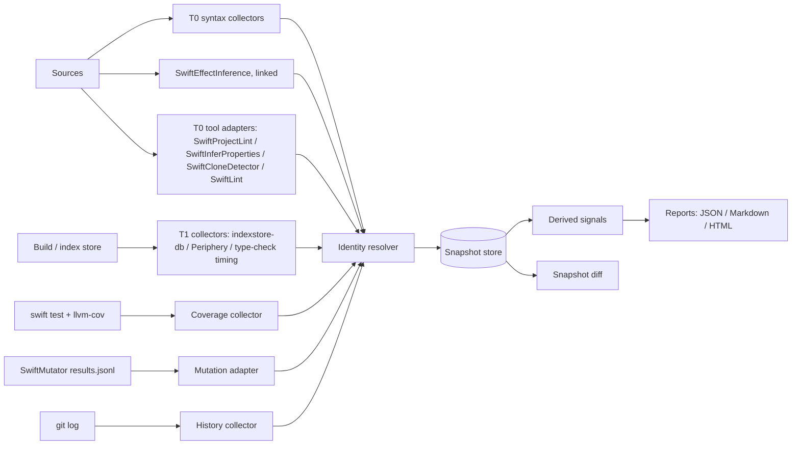

# SwiftStats — Product Requirements Document

**Status:** Draft v0.2 (2026-11-17). Reviewed against the source of every tool it names; see §16 for what changed and `Docs/prd-review-2026-11-17.md` in the repo for the evidence.
**Owner:** Joseph Cursio
**Repo:** `~/xcode_projects/SwiftStats` (SwiftPM, `SwiftStatsCore` library + `swiftstats` CLI)
**Inspired by:** [Sitrep](https://github.com/twostraws/Sitrep) (Paul Hudson / Hacking with Swift)

---

## 1. Summary

SwiftStats collects summary statistics about a Swift package. It stores them **one row per function**, keyed by a stable identity, and keeps **one snapshot per commit**. Sitrep reports project-wide totals: line counts, type counts, imports. SwiftStats goes down to individual functions and joins measurements that today live in separate tools: complexity, coverage, mutation results, side-effect tier, property-test candidates and git churn.

Each tool on its own gives a partial picture. The value comes from combining them, for example *"pure, complex, 40% region coverage, 6 surviving mutants, 2 untested Strong-tier property candidates, changed 14 times this quarter"*. That is a prioritised to-do list no single tool produces.

## 2. Problem

- Sitrep answers "how big is this project and what's it made of?" It can't answer "where are the risky, under-tested parts?"
- The signals that answer that question come from several places: SwiftLint, `llvm-cov`, SwiftMutator, SwiftEffectInference, SwiftInferProperties, SwiftPropertyLaws, SwiftCloneDetector, SwiftProjectLint, Periphery and git. Each has its own output format and its own idea of what a "function" is.
- No snapshots are kept, so trends (is coverage rising? is complexity creeping?) are invisible.

## 3. Goals

1. **Per-function records** that join every metric on a shared identity.
2. **Project and module roll-ups** reported as distributions (median, p90, max), not just totals or a single "longest".
3. **Snapshots per commit**, so any metric can be shown as a trend.
4. **Cost-tiered collection**: a cheap syntax-only scan runs in seconds; expensive collectors (tests, mutation) are opt-in and reuse earlier results where that is sound.
5. **Derived signals** computed from several metrics together (hotspots, untested properties, tool disagreements).
6. **Reuse existing tools** through adapters rather than reimplementing them.

## 4. Non-goals

- Not a linter. SwiftStats reports; it doesn't fail builds or suggest fixes (SwiftProjectLint and SwiftLint do that).
- Not a replacement for SwiftMutator, SwiftInferProperties and the others. It consumes their output.
- No GUI in v1. A Markdown or HTML report is enough. (A SwiftUI viewer could come later.)
- Xcode-project-only targets are out of scope for v1; SwiftPM packages only.
- No CI integration in v1 (most repos involved have no GitHub Actions, and free-tier minutes are tight).

## 5. Users and use cases

| User | Use case |
|---|---|
| Me, working on my own packages | "Which functions should I write tests for next?" |
| Me, running research corpora (e.g. swift-collections, swift-algorithms) | Compare packages; produce calibration data for SwiftInferProperties and SwiftEffectInference. |
| A reviewer of a PR | "Did this branch make anything measurably worse?" (diff of two snapshots) |

## 6. Core concepts

### 6.1 Function identity

Every metric must be attached to the same function.

**Primary key: a syntactic key, from M0 and permanent.** It is made of: module + enclosing path (type path including any extension `where` clause, and for a nested function its parent record's key) + declaration kind + `static`/`class` modifier + operator fixity (`prefix`/`postfix`/`infix`) + name + generic signature and constraints + parameter labels and types + `async`/`throws` + return type + `#if` condition. The file path is added only for `private` and `fileprivate` declarations, which Swift itself scopes to the file. Everything Swift lets overloads differ by is in the key, so overloads don't collide.

File path, source range and a **body hash** (over the body's tokens, with comments and whitespace removed) are attributes of the record, not part of the key. So inserting lines above a function, reformatting it, or moving a non-private function to another file in the same module leaves its key unchanged. A rename or signature change produces a new key; between neighbouring snapshots, a removed record and an added record with the same body hash are matched as one function, and the link records how the match was made (§7.13).

**USR: an attribute, added at M7.** The USR (Unified Symbol Resolution) comes from the index store, read with indexstore-db, and needs a build. It is unambiguous, including for overloads. It stays the same when a non-private function moves to another file in the same module. It changes when the function is renamed, its labels, parameter or return types or effects change, it moves to another type or module, or its access changes to or from `private`/`fileprivate`. `private` and `fileprivate` USRs also change when the file is renamed, because they include a file-based discriminator. So a USR is no more stable than the syntactic key; its value is resolving collisions and cross-file references. Stored keys are never rewritten when USRs arrive.

- SwiftPM writes the index store during debug builds (test targets always). Its location depends on the build system: under `.build/out/` with Swift 6.4's default Swift Build backend, and `.build/<triple>/debug/index/store` with `--build-system native`. SwiftStats finds the store rather than hard-coding a path, and records which build system produced it. indexstore-db also needs a database directory and the toolchain's `libIndexStore.dylib`.
- Two sources carry the USR already: an `llvm-cov` function name is the mangled symbol (USR = `s:` + the name without its leading `$s`), and Periphery's JSON lists USRs in `ids`. Join those on USR when the index is available, and by source range otherwise.

External tools report locations as file:line (coverage, mutants, SwiftLint, SwiftProjectLint, SwiftInferProperties), so **every function record stores its source range** (start and end line and column) and results are mapped to the **innermost** enclosing record. Sitrep stores no source locations for any declaration; its `Function` keeps only the name, argument labels, static flag, throws kind and return type, and it covers `func` declarations only.

**Results outside a function body.** SwiftMutator mutates stored-property and global initial values, default arguments and top-level statements, and coverage has regions there too. These attach to the enclosing type or file, and a default argument to its function. They count as mapped.

### 6.1a What counts as a function

The tools disagree (Sitrep counts `func` only, SwiftLint `func` and `init`, llvm-cov and SwiftMutator also report closures), so SwiftStats fixes its own rule:

- **Records:** `func`, `init`, `deinit`, `subscript`, explicit accessors (`get`/`set`/`willSet`/`didSet`, including computed-property bodies), nested functions (own record, with a link to the parent), and one synthetic record per file for top-level code.
- **Not records:** closures (their results fold into the enclosing record by source range), protocol requirements without a body, and macro expansions (results inside them are reported as unmapped).
- Extension members belong to the extended type.
- Code in every `#if` branch is walked and the condition is stored. Records in branches not compiled in the current configuration can never get a USR or coverage; that is expected, not a mapping failure.
- Files matching the configured generated-code globs, or carrying a known generated-file header (§7.8), are marked `generated`.
- Sitrep's "function count" is the `func` subset.

### 6.2 Snapshot

A snapshot is **one commit plus one working-tree state**. Each collector run attaches its results to that snapshot, so a later `scan --tier 3` adds to the T0 snapshot of the same commit rather than starting a new one.

Each snapshot records: commit SHA, branch, date, dirty flag, and the toolchain (the first line of `swift --version` run in the package directory, the swiftly selection and its source from `swiftly use` when swiftly is installed, and the SDK version from `xcrun --show-sdk-version`). For each collector it records its version string, the git commit of the tool's source when it is a local build (or the SHA-256 of the binary otherwise), its options, its run time and its status (§6.5). Tool version strings alone don't identify a build: SwiftProjectLint reports `1.0.0` after 1,697 commits with no tags, and SwiftCloneDetector's JSON always says `0.1.0`.

**Dirty trees.** A dirty tree gets at most one working snapshot per commit, which records a hash of the changed files; the next dirty scan of that commit replaces it. `diff`, `trend` and `backfill` use clean snapshots unless `--include-dirty` is given. The dirty check ignores `.swiftstats/`.

### 6.3 Collector

A unit that produces metrics. Each collector declares its **cost tier**, its inputs, and the identity it reports against.

| Tier | Needs | Typical time |
|---|---|---|
| T0 | Source files only (SwiftSyntax) | seconds |
| T1 | A build / index store | minutes |
| T2 | A test run | minutes |
| T3 | Mutation testing | tens of minutes to hours for a whole package (SwiftMutator: 19–39 min for SwiftProjectLint's 2,463 mutants); minutes for a branch with `--since` |
| TH | Git history | seconds–minutes |

### 6.4 Census vs defect

Every metric carries a **kind**. The idea comes from SwiftProjectLint's `CandidateInventory`, which keeps three census rules (`pureFunctionCandidate`, `pureClosureCandidate`, `pureMutatorCandidate`) out of its text report.

- **Census**: counts something that needs no action per item ("this function is pure", "this is a property candidate", "this function has complexity 7"). Census values are counted, rolled up and fed to other tools.
- **Defect**: a claim about a specific place that can be wrong and is worth reading each time ("force unwrap here", "test with no assertions", "pure logic trapped in an impure method").

Raw census metrics are never listed one per line in a human-facing report. A derived signal (§8) may list items selected by a census metric, because the signal makes them actionable; that is where census data becomes a to-do list.

SwiftProjectLint's outputs do not carry a kind, so SwiftStats keeps its own rule-to-kind list (§7.15) and checks it against `CandidateInventory` on each SwiftProjectLint update.

Motivation: in a July 2026 road test on SwiftProjectLint's own code, 76% of findings were census items (460 pure functions and 204 pure closures out of 876 findings; see SwiftProjectLint's `CandidateInventory.swift` and `Docs/roadtest/README.md`). They buried a real defect, a `lossyStructRebuild` finding at line 1438 of a 1768-line report, which went unread. SwiftStats is the natural home for census data, which leaves linter reports for defects only.

### 6.5 Collector status

Each collector records `ran`, `cached` (with the snapshot the results came from), `skipped (tool not found)` or `failed` (exit code and the last 20 lines of stderr).

- A missing value is stored as null, never 0. "Not collected" and "zero" must never look the same.
- A derived signal whose inputs are missing is left out of the report with the reason, not computed from partial data.
- Some tools exit non-zero on success: SwiftProjectLint exits 1 or 2 when it finds warnings or errors, and SwiftCloneDetector exits 2 when it finds clones. Adapters know each tool's codes.

## 7. Metric catalogue

### 7.1 Sitrep-compatible counts (T0)

SwiftStats reimplements these in its own visitor (§14 D1) and emits them as a `sitrep` block, compared against `sitrep -f json` as a test oracle:

- Files scanned; total lines; Sitrep's "source lines of code" (`sitrepLines`: non-empty lines, which still counts comments and lines holding only spaces); longest file and longest type in those lines
- Counts of structs, classes, enums, protocols and extensions, top-level only, as Sitrep counts them (nested-type counts are a separate SwiftStats metric, §7.2)
- Import counts per module
- UIKit view controller, UIKit view and SwiftUI view counts (direct subclasses or conformers only), and UIKit and SwiftUI lines of code

Sitrep has known quirks a per-function design fixes: nested types aren't counted; longest type is keyed by bare name, so a type's extensions add together and same-named types in different modules merge; longest file is reported by last path component only; file bodies are joined without a separator, so its stripped total loses a line per file boundary. The comparison lists each deliberate difference rather than copying the quirk.

**File discovery.** Sitrep scans every `.swift` file under the path (including `.build` and test folders) minus `.sitrep.yml` exclusions. SwiftStats scans the source files of the package's targets from `Package.swift`, split into production and test. For comparisons, run Sitrep with `.build` and the test folders excluded.

Sitrep declares function-count and documented-function-count fields but never fills them in or reports them; those are new SwiftStats metrics (§7.2, §7.5).

### 7.2 Size and shape (T0, per function / type / file)

**Stripped lines** are lines that contain at least one token after comments and whitespace are removed. Doc comments and attributes don't count. This differs from Sitrep's figure (§7.1), which is kept as `sitrepLines` for comparison.

- Function count (by §6.1a kind) and documented function count
- Type counts by kind including nested types
- Function length (stripped lines), parameter count, max nesting depth
- Type body length, member count; file length
- All reported as distributions per module and project

### 7.3 Complexity (T0)

- **Cyclomatic complexity**, counted the way SwiftLint's `cyclomatic_complexity` counts it so the numbers agree: start at 0; +1 for each `if`, `else if`, `guard`, `for`, `while`, `repeat`, `catch` and `case` (including `default`); −1 for each `fallthrough`. `&&`, `||`, `??`, `?:` and `#if` are not counted. Closures count towards the function that contains them; nested functions are scored separately. Honour `ignores_case_statements` from the package's `.swiftlint.yml`. SwiftLint scores only `func` and `init`, so accessors, subscripts and `deinit` get a SwiftStats-only score, marked as such. Record the SwiftLint version used for comparison, since the counting has changed between releases.
- **Cognitive complexity** (SonarSource's specification, v1.7, 2023). It counts a whole `switch` once rather than per case, adds a penalty for nesting, and ignores optional chaining and `??`. The spec doesn't cover several Swift constructs, starting with `guard`; those choices are made under §14 Q3 and listed in a table in the code.
- Optional: NPath, Halstead volume

### 7.4 Swift risk markers (T0)

Most of these are already SwiftProjectLint rules (`forceUnwrap`, `forceTry`, `forceCast`, `unconditionalTrap`, `uncheckedSendable`, `nonisolatedUnsafe`, `unsafeMemoryAPI`, `todoComment`); take them from the adapter (§7.15). SwiftStats computes the rest itself: **implicitly unwrapped optionals** (no rule exists), **`precondition`** (deliberately not reported by `unconditionalTrap`), **the `unsafe` expression keyword** (`unsafeMemoryAPI` covers `Unsafe*Pointer`, `OpaquePointer`, `Unmanaged`, `unsafeBitCast` and the `withUnsafe…` calls), and the concurrency-shape counts.

- Force unwrap `!`, `try!`, `as!`, implicitly unwrapped optionals
- `fatalError` and `preconditionFailure` (one rule, `unconditionalTrap`, which skips `required init?(coder:)`; split it by the callee named in the message if separate counts are wanted), and `precondition`
- Concurrency escape hatches: `@unchecked Sendable`, `nonisolated(unsafe)`, `unsafe` / `Unsafe*Pointer` use, `@preconcurrency` (`preconcurrencyImport`, `preconcurrencyConformance`), `@retroactive` (`retroactiveConformance`), `Task.detached` (`taskDetached`)
- Concurrency shape: actors, `@MainActor` declarations, `async` functions, `Task {}` creation sites
- `TODO` / `FIXME` count (`todoComment` also counts `HACK`)

The adapter runs SwiftProjectLint with a SwiftStats-owned config (§7.15), so the target repo's own configuration doesn't change these counts. Inline suppressions still apply and are counted separately.

### 7.5 API surface (T0)

- Declarations by access level (`open`, `public`, `package`, `internal`, `fileprivate`, `private`)
- `final` ratio among classes
- **Documentation coverage of the public API** (new; Sitrep tracks doc comments on types only and reports no documentation figures). SwiftStats counts documented and undocumented public declarations itself. SwiftProjectLint's `missingDocumentation` is a cross-check only: it flags undocumented `public` structs, classes and functions, and skips `open`, enums, protocols, actors and properties.
- **Over-exposed declarations**: implicitly `internal` declarations used only in their own file (SwiftProjectLint `couldBePrivate` for types, `couldBePrivateMember` for functions and properties, `protocolCouldBePrivate`), as a count and as a share of implicitly internal declarations. Over-exposed `public` API needs Periphery's redundant-public analysis (§7.6a, T1).

### 7.6 Coupling and structure (T1, via indexstore-db)

- Fan-in / fan-out per function and type
- Afferent / efferent coupling and instability per module
- LCOM (cohesion of a type's methods)
- Cycles in the type and module dependency graphs, from indexstore-db.

At T0, module structure comes from SwiftProjectLint's `undeclaredTargetDependency` and `unusedTargetDependency` (imports compared with `Package.swift`). Its `circularDependency` finds only two-type cycles through stored properties and parameters, and `layerDependency` checks folder layers only when `architectural_layers` is configured, so neither replaces the index for cycles.

### 7.6a Dead code (T1; commented-out code T0)

Use **Periphery** as the primary source. It needs a build and an index store. Run it as `periphery scan --format json --index-store-path <store>` after SwiftStats' own build, rather than letting Periphery build: version 2.21.2 looks for the old native index path and fails with Swift 6.4's default build system. For libraries pass `--retain-public`; that hides Periphery's redundant-public findings, so run once without it if those are wanted for §7.5. Its JSON gives kind, accessibility, `hints` (`unused`, `redundantPublicAccessibility`, …), USRs (`ids`) and `file:line:col`.

A naive "fan-in = 0" check from indexstore-db is only a fallback, because many declarations with no callers in the index are still live:

- `public` / `open` API used by other packages
- Protocol witnesses, `@objc`, `@IBAction` / `@IBOutlet`
- `Codable` properties, SwiftUI `#Preview`s, `@main`
- Code in `#if` branches not compiled in this configuration

Metrics:

- **Unused declarations** by kind (function, type, property, enum case)
- **Test-only code**: production declarations whose only references come from test targets. Periphery doesn't report this (it treats XCTest methods as roots), so SwiftStats works it out from the index. Periphery 2.21.2 also doesn't recognise Swift Testing `@Test` functions: it reports them, and code only they use, as unused. Drop results inside test targets, and treat "unused" in a Swift Testing package as "unused or test-only" until checked against the index.
- **Unused parameters** and **unused imports** (Periphery reports imports only of the package's own modules; unused imports of Foundation, system or third-party modules are not detected)
- **Unreachable code** (compiler warnings after `return` / `throw` / `fatalError`)
- **Commented-out code blocks** (T0 heuristic: comment blocks that parse as Swift)
- **Dead but tested**: dead declarations that still have tests and mutants. That wasted test time also skews the coverage and mutation numbers, so roll-ups should be reportable with dead code excluded.
- Cross-checks from SwiftProjectLint: `unusedProtocolAbstraction`, `unusedProtocolRequirement` (opt-in).

### 7.7 Build health

- **SwiftLint violations** by rule (T0 for SwiftLint's normal rules, which need no build; T1 for its analyzer rules)
- **Compiler warnings** by kind (T1)
- **Type-check time per function** (T1): `swift build -v -Xswiftc -Xfrontend -Xswiftc -debug-time-function-bodies` from a clean build, test targets included. Without `-v` the default build system prints no timings, and only recompiled files are timed. Lines are keyed by file:line:col, not USR, and implicit accessors can repeat at one location, so sum the entries per location and map them to a function by source range. Also collect `-warn-long-expression-type-checking=<ms>` warnings for single slow expressions. Motivation: the 12-arm `+` chain in a SwiftInferProperties test, which type-checked locally but timed out on the CI runner's older toolchain. Local timings can show that an expression is slow; they can't show whether another toolchain will time out.

### 7.8 Tests and coverage

#### Coverage (T2)

- **Line coverage** and **region coverage** per function: `swift test --enable-code-coverage`, then the JSON at `swift test --show-codecov-path`. Swift emits no branch records, so there is no branch coverage.
- Function names are mangled; demangle them with `swift demangle`, or join them on USR (§6.1).
- Closures and autoclosures (the right-hand side of `&&`, `||`, `??`) appear as separate functions and fold into their enclosing record by source range. Accessors are separate records too.
- The export has no per-function line totals, so line coverage is worked out from the file's segments over the function's range.
- Files under `.build/` (dependency checkouts), test files and SwiftPM's generated `test_entry_point.swift` are dropped. Generic functions get one record each in debug builds.
- When any test fails, SwiftPM writes no coverage JSON, but the `.profraw` files remain (see §13).

#### Test inventory (T0)

**Finding test code:** use the test targets declared in `Package.swift`, not file names or folders. Within test targets, a *test* is a `@Test` function or an XCTest `test…` method on an `XCTestCase` subclass; everything else is a **helper** (fixtures, mocks, builders, utilities).

Counts, each split by framework (Swift Testing vs XCTest):

- **Example-based** tests
- **Property-based** tests: a test that calls `propertyCheck(` (swift-property-based; Swift Testing only, so its XCTest column is always empty), a `check…PropertyLaws(` function (SwiftPropertyLaws; usable from Swift Testing or XCTest), `SwiftPropertyBasedBackend().check(` (SwiftInferProperties' generated stubs), or a wrapper built on `propertyCheck` such as SwiftIdempotency's `assertIdempotentProperty` / `assertIdempotentEffectsProperty`. Count the attribute forms too: `@PropertyLawSuite` and its sibling macros (`@ValueSemanticTests`, `@DefensiveCopyTests`, `@StableIdentityTests`, `@InteractionInvariantTests`), and SwiftInferProperties' `@CheckProperty(...)`. These expand wherever they are attached, so scan every target for them, not only test targets. Record the trial count where one is given (`count:` for `propertyCheck`, default 100; `options:` for the kit).
- **Idempotency checks** (SwiftIdempotency's `#assertIdempotent`, `assertIdempotentEffects`, `@IdempotencyTests`): example-based, counted separately and linked to the function they exercise
- **Parameterized** tests, with the **number of cases** (`@Test(arguments:)`), so one function running 50 cases isn't counted as one test
- **Generated** tests, found by their header rather than their folder: SwiftInferProperties stubs start with "// Auto-generated by `swift-infer discover --interactive`" (usually under `<test target>/Generated/SwiftInfer/`; refactor and trace outputs go to `Generated/SwiftInferRefactors/` and `Generated/SwiftInferTraces/`), and SwiftPropertyLaws files start with "// GENERATED by PropertyLawDiscoveryPlugin" (`PropertyLawTests.generated.swift`). Reported separately and excluded from ratios by default. Files under the legacy `Tests/Generated/` are in no test target and never run; report them as unbuilt.
- **Assertions per test**: `#expect`, `#require`, `XCTAssert*`
- **Tests with no assertions**: Swift Testing tests from SwiftProjectLint `testMissingAssertion`; XCTest tests with no `XCTAssert*` computed by SwiftStats. A defect-kind metric: these tests pass whatever the code does. Related, counted separately: `testMissingExpect` (a test that checks preconditions with `#require` but never asserts a result) and `testMissingRequire` (a test that traps through `!`, `try!` or `as!` where `#require` would fail just that test). All three rules are opt-in in SwiftProjectLint (§7.15).

#### Test-to-code ratio (T0)

Reported as context, never as a target. The plain project-wide line ratio misleads: property tests are compact (one can replace dozens of examples), generated tests and helpers inflate it, and it says nothing about whether tests check anything (that's mutation score, §7.9).

Variants to record:

- **Line ratio**, test stripped lines ÷ production stripped lines, with **generated tests and helpers excluded** on the test side. **Dead code (§7.6a) is excluded** on the production side once Periphery runs (M7); until then the snapshot records that the exclusion is missing.
- Same ratio **split by test kind** (example / property / parameterized)
- **Per module and per type**, not only per project, so a module with no tests isn't hidden by a healthy total
- **Tests per public function**: a test counts for a function when it covers it (T2, M5). Before coverage, a naming heuristic may be used, labelled as one.
- **Trend over time** (snapshots and backfill, §7.13): does test code grow with production code?

### 7.9 Mutation testing (T3, SwiftMutator)

- Mutants per function by outcome: killed (a failed test or a crash), survived, timed out, not covered (tests passed without running the mutant's code), build error
- **Mutation score** per function / module / project, worked out as SwiftMutator does: killed ÷ all mutants except build errors. Timeouts and not-covered mutants count as survivors.
- Surviving mutants listed with operator and location
- Kills made only by suspect tests (`killedOnlyBySuspectTests`), as evidence of weak tests

**Reading the results.** SwiftMutator has no library product (only the `swift-mutator` executable, with internal report types), so it is read from output. Read the run's `results.jsonl`, not the `-f json` report, which has no file hashes. Follow the file's reading rules: key mutants by `path`, `mutationOperatorId`, `line`, `column` and `occurrence`; the last `mutant` line for a key wins; a `retired` line drops earlier results for its keys; skip a line that doesn't parse; refuse an unknown `formatVersion`. Before mapping a mutant, compare its `fileSHA256` with the snapshot's hash of that file, and report mutants from changed files as unmapped. Read `outcome: passed` with `activated: false` as not covered.

SwiftMutator reports mutants per file, not per function; the adapter maps each by `path` + line/column. Use `path` (relative to the project), not `mutationPoint.filePath`, which points into the mutated copy. With coverage on (the default), SwiftMutator makes no mutants in code no test ran; an untested file shows as one `skipped (no coverage)` placeholder (no `key`, line 0), which is skipped, not counted as unmapped.

### 7.10 Side-effect tier (T0, SwiftEffectInference)

Syntax only; no build. The cross-file passes need every production source in the package parsed in one run.

Store **two fields**, not one:

- **Side-effect tier** on the lattice `pure < observational < idempotent < externally_idempotent < non_idempotent`, or **none** when nothing applies (the common case). Store the snake_case spelling; the Swift cases are `externallyIdempotent` / `nonIdempotent`. For `externally_idempotent`, also store the key parameter when one was declared. The tier's `idempotent` means *replay* idempotence (safe to run twice). It says nothing about *value* idempotence, `f(f(x)) == f(x)`, which is SwiftInferProperties' idempotence template (§7.11).
- **Purity verdict** from `PurityInferrer.verdict(for:)`: `pure` / `pure_but_partial` / `refuted`, with the refutation. A throwing function that is otherwise pure is `pure_but_partial` and gets no `pure` tier.

SwiftEffectInference has no single per-function call. Resolve in this order: declared annotation (`EffectAnnotationParser`), then `pure` from `PurityInferrer`, then the body-inferred tier (`EffectSymbolTable` + `BodyEffectInferrer`, the lub of the callees' tiers). Name-based guesses never give `pure` or `externally_idempotent`; body inference reaches them only through callees declared with those tiers, so a body-inferred `pure` means only that nothing it calls is worse than pure. It is not a purity verdict.

- **Declared** means a SwiftIdempotency marker macro (`@Pure`, `@Observational`, `@Idempotent`, `@ExternallyIdempotent(by:)`, `@NonIdempotent`) or a `/// @lint.effect <tier>` doc comment. SwiftEffectInference reads both by name, so SwiftIdempotency doesn't need to be in the build. If the two forms disagree on one declaration, the tier is withdrawn; record that as "conflicting declaration", not "none". `transactional_idempotent` is read as `non_idempotent`.
- `@EffectUnknown` (or `@lint.effect unknown`) and `@ClockDeterministic` are separate flags, off the lattice.
- **Evidence** stored per function: provenance (declared / body-inferred with hop depth / call-site heuristic with its reason string), anchor (declared or heuristic), and for purity the `PurityRefutation` case and its description. These stand in for a confidence value, which SwiftEffectInference doesn't have. Convert any `AbsolutePosition` to file:line with SwiftSyntax's `SourceLocationConverter`.
- **Identity.** SwiftEffectInference reports no location. SwiftStats walks the syntax itself and calls the per-declaration APIs (annotation, purity) on each declaration, so those results land on the right record. Body-inferred tiers are keyed only by `name(label:)`; a signature shared by more than one declaration in the package gets an inferred tier marked **ambiguous**, not copied to every declaration. Initialisers get no tier. Subscripts and computed properties get no declared or body-inferred tier, but can get a purity answer from `PurityInferrer` on their accessor block.
- **Construction facts.** Build `ConstructionFacts` from the package's production sources and pass them to every `PurityInferrer`, as SwiftProjectLint does; the default `.empty` gives different answers for functions that construct types with impure initialisers.
- **Repeatability.** Body inference stops at a wall-clock budget (30 s by default) and doesn't report that it stopped. SwiftStats sets a fixed hop count (`maxHops`) and a budget large enough not to bind, and records both in the snapshot, so inferred tiers are repeatable between runs.

### 7.11 Property-test candidates (T0, SwiftInferProperties)

**Source.** `swift-infer discover` (the default subcommand) prints text only. The machine-readable output is the semantic index: `swift-infer index --target <T>` writes `.swiftinfer/index.json` (top level: `schemaVersion`, `updatedAt`, `entries`, `typeShapes`, `interactionEntries`, `sourceFileByTypeName`). It runs once per target and upserts into one file. The index has no "why suggested" text, so the reason field needs the library adapter or is left empty.

**Identity.** Each suggestion carries an identity hash (`0x` + 16 hex digits; template + canonical signature; stable across moves, changes when the signature changes) and the file:line of its first function. No USR. SwiftStats maps it by line into the function's source range and keeps the hash as the join key for decisions, generated tests and verify results. `decisions.json` and `verify-evidence.json` store the hash without the `0x`.

- **Template** name, stored as SwiftInferProperties writes it (a free string, not a fixed enum; about 60 exist and the list grows). Common ones: `idempotence`, `round-trip`, `commutativity`, `associativity`, `identity-element`, `inverse-pair`, `monotonicity`, `invariant-preservation`, `dual-style-consistency`. Test-derived patterns (count-invariance, reduce-equivalence) arrive under `invariant-preservation` and `associativity`. "Algebraic structure" is not a template; it is a per-type cluster that `swift-infer suggest-refactors` reports as text.
- **Tier**: Strong (score ≥ 75) / Likely (40–74) / Possible (20–39), plus Advisory for unscored documentation rows (`equivalence-class`, `consumer-producer-chain`, synthesized `determinism`). Store the score too. `swift-infer index` includes Possible rows by default; `discover` hides them unless run with `--include-possible`, so record which command ran and with which flags. Treat Verified (Strong, and `swift-infer verify` passed) as a separate flag, not a tier. Suppressed rows never surface.
- **Pair partner** for two-function properties (e.g. `encode` ↔ `decode`), stored as a link. In the index this is a bare name (`secondaryFunctionName`), and only for `round-trip`, `differential-equivalence` and `emptiness-agreement`. SwiftStats resolves it to a record by name within the primary's type and file, and marks the link unresolved when that is ambiguous. Partners for other templates need the library adapter.
- **Decision status** from `.swiftinfer/decisions.json`, joined by identity hash: undecided (no record) / `accepted` / `acceptedAsConformance` / `rejected` / `skipped`. Count `// swiftinfer: skip <hash>` source markers separately as suppressed.
- **Whether a matching property test exists**: exact for generated tests (the stub's `// Suggestion identity:` line matches the hash), heuristic for hand-written ones (the function is called inside a property-test body). Also record the `swift-infer verify` outcome from `.swiftinfer/verify-evidence.json` when present (`measured-bothPass`, …).
- **Per type, suggested conformances** (RefactorBridge: Semigroup, Monoid, CommutativeMonoid, Group, Semilattice, SetAlgebra, Numeric). Only accepted ones can be read from files (`acceptedAsConformance` and `Generated/SwiftInferRefactors/`). Open proposals need the library adapter; if that isn't built, leave this field out rather than infer it.
- **Per type, law checks** (SwiftPropertyLaws): each declared conformance, tagged as (1) not covered by SwiftPropertyLaws, (2) covered but not run here, (3) run, or (4) suppressed. The kit covers 33 protocols (`KnownProtocol`: the stdlib set from `Equatable` to `StringProtocol`, plus Semigroup, Monoid, CommutativeMonoid, Group, Semilattice, Ring). "Run" means a `check<Protocol>PropertyLaws(for: T.self…)` call, `@PropertyLawSuite` on the type, a generated `<protocol>_<TypeName>` test, or a row in `.swiftinfer/kit-evidence.json`. A check also covers the protocols it inherits from (Hashable covers Equatable). "Suppressed" means a `// property-law-suppress: <protocol>_<TypeName>` marker or a `.skip(...)`.

### 7.12 Duplication (T0, SwiftCloneDetector)

- **Clone classes** (SwiftCloneDetector's term), broken down by kind: exact (type 1), renamed identifiers or literals (type 2), near-miss (type 3) and sequence (runs of statements or members). The tool's JSON doesn't label a class's kind (only near-miss classes have a non-null `similarity`), so the adapter runs each pass on its own through the CLI: `--type1` for exact, the default pass minus the `--type1` results for renamed, `--type3` for near-miss and `--sequence` for sequence (D3: only SwiftEffectInference is linked).
- Size in lines (`lineSpan`) and mass (AST nodes); the tool doesn't count tokens.
- **Percentage of code in clones**: stripped lines covered by any clone instance (merged, counted once), divided by the module's or project's stripped lines. Also store the tool's own `duplicatedLines` (redundant copies only, raw lines) for comparison with its output.
- **For each function**: the clone classes whose instances overlap it, with the share of its lines covered. A function's twins are the functions that overlap the other instances of the same class. Mark whether the instance is the whole function or part of it; fragments are rooted at 14 anchor kinds (statements, `if`/`guard`/`switch`, closures, members, …), not only functions.
- **Clone ratio over time** (from snapshots), to show whether duplication is growing. SwiftStats runs SwiftCloneDetector with fixed settings (the four passes above, the tool's defaults unless configured: `--min-mass 20`, `--min-lines 2`, `--similarity 0.85`, …) and stores them in the snapshot. Trends compare only snapshots with the same settings. Test targets are reported separately from production code.
- **Duplicated knowledge** that clone detection misses, because the code isn't copied but the same facts are restated (SwiftProjectLint `duplicateStructShape`, `duplicateEnumMapping`, `parallelEnumShape`, `scatteredEnumMapping`, `parallelListDrift`). Reported alongside clones but counted separately.

CLI details: exit code 2 means clones were found; pass the package root so instance paths are stable.

### 7.13 History (TH, git)

Source: the local clone's `git log`, not the GitHub API. PR reviews, linked issues and CI results add API calls and rate limits for little value on solo repos; revisit only for multi-contributor corpora.

- **Churn** (commits touching the function / file) over configurable windows. Default to a recent window (e.g. 90 days) so an early burst of AI-generated commits doesn't make everything look like a hotspot.
- **Age and stability**: first-seen date, last-modified date, time since last change.
- **Change coupling**: pairs of functions / files that change in the same commits, with a support count and a confidence ratio. Flagging pairs with **no static dependency** between them (hidden coupling) needs §7.6, so that part waits for M7.
- **Bug-fix density**: commits classified as fixes (message heuristics such as "fix", "bug", "regression", configurable), mapped to the functions they touched. Stored as a count and a rate per change.
- **Tests changing with the code**: for each production function, how often its changes come with a change to its tests (tests found by naming until coverage is available, then by coverage).
- **Reverts and repeated fixes**: functions touched by `Revert` commits, or by several fix commits in a short window.
- **Authors**: number of distinct authors. Only meaningful for third-party corpora; near-useless for solo, AI-assisted repos.

**Tracking through renames and moves.** Neither identity in §6.1 survives a rename on its own, and past commits have no USRs, because neither the history collector nor backfill builds them. Match functions between neighbouring commits by syntax: same key first, then the same body hash under a new name or file, then a similar body. Record each match with how it was made, so a guessed rename can be told apart from a certain one. Use `git log --follow` for single files only; its rename detection is a similarity guess and can credit a new file with another file's history. Git has no built-in Swift diff driver, so `git log -L :name:file` needs a `*.swift diff=swift` attribute and a `diff.swift.xfuncname` pattern; even then it matches by regex (overloads are ambiguous) and loses a function that moves file. Use `git log -L <start>,<end>:<file>` with the record's range only as a cross-check.

**Backfilled trends:** `swiftstats backfill` checks out past commits (every Nth commit, or one per week) in a separate worktree and runs the T0 collectors on each. This gives trend charts from day one instead of waiting for snapshots to build up. T1–T3 are not backfilled by default (too slow). Finding targets means evaluating each commit's `Package.swift`; cache the target layout per manifest hash and fall back to `Sources/` and `Tests/` with a warning when an old manifest won't evaluate.

**Assumption:** history is most useful when commits are small and merges keep them (`--merge`, not squash). Report which merge style a repo appears to use, since squash-merged history gives much coarser results.

### 7.14 Dependencies (T0)

- Direct dependencies from `Package.swift` (`swift package dump-package`).
- The full graph, with transitive edges, from `swift package show-dependencies --format json`.
- Pinned versions from `Package.resolved` when it exists. It is a flat list of remote pins, with no edges, no direct/transitive flag and no `path:` dependencies, and many libraries don't commit it (swift-algorithms ignores it; swift-collections has none at the root).
- Resolving dependencies may need the network, so this collector is T0 only when `.build` already holds resolved checkouts.

### 7.15 SwiftProjectLint findings (T0, adapter)

SwiftProjectLint has 218 rules in 13 categories.

**Output.** JSON: a `summary` of counts and an `issues` array. Each issue has `ruleName`, `category`, `severity`, `message`, `suggestion`, an optional `symbol`, and `locations` (a list of `filePath` + `lineNumber`, relative to the project root). `ruleName` is the rule's display name ("Force Unwrap"), so the adapter maps it to the case names used in this document through `RuleIdentifier(rawValue:)`. There is no column, no end line and no schema version. It also emits CSV (one row per location) and a `pbt-seeds` manifest (`file`, `line`, `symbol`, `rule`, `kind`, …) that swift-infer consumes.

SwiftStats reads the JSON for every finding and the `pbt-seeds` manifest for seed facts the JSON omits (`kind`, `role`, `restriction`, `effect`, `requires`, `mutates`, `skippedPackages`), joining the two on file, line and symbol. That means two runs (`--format json` and `--format pbt-seeds`). Each finding maps to a function by line, the same way as SwiftLint and coverage results. The schema allows several `locations` per finding, though no current rule emits more than one; if one does, store it once, link it to each function it names, and count it once in roll-ups.

**Invocation.** Several rules used here are opt-in (`testMissingAssertion`, `testMissingExpect`, `testMissingRequire`, `duplicateStructShape`, `duplicateEnumMapping`, `parallelEnumShape`, `scatteredEnumMapping`, `unusedProtocolRequirement`). There is no `--rules` flag, so SwiftStats runs SwiftProjectLint with its own config (`--config`) whose `enabled_only` lists every rule it consumes, plus `--include-nested-packages`, and records that rule list in the snapshot. Exit codes 1 and 2 mean findings, not failure.

**Census rules → per-function metrics.** Census is `CandidateInventory.inventoryRules` plus `impureClosureInventory` (below); every other rule is a defect. Until SwiftProjectLint's JSON carries a kind, SwiftStats keeps the list of these four rules' display names.

- Pure function / closure / mutator candidates (`pureFunctionCandidate`, `pureClosureCandidate`, `pureMutatorCandidate`). **Not** an independent purity opinion: these are built on SwiftEffectInference's `PurityInferrer` (function and mutator candidates through SwiftProjectLint's `PropertyTestCandidacy`; closure candidates call it directly), with filters for whether the function is a sensible property-test candidate. What SwiftStats gains is that candidacy decision. Compare on `verdict(for:)` with matching `ConstructionFacts` (§7.10). A function SwiftEffectInference calls pure (or pure but partial) that SwiftProjectLint doesn't nominate shows a candidacy filter at work. The reverse means the two ran different SwiftEffectInference revisions. Both pin it by commit SHA (it has no version tags), so record SwiftStats' revision and SwiftProjectLint's pinned one in the snapshot.
- `impureClosureInventory`: closures refused as pure, grouped by reason. Its doc comment calls it a census, but it is not in `CandidateInventory`; treat it as census and flag the mismatch upstream.

**Defect rules → counts per function, type and module**

- **Testability:** `extractableTotalKernel` (pure logic trapped in an impure method), `globalMutableState`, `nonInjectedNondeterminism` (direct `Date.now`, random, etc.), `singletonUsage`, `directInstantiation`, `missingEquatableOnPureResult` (pure function refused as a property-test candidate only because its result isn't `Equatable`; it still seeds pbt-seeds, but it asks for an edit, so it is a defect)
- **Correctness:** `lossyStructRebuild`, `lossyRoundTrip`, `subsumedCondition`, `contradictedClockDeterminism`, `catchWithoutHandling`, `discardedTryResult`, `potentialRetainCycle`
- **Design smells:** `fatProtocol`, `godViewModel`, `singleImplementationProtocol`, `lawOfDemeter`
- **Concurrency risk:** `actorReentrancy`, `fireAndForgetTask`, `swallowedTaskError`, `missingCancellationCheck`, `unboundedTaskGroup`, `blockingIOOnMainActor`
- **Idempotency:** `idempotencyViolation`, `missingIdempotencyKey`, `nonIdempotentInRetryContext`, `onceContractViolation`, `unannotatedInStrictReplayableContext`, `tupleEqualityWithUnstableComponents`, `nonIdempotentActionName`. The first five depend on `@lint.effect` / `@lint.context` annotations, so report them alongside the count of annotated functions: zero on an unannotated package means not checked. The last two are shape-based and run everywhere.
- Also consumed by other sections: risk markers (§7.4), over-exposure (§7.5), module structure (§7.6), dead code (§7.6a), assertion-free tests (§7.8), duplicated knowledge (§7.12)

**Suppression density**

- Count of `swiftlint:disable` and SwiftProjectLint suppression comments (`swiftlintSuppression`, `swiftprojectlintSuppression`), per module and over time. Rising suppression means problems are being muted rather than fixed.

**Roll-ups**

- Findings per rule and per category, per 1k stripped lines, as trends. Same treatment as SwiftLint violations (§7.7).

**Source of truth:** where SwiftStats and SwiftProjectLint could both compute a measure (risk markers, purity candidates), SwiftProjectLint is the source and SwiftStats only counts and joins, so the two tools can't disagree about, say, what counts as a force unwrap. §7.4 lists the few measures SwiftStats computes itself because no rule exists. Without SwiftProjectLint installed, its metrics show as "not collected" (§6.5), not zero.

## 8. Derived signals

Computed from the joined records. These are the main reason the project exists. "From" is the first milestone that has all the inputs.

| Signal | Definition (sketch) | Why it matters | From |
|---|---|---|---|
| **Hotspot** | high churn × high complexity | Complex code that keeps changing is where bugs land (Adam Tornhill's method). | M3 |
| **Bug-prone** | high bug-fix density, weighted by recency | Past bugs predict future ones; use as a weight on every "where to test next" list. | M3 |
| **Unstable fixes** | reverts or repeated fixes in a short window | Area that's hard to get right; needs tests before more changes. | M3 |
| **Safe to leave** | old, stable, no bug-fix history | Lowers priority of otherwise poor scores (complexity, coverage) so lists don't fill with code nobody touches. | M3 |
| **Tests not keeping up** | frequent production changes, tests rarely changed alongside | Covered code whose tests may no longer check what matters. | M3 (naming), M5 (coverage) |
| **Untested property** | Strong-tier candidate (or Verified), no property test | Concrete test to write. | M4 |
| **Tool disagreement** | idempotence suggested (from `swift-infer index`), but SwiftStats' own SwiftEffectInference run gives a *body-inferred* tier of `non_idempotent` (a declared `non_idempotent` already vetoes the suggestion inside SwiftInferProperties) | A triage list: each item is either an inference error or a function that returns a stable value while repeating a side effect (value vs replay idempotence, §7.10). Labelling them gives calibration data for SwiftEffectInference's heuristics. It is not evidence that SwiftInferProperties is wrong: `index` never resolves inferred effects (only `discover --resolve-effects` does, and that prints text only; see §15). Record both SEI revisions. | M4 |
| **Missing template?** | pure function with no scored candidate (ignore Advisory rows such as `determinism`; include Possible rows) | May reveal a template SwiftInferProperties lacks, or a law it left to SwiftPropertyLaws because a conformance already covers it. | M4 |
| **Unchecked laws** | declared conformance the kit covers, no check run (state 2 in §7.11) | Easy test coverage to add. | M4 |
| **Divergent clones** | clone twins from an earlier snapshot (or from the near-miss pass in the current one) where git shows a change to one copy since that snapshot and none to the other | Most useful duplication finding; a bug fixed in one copy likely still exists in the other. Exact and renamed clones drop out of the current report once one copy changes, so this needs snapshot history. | M4 |
| **Clone hotspot** | clone class with high churn | Every change has to be made in several places. | M4 |
| **Risky + untested** | risk markers (force unwraps, `@unchecked Sendable`) in low-coverage code | Crash or data-race candidates. | M5 |
| **Uneven clone testing** | one twin well covered / high mutation score, the other not | Copy the tests, or merge the code. | M5 (coverage), M6 (mutation) |
| **Weak tests** | high coverage or high test-to-code ratio, low mutation score, or kills only by suspect tests | Code is run, or lots of test code exists, but little is really checked. | M6 |
| **Genuinely under-tested** | low test-to-code ratio, low coverage, low mutation score | All three effort and quality measures agree. | M6 (partial at M5) |
| **Best property-test target** | property candidate + surviving mutants | A property test here may kill those mutants. Check after writing it: rerun SwiftMutator on the file and see whether the former survivors are now killed, and by which test (each mutant's `killingTests`). | M6 |
| **Hidden coupling** | high change coupling, no static dependency | Shared knowledge (formats, constants, assumptions) not visible in the code; candidates for an explicit abstraction. | M7 |
| **Dead but tested** | dead declaration with tests and mutants | Delete the code and its tests; frees test and mutation time. | M7 |
| **Test-only production code** | declaration referenced only from tests | Either dead or missing a production caller. | M7 |

Notes:

- **No "tool agreement" signal.** SwiftInferProperties already links SwiftEffectInference: it uses `PurityInferrer` as its purity oracle, adds +15 for a declared `idempotent` and vetoes on a declared `non_idempotent` or `externally_idempotent`. So SEI agreeing with an idempotence suggestion is not independent evidence, and `pure` says nothing about `f(f(x)) == f(x)` (`x + 1` is pure). Independent confirmation comes from a passing property test or mutation results.
- **Untested code and mutation.** With coverage on, SwiftMutator makes no mutants in code no test ran, so such a function has no mutation score at all. For the per-function signals above it counts as having a low score, not a missing one. Module and project scores still follow SwiftMutator's rule; run SwiftMutator with `--skip-coverage` to get real scores for that code.
- Thresholds are configurable, and defaults are relative (e.g. top decile within the project) rather than absolute. Because relative membership shifts when other code changes, `diff` compares raw scores, not signal membership.

## 9. Architecture

- **Collectors** produce metrics against either a syntactic key, a USR or a source range.
- **Identity resolver** maps every result onto function records (innermost enclosing record), and reports what it couldn't map rather than dropping it.
- **Adapters.** SwiftEffectInference is library-only (no CLI, no JSON), so it is linked. Linking it fixes SwiftStats to swift-syntax `exact: "603.0.2"` via the `swiftlang/swift-syntax` URL, and to a pinned SEI commit (it has no version tags). Every other tool is read through its output, so it can move independently: SwiftProjectLint (JSON + pbt-seeds), SwiftInferProperties (`.swiftinfer/*.json`), SwiftCloneDetector (JSON, one run per pass), SwiftMutator (`results.jsonl`), Periphery (JSON) and SwiftLint (JSON). See §14 D3.
- **Store:** one SQLite database per package, so derived signals are queries and trends are cheap. It records its schema version in `PRAGMA user_version` and upgrades with forward-only migrations (e.g. GRDB's `DatabaseMigrator`); migrations change the schema, never the measured values. `report --format json` gives a git-diffable file per snapshot for anyone who wants one.
- **Output contract.** Every JSON output carries `schemaVersion`. Reports are deterministic: records sort by signal score, then key; JSON keys are sorted; percentiles use nearest-rank; the only timestamp is the snapshot's own date. Running a report twice on the same snapshot gives byte-identical output.
- **Reuse of expensive results.**
  - T3: SwiftStats doesn't cache mutation results by its own rule. A mutant's verdict depends on the tests and on the rest of the code, not only on the function's source. It runs SwiftMutator with `run --reuse <previous results.jsonl>`, which keeps only results that still hold after source or test changes, and `--since <ref> --changed-lines` for a branch diff. A full run now and then, as SwiftMutator's README advises.
  - T2: coverage is not cached; one test run produces it for every function.
  - Reused results are marked as cached, with the snapshot they came from (§6.5).

## 10. User-facing behaviour

Command shape (illustrative):

- `swiftstats scan` — T0 + TH collectors, writes a snapshot (`--no-history` skips TH)
- `swiftstats scan --tier 2` — adds build and test collectors; `--tier 3` adds mutation
- `swiftstats report [--format json|markdown|html]` — latest snapshot with roll-ups and derived signals
- `swiftstats top <signal>` — e.g. `top hotspot`, `top untested-property`
- `swiftstats diff <sha-a> <sha-b>` — what got better / worse between two snapshots. It compares only metrics both snapshots have from the same collector version and options, and lists the rest as "not comparable". If a SHA has no snapshot (the usual case for a PR's base), it runs a T0 scan of it in a temporary worktree first, as `backfill` does.
- `swiftstats trend <metric>` — time series of a project or module metric
- `swiftstats backfill [--every N | --weekly]` — run T0 collectors on past commits to seed trends

Reports lead with the derived-signal lists, then roll-ups, then per-module detail.

### 10.1 Configuration

`.swiftstats.yml` in the package root, YAML like the sibling tools; command-line flags override it. Keys: `excluded` and `generated` path globs, `history.window` (default 90d), `history.fix_patterns`, `signals.<name>.threshold`, `collectors.<name>.enabled`, `.path` and `.options`, and `store` path. Unknown keys are an error.

## 11. Milestones

| Milestone | Scope | Done when |
|---|---|---|
| **M0** | `swiftstats scan --format json`, T0 only, no store, no git. Find targets with `swift package dump-package`; walk them with swift-syntax 603.0.2. Emit one record per §6.1a kind: key, kind, file, start and end line and column, stripped lines, body hash, parent key, `#if` condition, role (production / test / helper). Plus a `sitrep` block of Sitrep-compatible project counts (§7.1). Output carries `schemaVersion: 1`. | (1) A fixture package covering every §6.1a kind produces checked-in golden JSON exactly. (2) On Sitrep's test inputs (`Tests/SitrepCoreTests/Inputs`, wrapped in a fixture package since they are loose files) and on swift-algorithms, the `sitrep` block matches `sitrep -f json` field by field, with each deliberate difference listed. (3) Inserting lines above a function or reformatting it leaves its key and body hash unchanged; moving its file leaves a non-private function's key unchanged; changing its signature changes the key. (4) Two runs on the same tree give byte-identical output. (5) Scan time on swift-collections is recorded as the §12 baseline. |
| **M1** | T0: size, shape, complexity, risk markers, API surface, test inventory and test-to-code ratios (no dead-code exclusion yet); SwiftLint violations (normal rules); dependencies; `.swiftstats.yml`. **SwiftProjectLint adapter** (moved here from M4, since risk markers, over-exposure and assertion-free tests depend on it). | Cyclomatic complexity matches SwiftLint on swift-algorithms: SwiftLint run with `only_rules: [cyclomatic_complexity]` and `warning: 0`; for every `func` and `init`, SwiftLint's value (0 when it reports nothing) equals SwiftStats'. SwiftProjectLint findings joined to functions, with unmapped ones listed. |
| **M2** | Snapshot store (SQLite, migrations) + `report` + `diff` | Diffing a snapshot with itself is empty. On a fixture commit that adds, changes, moves and deletes one function each, the diff shows exactly those four, and the move shows as a move. Re-running `report` gives byte-identical output. |
| **M3** | TH: churn, stability, change-coupling pairs, bug-fix density, reverts; `backfill`; signals: hotspot, bug-prone, unstable fixes, safe to leave, tests not keeping up (naming-based) | On two repos, I label the top 20 hotspots and at least 12 are judged worth attention; the labels are kept as a test fixture. A backfilled trend of stripped lines and median complexity is produced for one repo. |
| **M4** | Adapters: SwiftEffectInference (linked), SwiftInferProperties, SwiftPropertyLaws detection, SwiftCloneDetector; signals: untested property, tool disagreement, missing template, unchecked laws, divergent clones, clone hotspot | Tool-disagreement table and divergent-clones list produced on two packages; every SwiftInferProperties suggestion maps to a record or is listed as unmapped. |
| **M5** | T2: coverage join (line + region, closures folded into their parent); tests per public function; signals: risky + untested, uneven clone testing (coverage part) | Per-function line and region coverage on two packages, with unmapped regions listed; "risky + untested" list produced. |
| **M6** | T3: SwiftMutator join via `results.jsonl`, with `--reuse` / `--since` runs; signals: weak tests, best property-test target, genuinely under-tested, uneven clone testing | Weak-tests and best-property-target lists produced; a `--since` run on a branch updates only the changed functions' results. |
| **M7** | T1: indexstore-db (USR as an attribute; coupling; cycles), type-check timing, compiler warnings, Periphery dead-code adapter; dead-code exclusion in ratios; signals: hidden coupling, dead but tested, test-only production code | On two packages, every record for code compiled in the build configuration gets a USR; records without one are listed with the reason (e.g. inactive `#if` branch); every case where USR and syntactic key disagree is listed. Dead-but-tested list produced. |
| Later | HTML trend charts, SwiftUI viewer, Xcode-project support | — |

## 12. Success criteria

1. `swiftstats scan --no-history` on swift-collections at a named tag, with the T0 collectors, finishes in under 30 seconds on this Mac with a warm build. Adapter times are recorded separately in each snapshot.
2. Every coverage region, mutant and function-scoped SwiftLint or SwiftProjectLint result whose location lies inside a function body maps to the innermost enclosing record. Results outside any function attach per §6.1; anything else is counted and reported as unmapped, never dropped. Target: at least 95% of in-body results mapped.
3. Over the first four weeks of use on two of my packages, at least half the items in each top-10 list are judged worth acting on. Each test written from a list is logged.
4. At least one SwiftInferProperties or SwiftEffectInference calibration-cycle document cites a disagreement found by SwiftStats.

## 13. Risks

| Risk | Mitigation |
|---|---|
| Identity drift between tools (macros, generated code, `#if`) | Store source ranges and hashes; report unmapped results rather than dropping them |
| Mutation runs are slow | Opt-in tier; incremental runs through SwiftMutator's `--reuse` and `--since`; a full run now and then |
| Coverage needs a passing test suite | SwiftPM writes no coverage JSON when a test fails, but the `.profraw` files remain. Merge them with `llvm-profdata` and export with `llvm-cov` to record coverage marked "tests failing", or record a partial snapshot and say which collectors failed |
| Toolchain skew (swiftly vs Xcode) changes results | Record `swift --version`, the swiftly selection and the SDK in every snapshot |
| Inferred stats (purity, properties) look more certain than they are | Always store the tool's own strength measure and reason alongside the value: SwiftInferProperties' tier and score; for side-effect tiers, provenance, anchor and hop depth. Don't invent a confidence number where a tool gives none |
| Inferred tiers vary between runs | SwiftEffectInference's body inference stops at a wall-clock budget without saying so; fix `maxHops` and a non-binding budget, and record both |
| Metric overload | Lead reports with derived signals, not raw tables |
| Fix-commit detection from messages is a guess | Configurable patterns; report precision on a hand-labelled sample per repo |
| Squash-merged or bulk-commit history gives coarse results | Detect merge style; warn in the report; prefer recent time windows |
| Function-level history is expensive on long histories | Limit to a time window; cache per-commit parse results |
| swift-syntax pinned exactly by linked tools | Link only SwiftEffectInference; record the pins; move swift-syntax in step with the sibling tools |
| Tool versions change between snapshots | Record each tool's commit or binary hash and options; mark trend breaks where a collector changed; `backfill --rerun` with current tools |
| Relative thresholds shift when other code changes | `diff` compares raw scores, not signal membership |
| Manifest evaluation per backfilled commit is slow, runs repo code and can fail on old manifests | Cache target layout per `Package.swift` hash; fall back to `Sources/` and `Tests/` with a warning |
| Tool output formats change silently | Adapters check `schemaVersion` / `formatVersion` where the tool has one, and fail loudly with the tool commit otherwise |

## 14. Decisions and open questions

### Proposed decisions (confirm before M0)

- **D1. Reimplement Sitrep's counts; don't fork or extend.** Using Sitrep as a dependency doesn't work: its data model is internal (the public API offers the aggregate `Report` and a debug JSON dump of each file's tree, with no source locations), and it requires `apple/swift-syntax` 602.x while SwiftEffectInference and the other tools pin 603.0.2, so the two can't share a package graph. Extending upstream means PRs to a project that merges a few times a year (last commits 2026-04-16 and 2026-09-11), and per-function records are outside its scope. A fork is small (about 1,140 lines in 12 files) but needs a swift-syntax bump, Swift 6 language mode and Apache-2.0 attribution, and brings Yams, the report code and the disabled stripper. Reimplementing the ten or so counts in SwiftStats' own visitor, with `sitrep -f json` as a test oracle, avoids all of that. Credit Sitrep in the README; offer source ranges upstream separately if wanted.
- **D2. The syntactic key is the permanent primary key** (§6.1). USRs are an attribute from M7; no stored key is ever rewritten.
- **D3. Link only SwiftEffectInference** (it has no CLI) and pin swift-syntax `exact: "603.0.2"` to match it. Read every other tool through its output files. SwiftInferProperties pins SEI by revision, so depending on it as a library would also force SwiftStats onto branch/revision/path dependencies; parsing `.swiftinfer/index.json` avoids that, at the cost of the explanation text and open RefactorBridge proposals.
- **D4. SwiftProjectLint is the source of truth** for every measure it has a rule for; §7.4 lists the exceptions. Without it, those metrics show as "not collected".
- **D5. SQLite store**, plus `report --format json` for git-diffable snapshots.
- **D6. Store raw counts; normalise per 1k stripped lines at report time**, so corpora can be compared without losing the raw numbers.

### Still open

1. **Where snapshots live.** Recommended: `.swiftstats/stats.sqlite` in the package, git-ignored, with `--store <path>` for research corpora. But I work on two machines and sync through GitHub, so a git-ignored store keeps separate history on each; T0 history can be rebuilt with `backfill`, T1–T3 can't. Alternatives: commit the JSON exports, or keep a central store in a synced folder. Needed by M2.
2. **Generated-code globs.** Which paths count as generated by default, beyond the known headers (§7.8)? Needed by M1.
3. **Cognitive complexity for Swift.** SonarSource's spec already covers closures (no increment, but they raise the nesting level), `?.` and `??` (ignored), `catch`, `else`/`else if`, `#if`, labelled `break`/`continue` and runs of `&&`/`||`. Still to decide: does `guard` count like an `if` or as a free early exit? Is a comma-separated condition list one run of `&&`? Do optional binding, `if case`, `try?` and `defer` add anything? Do the `if`/`switch` inside result-builder bodies (e.g. SwiftUI `body`) count in full? Needed by M1.
4. **Census rules in SwiftProjectLint's reports.** Its text report already counts the census rules without listing them (since July 2026). Should the HTML report do the same, and should the census counts leave the human-facing summary entirely? This is a SwiftProjectLint backlog item, not a SwiftStats one.

## 15. Changes worth making in the sibling tools

Small changes upstream would remove adapter work here. None blocks SwiftStats.

| Tool | Change | Removes |
|---|---|---|
| SwiftProjectLint | Add `schemaVersion`, the rule's case name, and a `kind` (census / defect) to the JSON; real version string | SwiftStats' census list and display-name mapping |
| SwiftProjectLint | Put `impureClosureInventory` in `CandidateInventory` (or drop "census" from its doc) | A known mismatch |
| SwiftCloneDetector | Add `pass` (exact / renamed / near-miss / sequence) to each class in the JSON; real version string | Running passes separately or linking the Kit |
| SwiftInferProperties | `discover --format json`, or `index --resolve-effects` plus the "why" text and partner locations in `index.json` | Empty reason fields, name-only partner links, and tool disagreements that are expected by construction |
| SwiftEffectInference | Report when body inference hit its time budget | Silent non-repeatable tiers |
| Periphery (third-party) | Recognise Swift Testing `@Test`; find the Swift Build index store | Post-filtering and `--index-store-path` |

## 16. Changes in v0.2

Reviewed on 2026-11-17 by checking every claim against the tools' source (full findings and evidence: `Docs/prd-review-2026-11-17.md` in the repo; v0.1 kept as `Docs/prd-v0.1.md`).

- **Facts corrected:** Swift has no branch coverage (§1, §7.8, M5); Sitrep doesn't report function or documented-function counts, and its "stripped" lines keep comments (§7.1); SwiftProjectLint has 218 rules in 13 categories, its JSON field names, suppression rule spellings, and which rules are opt-in (§7.15); SwiftInferProperties' tiers, decision values, template names, JSON source and generated-test paths (§7.11, §7.8); SwiftEffectInference is T0, library-only, and its tier is replay idempotence, separate from the purity verdict (§7.10); SwiftMutator outcomes, score rule, results file and lack of a library (§7.9); SwiftCloneDetector has no clone-type labels in JSON and no token counts (§7.12); USR stability (§6.1); `Package.resolved` has no graph (§7.14); `swiftly use` isn't a compiler version (§6.2); git has no Swift diff driver (§7.13); Periphery's limits (§7.6a).
- **Design fixed:** syntactic key without line range or file path is the permanent key, USR an attribute (§6.1, D2, M7); new §6.1a (what counts as a function), §6.5 (collector status), §10.1 (configuration), §15 (upstream asks); snapshot semantics for tier add-ons and dirty trees (§6.2); caching rule replaced with SwiftMutator's own `--reuse` (§9); output schema versioning and determinism (§9).
- **Signals:** "tool agreement" dropped (the tools aren't independent); "tool disagreement", "untested property", "missing template?", "unchecked laws", "divergent clones" redefined; each signal given a first milestone (§8).
- **Milestones:** M0 rescoped with testable done-when; SwiftProjectLint adapter moved to M1; hidden coupling moved to M7; every done-when made pass/fail.
- **Open questions:** six proposed as decisions (§14), four left open.
