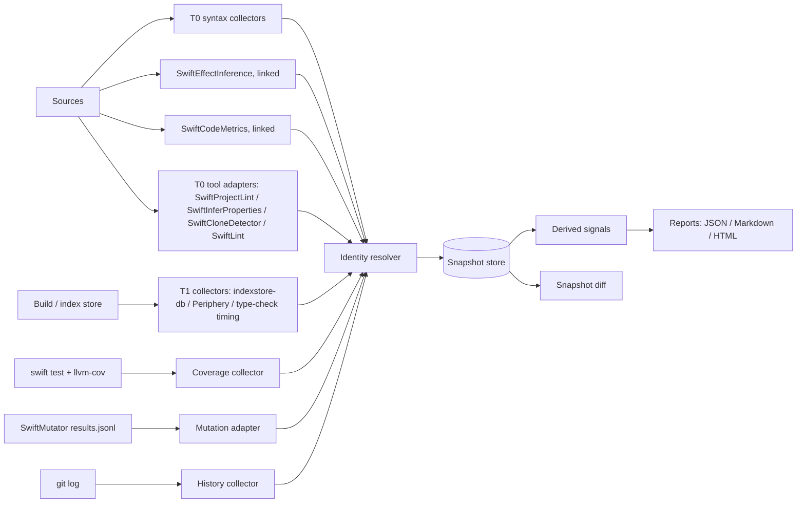

# SwiftStats — Product Requirements Document

**Status:** Draft v0.2.10 (2026-11-20). Reviewed against the source of every tool it names; see §16 for what changed and `Docs/prd-review-2026-11-17.md` in the repo for the evidence. M0, M1a, M1b and M2 are built, M3 is built with its labels pending, and M4 is built; see `Docs/m0-results.md`, `Docs/m1a-results.md`, `Docs/m1b-results.md`, `Docs/m2-results.md`, `Docs/m3-results.md` and `Docs/m4-results.md`.
**Owner:** Joseph Cursio
**Repo:** `~/xcode_projects/SwiftStats` (SwiftPM, `SwiftStatsCore` library + `swiftstats` CLI)
**Inspired by:** [Sitrep](https://github.com/twostraws/Sitrep) (Paul Hudson / Hacking with Swift)

---

## 1. Summary

SwiftStats collects summary statistics about a Swift package. It stores them **one row per function**, keyed by a stable identity, and keeps **one snapshot per commit**. Sitrep reports project-wide totals: line counts, type counts, imports. SwiftStats goes down to individual functions and joins measurements that today live in separate tools: complexity, coverage, mutation results, side-effect tier, property-test candidates and git churn.

Each tool on its own gives a partial picture. The value comes from combining them, for example *"pure, complex, 40% region coverage, 6 surviving mutants, 2 untested Strong-tier property candidates, changed 14 times this quarter"*. That is a prioritised to-do list no single tool produces.

## 2. Problem

- Sitrep answers "how big is this project and what's it made of?" It can't answer "where are the risky, under-tested parts?"
- The signals that answer that question come from several places: SwiftLint, `llvm-cov`, SwiftMutator, SwiftEffectInference, SwiftInferProperties, SwiftPropertyLaws, SwiftCloneDetector, SwiftProjectLint, Periphery and git. Each has its own output format and its own idea of what a "function" is.
- No snapshots are kept, so trends (is coverage rising? is complexity creeping?) are invisible.

## 3. Goals

1. **Per-function records** that join every metric on a shared identity.
2. **Project and module roll-ups** reported as distributions (median, p90, max), not just totals or a single "longest".
3. **Snapshots per commit**, so any metric can be shown as a trend.
4. **Cost-tiered collection**: a cheap syntax-only scan runs in seconds; expensive collectors (tests, mutation) are opt-in and reuse earlier results where that is sound.
5. **Derived signals** computed from several metrics together (hotspots, untested properties, tool disagreements).
6. **Reuse existing tools** through adapters rather than reimplementing them.

## 4. Non-goals

- Not a linter. SwiftStats reports; it doesn't fail builds or suggest fixes (SwiftProjectLint and SwiftLint do that).
- Not a replacement for SwiftMutator, SwiftInferProperties and the others. It consumes their output.
- No GUI in v1. A Markdown or HTML report is enough. (A SwiftUI viewer could come later.)
- Xcode-project-only targets are out of scope for v1; SwiftPM packages only.
- No CI integration in v1 (most repos involved have no GitHub Actions, and free-tier minutes are tight).

## 5. Users and use cases

| User | Use case |
|---|---|
| Me, working on my own packages | "Which functions should I write tests for next?" |
| Me, running research corpora (e.g. swift-collections, swift-algorithms) | Compare packages; produce calibration data for SwiftInferProperties and SwiftEffectInference. |
| A reviewer of a PR | "Did this branch make anything measurably worse?" (diff of two snapshots) |

## 6. Core concepts

### 6.1 Function identity

Every metric must be attached to the same function.

**Primary key: a syntactic key, from M0 and permanent.** It is made of: module + enclosing path (type path including any extension `where` clause, and for a nested function its parent record's key) + declaration kind + `static`/`class` modifier + operator fixity (`prefix`/`postfix`/`infix`) + name + generic signature and constraints + parameter labels and types + `async`/`throws` + return type + `#if` condition. The file path is added only for `private` and `fileprivate` declarations, which Swift itself scopes to the file. Everything Swift lets overloads differ by is in the key, so overloads don't collide.

File path, source range and a **body hash** (over the body's tokens, with comments and whitespace removed) are attributes of the record, not part of the key. So inserting lines above a function, reformatting it, or moving a non-private function to another file in the same module leaves its key unchanged. A rename or signature change produces a new key; between neighbouring snapshots, a removed record and an added record with the same body hash are matched as one function, and the link records how the match was made (§7.13).

**USR: an attribute, added at M7.** The USR (Unified Symbol Resolution) comes from the index store, read with indexstore-db, and needs a build. It is unambiguous, including for overloads. It stays the same when a non-private function moves to another file in the same module. It changes when the function is renamed, its labels, parameter or return types or effects change, it moves to another type or module, or its access changes to or from `private`/`fileprivate`. `private` and `fileprivate` USRs also change when the file is renamed, because they include a file-based discriminator. So a USR is no more stable than the syntactic key; its value is resolving collisions and cross-file references. Stored keys are never rewritten when USRs arrive.

- SwiftPM writes the index store during debug builds (test targets always). Its location depends on the build system: under `.build/out/` with Swift 6.4's default Swift Build backend, and `.build/<triple>/debug/index/store` with `--build-system native`. SwiftStats finds the store rather than hard-coding a path, and records which build system produced it. indexstore-db also needs a database directory and the toolchain's `libIndexStore.dylib`.
- Two sources carry the USR already: an `llvm-cov` function name is the mangled symbol (USR = `s:` + the name without its leading `$s`), and Periphery's JSON lists USRs in `ids`. Join those on USR when the index is available, and by source range otherwise.

External tools report locations as file:line (coverage, mutants, SwiftLint, SwiftProjectLint, SwiftInferProperties), so **every function record stores its source range** (start and end line and column) and results are mapped to the **innermost** enclosing record. Sitrep stores no source locations for any declaration; its `Function` keeps only the name, argument labels, static flag, throws kind and return type, and it covers `func` declarations only.

**Results outside a function body.** SwiftMutator mutates stored-property and global initial values, default arguments and top-level statements, and coverage has regions there too. These attach to the enclosing type or file, and a default argument to its function. They count as mapped.

### 6.1a What counts as a function

The tools disagree (Sitrep counts `func` only, SwiftLint `func` and `init`, llvm-cov and SwiftMutator also report closures), so SwiftStats fixes its own rule:

- **Records:** `func`, `init`, `deinit`, `subscript`, explicit accessors (`get`/`set`/`willSet`/`didSet`, including computed-property bodies), nested functions (own record, with a link to the parent), and one synthetic record per file for top-level code.
- **Not records:** closures (their results fold into the enclosing record by source range), protocol requirements without a body, and macro expansions (results inside them are reported as unmapped).
- Extension members belong to the extended type.
- Code in every `#if` branch is walked and the condition is stored. Records in branches not compiled in the current configuration can never get a USR or coverage; that is expected, not a mapping failure.
- Files matching the configured generated-code globs, or carrying a known generated-file header (§7.8, D8), are marked `generated`.
- Sitrep's "function count" is the `func` subset.

### 6.2 Snapshot

A snapshot is **one commit plus one working-tree state**. Each collector run attaches its results to that snapshot, so a later `scan --tier 3` adds to the T0 snapshot of the same commit rather than starting a new one.

Each snapshot records: the package, commit SHA, branch, date, dirty flag, and the toolchain (the first line of `swift --version` run in the package directory, the swiftly selection and its source from `swiftly use` when swiftly is installed, and the SDK version from `xcrun --show-sdk-version`). For each collector it records its version string, a **build identity**, its options, its run time and its status (§6.5). Tool version strings alone don't identify a build: SwiftProjectLint reports `1.0.0` after 1,697 commits with no tags, and SwiftCloneDetector's JSON always says `0.1.0`.

**Build identity** is what `diff` compares (§6.6), so it must change whenever the tool's output could, and a missing label must never make two builds look the same. It is a content hash, with a git commit kept beside it only as a label:

- **An external tool:** the SHA-256 of its binary, symlinks resolved. Rebuilding the same source gives the same binary (checked for SwiftProjectLint, 2026-11-19), so this causes no false breaks. The commit of the tool's source is recorded as a label only when the binary sits in a `.build` directory of a clean git work tree whose top level is the tool's own package, and the binary is newer than both HEAD's last move (its reflog) and every tracked file; otherwise none. The work tree's HEAD alone would name a binary built before a pull with the commit after it, and a pulled commit's own date is older than the pull.
- **SwiftStats itself (`swiftstats`).** Most T0 numbers (stripped lines, the Sitrep counts, risk markers, the API surface, the test inventory, where findings attach) are SwiftStats' own code, and they change when it does. `schemaVersion` tracks the output's shape, not its meaning: M1b's review changed what the API surface counts without changing it. So SwiftStats records its own build like any other tool's. Its identity is a hash of its build inputs (`Sources/`, `Package.swift`, `Package.resolved`, `Plugins/`), embedded at build time by a build-tool plugin with read-only git: the input trees at HEAD, plus the uncommitted changes to them when the tree is dirty, hashed as content (a diff in a fixed form whatever the user's diff settings, and each untracked input's blob hash). Docs-only commits don't change it, and debug and release builds of one tree share it. `Package.resolved` fixes the linked libraries (SwiftCodeMetrics, SwiftEffectInference, swift-syntax). The commit and dirty flag are its label. Without git at build time (a source archive), the identity is the SHA-256 of the `swiftstats` executable; the plugin only reports a commit when git's top level is SwiftStats' own package, so a copy inside another repository falls back too. Its options are the effective `excluded` and `generated` globs. While SwiftStats is changing quickly this breaks T0 trends often; `backfill --rerun` recomputes T0 history with the current build.
- **The dependency graph:** the `swift --version` line, and it is compared only when `swiftstats` is comparable too, since SwiftStats' own code reads the graph.
- **The history collector (`history`, M3):** `git:` and git's version, compared only when `swiftstats` is comparable too, since SwiftStats' own code parses every past version. Its options are its `history:` settings (§10.1). `diff` lists its comparability but doesn't diff history numbers in M3.
- **SwiftEffectInference (`swifteffectinference`, M4):** linked, so its identity is `git:` and the revision SwiftStats pins (§7.10), which is also its version. It is compared only when `swiftstats` is comparable too, since SwiftStats' own code walks the declarations and maps the results. Its options say how callees are resolved and which files are read (§7.10).
- **SwiftInferProperties and SwiftCloneDetector (M4)** are external tools like the rest: the binary's hash. Their version strings are recorded but identify nothing: `swift-infer --version` prints `1.160.0 (unattributable build)` for any plain build.
- **Law checks (M4)** are SwiftStats' own measurement (§7.11), so they belong to `swiftstats`, whose identity covers the protocol table compiled into it.

**Git state** is read before any collector runs (SwiftPM's own commands write untracked files into `.build`), with read-only git (`--no-optional-locks`), in the package directory, which may be a subdirectory of the repository. The dirty check covers that directory only and ignores `.swiftstats/`, and a store kept elsewhere in the package: staged and unstaged changes against HEAD, and untracked files that aren't ignored. Its diff has a fixed form (no external diff tool, text conversion or rename detection), so a user's diff settings can't hide a change.

**One snapshot per state.** A store holds at most one clean and one dirty snapshot per package and commit; a package outside git has one snapshot, replaced on each scan. The package is identified by its name and its path from the repository's top level, so one store can hold a corpus. Until a collector can run apart from the T0 scan (M5), a rescan replaces the whole snapshot, so a collector that ran before and is skipped now loses its earlier result; from M5 results are replaced per collector.

**Dirty trees.** A dirty tree gets at most one working snapshot per commit, which records a hash of the changed files; the next dirty scan of that commit replaces it. `diff`, `trend` and `backfill` use clean snapshots unless `--include-dirty` is given; `report` uses the working tree's own. A dirty snapshot stands for the working tree only while its hash of the changes is the tree's: `diff --include-dirty` rescans otherwise, and `report` says the tree has changed since its last scan.

### 6.3 Collector

A unit that produces metrics. Each collector declares its **cost tier**, its inputs, and the identity it reports against.

| Tier | Needs | Typical time |
|---|---|---|
| T0 | Source files only (SwiftSyntax) | seconds |
| T1 | A build / index store | minutes |
| T2 | A test run | minutes |
| T3 | Mutation testing | tens of minutes to hours for a whole package (SwiftMutator: 19–39 min for SwiftProjectLint's 2,463 mutants); minutes for a branch with `--since` |
| TH | Git history | seconds–minutes |

### 6.4 Census vs defect

Every metric carries a **kind**. The idea comes from SwiftProjectLint's `CandidateInventory`, which keeps three census rules (`pureFunctionCandidate`, `pureClosureCandidate`, `pureMutatorCandidate`) out of its text report.

- **Census**: counts something that needs no action per item ("this function is pure", "this is a property candidate", "this function has complexity 7"). Census values are counted, rolled up and fed to other tools.
- **Defect**: a claim about a specific place that can be wrong and is worth reading each time ("force unwrap here", "test with no assertions", "pure logic trapped in an impure method").

Raw census metrics are never listed one per line in a human-facing report. A derived signal (§8) may list items selected by a census metric, because the signal makes them actionable; that is where census data becomes a to-do list.

SwiftProjectLint's JSON carries each finding's kind from 1.1.0, so SwiftStats reads it rather than keeping its own rule-to-kind list (§7.15). SwiftStats' own markers (§7.4) carry a kind too.

Motivation: in a July 2026 road test on SwiftProjectLint's own code, 76% of findings were census items (460 pure functions and 204 pure closures out of 876 findings; see SwiftProjectLint's `CandidateInventory.swift` and `Docs/roadtest/README.md`). They buried a real defect, a `lossyStructRebuild` finding at line 1438 of a 1768-line report, which went unread. SwiftStats is the natural home for census data, which leaves linter reports for defects only.

### 6.5 Collector status

Each collector records `ran`, `cached` (with the snapshot the results came from), `skipped (tool not found)` or `failed` (exit code and the last 20 lines of stderr).

- A missing value is stored as null, never 0. "Not collected" and "zero" must never look the same.
- A derived signal whose inputs are missing is left out of the report with the reason, not computed from partial data.
- Some tools exit non-zero on success: SwiftProjectLint exits 1 or 2 when it finds warnings or errors, and SwiftCloneDetector exits 2 when it finds clones. Adapters know each tool's codes. SwiftCloneDetector exits 64 for a usage error, which includes being given no Swift files, so SwiftStats never runs it on an empty list: the collector has run and found no classes. `swift-infer index` exits 0 whatever it finds, 64 for an unknown target and 1 for any other error. It prints `note:` and `warning:` lines on stderr on normal runs, so stderr is no sign of failure.
- A SwiftInferProperties failure's reason reads the same on every run. Temporary paths in it are replaced with placeholders (`<copy>`, `<tmp>`, `<work>`, `<package>`), and a Foundation error gives its message without file paths or memory addresses. The warnings for unreadable `.swiftinfer/` join files carry no paths either. Other collectors record the tool's stderr as given; a SwiftCloneDetector failure, for example, reads "`swift-clone-detector …` over N files exited with status S: <message>".

### 6.6 Snapshot diff

`diff` says what changed between two snapshots, function by function, and what got better or worse.

**Comparability.** A collector's results are **compared** only when it ran in both snapshots with the same build identity and options (§6.2), and for results SwiftStats maps or reads itself (findings per function, the dependency graph) only when `swiftstats` is comparable too. Otherwise it is **not comparable** (it ran in both, with a different build or options; the reason is given) or **not collected** (it didn't run in one or both; each side's status is given). The function lists and everything SwiftStats measures belong to `swiftstats`; findings to their tool. Only "not comparable" makes a diff non-empty, so a snapshot diffed with itself is empty even when a tool was missing.

**Families.** Changes are reported per family, not per record: a record with no parent (§6.1a) together with its nested functions and accessors, or a computed property's accessors, named by the property. Moving a function moves its nested functions, and editing a nested function changes its parent's body hash too; both are one change, with the records involved listed under it.

**Matching**, families first and children after their parents:

1. **Same key**, held by exactly one record on each side. A key held by several records (a collision that location couldn't separate) is left unmatched, with a warning.
2. **A private record that moved file, or became or stopped being private:** its key without its ` @ <file>` part (and any collision location after it) is the other side's, held by exactly one family on each side; several families sharing that form are left to the next rule. Matched by key, so its body may also have changed.
3. **Same body hash:** family roots of the same kind and module whose body hash occurs exactly once among the unmatched on each side, and whose body, its own braces aside, has more than one stripped line (a one-line body such as `{ true }` is no evidence that two functions are one, however it is laid out). Each record carries its body's lines (`bodyLines`, scan `schemaVersion: 4`). The match is labelled `bodyHash`, so a guessed rename can be told from a certain one (§7.13).
4. Once a family matches, its nested records pair by key: the old root's key (or a computed property's accessor's) at the front of each is replaced with its new counterpart's, then sibling numbers and file parts are set aside, so a renumbered ` #2` still pairs with its own body. Children of an unmatched root are not matched by body hash.

Everything else is **added** or **removed**. Matching similar bodies waits for history (M3).

**Statuses** of a matched family, any of: **moved** (its file differs), **renamed** (its key differs other than in the ` @ <file>` part), **access changed** (its key differs only in having or not having that part, i.e. it became or stopped being `private`/`fileprivate`), **changed** (a record's body hash differs; the records are listed). Every matched family whose key or file differs has at least one status.

**Metric deltas**, before → after, for each matched record whose compared metrics differ: stripped lines, parameter count, the complexity scores, `async`, and findings per comparable tool and rule. For each roll-up (§7.2: each module, and the project's production and test parts), every number, compared when its collector is and `swiftstats` is too, since every roll-up counts only the files SwiftStats scanned, where it assigned them. Each metric has a fixed direction: lower is better for sizes, complexity, nesting, parameters and findings; higher is better for tests, assertions, parameterized cases, documented declarations and the test line ratio; counts such as functions, types, files and declarations by access level are neutral. From M4 the roll-ups also count side-effect tiers and purity verdicts, property candidates by tier, law pairs by state, and clone classes by kind with their cloned lines (§7.10–§7.12): clone counts and lines and unchecked law pairs are lower-is-better, the rest neutral. A count keyed by name (findings by rule, records by tier, pairs by state) that one side lacks reads 0 where its collector is compared, so a fall to zero is judged. Property candidates, law-check pairs, clone classes and side-effect facts are not diffed one by one; of the law checks only the `laws.state.*` counts are compared. Reports group deltas into worse, better and neutral.

**Known limits in M2:** removing the first of several same-named local functions renumbers the rest (` #2` becomes the first), so they pair wrongly; a collision's `:line` suffix changes when lines move; rewriting `var x: T { e }` as `{ get { e } }` changes the body hash; a nested function hoisted to the top level shows as removed and added.

## 7. Metric catalogue

### 7.1 Sitrep-compatible counts (T0)

SwiftStats reimplements these in its own visitor (§14 D1) and emits them as a `sitrep` block, compared against `sitrep -f json` as a test oracle:

- Files scanned; total lines; Sitrep's "source lines of code" (`sitrepLines`: non-empty lines, which still counts comments and lines holding only spaces); longest file and longest type in those lines
- Counts of structs, classes, enums, protocols and extensions, top-level only, as Sitrep counts them (nested-type counts are a separate SwiftStats metric, §7.2)
- Import counts per module
- UIKit view controller, UIKit view and SwiftUI view counts (direct subclasses or conformers only), and UIKit and SwiftUI lines of code

Sitrep has known quirks a per-function design fixes: nested types aren't counted; longest type is keyed by bare name, so a type's extensions add together and same-named types in different modules merge; longest file is reported by last path component only; file bodies are joined without a separator, so its stripped total loses a line per file boundary. The comparison lists each deliberate difference rather than copying the quirk.

**File discovery.** Sitrep scans every `.swift` file under the path (including `.build` and test folders) minus `.sitrep.yml` exclusions. SwiftStats scans the source files of the package's targets from `Package.swift`, split into production and test. For comparisons, run Sitrep with `.build` and the test folders excluded.

Sitrep declares function-count and documented-function-count fields but never fills them in or reports them; those are new SwiftStats metrics (§7.2, §7.5).

### 7.2 Size and shape (T0, per function / type / file)

**Stripped lines** are lines that contain at least one token after comments and whitespace are removed. Doc comments and attributes don't count, attributes nested in a body included, so a line holding only `@inlinable` counts toward neither the member, the type around it, nor the file. This differs from Sitrep's figure (§7.1), which is kept as `sitrepLines` for comparison.

- Function count (by §6.1a kind) and documented function count
- Type counts by kind including nested types
- Function length (stripped lines), parameter count, max nesting depth
- Type body length, member count; file length
- All reported as distributions per module and project

### 7.3 Complexity (T0)

Computed by **SwiftCodeMetrics**, a shared library that SwiftProjectLint also uses, so both tools report the same numbers. Its specification (`Docs/Spec.md` in that repo) defines every rule, with worked examples; SwiftStats doesn't restate them. Each function record gets three scores; the report records the library's definition version once (`metrics`), since every score in a scan shares it:

- **Cognitive complexity**, Swift-specific, built on SonarSource's specification (v1.7, 2023). Sonar removed its own Swift rule, so the Swift constructs (`guard`, condition lists, `if case`, `try`/`await`, result builders, `#if`) are decided in the spec.
- **Decision count**, McCabe's: every branch point, including `&&`, `||`, `??` and the ternary. Compared as `mccabe` (decisions + 1).
- **SwiftLint-compatible count**, matching SwiftLint's `cyclomatic_complexity` exactly, for parity checks: start at 0; +1 for each `if`, `else if`, `guard`, `for`, `while`, `repeat`, `catch` and `case` (including `default`); −1 for each `fallthrough`; no operators. Honour `ignores_case_statements` from the package's `.swiftlint.yml`. SwiftLint scores only `func` and `init`, so accessors, subscripts and `deinit` get a score marked as SwiftLint-unscored. Record the SwiftLint release the library was checked against.
- Optional: NPath, Halstead volume

### 7.4 Swift risk markers (T0)

Most of these are already SwiftProjectLint rules (`forceUnwrap`, `forceTry`, `forceCast`, `unconditionalTrap`, `uncheckedSendable`, `nonisolatedUnsafe`, `unsafeMemoryAPI`, `todoComment`); take them from the adapter (§7.15). SwiftStats computes the rest itself: **implicitly unwrapped optionals** (no rule exists), **`precondition`** (deliberately not reported by `unconditionalTrap`), **the `unsafe` expression keyword** (`unsafeMemoryAPI` covers `Unsafe*Pointer`, `OpaquePointer`, `Unmanaged`, `unsafeBitCast` and the `withUnsafe…` calls), and the concurrency-shape counts.

- Force unwrap `!`, `try!`, `as!`, implicitly unwrapped optionals
- `fatalError` and `preconditionFailure` (one rule, `unconditionalTrap`, which skips `required init?(coder:)`; split it by the callee named in the message if separate counts are wanted), and `precondition`
- Concurrency escape hatches: `@unchecked Sendable`, `nonisolated(unsafe)`, `unsafe` / `Unsafe*Pointer` use, `@preconcurrency` (`preconcurrencyImport`, `preconcurrencyConformance`), `@retroactive` (`retroactiveConformance`), `Task.detached` (`taskDetached`)
- Concurrency shape: actors, `@MainActor` declarations, `async` functions, `Task {}` creation sites
- `TODO` / `FIXME` count (`todoComment` also counts `HACK`)

The adapter runs SwiftProjectLint with a SwiftStats-owned config (§7.15), so the target repo's own configuration doesn't change these counts. Inline suppressions still apply and are counted separately.

The markers SwiftStats finds itself are findings of the `swiftstats` tool (§7.16): `implicitlyUnwrappedOptional` (a defect), and `precondition`, `unsafeExpression`, `mainActorDeclaration` (an attribute on a declaration, including one inside an `#if` in its attribute list, not on a closure or function type) and `taskCreation` (`Task { … }` or `Task(…) { … }`, specialised or not; `Task.detached` is SwiftProjectLint's), all census. `async` is a flag on each function record, and actors are counted with the other type kinds.

### 7.5 API surface (T0)

- Declarations by access level (`open`, `public`, `package`, `internal`, `fileprivate`, `private`)
- `final` ratio among classes
- **Documentation coverage of the public API** (new; Sitrep tracks doc comments on types only and reports no documentation figures). SwiftStats counts documented and undocumented public declarations itself. SwiftProjectLint's `missingDocumentation` is a cross-check only: it flags undocumented `public` structs, classes and functions, and skips `open`, enums, protocols, actors and properties.
- **Over-exposed declarations**: implicitly `internal` declarations used only in their own file (SwiftProjectLint `couldBePrivate` for types, `couldBePrivateMember` for functions and properties, `protocolCouldBePrivate`), as a count and as a share of implicitly internal declarations. Over-exposed `public` API needs Periphery's redundant-public analysis (§7.6a, T1).

What is counted (M1b): types, typealiases, functions, initialisers, subscripts and each name a `var` or `let` binds (a tuple pattern's labels bind nothing), outside function bodies, closures and top-level statements, whose declarations are locals. Protocol requirements take their protocol's access and enum cases can't write one, so neither is counted. A declaration's level is the one it writes, else its extension's (members of a `private` extension are `fileprivate`), capped by what encloses it; setter-only modifiers such as `private(set)` don't count. "Implicitly internal" means no modifier on the declaration or its extension, and nothing around it lowering that.

### 7.6 Coupling and structure (T0 via SwiftCodeMetrics; T1 cross-check via indexstore-db)

SwiftCodeMetrics computes these from syntax alone, using swift-syntax's lexical lookup and a per-module symbol table; its spec says what syntax can and can't resolve. That moves them from T1 to T0:

- Per function: fan-out (with implicit-member and chained calls reported separately), parameter counts, static and singleton references.
- Per type: efferent coupling (concrete, view and namespace targets split out), afferent coupling within the module, WMC, LCOM4 cohesion, type cycles.
- Per module: efferent and afferent coupling from imports, instability, and Martin's abstractness and distance where they apply.

indexstore-db (M7) adds what syntax can't see: fan-in across modules, calls resolved through overloads and protocols, and USR-based cycles. Where the two disagree, both are kept and the difference is listed.

At T0, module structure comes from SwiftProjectLint's `undeclaredTargetDependency` and `unusedTargetDependency` (imports compared with `Package.swift`). Its `circularDependency` finds only two-type cycles through stored properties (its visitor collects parameter types but skips them), and `layerDependency` checks folder layers only when `architectural_layers` is configured, so neither is used for cycles; type cycles come from SwiftCodeMetrics.

### 7.6a Dead code (T1; commented-out code T0)

Use **Periphery** as the primary source. It needs a build and an index store.

**Which Periphery.** Upstream `peripheryapp/periphery` (MIT) was archived on GitHub in August 2026. A maintained fork, `tiny-earth-moon/periphery`, now renamed **outskirts** (outskirts.dev, MIT), continues from the last 3.x release and keeps it building with Swift 6.4 / Xcode 27; it was three weeks old with one maintainer when checked (2026-11-17), so pin a version (D7: SwiftStats sends it patches rather than taking it on). Homebrew's `periphery` on this machine is **2.21.2**, older than 3.0, and the limits below marked "2.21.2" were measured with it; recheck them against the fork before building the adapter in M7.

Run it as `scan --format json --index-store-path <store>` after SwiftStats' own build, rather than letting it build: 2.21.2 looks for the old native index path and fails with Swift 6.4's default build system (the fork's notes describe `--index-store-path` support for Swift package index stores). For libraries pass `--retain-public`; that hides Periphery's redundant-public findings, so run once without it if those are wanted for §7.5. Its JSON gives kind, accessibility, `hints` (`unused`, `redundantPublicAccessibility`, …), USRs (`ids`) and `file:line:col`.

A naive "fan-in = 0" check from indexstore-db is only a fallback, because many declarations with no callers in the index are still live:

- `public` / `open` API used by other packages
- Protocol witnesses, `@objc`, `@IBAction` / `@IBOutlet`
- `Codable` properties, SwiftUI `#Preview`s, `@main`
- Code in `#if` branches not compiled in this configuration

Metrics:

- **Unused declarations** by kind (function, type, property, enum case)
- **Test-only code**: production declarations whose only references come from test targets. Periphery doesn't report this (it treats tests as roots), so SwiftStats works it out from the index. Swift Testing: Periphery 3.0 and the fork retain `@Test` functions, their enclosing types and `@Suite` types (`SwiftTestingRetainer`), but only in files that `import Testing` directly; 2.21.2 doesn't, and reports them and code only they use as unused. Drop results inside test targets either way.
- **Unused parameters** and **unused imports** (Periphery reports imports only of the package's own modules; unused imports of Foundation, system or third-party modules are not detected)
- **Unreachable code** (compiler warnings after `return` / `throw` / `fatalError`)
- **Commented-out code blocks** (T0 heuristic: comment blocks that parse as Swift)
- **Dead but tested**: dead declarations that still have tests and mutants. That wasted test time also skews the coverage and mutation numbers, so roll-ups should be reportable with dead code excluded.
- Cross-checks from SwiftProjectLint: `unusedProtocolAbstraction`, `unusedProtocolRequirement` (opt-in).

### 7.7 Build health

- **SwiftLint violations** by rule (T0 for SwiftLint's normal rules, which need no build; T1 for its analyzer rules). SwiftStats runs `swiftlint lint --reporter json --quiet --force-exclude --config <file>` on the targets' directories (a target at the package root gives its files instead; a directory inside another given is left out, since SwiftLint lints a file once per path holding it). `--config` names the package's root `.swiftlint.yml`, or an empty configuration when it has none, because without it SwiftLint also applies any `.swiftlint.yml` in the directories above the package. Naming one turns off nested configurations, so a `.swiftlint.yml` inside a target directory is reported in a warning as not applied. Not the whole root: a plain run there also lints `.build/checkouts`, worktrees and other packages (146,559 of 156,843 violations on swift-collections, measured in M1b), and `--force-exclude` keeps the configuration's `excluded` in force for paths given this way. Violations are findings (§7.16).
- **Compiler warnings** by kind (T1)
- **Type-check time per function** (T1): `swift build -v -Xswiftc -Xfrontend -Xswiftc -debug-time-function-bodies` from a clean build, test targets included. Without `-v` the default build system prints no timings, and only recompiled files are timed. Lines are keyed by file:line:col, not USR, and implicit accessors can repeat at one location, so sum the entries per location and map them to a function by source range. Also collect `-warn-long-expression-type-checking=<ms>` warnings for single slow expressions. Motivation: the 12-arm `+` chain in a SwiftInferProperties test, which type-checked locally but timed out on the CI runner's older toolchain. Local timings can show that an expression is slow; they can't show whether another toolchain will time out.

### 7.8 Tests and coverage

#### Coverage (T2)

- **Line coverage** and **region coverage** per function: `swift test --enable-code-coverage`, then the JSON at `swift test --show-codecov-path`. Swift emits no branch records, so there is no branch coverage.
- Function names are mangled; demangle them with `swift demangle`, or join them on USR (§6.1).
- Closures and autoclosures (the right-hand side of `&&`, `||`, `??`) appear as separate functions and fold into their enclosing record by source range. Accessors are separate records too.
- The export has no per-function line totals, so line coverage is worked out from the file's segments over the function's range.
- Files under `.build/` (dependency checkouts), test files and SwiftPM's generated `test_entry_point.swift` are dropped. Generic functions get one record each in debug builds.
- When any test fails, SwiftPM writes no coverage JSON, but the `.profraw` files remain (see §13).

#### Test inventory (T0)

**Finding test code:** use the test targets declared in `Package.swift`, not file names or folders. Within test targets, a *test* is a `@Test` function (including one inside an `#if` in the attribute list) or an XCTest `test…` method on an `XCTestCase` subclass, whose base class may be in any of the package's targets (swift-collections' `CollectionTestCase` is in a support library); everything else is a **helper** (fixtures, mocks, builders, utilities).

How M1b classifies a test: when one is more than one kind, the first that applies wins: property, idempotency, parameterized, example. A parameterized test's cases are counted when its arguments are literal (arrays, dictionaries, integer ranges, `zip` of those; two collections run every pair) and left unknown otherwise (`Mode.allCases`), or when the count would overflow. The test macros (`@PropertyLawSuite` and its siblings, `@CheckProperty`, `@IdempotencyTests`) are counted as `swiftstats` findings where they are attached, since SwiftStats can't see the tests they expand into.

Counts, each split by framework (Swift Testing vs XCTest):

- **Example-based** tests
- **Property-based** tests: a test that calls `propertyCheck(` (swift-property-based; Swift Testing only, so its XCTest column is always empty), a `check…PropertyLaws(` function (SwiftPropertyLaws; usable from Swift Testing or XCTest), `SwiftPropertyBasedBackend().check(` (SwiftInferProperties' generated stubs), or a wrapper built on `propertyCheck` such as SwiftIdempotency's `assertIdempotentProperty` / `assertIdempotentEffectsProperty`. Count the attribute forms too: `@PropertyLawSuite` and its sibling macros (`@ValueSemanticTests`, `@DefensiveCopyTests`, `@StableIdentityTests`, `@InteractionInvariantTests`), and SwiftInferProperties' `@CheckProperty(...)`. These expand wherever they are attached, so scan every target for them, not only test targets. Record the trial count where one is given (`count:` for `propertyCheck`, default 100; `options:` for the kit).
- **Idempotency checks** (SwiftIdempotency's `#assertIdempotent`, `assertIdempotentEffects`, `@IdempotencyTests`): example-based, counted separately and linked to the function they exercise
- **Parameterized** tests, with the **number of cases** (`@Test(arguments:)`), so one function running 50 cases isn't counted as one test
- **Generated** tests, found by their header rather than their folder: SwiftInferProperties stubs start with "// Auto-generated by `swift-infer discover --interactive`" (usually under `<test target>/Generated/SwiftInfer/`; refactor and trace outputs go to `Generated/SwiftInferRefactors/` and `Generated/SwiftInferTraces/`), and SwiftPropertyLaws files start with "// GENERATED by PropertyLawDiscoveryPlugin" (`PropertyLawTests.generated.swift`). Reported separately and excluded from ratios by default. Files under the legacy `Tests/Generated/` are in no test target and never run; report them as unbuilt.
- **Assertions per test**: `#expect`, `#require`, `XCTAssert*`
- **Tests with no assertions**: Swift Testing tests from SwiftProjectLint `testMissingAssertion`; XCTest tests with no `XCTAssert*` computed by SwiftStats. A defect-kind metric: these tests pass whatever the code does. Related, counted separately: `testMissingExpect` (a test that checks preconditions with `#require` but never asserts a result) and `testMissingRequire` (a test that traps through `!`, `try!` or `as!` where `#require` would fail just that test). All three rules are opt-in in SwiftProjectLint (§7.15).

#### Test-to-code ratio (T0)

Reported as context, never as a target. The plain project-wide line ratio misleads: property tests are compact (one can replace dozens of examples), generated tests and helpers inflate it, and it says nothing about whether tests check anything (that's mutation score, §7.9).

Variants to record:

- **Line ratio**, test stripped lines ÷ production stripped lines, with **generated tests and helpers excluded** on the test side. **Dead code (§7.6a) is excluded** on the production side once Periphery runs (M7); until then the snapshot records that the exclusion is missing.
- Same ratio **split by test kind** (example / property / parameterized)
- **Per module and per type**, not only per project, so a module with no tests isn't hidden by a healthy total. M1b gives per module: a production module is measured against the tests in the test targets that depend on it, and a test target against the production targets it depends on. Per type waits for coverage (M5), since only a naming heuristic could link tests to types before then.
- **Tests per public function**: a test counts for a function when it covers it (T2, M5). Before coverage, a naming heuristic may be used, labelled as one.
- **Trend over time** (snapshots and backfill, §7.13): does test code grow with production code?

### 7.9 Mutation testing (T3, SwiftMutator)

- Mutants per function by outcome: killed (a failed test or a crash), survived, timed out, not covered (tests passed without running the mutant's code), build error
- **Mutation score** per function / module / project, worked out as SwiftMutator does: killed ÷ all mutants except build errors. Timeouts and not-covered mutants count as survivors.
- Surviving mutants listed with operator and location
- Kills made only by suspect tests (`killedOnlyBySuspectTests`), as evidence of weak tests

**Reading the results.** SwiftMutator has no library product (only the `swift-mutator` executable, with internal report types), so it is read from output. Read the run's `results.jsonl`, not the `-f json` report, which has no file hashes. Follow the file's reading rules: key mutants by `path`, `mutationOperatorId`, `line`, `column` and `occurrence`; the last `mutant` line for a key wins; a `retired` line drops earlier results for its keys; skip a line that doesn't parse; refuse an unknown `formatVersion`. Before mapping a mutant, compare its `fileSHA256` with the snapshot's hash of that file, and report mutants from changed files as unmapped. Read `outcome: passed` with `activated: false` as not covered.

SwiftMutator reports mutants per file, not per function; the adapter maps each by `path` + line/column. Use `path` (relative to the project), not `mutationPoint.filePath`, which points into the mutated copy. With coverage on (the default), SwiftMutator makes no mutants in code no test ran; an untested file shows as one `skipped (no coverage)` placeholder (no `key`, line 0), which is skipped, not counted as unmapped.

### 7.10 Side-effect tier (T0, SwiftEffectInference)

Syntax only; no build. SwiftStats links SwiftEffectInference at revision `ba3624d754c3c9150c946f66468c2c356be3e7e0`, the one SwiftInferProperties and SwiftProjectLint pin (D3), and runs it in process on the calling thread. The cross-file passes need every production source in one run. That **universe** is the production targets' files left after exclusion, generated files included, sorted by relative path (`String <`): the same tree instances the scan walks, since SwiftEffectInference resolves some answers by node identity. Plugin targets are left out, as SwiftInferProperties never indexes them, so a plugin's namesake can't make a library function ambiguous. Test records get no side-effect facts.

Store **two fields**, not one:

- **Side-effect tier** on the lattice `pure < observational < idempotent < externally_idempotent < non_idempotent`, or **none** when nothing applies (the common case). Store the snake_case spelling; the Swift cases are `externallyIdempotent` / `nonIdempotent`. For `externally_idempotent`, also store the key parameter when one was declared (a body-inferred one carries its callee's parameter, which is not stored). The tier's `idempotent` means *replay* idempotence (safe to run twice). It says nothing about *value* idempotence, `f(f(x)) == f(x)`, which is SwiftInferProperties' idempotence template (§7.11).
- **Purity verdict** from `PurityInferrer.verdict(for:)`: `pure` / `pure_but_partial` / `refuted`, with the refutation. A throwing function is `pure_but_partial` only when it is otherwise pure and has no `try`; a `try` refutes it (`propagatedTry`). It gets no `pure` tier. **`pure` is not referential transparency.** It refutes I/O, nondeterminism, traps, `async`, propagated `try`, default arguments and constructions, but never looks at state: `mutating func increment() { count += 1 }`, an `inout` parameter and a write to a global all come back `pure`. Shape (below) covers what it doesn't.

SwiftEffectInference has no single per-function call. Resolve in this order: declared annotation (`EffectAnnotationParser`), then `pure` from `PurityInferrer`, then the body-inferred tier (the lub of the callees' tiers, below). The resolved tier's source is the first of `conflicting`, `unknown`, `declared`, `purity`, `bodyInferred` and `none`. The body-inferred tier is kept beside the resolved one, so a function can be `pure` by its verdict and `non_idempotent` by its body. Name-based guesses never give `pure` or `externally_idempotent`; body inference reaches them only through callees declared with those tiers, so a body-inferred `pure` means only that nothing it calls is worse than pure. It is not a purity verdict.

- **Declared** means a SwiftIdempotency marker macro (`@Pure`, `@Observational`, `@Idempotent`, `@ExternallyIdempotent(by:)`, `@NonIdempotent`) or a `/// @lint.effect <tier>` doc comment. SwiftEffectInference reads both by name, so SwiftIdempotency doesn't need to be in the build. Only bare attribute names count (`@SwiftIdempotency.Idempotent` is not read), the first recognised attribute wins (`@Pure @NonIdempotent` is `pure`, not a conflict), and the first doc line with a valid tier wins. If the attribute and the doc form disagree on one declaration, the tier is withdrawn; record that as "conflicting declaration", not "none". `transactional_idempotent` is read as `non_idempotent`.
- `@EffectUnknown` (or `/// @lint.effect unknown`) and `@ClockDeterministic` (or `/// @lint.determinism clock_deterministic`) are separate flags, off the lattice. Neither stops body inference.
- **Evidence** stored per function: the source above; for a body-inferred tier its depth, its anchor (declared or heuristic) and `via`; for purity the `PurityRefutation` case, its innermost cause and its description. These stand in for a confidence value, which SwiftEffectInference doesn't have. SwiftEffectInference keeps no reason per function (`EffectProvenance.callSite` is never produced), so SwiftStats makes one more pass that resolves each call the same way and records `via`: for the calls resolved at the function's tier, a heuristic callee's reason (``from the callee name `insert` ``) or ``calls `<signature>` ``, sorted, at most three. Depth is stored but never ranked or diffed, since it grows through cycles. A refutation's cause positions can belong to another file (a construction's type is declared elsewhere), so none are stored.
- **Identity.** SwiftEffectInference reports no location. SwiftStats walks the syntax itself and calls the per-declaration APIs (annotation, purity) on each declaration, joining results to records by file, start and kind as complexity scores are, so they land on the right record. Body-inferred tiers are keyed only by `name(label:)`, so each function also gets an inference state: `annotated` (it declares a tier), `ambiguous` (more than one bodied declaration has its signature, so no inferred tier), `shadowed` (another declaration annotates its signature) or `unique`, the only state that gets the inferred tier. A function declared inside a closure gets none. Only `func`s with bodies, computed-property getters and subscripts with bodies get side-effect facts; initialisers, deinitialisers, setters, observers and a subscript's own accessors get none, not even a purity verdict. Subscripts get no declared or body-inferred tier; computed properties can be declared (on the `var`), but get no body-inferred tier. Both get a purity answer for their accessor block, per block rather than per accessor: a block with a setter or an observer is refuted as `notAGetter` on the getter's record, and accessors are never `pure_but_partial`.
- **Strict resolution.** SwiftEffectInference merges every declaration that shares a signature, so a shared callee passes its merged tier to every caller: on SwiftInferProperties, 1,164 of the 1,408 unique-signature functions with a tier had it only through such a callee (measured for M4). SwiftStats therefore runs its own loop over SwiftEffectInference's public `BodyEffectInferrer.inferEffects`, keeping its lattice, walk, depth, anchors and heuristics and changing only which callees resolve. Each pass reads only the previous pass's results, so file order changes nothing. A call resolves, in order: to nothing when two annotations share its signature (as in SwiftEffectInference); to the declared tier when one declaration annotates it; to nothing when more than one bodied declaration shares it; when a bodied package declaration holds the signature, to that declaration's previous-pass tier, or nothing, without a name guess, unless the call goes through another receiver (`transport.send`, `logger.info`), which takes the higher of that tier and the guess; otherwise to the guess (`CallSiteEffectInferrer`, import-aware, every framework). The guess is the same in every pass and previous tiers only rise, so each pass is monotone and the loop converges. It stops when no tier changes; 50 passes without that fail the collector. A call to a package function whose body gives no tier therefore gives no tier, rather than the guess its name would draw. A recursive call through another receiver (`node.updateTree()`) keeps its guess.
- **Shape**, for "missing template" (§8). A function is **value-shaped** unless it is `mutating`, takes an `inout`, returns `Void`, `()` or `Never`, or writes state: assigns to, or makes a discarded call on, `self`, `super` or a name it doesn't bind in that scope (`issues.append(x)`, `self.record(…)`), or makes a discarded unqualified call that names no local binding (`addIssue(…)`), `precondition`, `assert`, `fatalError` and their kin aside. Calls on a local `var` are allowed. A value-shaped function with parameters and no `override` gets the first **shape** it matches, comparing type text and reading `Self` as the enclosing type: `endomorphism` (one parameter, returns its type), `binaryOperation` (two parameters of the return type), `selfReturning` (an instance method returning the enclosing type) or `predicate` (one or two parameters of one type, returns `Bool`).
- **Construction facts.** Build `ConstructionFacts` from the universe, in the same sorted order and from the same trees, and pass them to every `PurityInferrer`, as SwiftProjectLint does; the default `.empty` gives different answers for functions that construct types with impure initialisers. The scan records the refuted types with their witnesses.
- **Repeatability.** SwiftEffectInference's own `applyBodyInference` stops at a wall-clock budget (30 s by default) without saying so, runs one pass unless `multiHop` is set, and with its default `maxHops: 5` doesn't converge on SwiftInferProperties; its depths grow with passes and cycles and depend on file order. SwiftStats never calls it. Its loop has no clock and runs to a fixed point over sorted files, and the options record the policy (`calleeResolution: unique-signature`, `maxPasses: 50`, the heuristic, `recognition: default`, the universe), so inferred tiers are repeatable between runs.
- **JSON.** A record's `effect` holds `tier`, `source`, `purity` and `refutation` (`case`, `root`, `detail`), plus `declaration` (funcs and getters: `declared`, `keyParameter`, `unknown`, `clockDeterministic`) and `function` (funcs only: `inference`, `inferred` with `tier`, `depth`, `anchor` and `via`, `valueShaped`, `shape`). The groups keep "not collected for this kind" (absent) apart from false. The scan's `effects` block holds the revision, the passes taken and the refuted types.

### 7.11 Property-test candidates (T0, SwiftInferProperties)

**Source.** `swift-infer discover` (the default subcommand) prints text only. The machine-readable output is the semantic index: `swift-infer index --target <T>` writes `.swiftinfer/index.json` (top level: `schemaVersion`, `updatedAt`, `entries`, `typeShapes`, `interactionEntries`, `sourceFileByTypeName`; a `schemaVersion` other than 5 fails the collector). It runs once per target and upserts into one file, which keeps rows it no longer finds and lets the last target overwrite a hash two targets share. It reads the whole package for construction facts, reads its `Tests/` for lifted rows and cross-validation, and runs `swift package dump-package`, which evaluates the user's manifest. The index has no "why suggested" text, so there is no reason field.

**How SwiftStats runs it.** Never in the package. It copies the package into a temporary directory: `Package.swift` and any `Package@swift-*.swift`, `Package.resolved`, `.swift-version` (the package's own, else the nearest above it), every target's files after exclusion that read as UTF-8 (tests included), and `.swiftinfer/config.toml` with the vocabulary file it names, or `.swiftinfer/vocabulary.json`, when present. It never copies the index, the decisions or the verify files. Each target then gets its own clone of the copy and its own `TMPDIR`, and `swift-infer index --target <T>` runs there, at most min(4, active cores) at once, each writing a fresh index; SwiftStats merges them. The targets are the production library, executable and macro targets. Plugin targets are never passed (swift-infer exits 64 on them) and are listed in the options. swift-infer starts in the background once the targets are known and runs while the rest of the scan does, so its time is measured under contention. Its manifest scratch directory can't be moved into the per-target `TMPDIR`, since swift-infer ignores `TMPDIR` on macOS (§15). An interrupted scan (SIGINT, SIGTERM or SIGHUP, unless the signal was already ignored when it started, as under `nohup`) stops its child processes and removes the copy. The options record what changes swift-infer's output: the skipped targets, the flags (index defaults, Possible rows included), the copy and universe rules, hashes of `config.toml` and the vocabulary, the `.swift-version` pin, and the targets for information.

**Merge.** Rows are grouped by population and identity, whatever order the targets finish in. Rows equal but for their timestamps count once (`crossTargetDuplicates`). Rows at one location that differ keep, in order, the one with a structural blocker, then the one with a type shape, then the lower score, then the first target's (`crossTargetConflicts`). An identity at two locations keeps one candidate per location, each flagged (`identityCollisions`).

**Identity.** Each suggestion carries an identity hash (`0x` + 16 uppercase hex digits; template + canonical signature; stable across moves, changes when the signature changes). The signature uses the bare innermost type name and no module, so two modules can share a hash. No USR. Its location is an absolute path (in the copy, so SwiftStats makes it relative to the package) and the line of the `func` keyword, or of `var`/`let` for a computed property; no column. Rows lifted from tests point at the asserting test, and corpus-level rows at `<corpus>:0`. SwiftStats maps a row by line into the innermost function's source range, and a computed property's row by name to its getter. A row on a type, between declarations, in a file outside the scan, or with no usable location (`(unknown)`, `<corpus>:0`) is kept as unmapped with that reason and listed in the report. A row located in a test target's file is marked as a test site (the law is already asserted there), whether it maps to a test record, to a type or to nothing between declarations. The hash is the join key for decisions, generated tests and verify results; `decisions.json` and `verify-evidence.json` store it without the `0x`.

**Two populations.** `entries` are the algebraic suggestions. `interactionEntries` are reducer invariants (their template is their `family`, such as `determinism`), with their decisions in `.swiftinfer/interaction-decisions.json`. Both map the same way; the signals use only the algebraic ones.

- **Template** name, stored as SwiftInferProperties writes it (a free string, not a fixed enum; about 60 exist and the list grows). Common ones on the M4 packages: `predicate`, `idempotence`, `guard-domain`, `round-trip`, `value-round-trip`, `monotonicity`, `inverse-pair`. Test-derived patterns (count-invariance, reduce-equivalence) arrive under `invariant-preservation` and `associativity`. "Algebraic structure" is not a template; it is a per-type cluster that `swift-infer suggest-refactors` reports as text.
- **Tier** as written: Strong (score ≥ 75) / Likely (40–74) / Possible (20–39), or Advisory. Advisory rows are scored suggestions whose subject no test can call (it is `private` or `fileprivate`, or sits in a private type), with the reason in `structuralBlocker`. SwiftStats stores the tier, the score, the score band the score gives, and whether the row is blocked. `swift-infer index` includes Possible rows by default and ignores `includePossible` in `config.toml`; `discover` hides them unless run with `--include-possible`. The index never holds Verified or Suppressed rows.
- **Verified** is worked out as `discover` does it. Evidence counts only when fresh: the record's and the row's subject fingerprints are both present and equal. A fresh `measured-bothPass` adds 50 to the score, and the row is Verified when that reaches Strong and the row isn't Advisory, so a Possible row scoring 25 can be Verified. A fresh `measured-defaultFails` disproves the row. In the JSON this is `verification` (absent when there is no readable evidence file), holding `outcome` (absent when no record names the row) and `judgement` (`fresh`, `verified`, `disproven`). When no record names the row, `judgement` is present with all three false, for interaction rows as for algebraic ones. When a record names an interaction row, `judgement` is absent, since the index carries no fingerprint for interaction rows: freshness is undecided, not false.
- **Pair partner** for two-function properties (e.g. `encode` ↔ `decode`), stored as a link. In the index this is a bare name (`secondaryFunctionName`), only for `round-trip`, `differential-equivalence` and `emptiness-agreement`, and not always then. SwiftStats resolves it by base name and labels within the primary's file and type (a type and its extensions in that file count as one), never to the primary itself, and only when exactly one record matches; otherwise the link is unresolved. Partners for other templates need the library adapter.
- **Decision status** from the scanned package's own `.swiftinfer/decisions.json` (and the interaction file), joined by identity hash: undecided (no record) / `accepted` / `acceptedAsConformance` / `rejected` / `skipped`; the interaction file spells the second `accepted-as-conformance`. `decisions.json` writes tiers in lowercase (`strong`). `.swiftinfer/` is git-ignored in both M4 packages, so editing these files never makes a snapshot dirty, and an exported revision (`diff`, `backfill`) lacks them, so its joins are null. An export gets no special handling: SwiftStats reads the export's own `.swiftinfer/`, so a package that commits these files gets joins there too. The files' hashes are kept beside the candidates (`joinInputs`) as provenance, not as options, and decision-derived fields stay out of `diff` and every roll-up. Records that name no current row are counted (`orphanDecisions`, `orphanVerifyRecords`). An unreadable file joins nothing and gives a warning. `// swiftinfer: skip <hash>` markers are not counted in M4.
- **Whether a matching property test exists** (`testedBy`), the first that applies: `generated`, exact: a test-target file whose header has the stub's `// Suggestion identity: 0x…` line with the row's hash; `macro`: `@CheckProperty` whose kind checks the row's template (`.idempotent` for `idempotence` and `idempotence-lifted`, `.preservesInvariant` for `invariant-preservation`, `.roundTrip(pairedWith:)` for `round-trip`, on either side of the pair); `handwritten`, heuristic: a property test outside generated files, in a test target that depends on the function's module directly or through other targets, that calls the function's or its partner's base name (operators included).
- **Per type, suggested conformances** (RefactorBridge: Semigroup, Monoid, CommutativeMonoid, Group, Semilattice, SetAlgebra, Numeric). Only accepted ones can be read from files (`acceptedAsConformance` and `Generated/SwiftInferRefactors/`). Open proposals need the library adapter. Not built in M4.

**Law checks (SwiftPropertyLaws).** A SwiftStats measurement, not a collector: a syntax walk in the measure step, owned by `swiftstats`. SwiftPropertyLaws is neither run nor linked, and `.swiftinfer/kit-evidence.json` is not read: no owner repository has one, and its writer replaces rows per type rather than per protocol and races under parallel tests. Revisit once it records evidence per protocol (§15).

- **Protocols.** The kit covers 33 protocols (`KnownProtocol`: the stdlib set from `Equatable` to `StringProtocol`, plus Semigroup, Monoid, CommutativeMonoid, Group, Semilattice, Ring). The enum is package-scoped, so SwiftStats keeps a copy, with what each check runs of its parents at run time.
- **Subjects** are production structs, classes, enums and actors; never protocols, and never types local to a function. A private or fileprivate subject's name carries ` @ <file>`, as function keys do, so same-named private types in two files stay apart. A subject's conformances are its primary declaration's together with those of the production extensions that resolve to it (through typealiases, with generic arguments dropped), normalised (`@retroactive`, `@unchecked` and `Swift.` stripped, `&` split). A raw-value enum conforms to RawRepresentable (provenance `rawType`), and Encodable plus Decodable make Codable (`codable`); the rest are `declared`. The six algebraic protocols count only in a file that imports `PropertyLawKit`, `PropertyLawMacro` or `SwiftInferMacro`, and only when the package declares no protocol of that name. Conformances the kit doesn't cover make no pair. A conformance declared only in a test target, such as a RefactorBridge writeout under `Generated/SwiftInferRefactors/`, makes no pair and is counted (`testOnlyConformances`).
- **Implementation.** A pair is `custom` when the subject has a hand-written witness for laws the kit tests: `==` (Equatable; Hashable too), `hash(into:)` or `hashValue`, `<`, `encode(to:)` or `init(from:)` taking just a coder, or nested `CodingKeys`, `init?(rawValue:)` or `rawValue` (or a declared RawRepresentable), `allCases`; any class's Equatable or Hashable; and any other kit protocol. A file-scope `==` or `<` counts where the conformance can see it: its own file if it is private, else its module. Every other pair is `synthesized`.
- **State**, the first that applies. `suppressed` (evidence `marker`): the comment `// (check<Protocol>PropertyLaws for <Type> suppressed by user marker)`, which the discovery plugin writes in its own file, under the user's `// property-law-suppress: <protocol>_<TypeName>` marker, in place of the test the marker removed. SwiftStats reads that comment, not the marker's key, and only in a file whose header contains "GENERATED by PropertyLawDiscoveryPlugin"; the protocol comes from the check's name and the type from the text after ` for `. `run`: a `check<Protocol>PropertyLaws(…)` call in a test-target file (evidence `call`), covering the protocols that check runs of its parents unless it passes `laws: .ownOnly`; or `@PropertyLawSuite` on the primary declaration (evidence `macro`), which reads only that declaration's inheritance clause as written and covers its most specific kit protocols, never `IteratorProtocol`, `Strideable` or `CaseIterable`. `waived`: SignedNumeric, Numeric and AdditiveArithmetic beside a FloatingPoint or BinaryFloatingPoint check (a call or a suite), which leaves their laws out on purpose; a `checkBinaryFloatingPointPropertyLaws(…, laws: .ownOnly)` call waives them too, though it doesn't run FloatingPoint's laws. Otherwise `notRun`. A `.skip(...)` suppresses one law inside a check that still runs, so it is `run`.
- **Reading a check.** `for:` is optional, so the type comes from `for: X.self` or else a `using:`, `overEvery:` or `sampling:` argument written `X.gen()`, generic arguments stripped. It is resolved lexically from the call site (the enclosing types innermost first, then the module, then other modules), following typealiases; a type local to the test shadows a production one. The discovery plugin names its tests `<protocol>_<TypeName>` (the lower-camel protocol and the qualified type with other characters as `_`), which isn't injective, so SwiftStats reads the call rather than the name. A call whose type it can't name (a generic parameter, an associated type, an alias to something that isn't a type) is counted (`unresolvedCalls`); a name that resolves to several types is listed (`ambiguousNames`) and attached to none.
- **Output.** Each pair is `{ type, protocol, provenance, implementation, state, evidence, file, line, generated }` (`evidence` only for run and suppressed pairs), sorted by type and protocol, with the first declaration that makes the type conform as its location. `kitDependency` says whether the package depends on SwiftPropertyLaws (`Package.resolved` identity `swiftpropertylaws`, or its URL in the manifest). Type records gain `conformances`.

### 7.12 Duplication (T0, SwiftCloneDetector)

- **Clone classes** (SwiftCloneDetector's term), broken down by kind: exact (type 1), renamed identifiers or literals (type 2), near-miss (type 3) and sequence (runs of statements or members). The tool's passes are subtree (renamed by default, exact with `--type1`), near-miss (`--type3`) and sequence (`--sequence`), and its JSON labels neither the pass nor exactness: `similarity` appears only on near-miss classes, and is absent, not null, on the others. Taking the default pass minus the `--type1` results is unsound, since `--type1` reports sub-clones the default pass subsumes, and `--type3` or `--sequence` run alone re-report regions `--all` drops. So SwiftStats runs the default pass, `--type3`, `--sequence` and `--type1` as four processes at once, and merges the first three with the tool's own rule (`CloneClass.merged`, which `--all` applies: by mass, then specificity, then earliest copy, dropping a class whose every copy lies in lines already claimed in that file by an equally or more specific class), re-implemented and checked against `--all`. A subtree class is exact when its copies are exactly a `--type1` class's, otherwise renamed. SwiftCloneDetector does ship a linkable library (`SwiftCloneDetectorKit`), so reading its CLI output is a choice (D3).
- Size in lines (`lineSpan`, the tool's, which spans only its first copy) and mass (AST nodes plus tokens); the tool doesn't count tokens on their own.
- **Inputs.** Results depend on the set of files (rarity weights are computed over the run) and on the order they are given in, not only on the settings. So SwiftStats passes an explicit list from the package root: the production files left after exclusion that it read as UTF-8, generated ones left out, package-relative and byte-sorted. It records a hash of the list. An empty list runs no process: the collector has run and found no classes. Test targets are not run in M4.
- **Settings**, fixed and stored in the options: `--include-generated --min-mass 20 --min-lines 2 --min-distinct-identifiers 0 --similarity 0.85 --min-distinctiveness 1.55 --min-identifier-overlap 0.25`, which are the tool's defaults except that SwiftStats leaves generated files out by its own rule (§6.1a). Trends compare only snapshots with the same settings and file rule.
- **Copies.** The tool's positions are 1-based with an exclusive end column; SwiftStats stores them inclusive, shifts columns on line 1 past a byte order mark, and fails the collector on a copy with a position below 1 or one that ends before it starts. Similarity is rounded to 4 places. Copies are sorted by position, and classes numbered by first copy, then pass, then mass.
- **Percentage of code in clones**: stripped lines covered by any clone instance (merged, counted once), divided by the non-generated production stripped lines of the module or the project's production part, worked out at report time. A class counts in each module that holds a copy. The tool's own `duplicatedLines` uses the first copy's span for every copy and counts overlapping classes twice, so it is kept per pass as a hint, not trended.
- **For each copy**: the innermost record holding it (`containing`) and the records it covers whole (`wholes`). A copy is a function's whole when it covers that record; fragments are rooted at 14 anchor kinds (statements, `if`/`guard`/`switch`, closures, members, …), not only functions. Twins pair up position by position (§8): when whole types or runs of members are cloned, pairing every function that overlaps one copy with every function that overlaps another would match the wrong methods.
- **Clone ratio over time** (from snapshots), to show whether duplication is growing.
- **Duplicated knowledge** that clone detection misses, because the code isn't copied but the same facts are restated (SwiftProjectLint `duplicateStructShape`, `duplicateEnumMapping`, `parallelEnumShape`, `scatteredEnumMapping`, `parallelListDrift`). Reported alongside clones but counted separately.

CLI details: exit code 2 means clones were found, 64 a usage error (including no Swift files to read). The tool forms paths from its arguments and never makes them relative, and given a directory it reads every `.swift` file below it (fixtures included), so SwiftStats passes its own file list.

### 7.13 History (TH, git)

Source: the local clone's `git log`, not the GitHub API. PR reviews, linked issues and CI results add API calls and rate limits for little value on solo repos; revisit only for multi-contributor corpora.

**What runs it.** `scan` reads history unless `--no-history` is given; `scan --no-store` stays git-free, as in M0. History is read from the repository, never from the scanned directory, for the commit being scanned (HEAD for an in-place scan), so it can be read for any commit; `diff`'s scans of other revisions and `backfill` don't, for speed. Everything is relative to that commit's committer date, never the clock, so a commit's history reads the same whenever it is scanned. Uncommitted changes are not history: on a dirty tree, a family that exists only in uncommitted code has no history (null, never zero), and an uncommitted rename keeps its committed history. A package its commit doesn't hold yet is all uncommitted code: history runs and every family's is null.

**The walk.** One `git log <commit>` over the package's directory, merges left out (their changes are in the merged commits), newest first in topological order, with renames detected. Every setting that could change git's output (root commit, relative paths, rename detection and its limit, path quoting, external diff tools, signatures, mailmap) is fixed on the command line, so a user's git configuration can't change the history. Concurrent branches are linearised by that order. A shallow clone gives a warning. Only Swift files a target compiles count: a file the scanned commit holds counts only when one of the scan's targets compiles it, so fixtures, files a target excludes and files of a commented-out target don't. An old path, one the scanned commit no longer holds, counts under one of its target directories, or under `Sources/<X>/` and `Tests/<X>/`; `excluded` files never do. Only commits that changed one of those files are counted or listed. The history covers the package's whole life; the window (§10.1, default 90 days) only decides which commits count as recent.

**Tracking through renames and moves.** Neither identity in §6.1 survives a rename on its own, and past commits have no USRs. Every changed version of every file is parsed with the scan's own collector and key rules (in parallel, through one `git cat-file --batch` per batch of blobs). For each commit, the function families (§6.6) of its changed files before and after are matched with `diff`'s rules, plus three that only history uses: the same key after a move to another target (`module-moved-key`, whether or not git saw the move as a rename), the same file, kind, enclosing type and name with the signature changed (`same-name`), and bodies of three lines or more sharing at least 70% of their lines, each the other's only best match (`similar-body`, a guess). A family's lineage starts from the families of the scanned commit's own files, parsed the same way, and runs back through those matches; the scan's families are then joined to them (exactly on a clean tree, by `diff`'s matching on a dirty one). Each family records its least certain link (`tracedBy`), so a guessed rename can be told apart from a certain one. A commit changes a family when a member's body, its members, its name or signature, or its access changed; a pure move to another file or target does not count.

**Sweeps.** A commit that changes more of the package's Swift files than `history.bulk_files` (default 30), or that `history.ignore_revs` or the repository's `.git-blame-ignore-revs` names, is a sweep: lint runs, reformatting, renames across the codebase. Sweeps are left out of churn, fixes, reverts and coupling and counted apart, and the report lists them. Token-neutral sweeps (trailing commas, comments, reordering) change no body hash and never count at all.

**Per family**, up to the scanned commit:

- **Churn:** commits in the window that changed it (sweeps aside), sweeps in the window, and all commits that ever changed it.
- **Age and stability:** first seen and last changed.
- **Bug-fix density:** fix commits in the window and ever, the fix rate per change in the window, and a fix score that weights each fix by age (0.5 at `history.half_life`, default 90 days). A commit is a fix when its subject matches one of `history.fix_patterns` and none of `history.fix_exclude_patterns`, and it isn't a sweep. The defaults (`^(fix|fixes|fixed)\b`, `\bbug\b`, `\bregression\b`, `^hotfix\b`; excluding lint and warning cleanups and `style:`/`chore:`) are a starting point: repositories with their own subject style should set their own, and §13's labelled sample measures them.
- **Reverts and repeated fixes:** revert commits in the window (`Revert …` or "This reverts commit"), and fixes that follow another fix to the same family within `history.repeat_window` (default 14 days).
- **Tests changing with the code:** how many of its changes also changed a matching test file. Until coverage (M5), tests are matched by file name, in tiers, the first that finds any winning: the test file named for the family's file (`ShapeTests` for `Shape.swift`, or `Shape+Draw.swift`), then tests named for the file plus a topic (`FunctionScannerBodyTests`), then tests named for the enclosing type.
- **Change coupling:** pairs of families changed together by at least `history.coupling.min_support` (default 3) non-sweep commits in the window, with each side's changes, so confidence follows. They are kept in the scan JSON and the report lists the strongest; flagging pairs with **no static dependency** between them (hidden coupling) needs §7.6, so that part waits for M7, along with a table and `top` view of the pairs.
- **Authors** are not counted: near-useless for solo, AI-assisted repos.
- **Which commits** (M4): the history lists the commits it counted (`commitLog`: hash, date, and whether each is a sweep or a fix, in walk order), and each family the positions in that list of the commits that changed it (`changedBy`, sweeps included). `changedBy` is null when the family has no history and `[]` when no listed commit changed it, matching `allChanges`. Divergent clones and clone hotspot (§8) read these lists.

**Merge style.** From the first-parent commits in the window: `merge` when at least a fifth are merges, `squash` when few are and most subjects end in a pull-request number, else `linear`. A squashing repository gets a report warning, since each branch counts as one commit.

**Backfilled trends:** `swiftstats backfill` scans past first-parent commits that hold the package's manifest, every Nth counting from the first of them or the latest of each ISO week in UTC, so earlier picks never move and a package newer than its repository has no failed picks. Each commit is exported from a temporary index into a temporary directory, as `diff` exports one, so nothing is left in the repository, and scanned with `swift package describe` like any other scan: SwiftPM's own source selection, at about a second per commit. When describing fails, the export's `.swift-version` toolchain pins are removed (its own, and for a nested package the nearest one above it, which the export carries just above itself) and it is tried once more, as `diff`'s scan of an export is; a commit that still fails is reported and skipped, never scanned with guessed targets. By default only SwiftStats' own collectors run, SwiftEffectInference and law detection included (`--with-tools` adds SwiftLint, SwiftProjectLint, SwiftInferProperties and SwiftCloneDetector), and history is never read. T1–T3 are not backfilled.

**Assumption:** history is most useful when commits are small and merges keep them (`--merge`, not squash).

**Nested packages.** A package whose code lives in local path packages inside the same repository (SwiftProjectLint keeps its rules in seven under `Packages/`) is scanned per package: each nested package is a package of its own, whose history follows its own directory. Files moved into it from elsewhere in the repository start their history at the move.

### 7.14 Dependencies (T0)

- Direct dependencies from `Package.swift` (`swift package describe --type json` or `dump-package`).
- The full graph, with transitive edges, from `swift package show-dependencies --format json`.
- Pinned versions from `Package.resolved` when it exists. It is a flat list of remote pins, with no edges, no direct/transitive flag and no `path:` dependencies, and many libraries don't commit it (swift-algorithms ignores it; swift-collections has none at the root).
- Resolving dependencies may need the network, so this collector is T0 only when `.build` already holds resolved checkouts. M1b runs `show-dependencies` only when `.build/workspace-state.json` exists (or the package declares no dependencies); otherwise the `dependencies` collector is skipped with that reason, and the graph is absent rather than empty. It runs with `--disable-automatic-resolution`, so a dependency added since the last resolve fails the run instead of fetching, and the run never writes `Package.resolved`. A `Package.resolved` that exists but can't be read gives a warning, not an absent lockfile.

### 7.15 SwiftProjectLint findings (T0, adapter)

SwiftProjectLint has 218 rules in 13 categories.

**Output.** JSON: a `summary` of counts and an `issues` array. Each issue has `ruleName`, `category`, `severity`, `message`, `suggestion`, an optional `symbol`, and `locations` (a list of `filePath` + `lineNumber`, relative to the project root). `ruleName` is the rule's display name ("Force Unwrap"). From 1.1.0 the report also carries `schemaVersion` and `tool` (name and version), and each issue carries `ruleIdentifier`, the case name used in this document, and `kind` (`census` or `defect`). There is no column and no end line. It also emits CSV (one row per location) and a `pbt-seeds` manifest (`file`, `line`, `symbol`, `rule`, `kind`, …) that swift-infer consumes.

SwiftStats reads the JSON for every finding, and fails loudly on a `schemaVersion` it doesn't know. The `pbt-seeds` manifest holds seed facts the JSON omits (`kind`, `role`, `restriction`, `effect`, `requires`, `mutates`, `skippedPackages`); reading it, joined on file, line and symbol, waits for the milestone that reads SwiftInferProperties' `seed-index.json` (`swift-infer index --seeds`). The plain `index` M4 runs never reads seeds, so M4 doesn't read the manifest. Each finding maps to a function by line, the same way as SwiftLint and coverage results (§7.16). The schema allows several `locations` per finding, though no current rule emits more than one; if one does, store it once, link it to each function it names, and count it once in roll-ups.

**Invocation.** Several rules used here are opt-in (`testMissingAssertion`, `testMissingExpect`, `testMissingRequire`, `duplicateStructShape`, `duplicateEnumMapping`, `parallelEnumShape`, `scatteredEnumMapping`, `unusedProtocolRequirement`). There is no `--rules` flag, and `enabled_only` both turns opt-in rules on and turns every unlisted rule off, so one run can't have every default rule plus some opt-in ones without listing all 218 display names. SwiftStats runs it twice, each time with a config of its own (`--config`), so the package's `.swiftprojectlint.yml` changes nothing: once with an empty config, for every default rule, and once with `enabled_only` naming the eight opt-in rules above by display name. It records both configs. A rule name SwiftProjectLint doesn't recognise (it says so on stderr) becomes a scan warning. Nested packages are not included: SwiftStats scans only the package's own targets, so their findings would land outside the scan. Exit codes 1 and 2 mean findings, not failure.

**Census rules → per-function metrics.** Census is `CandidateInventory.inventoryRules` plus `impureClosureInventory` (below); every other rule is a defect. The JSON's `kind` says which.

- Pure function / closure / mutator candidates (`pureFunctionCandidate`, `pureClosureCandidate`, `pureMutatorCandidate`). **Not** an independent purity opinion: these are built on SwiftEffectInference's `PurityInferrer` (function and mutator candidates through SwiftProjectLint's `PropertyTestCandidacy`; closure candidates call it directly), with filters for whether the function is a sensible property-test candidate. What SwiftStats gains is that candidacy decision. Compare on `verdict(for:)` with matching `ConstructionFacts` (§7.10). A function SwiftEffectInference calls pure (or pure but partial) that SwiftProjectLint doesn't nominate shows a candidacy filter at work. The reverse means the two ran different SwiftEffectInference revisions. Both pin it by commit SHA (it has no version tags), so record SwiftStats' revision and SwiftProjectLint's pinned one in the snapshot.
- `impureClosureInventory`: closures refused as pure, grouped by reason. Its doc comment calls it a census, but it is not in `CandidateInventory`; treat it as census and flag the mismatch upstream.

**Defect rules → counts per function, type and module**

- **Testability:** `extractableTotalKernel` (pure logic trapped in an impure method), `globalMutableState`, `nonInjectedNondeterminism` (direct `Date.now`, random, etc.), `singletonUsage`, `directInstantiation`, `missingEquatableOnPureResult` (pure function refused as a property-test candidate only because its result isn't `Equatable`; it still seeds pbt-seeds, but it asks for an edit, so it is a defect)
- **Correctness:** `lossyStructRebuild`, `lossyRoundTrip`, `subsumedCondition`, `contradictedClockDeterminism`, `catchWithoutHandling`, `discardedTryResult`, `potentialRetainCycle`
- **Design smells:** `fatProtocol`, `godViewModel`, `singleImplementationProtocol`, `lawOfDemeter`
- **Concurrency risk:** `actorReentrancy`, `fireAndForgetTask`, `swallowedTaskError`, `missingCancellationCheck`, `unboundedTaskGroup`, `blockingIOOnMainActor`
- **Idempotency:** `idempotencyViolation`, `missingIdempotencyKey`, `nonIdempotentInRetryContext`, `onceContractViolation`, `unannotatedInStrictReplayableContext`, `tupleEqualityWithUnstableComponents`, `nonIdempotentActionName`. The first five depend on `@lint.effect` / `@lint.context` annotations, so report them alongside the count of annotated functions: zero on an unannotated package means not checked. The last two are shape-based and run everywhere.
- Also consumed by other sections: risk markers (§7.4), over-exposure (§7.5), module structure (§7.6), dead code (§7.6a), assertion-free tests (§7.8), duplicated knowledge (§7.12)

**Suppression density**

- Count of `swiftlint:disable` and SwiftProjectLint suppression comments (`swiftlintSuppression`, `swiftprojectlintSuppression`), per module and over time. Rising suppression means problems are being muted rather than fixed.

**Roll-ups**

- Findings per rule and per category, per 1k stripped lines, as trends. Same treatment as SwiftLint violations (§7.7).

**Source of truth:** where SwiftStats and SwiftProjectLint could both compute a measure (risk markers, purity candidates), SwiftProjectLint is the source and SwiftStats only counts and joins, so the two tools can't disagree about, say, what counts as a force unwrap. §7.4 lists the few measures SwiftStats computes itself because no rule exists. Without SwiftProjectLint installed, its metrics show as "not collected" (§6.5), not zero.

### 7.16 Findings and where they attach (T0)

SwiftProjectLint issues, SwiftLint violations and the markers SwiftStats finds itself (§7.4) are all **findings**: a tool, a rule, a kind (§6.4), a severity, a message and a location (file and line, plus a column when the tool gives one). They share one mapping and one roll-up, so a SwiftLint `force_unwrapping` and a SwiftProjectLint `forceUnwrap` are counted the same way.

- **Where a finding attaches.** To the innermost function record whose line range holds its line (a file's top-level-code record holds only its statements' lines, not the declarations between them); otherwise to the innermost type whose range holds it; otherwise to its file. All three count as mapped (§6.1). A finding in a file SwiftStats didn't scan (`Package.swift`, an excluded file, a folder in no target) is **outside the scan**: kept, listed, and left out of the mapped share rather than dropped (§12 criterion 2).
- **Roll-ups.** Per module and project: findings by tool and rule, and by tool and kind. Raw counts only; per 1k stripped lines is worked out at report time (D6).
- **A tool that didn't run** gives no counts at all, not zeros (§6.5): its collector status says why (`skipped` with the reason, or `failed` with the exit code and the end of stderr). In the JSON a place outside the scan is `unscanned`, and a SwiftLint violation with no line attaches to its file.
- **Finding the tools.** `collectors.<name>.path` in `.swiftstats.yml` names a binary, otherwise `swiftprojectlint` and `swiftlint` are looked up on `PATH`; `collectors.<name>.enabled: false` turns one off.

## 8. Derived signals

Computed from the joined records. These are the main reason the project exists. "From" is the first milestone that has all the inputs.

| Signal | Definition (sketch) | Why it matters | From |
|---|---|---|---|
| **Hotspot** | high churn × high complexity | Complex code that keeps changing is where bugs land (Adam Tornhill's method). | M3 |
| **Bug-prone** | high bug-fix density, weighted by recency | Past bugs predict future ones; use as a weight on every "where to test next" list. | M3 |
| **Unstable fixes** | reverts or repeated fixes in a short window | Area that's hard to get right; needs tests before more changes. | M3 |
| **Safe to leave** | old, stable, no bug-fix history | Lowers priority of otherwise poor scores (complexity, coverage) so lists don't fill with code nobody touches. | M3 |
| **Tests not keeping up** | frequent production changes, tests rarely changed alongside | Covered code whose tests may no longer check what matters. | M3 (naming), M5 (coverage) |
| **Untested property** | algebraic suggestion on a production function, in the Strong score band (Advisory rows included, flagged as blocked) or Verified, neither disproven nor rejected, that no property test checks (§7.11); rows at test sites are left out, since a test already asserts them | Concrete test to write. | M4 |
| **Tool disagreement** | idempotence suggested (from `swift-infer index`: `idempotence`, `idempotence-lifted`, `binary-idempotence`, `mutator-idempotence`, or the replay law `replay-idempotence`) on a production function whose own signature is unique and undeclared, but whose body SwiftStats' strict SwiftEffectInference run (§7.10) infers `non_idempotent` (a declared `non_idempotent` already vetoes the suggestion inside SwiftInferProperties) | A triage list: each item is either an inference error or a function that returns a stable value while repeating a side effect (value vs replay idempotence, §7.10); a `replay-idempotence` row is a contradiction outright. SwiftInferProperties proposes idempotence only for functions its own SwiftEffectInference oracle calls pure, so the list mainly calibrates SwiftEffectInference's heuristics and receiver resolution. It is not evidence that SwiftInferProperties is wrong: `index` never resolves inferred effects (only `discover --resolve-effects` does, and that prints text only; see §15). Record both SEI revisions. | M4 |
| **Missing template?** | pure (or pure but partial), value-shaped, template-shaped production function (§7.10), not nested, with no algebraic suggestion of any tier (Advisory and Possible rows count, and a two-function suggestion covers its partner) | May reveal a template SwiftInferProperties lacks, or a law it left to SwiftPropertyLaws because a conformance already covers it. SwiftEffectInference's `pure` ignores state, so without the shape filters every mutating or Void function would qualify. | M4 |
| **Unchecked laws** | production type with a hand-written witness (`custom`) for a conformance the kit covers, and no check run (`notRun`, §7.11) | Easy test coverage to add, where a hand-written `==`, `<` or `hash(into:)` can break a law. Synthesised witnesses are lawful by construction, though not guaranteed, so their pairs are counted, not listed. | M4 |
| **Divergent clones** | a clone class of an earlier snapshot where, since then, one copy changed (a non-sweep commit to its family and a diff hunk in its lines) and another didn't | Most useful duplication finding; a bug fixed in one copy likely still exists in the other. Exact and renamed clones drop out of the current report once one copy changes, so this needs snapshot history. A current near-miss pair has no "since", so there is no variant for it. | M4 |
| **Clone hotspot** | clone class whose copies are whole functions or cover at least 80% of one, with high churn | Every change has to be made in several places. | M4 |
| **Risky + untested** | risk markers (force unwraps, `@unchecked Sendable`) in low-coverage code | Crash or data-race candidates. | M5 |
| **Uneven clone testing** | one twin well covered / high mutation score, the other not | Copy the tests, or merge the code. | M5 (coverage), M6 (mutation) |
| **Weak tests** | high coverage or high test-to-code ratio, low mutation score, or kills only by suspect tests | Code is run, or lots of test code exists, but little is really checked. | M6 |
| **Genuinely under-tested** | low test-to-code ratio, low coverage, low mutation score | All three effort and quality measures agree. | M6 (partial at M5) |
| **Best property-test target** | property candidate + surviving mutants | A property test here may kill those mutants. Check after writing it: rerun SwiftMutator on the file and see whether the former survivors are now killed, and by which test (each mutant's `killingTests`). | M6 |
| **Hidden coupling** | high change coupling, no static dependency | Shared knowledge (formats, constants, assumptions) not visible in the code; candidates for an explicit abstraction. | M7 |
| **Dead but tested** | dead declaration with tests and mutants | Delete the code and its tests; frees test and mutation time. | M7 |
| **Test-only production code** | declaration referenced only from tests | Either dead or missing a production caller. | M7 |

Notes:

- **No "tool agreement" signal.** SwiftInferProperties already links SwiftEffectInference: it uses `PurityInferrer` as its purity oracle, adds +15 for a declared `idempotent` and vetoes on a declared `non_idempotent` or `externally_idempotent`. So SEI agreeing with an idempotence suggestion is not independent evidence, and `pure` says nothing about `f(f(x)) == f(x)` (`x + 1` is pure). Independent confirmation comes from a passing property test or mutation results.
- **Untested code and mutation.** With coverage on, SwiftMutator makes no mutants in code no test ran, so such a function has no mutation score at all. For the per-function signals above it counts as having a low score, not a missing one. Module and project scores still follow SwiftMutator's rule; run SwiftMutator with `--skip-coverage` to get real scores for that code.
- Thresholds are configurable, and defaults are relative (e.g. top decile within the project) rather than absolute. Because relative membership shifts when other code changes, `diff` compares raw scores, not signal membership.
- **How M3's signals are computed.** At report time, from the snapshot's typed rows, with the thresholds of the configuration the report is made with (printed in the report). Candidates are production families outside generated files whose history is known. A ranked signal (hotspot, bug-prone) keeps the top `signals.<name>.threshold` percent (default 10) of all candidates by nearest rank, keeping ties at the cut; the others keep every family meeting their condition. Hotspot: changes in the window × cognitive complexity (a computed property's, or a subscript's with explicit accessors: its most complex accessor's). Bug-prone: the fix score, for families fixed at least once. Unstable fixes: reverts plus repeated fixes in the window. Tests not keeping up: at least 3 changes in the window, a test file matching by name, and a test change in under a quarter of them. Safe to leave: complex, unchanged in the window, never fixed, and older than the window. `top` ranks every candidate with a score above zero and marks the members, so a 20-item list exists where membership is shorter.
- **How M4's signals are computed.** As M3's: at report time, from the snapshot's typed rows (§9), over production code outside generated files. A signal whose inputs are missing is left out with the first reason that applies: no history (M3's wording, for the signals that need it); "the snapshot predates M4" (the scan report it was stored from has a `schemaVersion` below 6, or it has no row for the collector or no M4 facts); "needs `<collector>`: `<state>`, `<reason>`"; and for divergent clones git's failure, then the lack of an earlier snapshot. Only clone hotspot is ranked (`signals.clone-hotspot.threshold`, default 10, as M3's ranked signals); the others list every member, so `top` adds only the ranking. Each states its order; ties end with subject, file and line.
  - *Untested property:* the score is SwiftInferProperties' plus 50 for a Verified row, as `discover` scores it. When no record is a test or helper, the rule says the package has no test target, so no test can be found.
  - *Tool disagreement:* the rule prints a funnel: of the suggestions in the pool, how many were removed for a shared signature, for being shadowed or declared, for not being a production `func` or not mapped, for having no body-inferred tier, and for an inferred tier other than `non_idempotent`. It names both SwiftEffectInference revisions: SwiftStats' own, and swift-infer's from the `workspace-state.json` of the `.build` holding its binary (possibly stale after a resolve without a rebuild). Rows sort replay first, then declared anchors before heuristic ones, then by SwiftInferProperties' score; the table shows `via`, anchor, depth, source and purity.
  - *Missing template:* scored by body lines, sorted by shape (endomorphism, binary operation, self-returning, predicate) and then the shortest first; the rule counts the pure, value-shaped functions left out for having no shape.
  - *Unchecked laws:* scored by the number of such pairs; the rule counts the synthesised `notRun` pairs it leaves out. The action is to add `check<Protocol>PropertyLaws` calls, or first the SwiftPropertyLaws dependency when the package lacks it.
  - *Divergent clones.* The earlier snapshot S is a clean snapshot, in which SwiftCloneDetector ran, of a commit before the scanned commit C on C's first-parent line: the latest whose committer date is at or before the start of C's history window, else the earliest. The rule names S's commit and date, and says when the period is shorter than the window. "Since" means the commits of `git rev-list S..C` and the hunks of a zero-context `git diff -M -w --text` from S to C over the package's Swift files, with the settings and environment that could change it pinned, as for the history walk. S's families are matched to C's with `diff`'s rules (§6.6). A copy's units are the families whose roots it covers whole, else the family of the record holding it, with the copy's own lines. A copy is used only when every unit matches a production family outside generated files whose history is known; other copies are skipped and counted. A unit changed when a non-sweep commit since S changed its family and a hunk lies in its lines at S, so an edit elsewhere in the same function reads as unchanged, an edit later reverted reads as unchanged, and a sweep through the copy plus another commit elsewhere in the function reads as changed. Units pair into slots across copies: by position for subtree and sequence classes whose copies have equal numbers of units, else by signature when a copy has several (a unit without one partner in every other copy takes no slot), else one slot of each copy's unit. A class is listed when a slot has a changed and an unchanged unit. **Score:** the stripped lines of every used copy's units in the diverging slots, summed, divided by the number of used copies minus one; so two copies of a 6-line method, one changed, score 12. Items sort by score; ties go to the larger mass, then exact, renamed, sequence, near-miss. A listed class whose changed and unchanged families both fall within another listed class's folds into it, and the rule counts the folded classes. The subject is the first unchanged copy; the table lists the changed copies with their commits since S and the last one's date. On a dirty snapshot only commits are compared, up to C, and the rule says uncommitted changes aren't compared (they aren't history, §7.13). Without an earlier snapshot the reason names the remedy, `swiftstats diff <rev> --rescan`, or `backfill --with-tools` for commits not yet scanned: a plain `diff` or `backfill` keeps a commit's existing snapshot, which may lack clone data. `report` runs `git` (the first-parent line, `rev-list` and `diff`) for this signal when the snapshot has history.
  - *Clone hotspot:* the pool is C's classes whose every copy is a whole function or covers at least 80% of its family's stripped lines, and whose families are production, outside generated files, with known history; the rule counts the fragment classes it leaves out. The score is the number of distinct non-sweep commits in the window that changed any of those families, so a commit changing both copies counts once.

## 9. Architecture

- **Collectors** produce metrics against either a syntactic key, a USR or a source range.
- **Identity resolver** maps every result onto function records (innermost enclosing record), and reports what it couldn't map rather than dropping it.
- **Adapters.** SwiftEffectInference is library-only (no CLI, no JSON), so it is linked. SwiftCodeMetrics is linked too: it takes a parsed tree, so it reuses SwiftStats' parse, and SwiftStats and SwiftProjectLint can't drift apart on complexity or coupling. Linking them fixes SwiftStats to swift-syntax `exact: "603.0.2"` via the `swiftlang/swift-syntax` URL, to SEI at revision `ba3624d754c3c9150c946f66468c2c356be3e7e0` (it has no version tags), and to a SwiftCodeMetrics release. Every other tool is read through its output, so it can move independently: SwiftProjectLint (JSON; its pbt-seeds manifest later), SwiftInferProperties (`.swiftinfer/index.json` from per-target runs in a temporary copy, plus the package's own decisions and verify evidence), SwiftCloneDetector (JSON, one run per pass), SwiftMutator (`results.jsonl`), Periphery (JSON) and SwiftLint (JSON). Law checks are neither: SwiftStats detects them in the syntax it already walks (§7.11). See §14 D3.
- **Store:** one SQLite database per package (D9), so derived signals are queries and trends are cheap. It upgrades with GRDB's `DatabaseMigrator`, forward only; migrations change the schema, never the measured values. GRDB's own table of applied migrations is the source of truth, and `PRAGMA user_version` mirrors their count for other readers. A store with a migration this build doesn't know was written by a newer SwiftStats, and is refused rather than opened. `report --format json` gives a git-diffable file per snapshot for anyone who wants one.
  - **Tables (M2):** `snapshot` (§6.2); `collectorRun` (one per collector per snapshot: status, version, build identity and its label, options, run time); `function` (one row per function record, with the columns diff and trends need: key, kind, module, name, file, lines, body hash, parent key, role, stripped lines and body lines, parameter count, the complexity scores, `async`); `finding` (one row per finding location: tool, rule, kind, severity, file, line, and what it attaches to); `rollupMetric` (one row per number in each roll-up, named by its path, such as `cognitive.p90` or `findings.swiftlint.line_length`, so a roll-up field added later needs no migration and is simply absent from older snapshots); and the whole scan report, deflate-compressed, for `report --format json`.
  - **Tables (M3):** `historyRun` (one per snapshot whose history was read: the commit, its date, the window, the merge style and commit counts) and `familyHistory` (one row per family: the §7.13 numbers, null where the family has no history, whether its file is generated, and how it was traced). Coupling pairs and the commit notes stay in the stored report until M7.
  - **Tables (M4, migration v3):** `function` gains nullable side-effect columns (`effectTier`, `effectSource`, `purity`, `refutation` (the innermost cause's case), `inference`, `inferredTier`, `inferredAnchor`, `inferredDepth`, `inferredVia`, `valueShaped`, `shape`) and `generated`; `scanFacts` (one per snapshot: `kitDependency` and swift-infer's SEI revision); `propertyCandidate`, `lawCheck` and `cloneClass`, each with an `ordinal` that keeps the report's order; `cloneInstance` (its class, file, inclusive range, stripped lines, `containing`, `wholes`); `historyCommit` (the commit log) and `familyChange` (family, file, commit ordinal: the `changedBy` lists, with no rows where a family has none or no history, which its `familyHistory` row tells apart). Rows of snapshots from before v3 are null or absent, and M4 signals leave such snapshots out (§8).
  - **Old reports.** The tables are what `diff`, trends and signals read, and migrations carry them forward. The stored report is read only by a build with the same report `schemaVersion`; an older one gives an error naming its version and suggesting a rescan, rather than SwiftStats keeping a decoder for every past version. T0 is always rescannable.
- **Output contract.** Every JSON output carries `schemaVersion`. Reports are deterministic: each signal's items sort in the order its definition states (by default score, then subject, file and line); JSON keys are sorted; percentiles use nearest-rank; the only timestamp is the snapshot's own date. Running a report twice on the same snapshot with the same configuration gives byte-identical output.
- **Reuse of expensive results.**
  - T3: SwiftStats doesn't cache mutation results by its own rule. A mutant's verdict depends on the tests and on the rest of the code, not only on the function's source. It runs SwiftMutator with `run --reuse <previous results.jsonl>`, which keeps only results that still hold after source or test changes, and `--since <ref> --changed-lines` for a branch diff. A full run now and then, as SwiftMutator's README advises.
  - T2: coverage is not cached; one test run produces it for every function.
  - Reused results are marked as cached, with the snapshot they came from (§6.5).

## 10. User-facing behaviour

Command shape (illustrative):

- `swiftstats scan` — T0 + TH collectors, writes a snapshot (`--no-history` skips TH) and prints a one-line summary; `--format json` prints the scan JSON (`-o` writes it to a file; `schemaVersion: 5` added `history`, and `schemaVersion: 6` adds side effects, property candidates, law checks, clones and history's commit lists), `--no-store` skips the store and reads no history. The T0 collectors include SwiftEffectInference, law detection, SwiftInferProperties and SwiftCloneDetector from M4
- `swiftstats scan --tier 2` — adds build and test collectors; `--tier 3` adds mutation
- `swiftstats report [--format json|markdown]` — the snapshot of the working tree (HEAD's; when the tree is dirty, its dirty snapshot if that covers the current changes, else an error saying to scan), or of `--commit <rev>`, with roll-ups and derived signals; outside git, the latest. Markdown leads with the signals (none until M3, and it says so), then the collectors, the project roll-up with findings per 1k stripped lines by tool and rule and by tool and kind (D6), the count sections M4 adds (side effects, property candidates with every unmapped candidate listed, law checks, and clones with their share of the code), and per-module detail. JSON is a document of its own (`schemaVersion: 3`) holding the snapshot block, the signals with their members, and the scan report, which keeps its own `schemaVersion`. Each signal item has `rank`, `subject`, `file`, `line`, `score` and `member`, plus the payloads its signal fills: `history` (M3's numbers), `property`, `effect`, `function`, `laws` and `clone` (with `churn` for a clone hotspot, and `divergence` for divergent clones: the earlier commit, the folded classes, and the changed and unchanged copies). When the snapshot has history, `report` runs `git` for divergent clones (§8). HTML waits for the trend charts (Later).
- `swiftstats top <signal> [--limit 20] [--commit <rev>]` — e.g. `top hotspot`, `top untested-property`; the snapshot `report` would show, every candidate with a score above zero ranked, members marked; Markdown or JSON (`schemaVersion: 2`, with how many items are ranked and are members before `--limit` cuts the list, and items shaped as `report`'s). A report's pointer to a signal's other members passes `--limit` when they don't fit in the default 20.
- `swiftstats diff <rev-a> [<rev-b>]` — what changed and what got better / worse between two snapshots (§6.6); `<rev-b>` defaults to HEAD, and revisions resolve to commits (`<rev>^{commit}`, so an annotated tag names its commit). If a revision has no snapshot (the usual case for a PR's base), it runs a T0 scan of it first, in a temporary directory checked out from a temporary index (`read-tree` and `checkout-index` with their own `GIT_INDEX_FILE`), which leaves no state in the repository and, unlike `git archive`, keeps `export-ignore` files and doesn't rewrite `export-subst` ones; submodules are not exported. It stores the snapshot. That scan uses the revision's own `.swiftstats.yml` (or `--config` when given) but the invoking package's store. Its dependency graph is not collected, since the archive has no resolved `.build`, and its SwiftInferProperties joins are null when `.swiftinfer/` is git-ignored, as in both M4 packages, since the export holds only what the commit holds (§7.11). For the same reason a git-ignored `config.toml` and vocabulary are missing from the export, so swift-infer runs there without them (its options record `config.toml: absent`); that can change scores, and against a working-tree scan with those files SwiftInferProperties is not comparable. `--rescan` rescans both revisions with the current build first (once, when they are the same commit). JSON (`schemaVersion: 1`) or Markdown.
- `swiftstats trend <metric> [--module <name> | --part production|tests]` — a roll-up number (such as `fileLength.total` or `cognitive.median`) over the clean snapshots of HEAD's first-parent commits, oldest first; a count keyed by name (findings by rule, side-effect records by tier, law pairs by state, …) reads 0 where its collector ran and the module or part is there, once some point stores it for that module or part, as `diff` reads it, and is shown as not collected otherwise, so a count never collected there (side effects, law pairs or clones in test code) or a misspelt key isn't a flat 0; a point whose collector or SwiftStats build or options differ from the one before, or whose collector ran on only one side, is marked as a break; a collector that ran on neither side gave neither a number, so nothing breaks. Snapshots of commits only reachable through a merged branch are counted, not shown; snapshots of commits HEAD can't reach are neither. Markdown or JSON (`schemaVersion: 1`).
- `swiftstats backfill [--every N | --weekly] [--since <date|rev>] [--max-commits N] [--rerun] [--with-tools]` — scan past first-parent commits to seed trends (§7.13). A commit with a snapshot is skipped, whatever the package was called at that commit; `--rerun` rescans those from another SwiftStats build, but never replaces a snapshot holding results the new scan didn't collect: history, tools not run or not found, or a dependency graph an export can't read (until M5 replaces results per collector). SwiftEffectInference and law detection always run; `--with-tools` adds SwiftLint, SwiftProjectLint, SwiftInferProperties and SwiftCloneDetector.

Reports lead with the derived-signal lists, then roll-ups, then per-module detail.

### 10.1 Configuration

`.swiftstats.yml` in the package root, YAML like the sibling tools; command-line flags override it. Keys: `excluded` and `generated` path globs; `history.window` (`<n>d`, default 90d), `history.fix_patterns` and `history.fix_exclude_patterns` (lists of case-insensitive regular expressions), `history.repeat_window` (14d), `history.half_life` (90d), `history.bulk_files` (30), `history.ignore_revs` (commit hashes) and `history.coupling.min_support` (3); `signals.hotspot.threshold`, `signals.bug-prone.threshold` and `signals.clone-hotspot.threshold` (a percent, default 10); `collectors.<name>.enabled`, `.path` and `.options`; and `store` path. The collectors with settings are `dependencies`, `swiftlint`, `swiftprojectlint`, `swifteffectinference`, `swiftinferproperties` and `swiftclonedetector`. `swifteffectinference` runs in process, so a `path` for it is an error ("a collector SwiftStats runs itself has no path"); `enabled: false` records it as skipped ("disabled by collectors.swifteffectinference.enabled"), and the signals needing it are left out. `.options` is accepted but not used yet, with a warning, as is a collector name SwiftStats doesn't build yet. Other unknown keys, at any level, and invalid values are an error.

## 11. Milestones

| Milestone | Scope | Done when |
|---|---|---|
| **M0** | `swiftstats scan --format json`, T0 only, no store, no git. Find targets and their source files with `swift package describe --type json` (SwiftPM's own source selection, no dependency resolution); walk them with swift-syntax 603.0.2. Emit one record per §6.1a kind: key, kind, file, start and end line and column, stripped lines, body hash, parent key, `#if` condition, role (production / test / helper). Plus a `sitrep` block of Sitrep-compatible project counts (§7.1). Output carries `schemaVersion: 1`. | (1) A fixture package covering every §6.1a kind produces checked-in golden JSON exactly. (2) On Sitrep's test inputs (`Tests/SitrepCoreTests/Inputs`, wrapped in a fixture package since they are loose files) and on swift-algorithms, the `sitrep` block matches `sitrep -f json` field by field, with each deliberate difference listed. (3) Inserting lines above a function or reformatting it leaves its key and body hash unchanged; moving its file leaves a non-private function's key unchanged; changing its signature changes the key. (4) Two runs on the same tree give byte-identical output. (5) Scan time on swift-collections is recorded as the §12 baseline. |
| **M1 prep** (sibling repos) | **SwiftCodeMetrics:** tag `0.3.0`, the release SwiftStats pins (D3). **SwiftProjectLint:** add `schemaVersion`, the rule's case name, a `kind` (census / defect) and a real version string to the JSON (§15), before the adapter is written against it. | `swift package resolve` pins SwiftCodeMetrics `0.3.0`. SwiftProjectLint's JSON carries the four fields, with a test for each, and its `kind` agrees with the census list in §7.15. |
| **M1a** | T0, SwiftStats only: link SwiftCodeMetrics `0.3.0`, reusing the M0 parse; the three complexity scores and the library's definition version on every record (§7.3); size and shape per function, type and file, with distributions per module and project (§7.2); a minimal `.swiftstats.yml` (§10.1); `schemaVersion: 2`. | (1) The SwiftLint-compatible count matches SwiftLint on swift-algorithms: SwiftLint run with `only_rules: [cyclomatic_complexity]` and `warning: 0`; for every `func` and `init`, SwiftLint's value (0 when it reports nothing) equals SwiftStats'. (SwiftCodeMetrics runs the same test; this one checks the join.) (2) The AllKinds fixture's golden JSON, regenerated with the new fields, matches exactly. (3) Two runs give byte-identical output. (4) Scan time on swift-collections is recorded next to the M0 baseline, within §12's 30-second budget. |
| **M1b** | T0 adapters and counts: the **SwiftProjectLint adapter** on the new JSON (§7.15; moved here from M4, since risk markers, over-exposure and assertion-free tests depend on it); risk markers (§7.4); API surface (§7.5); test inventory and test-to-code ratios, no dead-code exclusion yet (§7.8); SwiftLint violations, normal rules (§7.7); dependencies (§7.14). | (1) SwiftProjectLint and SwiftLint findings on swift-algorithms and one more package map to functions per §12 criterion 2 (at least 95% of in-body results), with unmapped ones listed. (2) SwiftLint violation counts per rule equal `swiftlint lint --reporter json` on swift-algorithms. (3) A fixture package gives hand-checked golden counts for the markers SwiftStats computes itself (implicitly unwrapped optionals, `precondition`, `unsafe`, concurrency shape), the API-surface counts, and the test inventory: every test classified by framework and kind, parameterized case counts, generated files excluded, and the line ratio. (4) Direct dependencies match `swift package describe` on two packages, and the transitive graph matches `show-dependencies` when `.build` is resolved. |
| **M2** | Snapshot store (SQLite, migrations) + `report` + `diff`; each snapshot's metadata per §6.2, with every collector's build identity, SwiftStats' own included | Diffing a snapshot with itself is empty. On a fixture commit that adds, changes, moves and deletes one function each, the diff shows exactly those four, and the move shows as a move. Two snapshots of one commit, taken by SwiftStats builds from different commits, diff with SwiftStats' measurements listed as not comparable (through two stores, since a store keeps one clean snapshot per commit). Re-running `report` gives byte-identical output. |
| **M3** | TH: churn, stability, change-coupling pairs, bug-fix density, reverts; `backfill`, `top` and `trend`; signals: hotspot, bug-prone, unstable fixes, safe to leave, tests not keeping up (naming-based). The labelled repositories are SwiftProjectLint's rules package (`Packages/SwiftProjectLintRules`) and SwiftInferProperties | On two repos, I label the top 20 hotspots and at least 12 are judged worth attention; the labels are kept as a test fixture. A backfilled trend of stripped lines and median complexity is produced for one repo. |
| **M4** | Adapters: SwiftEffectInference (linked at `ba3624d`, strict resolution, §7.10), SwiftInferProperties (`swift-infer index` per target in a temporary copy, joined to the package's own decisions and verify evidence, §7.11), law detection (a SwiftStats measurement, §7.11), SwiftCloneDetector (one run per pass, merged, §7.12); history's commit lists; store migration v3; signals: untested property, tool disagreement, missing template, unchecked laws, divergent clones, clone hotspot. The two packages are M3's: SwiftInferProperties and SwiftProjectLint's rules package | On both packages: (1) the tool-disagreement table is produced, and a package with no rows counts as produced when its funnel is printed, since a fixture test shows the signal does yield rows; (2) the divergent-clones list is produced against an earlier snapshot made with `swiftstats diff <rev>`; (3) every SwiftInferProperties suggestion, interaction rows included, maps to a record or is listed as unmapped. |
| **M5** | T2: coverage join (line + region, closures folded into their parent); tests per public function; signals: risky + untested, uneven clone testing (coverage part) | Per-function line and region coverage on two packages, with unmapped regions listed; "risky + untested" list produced. |
| **M6** | T3: SwiftMutator join via `results.jsonl`, with `--reuse` / `--since` runs; signals: weak tests, best property-test target, genuinely under-tested, uneven clone testing | Weak-tests and best-property-target lists produced; a `--since` run on a branch updates only the changed functions' results. |
| **M7** | T1: indexstore-db (USR as an attribute; cross-module coupling and cycles, checked against §7.6's syntax values), type-check timing, compiler warnings, Periphery dead-code adapter; dead-code exclusion in ratios; signals: hidden coupling, dead but tested, test-only production code | On two packages, every record for code compiled in the build configuration gets a USR; records without one are listed with the reason (e.g. inactive `#if` branch); every case where USR and syntactic key disagree is listed. Dead-but-tested list produced. |
| Later | HTML trend charts, SwiftUI viewer, Xcode-project support | — |

## 12. Success criteria

1. `swiftstats scan --no-history` on swift-collections at a named tag, with the T0 collectors, finishes in under 30 seconds on this Mac with a warm build. From M4 these include SwiftEffectInference, law detection, SwiftInferProperties and SwiftCloneDetector; swift-infer runs from the start of the scan, overlapping SwiftStats' own work. Adapter times are recorded separately in each snapshot, measured while the others run.
2. Every coverage region, mutant and function-scoped SwiftLint or SwiftProjectLint result whose location lies inside a function body maps to the innermost enclosing record. Results outside any function attach per §6.1; anything else is counted and reported as unmapped, never dropped. Target: at least 95% of in-body results mapped.
3. Over the first four weeks of use on two of my packages, at least half the items in each top-10 list are judged worth acting on. Each test written from a list is logged.
4. At least one SwiftInferProperties or SwiftEffectInference calibration-cycle document cites a disagreement found by SwiftStats.

## 13. Risks

| Risk | Mitigation |
|---|---|
| Identity drift between tools (macros, generated code, `#if`) | Store source ranges and hashes; report unmapped results rather than dropping them |
| Mutation runs are slow | Opt-in tier; incremental runs through SwiftMutator's `--reuse` and `--since`; a full run now and then |
| Coverage needs a passing test suite | SwiftPM writes no coverage JSON when a test fails, but the `.profraw` files remain. Merge them with `llvm-profdata` and export with `llvm-cov` to record coverage marked "tests failing", or record a partial snapshot and say which collectors failed |
| Toolchain skew (swiftly vs Xcode) changes results | Record `swift --version`, the swiftly selection and the SDK in every snapshot |
| Inferred stats (purity, properties) look more certain than they are | Always store the tool's own strength measure and reason alongside the value: SwiftInferProperties' tier, score and blocker; for side-effect tiers, the source, anchor, depth and `via`. Don't invent a confidence number where a tool gives none |
| Inferred tiers vary between runs | SwiftEffectInference's own body inference stops at a wall-clock budget without saying so, runs one pass unless told otherwise, doesn't converge at its default hop count, and depends on file order. SwiftStats runs its own strict loop instead (§7.10): no clock, sorted files, monotone passes to a fixed point, failing the collector after 50 passes; its options are recorded |
| Clone results depend on more than the settings | The file set and the input order change SwiftCloneDetector's classes; pass an explicit byte-sorted file list and record its hash with the settings; round similarity to 4 places |
| SwiftInferProperties' index keeps stale rows, depends on target order and evaluates the manifest | Run `index` per target in clones of a temporary copy, each writing a fresh index, and merge them in SwiftStats in an order-free way; never touch the package; an interrupted scan stops the runs and removes the copy |
| Decisions and verify evidence change without a commit | `.swiftinfer/` is git-ignored, so record the join files' hashes with the candidates and keep decision-derived fields out of `diff` and roll-ups |
| Metric overload | Lead reports with derived signals, not raw tables |
| Fix-commit detection from messages is a guess | Configurable patterns and exclusions; sweeps never count as fixes; precision and recall on a hand-labelled sample per repo (`Tests/Fixtures/FixLabels`) |
| Squash-merged or bulk-commit history gives coarse results | Detect merge style; warn in the report; prefer recent time windows; set sweeps apart (§7.13) |
| Function-level history is expensive on long histories | Parse each file version once, in parallel, through `git cat-file --batch`; measured at about 5 s for SwiftInferProperties' 2,600 commits, so no cache is kept |
| swift-syntax pinned exactly by linked tools | Link only SwiftEffectInference and SwiftCodeMetrics; record the pins; move swift-syntax in step with the sibling tools |
| Tool versions change between snapshots | Record each tool's commit or binary hash and options, SwiftStats' own included (§6.2); mark trend breaks where a collector changed; `backfill --rerun` with current tools |
| Relative thresholds shift when other code changes | `diff` compares raw scores, not signal membership |
| Manifest evaluation per backfilled commit is slow, runs repo code and can fail on old manifests | Measured at about a second per commit, so no cache (a layout cached by manifest hash would also miss files added since); retry without the export's `.swift-version` pins, its own and the one it inherits; report a commit that still fails rather than guess its targets |
| Tool output formats change silently | Adapters check `schemaVersion` / `formatVersion` where the tool has one, and fail loudly with the tool commit otherwise |

## 14. Decisions and open questions

### Proposed decisions (confirm before M0)

- **D1. Reimplement Sitrep's counts; don't fork or extend.** Using Sitrep as a dependency doesn't work: its data model is internal (the public API offers the aggregate `Report` and a debug JSON dump of each file's tree, with no source locations), and it requires `apple/swift-syntax` 602.x while SwiftEffectInference and the other tools pin 603.0.2, so the two can't share a package graph. Extending upstream means PRs to a project that merges a few times a year (last commits 2026-04-16 and 2026-09-11), and per-function records are outside its scope. A fork is small (about 1,140 lines in 12 files) but needs a swift-syntax bump, Swift 6 language mode and Apache-2.0 attribution, and brings Yams, the report code and the disabled stripper. Reimplementing the ten or so counts in SwiftStats' own visitor, with `sitrep -f json` as a test oracle, avoids all of that. Credit Sitrep in the README; offer source ranges upstream separately if wanted.
- **D2. The syntactic key is the permanent primary key** (§6.1). USRs are an attribute from M7; no stored key is ever rewritten.
- **D3. Link only SwiftEffectInference and SwiftCodeMetrics** (neither has a CLI; SwiftCodeMetrics is shared with SwiftProjectLint so the numbers agree) and pin swift-syntax `exact: "603.0.2"` to match them. Read every other tool through its output files. SwiftInferProperties pins SEI by revision, so depending on it as a library would also force SwiftStats onto branch/revision/path dependencies; parsing `.swiftinfer/index.json` avoids that, at the cost of the explanation text and open RefactorBridge proposals. **SEI is pinned by revision `ba3624d754c3c9150c946f66468c2c356be3e7e0`** (decided for M4), the revision SwiftInferProperties and SwiftProjectLint pin, so all three judge purity alike; `c8644fd`, named earlier, was a stale local checkout. A revision dependency means no package can depend on SwiftStatsCore by version, which a CLI can accept. SwiftCloneDetector does ship a linkable `SwiftCloneDetectorKit` on a compatible swift-syntax range, so reading its CLI output is a choice, not forced: it keeps the tool's version independent of SwiftStats' build. Law detection links nothing: it is a SwiftStats measurement over the syntax it already walks (§7.11), with SwiftPropertyLaws' package-scoped protocol table copied.
- **D4. SwiftProjectLint is the source of truth** for every measure it has a rule for; §7.4 lists the exceptions. Without it, those metrics show as "not collected". Complexity and coupling (§7.3, §7.6) are the other exception: SwiftStats calls SwiftCodeMetrics directly, the library SwiftProjectLint's rules use, so it gets every function's score rather than only those over a threshold.
- **D5. SQLite store**, plus `report --format json` for git-diffable snapshots.
- **D6. Store raw counts; normalise per 1k stripped lines at report time**, so corpora can be compared without losing the raw numbers.
- **D7. Don't make Periphery a sibling project; pin outskirts and send it patches** (decided 2026-11-18). Every other tool SwiftStats reads is the owner's, so changing one is cheap. Periphery isn't: it works from the index store and the compiler's build output, which tend to break with each Swift and Xcode release. Keeping it building is the cost that outskirts already carries, and the reason upstream was archived. SwiftStats needs only the two small changes in §15, and both have workarounds. So at M7: pin an outskirts release, recheck the 2.21.2 limits (§7.6a), and send the two changes to outskirts as pull requests. If they stall, keep a thin GitHub fork of outskirts, never of the archived upstream, only to carry those patches rebased on its releases. Keep reading its JSON rather than linking it (D3), so its swift-syntax and index-store dependencies stay out of SwiftStats' package graph. Revisit only if outskirts goes quiet, or if SwiftStats comes to need deep changes, such as native test-only reporting or a reason for each retained declaration. Either way the maintenance would then be SwiftStats' to carry, so it may as well own the code.

- **D8. Generated code** (decided 2026-11-18, for M1b). A file is generated when its path matches a `generated` glob or its leading comment carries a known header. The default globs are `**/*.generated.swift`, `**/*.pb.swift`, `**/*.grpc.swift` and `**/Generated/**`; `generated:` in `.swiftstats.yml` replaces them. The known headers are SwiftInferProperties' ("Auto-generated by `swift-infer"), SwiftPropertyLaws' ("GENERATED by PropertyLawDiscoveryPlugin"), Sourcery's and SwiftGen's ("Generated using Sourcery" / "Generated using SwiftGen"), and the common "DO NOT EDIT". Headers always count, whatever the globs. SwiftInferProperties' `scaffold-kit-suites` output ("Generated by `swift-infer scaffold-kit-suites`. REVIEW BEFORE USE") matches none of them, so a kept scaffold counts as hand-written unless a glob catches it; that is intended, since it is meant to be reviewed and adopted. Being generated changes no measurement of the file: it is marked on the file record, and its tests are reported separately and left out of the test-to-code ratio (§7.8).
- **D9. The store is local** (decided 2026-11-19, for M2): `.swiftstats/stats.sqlite` in the package, kept out of git by a `.gitignore` of `*` that SwiftStats writes in `.swiftstats/`, so it never edits the package's own `.gitignore`. `store:` in `.swiftstats.yml` or `--store <path>` puts it elsewhere, for research corpora. Each machine keeps its own history: T0 history can be rebuilt with `backfill`, coverage and mutation history (M5, M6) can't, which is worth revisiting before M5. SQLite is reached through GRDB.

### Still open

1. ~~**Where snapshots live.**~~ Decided as D9.
2. ~~**Generated-code globs.**~~ Decided as D8.
3. ~~**Cognitive complexity for Swift.**~~ Moved to the SwiftCodeMetrics spec (v0.2.2), which decides `guard`, condition lists, optional binding, `if case`, `try?`, `defer` and result-builder bodies, with worked examples.
4. **Census rules in SwiftProjectLint's reports.** Its text report already counts the census rules without listing them (since July 2026). Should the HTML report do the same, and should the census counts leave the human-facing summary entirely? This is a SwiftProjectLint backlog item, not a SwiftStats one.

## 15. Changes worth making in the sibling tools

Small changes upstream would remove adapter work here. None blocks SwiftStats.

| Tool | Change | Removes |
|---|---|---|
| SwiftProjectLint | ~~Add `schemaVersion`, the rule's case name, and a `kind` (census / defect) to the JSON; real version string~~ Done in 1.1.0 | SwiftStats' census list and display-name mapping |
| SwiftProjectLint | An `opt_in_rules` config key that adds opt-in rules to the defaults, as SwiftLint's does | The second run (§7.15) |
| SwiftProjectLint | Put `impureClosureInventory` in `CandidateInventory` (or drop "census" from its doc) | A known mismatch |
| SwiftCloneDetector | Add `pass` (`subtree` / `sequence` / `near-miss`, already `CloneClass.pass`) and an `exact` flag to each class in the JSON (exact vs renamed is a normalisation, not a pass), a `schemaVersion`, a count of skipped generated files and a real version string; sort its input files and each class's copies itself; write end columns inclusive | Four runs and SwiftStats' copy of the merge; passing a sorted file list to get stable results; the end-column adjustment |
| SwiftInferProperties | `discover --format json`, or `index --resolve-effects` plus the "why" text and partner locations in `index.json` | Empty reason fields, name-only partner links, and tool disagreements that are expected by construction |
| SwiftInferProperties | In `index.json`: the module or target on each row, a flag for rows lifted from tests, package-relative locations; a way to write a fresh index rather than upsert one (`--fresh`) | Hash collisions across modules, test-site detection by path, stripping the copy's root, per-target indexes merged by SwiftStats |
| SwiftInferProperties | Honour `TMPDIR` for the `dump-package` scratch directory, or take `--scratch-path` | A shared per-user scratch directory outside the temporary copy |
| SwiftInferProperties | `KitEvidenceRecorder`: replace rows per type and protocol rather than per type, serialise writes, and add a `schemaVersion` and a module-qualified type | The reasons `kit-evidence.json` isn't read (§7.11) |
| SwiftEffectInference | Report when body inference hit its time budget | Silent non-repeatable tiers |
| SwiftEffectInference | Body-inferred results per declaration, or an option to refuse callees whose signature several declarations share | SwiftStats' strict resolution loop (§7.10) |
| SwiftPropertyLaws | Make `KnownProtocol` public, with what each check runs of its parents and what it waives | SwiftStats' copy of the 33-protocol table |
| SwiftProjectLint | Add cognitive-complexity and decision-count rules, and move `circularDependency` and `singleImplementationProtocol` onto SwiftCodeMetrics' type graph | Two definitions of the same number |
| Periphery / outskirts (third-party; sent as pull requests to outskirts, D7) | Recognise `@Test` when `Testing` is imported indirectly; confirm it finds the Swift Build index store | Post-filtering and `--index-store-path` |

## 16. Changes in v0.2

Reviewed on 2026-11-17 by checking every claim against the tools' source (full findings and evidence: `Docs/prd-review-2026-11-17.md` in the repo; v0.1 kept as `Docs/prd-v0.1.md`).

- **Facts corrected:** Swift has no branch coverage (§1, §7.8, M5); Sitrep doesn't report function or documented-function counts, and its "stripped" lines keep comments (§7.1); SwiftProjectLint has 218 rules in 13 categories, its JSON field names, suppression rule spellings, and which rules are opt-in (§7.15); SwiftInferProperties' tiers, decision values, template names, JSON source and generated-test paths (§7.11, §7.8); SwiftEffectInference is T0, library-only, and its tier is replay idempotence, separate from the purity verdict (§7.10); SwiftMutator outcomes, score rule, results file and lack of a library (§7.9); SwiftCloneDetector has no clone-type labels in JSON and no token counts (§7.12); USR stability (§6.1); `Package.resolved` has no graph (§7.14); `swiftly use` isn't a compiler version (§6.2); git has no Swift diff driver (§7.13); Periphery's limits (§7.6a).
- **Design fixed:** syntactic key without line range or file path is the permanent key, USR an attribute (§6.1, D2, M7); new §6.1a (what counts as a function), §6.5 (collector status), §10.1 (configuration), §15 (upstream asks); snapshot semantics for tier add-ons and dirty trees (§6.2); caching rule replaced with SwiftMutator's own `--reuse` (§9); output schema versioning and determinism (§9).
- **Signals:** "tool agreement" dropped (the tools aren't independent); "tool disagreement", "untested property", "missing template?", "unchecked laws", "divergent clones" redefined; each signal given a first milestone (§8).
- **Milestones:** M0 rescoped with testable done-when; SwiftProjectLint adapter moved to M1; hidden coupling moved to M7; every done-when made pass/fail.
- **Open questions:** six proposed as decisions (§14), four left open.

### v0.2.1 (2026-11-17, after M0)

- **§7.6a Periphery:** upstream is archived; the maintained fork (outskirts) and Periphery 3.0+ retain Swift Testing `@Test` functions, so the "unused or test-only" caveat applied only to the old 2.21.2 installed here. Pin a fork version and recheck the 2.21.2 limits in M7.
- **M0 discovery:** targets and sources come from `swift package describe --type json` instead of `dump-package` plus hand-written layout rules. The M0 review found eight ways those rules disagreed with SwiftPM (resources, symlinked directories, bundle directories, test targets under `Sources/`, `path: "."`, `..` in `exclude`).

### v0.2.2 (2026-11-17)

- **SwiftCodeMetrics:** complexity and coupling move into a shared library, also used by SwiftProjectLint, specified in its own repo. §7.3 now names three scores (cognitive, decision count, SwiftLint-compatible); §7.6's syntax-only coupling moves from T1 to T0, with indexstore-db as the M7 cross-check; D3 and D4 name the library; §14 Q3 is answered by the spec.

### v0.2.3 (2026-11-18)

- **D7 Periphery:** Periphery stays a third-party tool, not a sibling project. SwiftStats pins an outskirts release, sends it the two §15 changes as pull requests, and forks outskirts only to carry those patches if they stall. §7.6a and §15 point to D7.

### v0.2.4 (2026-11-18)

- **M1 split:** M1 named nine pieces of work, but its done-when checked only two of them. It is now three rows:
  - **M1 prep** makes the two sibling changes M1 builds on: a SwiftCodeMetrics `0.3.0` tag to pin, and SwiftProjectLint's JSON fields from §15, added before the adapter is written.
  - **M1a** links SwiftCodeMetrics and adds complexity, size and shape; its done-when keeps the SwiftLint parity check.
  - **M1b** adds the adapters and the remaining T0 counts, each with its own pass/fail criterion.
- §11 named SwiftCodeMetrics v0.1, but the library is at v0.3, so M1 now pins `0.3.0`. Open question 2 is now needed by M1b.

### v0.2.5 (2026-11-18, after M1a)

- **M1a built** (`Docs/m1a-results.md`): all four done-when criteria met.
- **§7.2:** stripped lines leave out every attribute, nested ones included, so functions, types and files measure the same way.
- **§7.3:** the definition version is recorded once per report (`metrics`) rather than on each record.

### v0.2.6 (2026-11-18, after M1b)

- **M1b built** (`Docs/m1b-results.md`): all four done-when criteria met; `schemaVersion: 3`.
- **D8:** open question 2 (generated-code globs) decided.
- **§6.4, §7.15:** SwiftProjectLint's JSON carries the kind and case name from 1.1.0, so SwiftStats keeps no census list. The adapter runs SwiftProjectLint twice (every default rule, then the eight opt-in rules), since `enabled_only` can't add opt-in rules to the defaults; §15 asks for an `opt_in_rules` key. Nested packages aren't included, and the `pbt-seeds` join moves to M4.
- **New §7.16:** SwiftProjectLint issues, SwiftLint violations and SwiftStats' own markers are all findings, with one mapping and one roll-up; how tools are found and turned off.
- **§7.4, §7.5, §7.7, §7.8, §7.14:** what M1b decided for each: SwiftStats' markers and their kinds; which declarations the API surface counts and at which level; SwiftLint on the targets' directories rather than the root, with the configuration always named; test kinds, case counts, and the ratio per module (per type waits for M5); the graph only when resolved, never resolving or writing `Package.resolved`.

### v0.2.7 (2026-11-18)

- **§6.2, §11 M2, §13:** SwiftStats records its own build in each snapshot as the `swiftstats` collector (version, commit with a dirty flag, or its executable's hash), since its own code produces most T0 numbers and `schemaVersion` doesn't track their meaning. `diff` compares its measurements only between snapshots from the same build; M2 gains a done-when for it.

### v0.2.10 (2026-11-20, M4)

- **M4 built** (`Docs/m4-results.md`): scan `schemaVersion: 6`, report `schemaVersion: 3`, top `schemaVersion: 2`, store migration v3.
- **Decided for M4:** SwiftEffectInference pinned by revision `ba3624d`, the one SwiftInferProperties and SwiftProjectLint pin (`c8644fd` was a stale local checkout); swift-infer runs in a temporary copy, while decisions and verify evidence are read from the package's own `.swiftinfer/`; an empty tool-disagreement table counts as produced when its funnel is printed; unchecked laws covers only conformances with a hand-written witness; missing template covers pure, value-shaped, template-shaped functions with no suggestion of any tier; `kit-evidence.json` is not read, and law detection is a SwiftStats measurement, not a collector.
- **D3, §9:** the SEI pin, and that a revision pin means nothing can depend on SwiftStatsCore by version; SwiftCloneDetector's library is linkable, so reading its CLI is a choice; the M4 tables; each signal's items sort in the order it states.
- **§6.2, §6.5, §6.6:** the three new collectors' identities, SEI compared only when `swiftstats` is; swift-infer's and SwiftCloneDetector's exit codes; SwiftInferProperties failure reasons that read the same on every run; the M4 roll-ups' directions, and keyed counts read as 0 beside a compared side.
- **§7.10 rewritten:** the universe is the production files after exclusion; strict resolution, since shared signatures passed merged tiers to their callers; SwiftStats' own loop instead of SEI's budgeted `applyBodyInference`, which needs `multiHop` and doesn't converge at 5 hops; depth stored, never ranked; `via` in place of a per-function reason SEI doesn't keep; inference states; computed properties can be declared, and accessor purity is per block; `pure` ignores mutation, so value shape and shapes are added; `pure_but_partial` needs no `try`; cause positions belong to other files and aren't stored; `@lint.determinism clock_deterministic`; only bare attribute names, and the first attribute and doc line win.
- **§7.11 rewritten:** fresh per-target indexes from clones of a temporary copy, merged by SwiftStats, since the upsert keeps stale rows and lets the last target overwrite a shared hash; plugin targets skipped; absolute `func`-line locations, test-site rows and `<corpus>:0`; interaction rows and their decisions file; Advisory means scored but blocked; Verified computed from fresh evidence, so a Possible row can reach it; lowercase tiers and no `0x` in the decisions file; `.swiftinfer/` is git-ignored, so the join files are provenance; partners resolved by labels to exactly one record; test links by stub, by `@CheckProperty` kind and by heuristic; the templates common on the M4 packages. Law checks: `for:` is optional; `@PropertyLawSuite` reads the primary declaration only; the `<protocol>_<Type>` naming is the discovery plugin's; the suppression marker counts only in the plugin's file; `.skip` is per law; runtime inheritance and the FloatingPoint waiver; raw-value enums; subjects exclude protocols, local types and test-only extensions.
- **§7.12 rewritten:** per-pass runs merged by the tool's own rule, since subtracting `--type1` is unsound; an explicit byte-sorted file list, since results depend on the file set and its order; `similarity` absent, not null; exclusive end columns; the seven flags that change results; `mass` includes tokens; `duplicatedLines` double-counts and is a hint; twins by position; production code only.
- **§7.13:** the commit log and each family's `changedBy`. **§7.15:** the pbt-seeds join waits for a milestone that reads `seed-index.json`. **D8:** the `scaffold-kit-suites` header isn't recognised.
- **§8:** divergent clones compares an earlier snapshot with a line-level change test and has no near-miss variant; untested property leaves out test sites; tool disagreement prints its funnel; how M4's signals are computed, divergent clones' score included.
- **§10, §10.1, §12, §13:** schema versions and item payloads; `report` runs `git` for divergent clones; backfill's tools; the new collectors' settings, the `path` rule and `signals.clone-hotspot.threshold`; criterion 1 with swift-infer overlapping the scan; SEI, clone and swift-infer repeatability.
- **§11 M4:** the scope as built; the done-when names the earlier snapshot and counts interaction rows.
- **§15:** SEI results per declaration; SwiftInferProperties' module and test-site fields, relative paths, a fresh index, `TMPDIR` for its scratch and per-protocol kit evidence; SwiftCloneDetector's `pass`, `exact`, `schemaVersion`, sorted inputs and inclusive ends; a public `KnownProtocol`.
- **After the M4 review:** plugin targets are left out of SwiftEffectInference's universe, as its options record; in strict resolution a call to a signature a bodied package declaration holds takes only that declaration's previous-pass tier, with no name guess, unless the call goes through another receiver, which makes each pass monotone so the loop always converges; private and fileprivate law subjects carry ` @ <file>`; divergent clones compares commits only, and says so on a dirty snapshot; its left-out reason names `swiftstats diff <rev> --rescan`; swift-infer's manifest scratch can't be moved into the per-target `TMPDIR`, since swift-infer ignores `TMPDIR` on macOS; an interrupted scan (SIGINT, SIGTERM or SIGHUP, unless ignored at start) stops swift-infer's runs and removes the temporary copy.

### v0.2.9 (2026-11-19, M3)

- **M3 built** (`Docs/m3-results.md`), labels pending: scan `schemaVersion: 5`, report `schemaVersion: 2`, store migration v2.
- **§6.2:** the history collector's identity is git's version, compared only when `swiftstats` is.
- **§7.13 rewritten:** history is read for the scanned commit from the repository, anchored at its committer date; one pinned `git log` walk; every file version parsed with the scan's rules; three history-only matching rules; lineages start from the scanned commit's own files; sweeps set apart; fix exclusions; name-based test matching in tiers; coupling kept in the JSON until M7; nested packages scanned per package; backfill exports like `diff`, describes each commit without a cache, and never guesses targets.
- **§8:** how M3's signals and their membership are computed; `top` ranks beyond membership.
- **§9, §10, §10.1:** the M3 tables; reports byte-identical for the same configuration; `top`, `trend` and `backfill` specified, `scan --no-history`; every `history:` and `signals:` key with its default.
- **§11 M3:** `top` and `trend` added to the scope; the labelled repositories named.
- **§13:** fix detection measured on labelled samples; history needs no per-commit cache; backfill keeps no manifest cache.
- **After the M3 review:** only files a target compiles, and only commits that changed them, count in history; a package its commit doesn't hold has null history; every git call that formats a commit pins signatures off; a move to another target is always `module-moved-key`; a get/set subscript's complexity comes from its accessors; `top`'s JSON counts what `--limit` cut; backfill skips by commit whatever the package's name, picks only commits holding the package and keeps any snapshot whose results the new scan lacks; `trend` breaks only where a collector's results differ and counts only reachable off-line snapshots.

### v0.2.8 (2026-11-19, M2)

- **M2 built** (`Docs/m2-results.md`): all four done-when criteria met; scan `schemaVersion: 4`.
- **D9:** open question 1 decided: the store is local and git-ignored, through GRDB.
- **§6.2:** build identity is a content hash, with the commit only as a label: an external tool's binary hash, and for SwiftStats a hash of its build inputs embedded by a build plugin, so docs-only commits and debug versus release builds don't break comparisons. SwiftStats' options are its `excluded` and `generated` globs. Git state is read before any collector runs; one snapshot per package, commit and dirtiness; a rescan replaces the whole snapshot until M5.
- **New §6.6:** how `diff` decides comparability (compared, not comparable, not collected), groups records into families, matches them (key, private move, unique non-trivial body hash, children after parents) and names what changed, with a fixed better/worse direction per metric. Records gain `bodyLines` (scan `schemaVersion: 4`) for the non-trivial test.
- **§9:** the store's tables; `rollupMetric` rows named by path so new roll-up fields need no migration; a stored report is read only by a build with its `schemaVersion`.
- **§10:** `scan` prints a summary and stores, with `--format json` for the JSON; `report` defaults to the working tree's snapshot and has its own JSON document; `diff` scans a missing revision from a checkout of a temporary index rather than a worktree or `git archive`; HTML reports wait for the trend charts.
