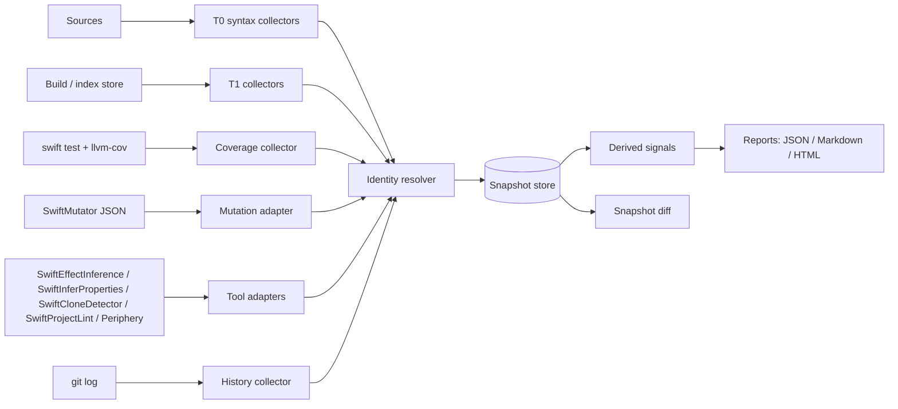

# SwiftStats — Product Requirements Document

**Status:** Draft v0.1 (2026-11-16)
**Owner:** Joseph Cursio
**Inspired by:** [Sitrep](https://github.com/twostraws/Sitrep) (Paul Hudson / Hacking with Swift)

---

## 1. Summary

SwiftStats collects summary statistics about a Swift package. It stores them **one row per function**, keyed by a stable identity, and keeps **one snapshot per commit**. Sitrep reports project-wide totals: line counts, type counts, imports. SwiftStats goes down to individual functions and joins measurements that today live in separate tools: complexity, coverage, mutation results, side-effect tier, property-test candidates and git churn.

Each tool on its own gives a partial picture. The value comes from combining them, for example *"pure, complex, 40% branch coverage, 6 surviving mutants, 2 untested Strong-tier property candidates, changed 14 times this quarter"*. That is a prioritised to-do list no single tool produces.

## 2. Problem

- Sitrep answers "how big is this project and what's it made of?" It can't answer "where are the risky, under-tested parts?"
- The signals that answer that question come from several places: SwiftLint, `llvm-cov`, SwiftMutator, SwiftEffectInference, SwiftInferProperties, SwiftCloneDetector and git. Each has its own output format and its own idea of what a "function" is.
- No snapshots are kept, so trends (is coverage rising? is complexity creeping?) are invisible.

## 3. Goals

1. **Per-function records** that join every metric on a shared identity.
2. **Project and module roll-ups** reported as distributions (median, p90, max), not just totals or a single "longest".
3. **Snapshots per commit**, so any metric can be shown as a trend.
4. **Cost-tiered collection**: a cheap syntax-only scan runs in seconds; expensive collectors (tests, mutation) are opt-in and their results are cached.
5. **Derived signals** computed from several metrics together (hotspots, untested properties, tool disagreements).
6. **Reuse existing tools** through adapters rather than reimplementing them.

## 4. Non-goals

- Not a linter. SwiftStats reports; it doesn't fail builds or suggest fixes (SwiftProjectLint and SwiftLint do that).
- Not a replacement for SwiftMutator, SwiftInferProperties and the others. It consumes their output.
- No GUI in v1. A Markdown or HTML report is enough. (A SwiftUI viewer could come later.)
- Xcode-project-only targets are out of scope for v1; SwiftPM packages only.
- No CI integration in v1 (most repos involved have no GitHub Actions, and free-tier minutes are tight).

## 5. Users and use cases

| User | Use case |
|---|---|
| Me, working on my own packages | "Which functions should I write tests for next?" |
| Me, running research corpora (e.g. swift-collections, swift-algorithms) | Compare packages; produce calibration data for SwiftInferProperties and SwiftEffectInference. |
| A reviewer of a PR | "Did this branch make anything measurably worse?" (diff of two snapshots) |

## 6. Core concepts

### 6.1 Function identity

Every metric must be attached to the same function. In order of preference:

1. **USR** (Unified Symbol Resolution) from indexstore-db: stable across renames of the file and unambiguous for overloads. Needs a build.
2. **Fallback key:** module + file path + enclosing type + signature + line range. Available syntax-only, but breaks when code moves.

External tools report locations as file:line (coverage, mutants, SwiftLint), so **every function record must store its source range** so results can be mapped back to it. (Sitrep's `Function` model does not store this today.)

### 6.2 Snapshot

One run of SwiftStats, tagged with: commit SHA, branch, dirty flag, date, toolchain version (`swiftly use` output), and which collectors ran and with what versions.

### 6.3 Collector

A unit that produces metrics. Each collector declares its **cost tier**, its inputs, and the identity it reports against.

| Tier | Needs | Typical time |
|---|---|---|
| T0 | Source files only (SwiftSyntax) | seconds |
| T1 | A build / index store | minutes |
| T2 | A test run | minutes |
| T3 | Mutation testing | hours |
| TH | Git history | seconds–minutes |

### 6.4 Census vs defect

Every metric carries a **kind**, adopted from SwiftProjectLint's `CandidateInventory`:

- **Census**: counts something that needs no action per item ("this function is pure", "this is a property candidate", "this function has complexity 7"). Census values are counted, rolled up and fed to other tools, but never listed one per line in a human-facing report.
- **Defect**: a claim about a specific place that can be wrong and is worth reading each time ("force unwrap here", "test with no assertions", "pure logic trapped in an impure method").

Motivation: on SwiftProjectLint's own code, 76% of findings were census items (460 pure functions, 204 pure closures). They buried a real defect in the report, which went unread. SwiftStats is the natural home for census data, which leaves linter reports for defects only.

## 7. Metric catalogue

### 7.1 Inherited from Sitrep (T0)

Files scanned, lines of code (raw and stripped), longest file and type, UIKit vs SwiftUI lines, counts of structs / classes / enums / protocols / extensions, imports, inheritance, function count, documented function count.

### 7.2 Size and shape (T0, per function / type / file)

- Function length (stripped lines), parameter count, max nesting depth
- Type body length, member count; file length
- All reported as distributions per module and project

### 7.3 Complexity (T0)

- **Cyclomatic complexity** (match SwiftLint's `cyclomatic_complexity` counting so numbers agree)
- **Cognitive complexity** (Sonar's measure, which treats flat `switch`/`guard` more fairly)
- Optional: NPath, Halstead volume

### 7.4 Swift risk markers (T0)

Most of these are already SwiftProjectLint rules (`forceUnwrap`, `forceTry`, `forceCast`, `unconditionalTrap`, `uncheckedSendable`, `nonisolatedUnsafe`, `unsafeMemoryAPI`, `todoComment`); take them from the adapter (§7.15) rather than reimplementing. SwiftStats computes only the concurrency-shape counts itself.

- Force unwrap `!`, `try!`, `as!`, implicitly unwrapped optionals
- `fatalError`, `preconditionFailure`, `precondition`
- Concurrency escape hatches: `@unchecked Sendable`, `nonisolated(unsafe)`, `unsafe` / `Unsafe*Pointer` use
- Concurrency shape: actors, `@MainActor` declarations, `async` functions, `Task {}` creation sites
- `TODO` / `FIXME` count

### 7.5 API surface (T0)

- Declarations by access level (`open`, `public`, `package`, `internal`, `fileprivate`, `private`)
- `final` ratio among classes
- **Documentation coverage of the public API** (extends Sitrep's documented-function count)
- **Over-exposed declarations**: more visible than any use requires (SwiftProjectLint `couldBePrivate`, `couldBePrivateMember`, `protocolCouldBePrivate`), as a count and as a share of each access level

### 7.6 Coupling and structure (T1, via indexstore-db)

- Fan-in / fan-out per function and type
- Afferent / efferent coupling and instability per module
- LCOM (cohesion of a type's methods)
- Cycles in the type and module dependency graphs. SwiftProjectLint already builds a package graph and reports `circularDependency`, `layerDependency` and `undeclaredTargetDependency` at T0; use those for module-level structure and indexstore-db for type- and function-level structure.

### 7.6a Dead code (T0/T1)

Use **Periphery** as the primary source. A naive "fan-in = 0" check from indexstore-db is only a fallback, because many declarations with no callers in the index are still live:

- `public` / `open` API used by other packages
- Protocol witnesses, `@objc`, `@IBAction` / `@IBOutlet`
- `Codable` properties, SwiftUI `#Preview`s, `@main`
- Code in `#if` branches not compiled in this configuration

Metrics:

- **Unused declarations** by kind (function, type, property, enum case)
- **Test-only code**: production declarations referenced only from test targets
- **Unused parameters** and **unused imports**
- **Unreachable code** (compiler warnings after `return` / `throw` / `fatalError`)
- **Commented-out code blocks** (T0 heuristic: comment blocks that parse as Swift)
- **Dead but tested**: dead declarations that still have tests and mutants. That wasted test time also skews the coverage and mutation numbers, so roll-ups should be reportable with dead code excluded.

### 7.7 Build health (T1)

- Compiler warnings by kind
- SwiftLint violations by rule
- **Type-check time per function** (`-Xfrontend -debug-time-function-bodies`). Motivation: the 12-arm `+` chain in SwiftInferProperties that passed locally and timed out on the CI runner.

### 7.8 Tests and coverage

#### Coverage (T2)

- **Line coverage** and **region/branch coverage** per function (`swift test --enable-code-coverage` → `llvm-cov export`)

#### Test inventory (T0)

**Finding test code:** use the test targets declared in `Package.swift`, not file names or folders. Within test targets, a *test* is a `@Test` function or an XCTest `test…` method on an `XCTestCase` subclass; everything else is a **helper** (fixtures, mocks, builders, utilities).

Counts, each split by framework (Swift Testing vs XCTest):

- **Example-based** tests
- **Property-based** tests (detected via the property-testing library's API, e.g. swift-property-based)
- **Parameterized** tests, with the **number of cases** (`@Test(arguments:)`), so one function running 50 cases isn't counted as one test
- **Generated** tests (e.g. `Tests/Generated/SwiftInfer/`), reported separately and excluded from ratios by default
- **Assertions per test**: `#expect`, `#require`, `XCTAssert*`
- **Tests with no assertions** (SwiftProjectLint `testMissingAssertion`, `testMissingExpect`, `testMissingRequire`): a defect-kind metric; these tests pass whatever the code does

#### Test-to-code ratio (T0)

Reported as context, never as a target. The plain project-wide line ratio misleads: property tests are compact (one can replace dozens of examples), generated tests and helpers inflate it, and it says nothing about whether tests check anything (that's mutation score, §7.9).

Variants to record:

- **Line ratio**, test lines ÷ production lines, with **generated tests and helpers excluded** on the test side and **dead code (§7.6a) excluded** on the production side
- Same ratio **split by test kind** (example / property / parameterized)
- **Per module and per type**, not only per project, so a module with no tests isn't hidden by a healthy total
- **Tests per public function**: closer to "is the API tested?" than line counts
- **Trend over time** (snapshots and backfill, §7.13): does test code grow with production code?

### 7.9 Mutation testing (T3, SwiftMutator)

- Mutants generated, killed, survived, timed out, per function
- **Mutation score** per function / module / project
- Surviving mutants listed with operator and location

### 7.10 Side-effect tier (T0/T1, SwiftEffectInference)

- Tier on the lattice `pure < observational < idempotent < externally_idempotent < non_idempotent`
- Whether the tier was **declared** (annotation) or **inferred**, plus the reason / evidence
- Answers the original "is it pure?" and "is it idempotent?" questions as one field

### 7.11 Property-test candidates (T0, SwiftInferProperties)

- Templates that fired (idempotence, round-trip, commutativity, monotonicity, count-invariance, reduce-equivalence, algebraic structure)
- Tier (Strong / Possible)
- Pair partner for two-function properties (e.g. `encode` ↔ `decode`), stored as a link
- Decision status from `.swiftinfer/decisions.json` (suggested / accepted / rejected / suppressed)
- Whether a matching property test exists
- Per type: suggested conformances (RefactorBridge), and declared conformances whose laws SwiftPropertyLaws does / doesn't check

### 7.12 Duplication (T0, SwiftCloneDetector)

- Clone groups, broken down by **clone type** (1 = exact copy, 2 = renamed identifiers, 3 = edited copy) and by **size** (lines / tokens)
- Percentage of code in clones, per module and project, overall and per clone type
- For each function: the clone groups it belongs to and its twins
- **Clone ratio over time** (from snapshots), to show whether duplication is growing
- **Duplicated knowledge** that clone detection misses, because the code isn't copied but the same facts are restated (SwiftProjectLint `duplicateStructShape`, `duplicateEnumMapping`, `parallelEnumShape`, `scatteredEnumMapping`, `parallelListDrift`). Reported alongside clones but counted separately.

### 7.13 History (TH, git)

Source: the local clone's `git log`, not the GitHub API. PR reviews, linked issues and CI results add API calls and rate limits for little value on solo repos; revisit only for multi-contributor corpora.

- **Churn** (commits touching the function / file) over configurable windows. Default to a recent window (e.g. 90 days) so an early burst of AI-generated commits doesn't make everything look like a hotspot.
- **Age and stability**: first-seen date, last-modified date, time since last change.
- **Change coupling**: pairs of functions / files that change in the same commits, with a support count and a confidence ratio. Flag pairs with **no static dependency** between them (from §7.6): these are hidden dependencies the current code doesn't show.
- **Bug-fix density**: commits classified as fixes (message heuristics such as "fix", "bug", "regression", configurable), mapped to the functions they touched. Stored as a count and a rate per change.
- **Tests changing with the code**: for each production function, how often its changes come with a change to its tests (tests found via coverage or naming).
- **Reverts and repeated fixes**: functions touched by `Revert` commits, or by several fix commits in a short window.
- **Authors**: number of distinct authors. Only meaningful for third-party corpora; near-useless for solo, AI-assisted repos.

**Tracking through renames and moves:** follow history by function identity (§6.1) rather than file path. Use `git log --follow` for files and `git log -L` (or diffing parsed syntax trees between commits) for functions.

**Backfilled trends:** `swiftstats backfill` checks out past commits (every Nth commit, or one per week) in a separate worktree and runs the T0 collectors on each. This gives trend charts from day one instead of waiting for snapshots to build up. T1–T3 are not backfilled by default (too slow).

**Assumption:** history is most useful when commits are small and merges keep them (`--merge`, not squash). Report which merge style a repo appears to use, since squash-merged history gives much coarser results.

### 7.14 Dependencies (T0)

- Direct and transitive package dependencies (from `Package.resolved`)

### 7.15 SwiftProjectLint findings (T0, adapter)

SwiftProjectLint has roughly 220 rules across 14 categories and emits JSON (file, line, rule, category, severity), CSV and a `pbt-seeds` manifest that swift-infer consumes. SwiftStats reads the JSON and maps each finding to a function by line range, the same way as SwiftLint and coverage results. Each rule is tagged census or defect (§6.4).

**Census rules → per-function metrics**

- Pure function / closure / mutator candidates (`pureFunctionCandidate`, `pureClosureCandidate`, `pureMutatorCandidate`). **Not** an independent purity opinion: these are built on SwiftEffectInference's `PurityInferrer` (via `PropertyTestCandidacy`), adding filters for whether the function is a sensible property-test candidate. What SwiftStats gains is that candidacy decision. A function SwiftEffectInference calls pure but SwiftProjectLint doesn't nominate shows a candidacy filter at work; the reverse points to version skew between the two tools' copies of SwiftEffectInference.
- `missingEquatableOnPureResult`: pure function whose result type isn't `Equatable`, so it is hard to property-test

**Defect rules → counts per function, type and module**

- **Testability:** `extractableTotalKernel` (pure logic trapped in an impure method), `globalMutableState`, `nonInjectedNondeterminism` (direct `Date.now`, random, etc.), `singletonUsage`, `directInstantiation`
- **Design smells:** `fatProtocol`, `godViewModel`, `singleImplementationProtocol`, `lawOfDemeter`
- **Concurrency risk:** `actorReentrancy`, `fireAndForgetTask`, `swallowedTaskError`, `missingCancellationCheck`, `unboundedTaskGroup`, `blockingIOOnMainActor`
- **Idempotency:** `idempotencyViolation`, `missingIdempotencyKey`, `nonIdempotentInRetryContext`, and the related replay rules
- Also consumed by other sections: risk markers (§7.4), over-exposure (§7.5), module structure (§7.6), assertion-free tests (§7.8), duplicated knowledge (§7.12)

**Suppression density**

- Count of `swiftlint:disable` and SwiftProjectLint suppression comments (`swiftLintSuppression`, `swiftProjectLintSuppression`), per module and over time. Rising suppression means problems are being muted rather than fixed.

**Roll-ups**

- Findings per rule and per category, per 1k lines, as trends. Same treatment as SwiftLint violations (§7.7).

**Source of truth:** where SwiftStats and SwiftProjectLint could both compute a measure (risk markers, purity candidates), SwiftProjectLint is the source and SwiftStats only counts and joins. That way the two tools can't disagree about, say, what counts as a force unwrap. See §14.

## 8. Derived signals

Computed from the joined records. These are the main reason the project exists.

| Signal | Definition (sketch) | Why it matters |
|---|---|---|
| **Hotspot** | high churn × high complexity | Complex code that keeps changing is where bugs land (Adam Tornhill's method). |
| **Weak tests** | high coverage or high test-to-code ratio, low mutation score | Code is run, or lots of test code exists, but little is really checked. |
| **Genuinely under-tested** | low test-to-code ratio, low coverage, low mutation score | All three effort and quality measures agree. |
| **Untested property** | Strong-tier candidate, no property test | Concrete test to write. |
| **Best property-test target** | property candidate + surviving mutants | A property test here likely kills those mutants. |
| **Tool agreement** | SwiftInferProperties suggests idempotence *and* SwiftEffectInference says idempotent or pure | Two independent signals; higher confidence. |
| **Tool disagreement** | e.g. idempotence suggested but tier is `non_idempotent` | One tool is wrong; calibration data for both. |
| **Missing template?** | pure function, no property candidates | May reveal a template SwiftInferProperties lacks. |
| **Unchecked laws** | declared `Equatable` / `Hashable` / etc. with no SwiftPropertyLaws check | Easy test coverage to add. |
| **Risky + untested** | risk markers (force unwraps, `@unchecked Sendable`) in low-coverage code | Crash or data-race candidates. |
| **Divergent clones** | clone twins where git shows a fix or change to one copy but not the other | Most useful duplication finding; a bug fixed in one copy likely still exists in the other. |
| **Uneven clone testing** | one twin well covered / high mutation score, the other not | Copy the tests, or merge the code. |
| **Clone hotspot** | clone group with high churn | Every change has to be made in several places. |
| **Dead but tested** | dead declaration with tests and mutants | Delete the code and its tests; frees test and mutation time. |
| **Test-only production code** | declaration referenced only from tests | Either dead or missing a production caller. |
| **Hidden coupling** | high change coupling, no static dependency | Shared knowledge (formats, constants, assumptions) not visible in the code; candidates for an explicit abstraction. |
| **Bug-prone** | high bug-fix density, weighted by recency | Past bugs predict future ones; use as a weight on every "where to test next" list. |
| **Tests not keeping up** | frequent production changes, tests rarely changed alongside | Covered code whose tests may no longer check what matters. |
| **Unstable fixes** | reverts or repeated fixes in a short window | Area that's hard to get right; needs tests before more changes. |
| **Safe to leave** | old, stable, no bug-fix history | Lowers priority of otherwise poor scores (complexity, coverage) so lists don't fill with code nobody touches. |

Thresholds should be configurable, and defaults should be relative (e.g. top decile within the project) rather than absolute.

## 9. Architecture

- **Collectors** produce metrics against either a USR or a source range.
- **Identity resolver** maps every result onto function records.
- **Store:** one SQLite database per package (recommended; lets derived signals be queries and makes trends cheap). Alternative: one JSON file per snapshot. See open questions.
- **Adapters** prefer linking a tool's library product (SwiftEffectInference already ships as a library) and fall back to parsing its JSON output (SwiftMutator, SwiftCloneDetector, SwiftProjectLint and SwiftInferProperties emit JSON).
- **Caching:** T2/T3 results are reused when the function's source hash hasn't changed since the last snapshot.

## 10. User-facing behaviour

Command shape (illustrative):

- `swiftstats scan` — T0 + TH collectors, writes a snapshot
- `swiftstats scan --tier 2` — adds build and test collectors; `--tier 3` adds mutation
- `swiftstats report [--format json|markdown|html]` — latest snapshot with roll-ups and derived signals
- `swiftstats top <signal>` — e.g. `top hotspot`, `top untested-property`
- `swiftstats diff <sha-a> <sha-b>` — what got better / worse between two snapshots
- `swiftstats trend <metric>` — time series of a project or module metric
- `swiftstats backfill [--every N | --weekly]` — run T0 collectors on past commits to seed trends

Reports lead with the derived-signal lists, then roll-ups, then per-module detail.

## 11. Milestones

| Milestone | Scope | Done when |
|---|---|---|
| **M0** | Decide fork vs extend Sitrep; function identity with source ranges | Sitrep's existing stats reproduced, plus per-function records with ranges |
| **M1** | T0: size, shape, complexity, risk markers, API surface, test inventory and test-to-code ratios | Complexity numbers match SwiftLint on a sample package |
| **M2** | Snapshot store + `report` + `diff` | Two snapshots of one repo diff cleanly |
| **M3** | TH: churn, stability, change coupling, bug-fix density; `backfill`; hotspot, hidden-coupling and bug-prone signals | Hotspot list on a real package looks sensible on review; backfilled trend chart for one repo |
| **M4** | Adapters: SwiftEffectInference, SwiftInferProperties, SwiftCloneDetector, SwiftProjectLint (with census/defect tagging) | Tool agreement / disagreement table and divergent-clones list produced; SwiftProjectLint findings joined to functions |
| **M5** | T2: coverage join | Per-function line + branch coverage; "risky + untested" signal |
| **M6** | T3: SwiftMutator join + caching | Weak-tests and best-property-target signals |
| **M7** | T1: indexstore-db identity, coupling, type-check timing, Periphery dead-code adapter | USR identity replaces fallback key; dead-but-tested signal produced |
| Later | HTML trend charts, SwiftUI viewer, Xcode-project support | — |

## 12. Success criteria

- A T0 scan of a mid-sized package (e.g. swift-collections) finishes in under 30 seconds.
- At least 95% of coverage / mutation / SwiftLint results map onto a function record.
- On my own packages, the top-10 lists from derived signals lead to tests I actually write.
- Tool disagreement output is useful enough to feed SwiftInferProperties / SwiftEffectInference calibration cycles.

## 13. Risks

| Risk | Mitigation |
|---|---|
| Identity drift between tools (macros, generated code, `#if`) | Store source ranges and hashes; report unmapped results rather than dropping them |
| Mutation runs are slow | Opt-in tier, per-function caching by source hash |
| Coverage needs a passing test suite | Record partial snapshots and say which collectors failed |
| Toolchain skew (swiftly vs Xcode) changes results | Record toolchain version in every snapshot |
| Inferred stats (purity, properties) look more certain than they are | Always store tier, confidence and reason alongside the value |
| Metric overload | Lead reports with derived signals, not raw tables |
| Fix-commit detection from messages is a guess | Configurable patterns; report precision on a hand-labelled sample per repo |
| Squash-merged or bulk-commit history gives coarse results | Detect merge style; warn in the report; prefer recent time windows |
| Function-level history is expensive on long histories | Limit to a time window; cache per-commit parse results |

## 14. Open questions

1. **Fork or extend Sitrep?** Sitrep is Apache-2.0 and SwiftSyntax-based, so either works. Extending keeps its stats compatible; a fork allows a per-function data model without upstream constraints.
2. **Store:** SQLite (recommended) or JSON per snapshot? JSON diffs nicely in git; SQLite queries better.
3. **Library vs CLI adapters:** linking SwiftInferProperties / SwiftMutator as libraries pins their versions together; parsing JSON keeps them independent.
4. **Where snapshots live:** in the target repo (e.g. `.swiftstats/`) or in a central corpus directory?
5. **Cross-package comparison:** should roll-ups be normalised (per 1k lines) so corpora can be compared?
6. **Cognitive complexity rules for Swift-specific constructs** (`guard`, `if let`, result builders): adopt Sonar's rules as-is or adapt?
7. **Overlap with SwiftProjectLint:** for measures both tools could compute (risk markers, purity candidates), should SwiftStats always take them from SwiftProjectLint (recommended: one definition, no disagreements) or compute them itself at T0 so it works without SwiftProjectLint installed?
8. **Moving census rules out of SwiftProjectLint:** once SwiftStats exists, should SwiftProjectLint's census rules leave its human-facing reports entirely and stay only in its JSON and `pbt-seeds` output?
